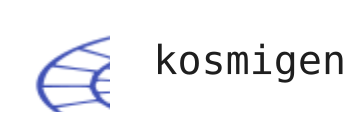

<div align="center">

</div>

个人技术文档、项目与博客，使用 Material for MkDocs 构建。

- 网站：<https://kosmigen.github.io/PureLearning/>
- **内容编辑入口：[网站内容编辑手册](handbook/网站内容编辑手册.md)**
- 代理协作规范：[Agent.md](Agent.md)；[AGENTS.md](AGENTS.md) 与 [CLAUDE.md](CLAUDE.md) 均为入口。

## 快速预览

从仓库根目录执行。已有 `.venv/` 时直接使用，仅在不存在时创建：

```sh
python3 -m venv .venv
.venv/bin/python -m pip install -r requirements.txt
.venv/bin/mkdocs serve --dev-addr 127.0.0.1:8000
```

访问 <http://127.0.0.1:8000/PureLearning/>。停止预览时在终端按 `Ctrl+C`。

```sh
# 发布前严格构建
.venv/bin/mkdocs build --strict
```

推送 `main` 会触发 GitHub Pages 工作流；不要直接编辑或提交生成的 `site/`。

## 目录分工

```text
docs/                    网站内容与公开资源
  index.md               首页
  blog/                  博客入口、作者、标签与 posts/ 文章
  notes/                 技术文档入口、C / Python / Java，以及未来的框架文档
  fundamentals/          计算机基础
  ai/                    AI 文档
  projects/              项目卡片数据
  about/                 关于网站与作者
  assets/                字体、图片、样式、脚本与本地组件
overrides/               实际需要自定义的主题模板
hooks/                   字数统计、项目卡片、图表与旧网址兼容
scripts/                 按需运行的维护工具（字体分片）
handbook/                内容编辑手册，不发布到网站
mkdocs.yml               站点配置与功能开关
requirements.txt         固定的直接依赖
```

顶部顺序为 **博客｜文档｜项目｜关于**；“文档”首页与左侧栏目叫“技术文档”。导航结构由 `docs/.nav.yml` 与各目录的 `.nav.yml` 管理，自定义顶部文字在 `overrides/partials/header.html` 中配置。

三门语言保留在 `notes/` 下，基础与 AI 保留当前目录。原来的 `notes/fundamentals/`、`notes/ai/` 及其子页通过构建时生成的跳转页兼容。

新增文档、博客元数据、自动项目预览、Markdown 扩展、导航调整、资源路径、预览部署与常见问题，统一见[编辑手册](handbook/网站内容编辑手册.md)。

## 资源维护

样式按职责拆分：`extra.css` 为文档基础样式，`tokens.css` 为共享配色和字体变量，`home.css`、`blog.css`、`projects.css`、`footer.css` 各自负责对应页面。

Web Awesome 3.14.0 仅保留项目使用的 Card、Badge 和完整依赖；来源及许可证位于 `docs/assets/javascripts/vendor/webawesome/`。字体与首页插画来源见 `docs/assets/fonts/NOTICE.txt`、`docs/assets/images/home/NOTICE.txt`。

维护时按引用清理资源，保留正在使用资源的许可证、中文字体完整字符覆盖及旧网址跳转。`.venv/`、`site/`、缓存与本地研究输出均已忽略，不属于网站源文件。
