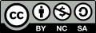

# 关于网站

尽管之前也零零散散做了几个考研备考网站和个人博客网站，但都是浅尝辄止，没有长期坚持，这算是一个遗憾。

2026 年 11 月 15 日，kosmigen.com 正式启用。

## 网站内容

页脚的 **Not By AI** 徽章适用于符合徽章规则的原创文章。

- [**:icons-notebook-pen: 博客**](../blog/index.md)

    啥都写，想到啥写啥，生活、学习、娱乐...

- [**:icons-book-open: 文档**](../notes/overview.md)

    技术相关的内容，使用文档形式，更好管理。

- [**:icons-folder-code: 项目**](../projects/index.md)

    我维护的所有项目。

- [**:icons-clock: Now**](../now/index.md)

    当前的状态和重点关心的内容。

<!-- site-word-count -->

## 开发与部署

网站使用 [Material for MkDocs](https://squidfunk.github.io/mkdocs-material/) 搭建，部署在 [Cloudflare Workers](https://developers.cloudflare.com/workers/)。

栏目图标使用 [Lucide](https://lucide.dev/)，项目页卡片使用 [Web Awesome](https://webawesome.com/)。

书架和部分动效使用了 [React Bits](https://reactbits.dev/) 的组件。

静态网站的开源框架非常之多，我之前也尝试过许多框架以及相关主题，最终还是采用这个，原因无殊，不过不再喜欢花里胡哨，返璞归真罢了。

下面推荐一些开源框架，还喜欢折腾的读者可以自行去尝试尝试。

- [Hugo](https://gohugo.io/)
- [VitePress](https://vitepress.dev/)
- [Eleventy](https://www.11ty.dev/)
- [Zola](https://www.getzola.org/)
- [Astro](https://astro.build/)
- [Docusaurus](https://docusaurus.io/)
- [Mkdocs](https://www.mkdocs.org/)
- [VuePress](https://vuepress.vuejs.org/)
- [Hexo](https://hexo.io/zh-cn/)

除了上面提到的框架，还有许多优秀的开源项目，慢慢探索吧！

## 联系与反馈

发现文章有误、链接失效或网站显示有问题，欢迎到 [GitHub Issues](https://github.com/kosmigen/PureLearning/issues) 留言。附上页面链接和具体位置，方便我找到问题。

想聊文章或项目，可以在 [X](https://x.com/kosmigen) 或 [GitHub](https://github.com/kosmigen) 找到我。

## 内容使用许可

除另有标注外，Kosmigen 享有著作权的原创文章和技术文档采用 [CC BY-NC-SA 4.0 国际许可协议](https://creativecommons.org/licenses/by-nc-sa/4.0/deed.zh-hans)。

非商业转载、翻译或改编时，请署名 kosmigen，附上原文和许可链接，并注明所作修改。公开分享改编内容时，请沿用同一许可。商业使用请事先联系 kosmigen 获取授权。

第三方材料及另有许可标注的内容，适用各自的许可。
