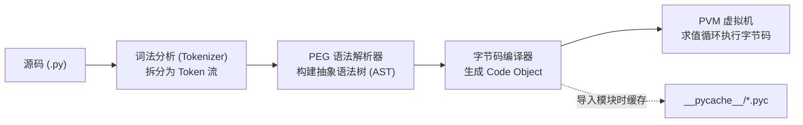

# 本章导读

掌握 Python 的关键不在于死记零散的语法糖，而在于建立一套自洽的底层心智模型。只要理解了**“一切皆对象”**的内存模型、**“动态强类型 + 协议驱动”**的类型哲学，以及**“源码 → 字节码 → 虚拟机栈帧”**的执行链路，后续的闭包、装饰器、描述符、元类乃至并发协程都会成为这套模型的自然推论。

---

## 一切皆对象（Everything is an Object）

在 C、C++ 或 Java 等语言中，“基本数据类型”（如 `int`、`double`）通常直接存储在栈内存中，而“对象”分配在堆上；函数和类更是编译期的代码结构，与运行期数据截然分开。

Python 彻底抹平了这层界限：**在 Python 中，所有数据、函数、类、方法、乃至导入的模块和编译后的代码块，全部都是堆内存中的对象。**

### 对象的底层三要素：身份（Identity）、类型（Type）与值（Value）

任何一个 Python 对象在诞生瞬间都具备三个核心维度：

| 要素 | 含义 | 查看 / 比较方式 | 生命周期内能否改变 |
| :--- | :--- | :--- | :--- |
| **身份（Identity）** | 对象在内存中的唯一标识（CPython 中即内存首地址） | `id(obj)` / `a is b` | **绝对不可变** |
| **类型（Type）** | 决定对象支持哪些操作、属性及占用的内存结构 | `type(obj)` / `isinstance(obj, cls)` | **绝对不可变** |
| **值（Value）** | 对象内部承载的数据状态 | `a == b` | **取决于类型可变性**（可变对象可就地修改，不可变对象不可改） |

```python
x = 42
print(f"身份 (id): {id(x)}")
print(f"类型 (type): {type(x)}")
print(f"类型本身也是对象: {type(type(x))}")
```

输出：

```text
身份 (id): 4303651808
类型 (type): <class 'int'>
类型本身也是对象: <class 'type'>
```

### 一等公民（First-Class Citizens）：数据、函数、类与模块皆对象

所谓“一等公民”，是指某类实体在语言中享有与其他普通数据完全平等的权利：

1. 可以在运行期动态创建；
2. 可以赋值给变量，或存入列表、字典等容器中；
3. 可以作为参数传递给函数；
4. 可以作为函数的返回值返回；
5. 可以拥有自己的属性（`__dict__`）与方法。

```python
import math


def square(n: int) -> int:
    return n * n


class Multiplier:
    def __init__(self, factor: int) -> None:
        self.factor = factor

    def __call__(self, n: int) -> int:
        return n * self.factor


# 数字、函数、类、实例、模块可以无差别地放进同一个列表中
objects = [100, square, Multiplier, Multiplier(3), math]

for item in objects:
    print(f"{item!r:<35} -> type: {type(item).__name__}")
```

输出：

```text
100                                 -> type: int
<function square at 0x104a2b380>    -> type: function
<class '__main__.Multiplier'>       -> type: type
<__main__.Multiplier object at ...> -> type: Multiplier
<module 'math' (built-in)>          -> type: module
```

!!! tip "这能解释什么高级特性？"

    - **装饰器（Decorator）**：因为函数是一等对象，才能把一个函数传给另一个函数去包装替换。
    - **元类（Metaclass）**：因为类（`class`）本身也是对象（由 `type` 创建的实例），才能在运行期拦截或动态生成类。

### CPython 对象头部心智模型（PyObject 与引用计数）

在官方 CPython 解释器（C 语言实现）中，哪怕是一个最简单的整数 `1`，也不是裸的 4 字节或 8 字节二进制数，而是一个完整的 C 结构体。所有 Python 对象在底层都共享一个名为 `PyObject` 的公共头部：

```text
+-----------------------------------+
| ob_refcnt (引用计数, Py_ssize_t)  |  <-- 记录当前有多少个引用指向本对象
+-----------------------------------+
| ob_type   (类型指针, PyTypeObject*)| <-- 指向该对象的类型对象（如 &PyLong_Type）
+-----------------------------------+
| 实际数据区 (ob_digit / ob_item...) | <-- 存放对象自身的值或子对象指针数组
+-----------------------------------+
```

- **`ob_refcnt`（引用计数）**：每当有一个新名字或容器槽位绑定到该对象，计数 `+1`；离开作用域或被解绑时，计数 `-1`。一旦归零，内存立即回收。
- **`ob_type`（类型指针）**：指向描述该对象行为的类型结构体（内部定义了加减乘除、哈希、迭代等所有函数指针槽位）。因此，**变量名本身没有任何类型信息，类型信息永远刻在对象头部的 `ob_type` 里**。

---

## 动态类型与强类型系统

评价一门编程语言的类型系统，通常沿着两个正交维度：**“动态 vs 静态”**（何时确定类型）与**“强类型 vs 弱类型”**（是否允许隐式不安全转换）。Python 是典型的**动态强类型**语言。

### 动态类型：运行期名字绑定与类型归属于对象而非变量

在静态类型语言（如 C / Java / Rust）中，变量声明时必须绑定类型（如 `int a = 10;`），变量名代表一块只能存放 `int` 的固定内存区域。

而在 Python 中，**变量只是一个贴在对象上的标签（名字）**。同一个变量名可以在不同时刻先后指向完全不同类型的对象：

```python
data = 1024          # 名字 data 贴在 int 对象上
data = "kosmigen"    # 名字 data 撕下来，改贴在 str 对象上
data = [1, 2, 3]     # 名字 data 改贴在 list 对象上
```

### 强类型：严格的类型边界与拒绝隐式不安全转换

“动态类型”绝不等于“弱类型”。在 JavaScript 或 PHP 等弱类型语言中，字符串与数字相加会悄悄发生隐式类型转换（如 `"3" + 5` 得到 `"35"`，`"5" - 3` 得到 `2`），极易掩盖数据污染 Bug。

Python 作为**强类型语言**，除数值体系内部的精度提升（如 `int + float -> float`）外，严禁跨类型的隐式转换：

```python
# 数值类型间安全的算术提升
print(3 + 2.5)  # 5.5 (int 自动提升为 float)

# 跨类型运算直接抛出 TypeError，绝不静默猜测
try:
    result = "年龄: " + 18
except TypeError as exc:
    print(f"拦截非法跨类型运算: {exc}")
```

输出：

```text
5.5
拦截非法跨类型运算: can only concatenate str (not "int") to str
```

### 鸭子类型（Duck Typing）与协议驱动设计哲学

> “当看到一只鸟走起来像鸭子、游泳起来像鸭子、叫起来也像鸭子，那么这只鸟就可以被称为鸭子。”

Python 传统上不依赖死板的继承树（即不强制要求“你必须继承自 `Reader` 基类”），而是关注**对象实现了什么行为协议（Protocol）**：

- 只要一个对象实现了 `__iter__` 方法，它就能被 `for` 循环遍历、被 `list()` 转换、被解包；
- 只要一个对象实现了 `__len__` 方法，它就能被传入内置函数 `len()`；
- 只要一个对象实现了 `read()` 方法，它就能作为类文件对象（File-like Object）传给 JSON 解析器。

```python
import io
import json

# json.load 并不关心传入的是不是真实磁盘文件，只要有 .read() 方法即可
fake_file = io.StringIO('{"language": "Python", "version": 3.14}')
parsed = json.load(fake_file)
print(parsed)  # {'language': 'Python', 'version': 3.14}
```

### 渐进式类型系统：运行期动态性与静态类型注解的协同

自 Python 3.5 引入 Type Hints（PEP 484）并历经 Python 3.10–3.14 的现代演进（如 `X | Y`、PEP 695 泛型、`Protocol`），Python 形成了**渐进式类型（Gradual Typing）**体系：

- **运行期**：解释器依然保持 100% 的动态类型特性，类型注解不会带来任何运行期类型检查开销；
- **开发与 CI 期**：IDE（Pylance / PyCharm）与静态检查器（`mypy` / `pyright` / `ty`）以及运行时校验库（如 `Pydantic`）利用这些注解，在代码上线前消灭绝大多数类型不匹配错误。

---

## Python 执行模型概览

经常有人笼统地说“Python 是解释型语言”，但严格来说，CPython 采用的是**“先编译为字节码，再由虚拟机解释执行”**的混合架构（与 Java 字节码运行在 JVM 上非常相似，区别在于 Python 的编译过程对开发者是自动且透明的）。

### 从源码到字节码：词法分析、PEG 解析器、AST 与字节码编译（.pyc）

当你运行 `python3 app.py` 或导入一个模块时，CPython 内部经历以下流水线：



1. **词法分析（Lexing）**：将字符流切分为有意义的词法单元（Tokens），如关键字、标识符、运算符以及至关重要的 `INDENT` / `DEDENT`（缩进增减标记）。
2. **语法分析（Parsing）**：Python 3.9+ 采用强大的 **PEG（Parsing Expression Grammar）解析器**，将 Token 流构建成**抽象语法树（AST）**。
3. **编译（Compilation）**：编译器遍历 AST，将其编译成指令集紧凑的**字节码（Bytecode）**，封装在不可变的 `PyCodeObject`（代码对象）中。
4. **`.pyc` 缓存注意事项**：
   - 只有被 `import` 导入的模块，其字节码才会被持久化写入 `__pycache__/module.cpython-314.pyc`，以加速下次启动的加载过程（注意：`.pyc` 只加速“加载与编译”阶段，不提高字节码本身的运行速度）。
   - 直接作为入口执行的顶层脚本（`python3 main.py` 中的 `main.py`）默认不会生成 `.pyc` 文件。

我们可以使用标准库 `dis` 直接观察编译后的字节码指令：

```python
import dis


def calc(a: int, b: int) -> int:
    return a * 2 + b


# 查看函数的代码对象属性与反汇编字节码
print("常量池 co_consts:", calc.__code__.co_consts)
print("变量名 co_varnames:", calc.__code__.co_varnames)
dis.dis(calc)
```

输出（以 Python 3.12+ 字节码为例）：

```text
常量池 co_consts: (None, 2)
变量名 co_varnames: ('a', 'b')
  5           0 RESUME                   0

  6           2 LOAD_FAST                0 (a)
              4 LOAD_CONST               1 (2)
              6 BINARY_OP                5 (*)
             10 LOAD_FAST                1 (b)
             12 BINARY_OP                0 (+)
             16 RETURN_VALUE
```

### PVM 虚拟机、代码对象（Code Object）与栈帧（Frame）执行机制

**PVM（Python Virtual Machine）** 是 CPython 的核心执行引擎（源码位于 `Python/ceval.c` 中的巨型 `switch-case` / 计算跳转循环）：

- **基于栈的虚拟机（Stack-based VM）**：PVM 没有通用寄存器，所有运算指令（如上面的 `LOAD_FAST`、`BINARY_OP`）都通过向**求值栈（Evaluation Stack）**压入（Push）和弹出（Pop）对象指针来完成。
- **`Code Object`（静态蓝图） vs `Frame`（动态执行栈帧）**：
  - 函数定义被编译后生成唯一的 `Code Object`，它只包含静态的字节码指令、常量池和变量名表，不包含任何运行时的具体数值。
  - **每次调用函数时**，PVM 都会在堆上创建一个全新的**栈帧（`Frame` 对象）**，栈帧持有一份独立的局部变量数组、当前执行到的字节码指令偏移量（`f_lasti`）以及指向调用者栈帧的指针（`f_back`）。这正是递归调用、闭包以及生成器暂停/恢复（`yield` 挂起当前栈帧而不销毁）能够工作的底层基石。

### 内存管理概览：引用计数、分代/并发垃圾回收与对象缓存池

CPython 的内存管理分为三道紧密配合的防线：

1. **引用计数为主（Reference Counting）**：对象 `ob_refcnt` 降为 `0` 的瞬间立即回收内存，具备极高的实时确定性。
2. **垃圾回收器为辅（Cyclic GC）**：当两个容器对象互相引用（如 `a = []; b = [a]; a.append(b)`）且外部名字已全部销毁时，它们的引用计数永远停留在 `1`。CPython 的循环垃圾回收器通过遍历容器引用图，定期检测并打破这类**孤立循环引用（Reference Cycles）**。
3. **小对象内存池（PyMalloc）与类型缓存**：为了避免频繁调用操作系统的 `malloc/free` 造成内存碎片，CPython 对小于 512 字节的对象使用 `Arena -> Pool -> Block` 三级内存池分配器，并对小整数（`[-5, 256]`）、短 ASCII 字符串等高频不可变对象进行预留缓存复用。

---

## 本章知识图谱与学习路线

本章按照**从基础对象模型 → 语法控制与容器 → 抽象与协议 → 模块、类型系统与元编程**的进阶阶梯设计为 11 个专题：

### 语法基础、内置类型与控制流

- **[01 基础语法与对象模型](01-basics-and-object-model.md)**：吃透名字绑定、可变性、`is` 与 `==`、深浅拷贝的 `memo` 图遍历原理以及运算符与海象运算符 `:=`。
- **[02 内置数据类型与容器](02-builtin-types.md)**：掌握数值精度陷阱、`str` 与 `bytes` 编码边界、`f-string` 与 PEP 750 `t-string`、四大内置容器底层结构及切片/解包协议。
- **[03 控制流与模式匹配](03-control-flow.md)**：深入分支卫语句、`for/while-else` 的 `no-break` 语义、`match-case` 结构化模式匹配、推导式及 `enumerate` / `zip` / `any` / `all`。

### 函数抽象、面向对象与数据模型协议

- **[04 函数与函数式特性](04-functions.md)**：拆解五类参数签名、可变默认参数暗礁、LEGB 作用域、闭包延迟绑定、装饰器洋葱模型与 `functools` 高阶工具。
- **[05 面向对象与类机制](05-oop-and-classes.md)**：厘清类与实例属性查找、三类方法绑定、菱形继承 C3 MRO 算法与 `super()`、抽象基类 `ABC`、数据类 `dataclass` 与枚举 `Enum`。
- **[06 数据模型与魔术方法](06-data-model.md)**：打通 `__new__`/`__init__` 生命周期、`__repr__`/`__str__`、`__eq__` 与 `__hash__` 契约、容器模拟、运算符重载及 `__call__`。

### 迭代器、异常机制、模块系统与高级元编程

- **[07 迭代器、生成器与上下文协议](07-iterators-and-context.md)**：剖析迭代协议、`yield` 与 `yield from` 栈帧挂起、`with` 上下文管理器与 `async/await` 原生协程语法协议。
- **[08 异常机制](08-exceptions.md)**：掌握异常继承树、`try-except-else-finally` 执行细节、`raise from` 异常链与 Python 3.11+ `ExceptionGroup` / `except*`。
- **[09 模块与包机制](09-modules-and-packages.md)**：跟踪 `import` 三阶段加载、`sys.modules` 缓存、相对与绝对导入、命名空间包以及循环导入的根本解法。
- **[10 类型注解系统](10-type-annotations.md)**：精通渐进式类型、Python 3.12+ PEP 695 现代泛型语法、`Union`/`Literal`/`Callable`/`overload`、`TypedDict` 与 `Protocol` 结构化子类型。
- **[11 高级特性与元编程](11-metaprogramming.md)**：深入自省反射、`@property`、描述符协议优先级链、`__slots__`、`__init_subclass__`、元类 `Metaclass` 与 `ast` 抽象语法树。

---

## 练习与实战

### 练习 1：验证“一切皆对象”与一等公民特性

编写一段代码，定义一个普通函数 `greet(name: str) -> str` 和一个类 `Greeter`。请用代码证明：

1. 函数 `greet` 可以在运行期动态挂载自定义属性（例如 `greet.author = "kosmigen"`）；
2. 函数 `greet` 是 `object` 的实例，类 `Greeter` 也是 `object` 的实例，甚至连最顶层的元类 `type` 也是 `object` 的实例（同时 `object` 又是 `type` 的实例）。

??? success "点击查看答案与解析"

    在 Python 中，`object` 是所有继承关系的顶层基类（一切皆继承自 `object`），而 `type` 是所有类型对象的元类（一切类型皆由 `type` 实例化而来，`type` 自身也是自己的实例）。

    ```python
    def greet(name: str) -> str:
        return f"Hello, {name}!"


    class Greeter:
        pass


    # 1. 函数拥有自己的属性字典 __dict__，可动态挂载属性
    greet.author = "kosmigen"
    assert greet.author == "kosmigen"
    assert "author" in greet.__dict__

    # 2. 验证 object 与 type 的环形顶层关系
    assert isinstance(greet, object)
    assert isinstance(Greeter, object)
    assert isinstance(Greeter, type)

    # type 与 object 的哲学闭环：
    assert isinstance(type, object)    # type 也是一个对象（继承自 object）
    assert isinstance(object, type)    # object 是一个类（由元类 type 创建）
    assert isinstance(type, type)      # type 是它自己的元类
    print("所有对象模型断言验证通过！")
    ```

### 练习 2：动态强类型的行为预测

不运行代码，先判断以下四行表达式分别会输出什么结果，或者抛出什么类型的异常，并说明原因：

1. `True + True + 2.5`
2. `"3" * 3`
3. `"3" + 3`
4. `[1, 2] + (3, 4)`

??? success "点击查看答案与解析"

    1. **`True + True + 2.5` -> 输出 `4.5`（`float`）**：
       在 Python 中，`bool` 是 `int` 的子类（`issubclass(bool, int)` 为 `True`），`True` 的整数值为 `1`，再与 `float` 相加触发安全的数值精度提升，结果为 `4.5`。
    2. **`"3" * 3` -> 输出 `"333"`（`str`）**：
       这不是弱类型的隐式字符串转数字，而是序列类型（`str` / `list` / `tuple`）明确重载了与整数 `int` 的重复拼接运算符（`__mul__`）。
    3. **`"3" + 3` -> 抛出 `TypeError: can only concatenate str (not "int") to str`**：
       体现强类型边界：字符串不允许与整数隐式转换拼接。
    4. **`[1, 2] + (3, 4)` -> 抛出 `TypeError: can only concatenate list (not "tuple") to list`**：
       即便同为序列，列表的 `+`（`__add__`）也严格要求右侧操作数必须是 `list`（而 `list.extend()` 则遵循鸭子类型，接收任意可迭代对象）。

### 练习 3：用 `dis` 比较两个函数的字节码

定义一个计算常量表达式的函数 `def f1(): return 24 * 60 * 60` 和一个包含变量运算的函数 `def f2(days): return days * 24 * 60 * 60`。使用 `dis.dis()` 或查看 `__code__.co_consts` 观察解释器在编译期做了什么优化？为什么 `f2` 中的 `24 * 60 * 60` 没有被完全合并为一个常数？

??? success "点击查看答案与解析"

    CPython 编译器在生成字节码时具备**常量折叠（Constant Folding）**优化，但严格遵循运算符的**左结合性**规则：

    ```python
    import dis


    def f1() -> int:
        return 24 * 60 * 60


    def f2(days: int) -> int:
        return days * 24 * 60 * 60


    def f3(days: int) -> int:
        return days * (24 * 60 * 60)


    print("f1 常量池:", f1.__code__.co_consts)
    print("f2 常量池:", f2.__code__.co_consts)
    print("f3 常量池:", f3.__code__.co_consts)
    ```

    输出：

    ```text
    f1 常量池: (None, 86400)
    f2 常量池: (None, 24, 60)
    f3 常量池: (None, 86400)
    ```

    **原因解析**：
    - 在 `f1` 中，整个表达式都是纯字面量常量，编译期直接折叠计算出 `86400`，运行期只需一条 `RETURN_CONST 86400`。
    - 在 `f2` 中，乘法是**自左向右结合**的，AST 结构等价于 `((days * 24) * 60) * 60`。由于最内层左操作数 `days` 是运行期未知的变量，编译器无法假定 `days` 的类型（万一传入的是自定义重载了 `*` 的对象或序列呢？），因此不能擅自改变结合律把后面的常数先乘起来！
    - 如果像 `f3` 一样加上括号 `days * (24 * 60 * 60)`，括号内的子树是纯常量，编译器就能将其折叠为 `86400`。
