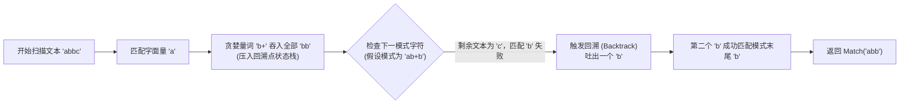

# 文本处理与正则表达式

真实工程中的外部文本数据——无论是用户表单输入、跨平台文件名、爬虫抓取的网页正文，还是海量非结构化系统日志——几乎从来不是干净整齐的 ASCII 字符串。视觉完全一致的字符可能拥有截然不同的底层编码，一行看似无害的正则表达式在恶意输入面前可能引发单核 CPU 100% 锁死的拒绝服务故障（ReDoS）。

本篇系统拆解 Python 标准库在文本工程领域的四大支柱：**`unicodedata` / `str.translate` / `textwrap` 文本归一化与排版**、**`re` 模块 NFA 回溯引擎机理与防回溯安全设计**、**分组捕获与零宽环视（Lookaround）高级提取**，以及 **`difflib` 文本差异比对与智能纠错**。

---

## Unicode 规范化与工业级文本清洗

### 视觉相同但编码不同：`unicodedata.normalize`

在 Unicode 标准中，许多带重音符号的拉丁字母、汉字异体或全角字符存在多种合法的码位表示方式。如果不经规范化直接执行 `==` 比较、字典哈希查找或数据库唯一索引写入，就会触发极隐蔽的逻辑漏洞。

最常见的两类等价性陷阱是：

1. **标准等价（Canonical Equivalence）—— 预组字符 vs 组合字符序列**：
   例如法语单词 `"Café"` 末尾的 `"é"`，既可以用单一码位 `U+00E9`（`LATIN SMALL LETTER E WITH ACUTE`）表示，也可以拆分为基础字母 `"e"`（`U+0065`）紧跟一个零宽组合重音符 `"\u0301"`（`COMBINING ACUTE ACCENT`）。两者在屏幕渲染上完全重叠、肉眼无法分辨，但字节长度和哈希值完全不同。
2. **兼容等价（Compatibility Equivalence）—— 全角半角、连字与排版变体**：
   中文输入法下误输的全角数字与字母（如 `"Ｐｙｔｈｏｎ　３．１４"`）、PDF 复制出的西文排版连字 `"fi"`（`U+FB01`，单个字符代表 `f` + `i`）、罗马数字 `"Ⅳ"` 或上标 `"²"`，在语义上与 ASCII 标准字符对应，但码位截然不同。

`unicodedata.normalize(form, unistr)` 提供了四种标准规范化范式：

| 规范化范式 | 英文全称 | 处理机制 | 典型工程适用场景 |
| :--- | :--- | :--- | :--- |
| **`NFC`** | Normalization Form C (Canonical Composition) | 先按标准等价分解，再**合并为最短预组字符** | **通用文本存储、数据库入库、Web 前后端传输对比（W3C 推荐标准）** |
| **`NFD`** | Normalization Form D (Canonical Decomposition) | 按标准等价**完全拆分为“基础字符 + 组合音标”** | 剥离重音变音符号（Accent Stripping）、兼容旧版 macOS HFS+/APFS 文件名底层对比 |
| **`NFKC`** | Normalization Form KC (Compatibility Composition) | 按兼容等价分解（全角转半角、拆开连字 `fi` -> `fi`）后再执行标准合并 | **搜索引擎分词索引、用户名/标识符防仿冒校验、表单脏数据清洗** |
| **`NFKD`** | Normalization Form KD (Compatibility Decomposition) | 按兼容等价完全拆分，不做重组 | 需要同时拆解兼容变体并过滤音标符号的深度文本归一化流水线 |

!!! warning "跨平台文件名与安全校验中的 Unicode 陷阱"

    macOS 文件系统在处理含重音字母的文件名时倾向于使用接近 `NFD` 的分解形式，而 Linux、Windows 与浏览器上传通常使用 `NFC`。对比路径名或校验用户名唯一性前，务必先统一执行 `unicodedata.normalize("NFC", text)`（对于账号/昵称防视觉欺骗场景，应使用更严格的 `NFKC` 并配合 `.casefold()`）。

下面演示标准等价合并、全角兼容清洗以及利用 `NFD` + `unicodedata.combining()` 剥离西文重音符号的完整做法：

```python
import unicodedata

# 1. 标准等价陷阱：预组字符 vs 基础字符 + 组合音标
cafe_composed = "Caf\u00e9"          # 'Café'，长度 4
cafe_decomposed = "Cafe\u0301"       # 视觉完全一样，但长度 5！
assert cafe_composed != cafe_decomposed
assert len(cafe_composed) == 4 and len(cafe_decomposed) == 5

# 使用 NFC 统一合并后即可安全判等与作为 dict 键
assert unicodedata.normalize("NFC", cafe_composed) == unicodedata.normalize("NFC", cafe_decomposed)

# 2. 兼容等价清洗：NFKC 一键将全角字母/数字/空格、连字 fi 与上标转为标准半角字符
dirty_input = "Ｐｙｔｈｏｎ　３．１４ — final²"
clean_input = unicodedata.normalize("NFKC", dirty_input)
assert clean_input == "Python 3.14 — final2"

# 3. 大小写无关归一化：casefold() 比 lower() 更彻底（例如德语 'ß' 会展开为 'ss'）
assert "Straße".lower() == "straße"
assert "Straße".casefold() == "strasse"

# 4. 实战技巧：利用 NFD 拆分 + combining() 过滤组合音标，生成纯 ASCII 搜索词
def strip_accents(text: str) -> str:
    decomposed = unicodedata.normalize("NFD", text)
    return "".join(ch for ch in decomposed if not unicodedata.combining(ch))

assert strip_accents("Café naïve résumé") == "Cafe naive resume"
```

---

### 单趟批量字符映射清洗：`str.translate` 与 `str.maketrans`

当需要从大段文本中同时替换十几种中文标点、转换分隔符并删除零宽控制字符时，连续链式调用十几次 `.replace()` 会反复扫描并分配新的中间字符串对象。Python 内置的 `str.translate(table)` 底层直接基于 Unicode 码位映射表执行**单趟 `O(n)` 扫描**，速度极快。

构造映射表的标准工具是 `str.maketrans`，支持两种常用签名：

- **`str.maketrans(x, y[, z])`（三字符串形式）**：`x` 与 `y` 必须等长，`x[i]` 映射为单字符 `y[i]`；可选的第三个字符串 `z` 中的**每一个字符都会被直接删除**（映射为 `None`）。
- **`str.maketrans(mapping_dict)`（字典形式）**：键为单字符（或整数码位），值可以是单字符、**任意长度的字符串（一对多展开）**，或者 `None`（代表删除该字符）。

```python
# 1. 三参数形式：将中文标点一对一映射为英文标点，同时删除零宽空格 (\u200b)、BOM (\ufeff) 与制表符
trans_table = str.maketrans(
    "，。！？；：（）【】",
    ",.!?;:()[]",
    "\u200b\ufeff\t\r",
)

raw_log = "\ufeff你好，世界！\t这是一条【测试】消息\u200b。\r"
cleaned_log = raw_log.translate(trans_table)
assert cleaned_log == "你好,世界!这是一条[测试]消息."

# 2. 字典形式：支持“一对多”字符串展开与字符删除混合执行
escape_html_minimal = str.maketrans({
    "&": "&amp;",
    "<": "&lt;",
    ">": "&gt;",
    "\x00": None,  # 彻底剔除空字节 Null Byte
})
assert "a < b & c > 0\x00".translate(escape_html_minimal) == "a &lt; b &amp; c &gt; 0"
```

---

### `string` 模块常量与安全模板

在对字符进行白名单过滤、生成随机凭证字符池或执行受限占位符替换时，应优先引用标准库 `string` 模块预定义的常量，避免手写容易漏字母的硬编码字符串：

| 常量名称 | 包含内容说明 | 示例值概览 |
| :--- | :--- | :--- |
| `string.ascii_lowercase` | 小写英文字母 | `'abcdefghijklmnopqrstuvwxyz'` |
| `string.ascii_uppercase` | 大写英文字母 | `'ABCDEFGHIJKLMNOPQRSTUVWXYZ'` |
| `string.ascii_letters` | 大小写英文字母并集 | `ascii_lowercase + ascii_uppercase` |
| `string.digits` | 十进制 ASCII 数字 | `'0123456789'` |
| `string.hexdigits` | 十六进制合法字符（含大小写） | `'0123456789abcdefABCDEF'` |
| `string.octdigits` | 八进制合法字符 | `'01234567'` |
| `string.punctuation` | 32 个标准 ASCII 英文标点符号 | `'!"#$%&\'()*+,-./:;<=>?@[\\]^_`{|}~'` |
| `string.whitespace` | 全部 ASCII 空白符 | `' \t\n\r\x0b\x0c'` |
| `string.printable` | 数字 + 字母 + 标点 + 空白符 | 可打印 ASCII 字符全集 |

!!! tip "何时使用 `string.Template` 代替 `f-string` 或 `str.format`？"

    当模板字符串本身**来自外部不可信配置或用户输入**（如运营人员编辑的通知模板）时，切勿直接对其调用 `user_tpl.format(...)`——恶意用户可构造 `"{user.__class__.__init__.__globals__}"` 窃取敏感内存变量。此时使用 `string.Template`（基于 `$var` 或 `${var}` 语法，`$$` 转义字面美元符）只能做纯字典键替换，不支持属性访问与索引，天然免疫格式串注入（Python 3.14+ 亦可结合 `t-string` 编写自定义安全渲染器）。

```python
import string

# 1. 利用 string 常量构造合法标识符字符集校验与标点剥离表
ALLOWED_SLUG_CHARS = frozenset(string.ascii_lowercase + string.digits + "-_")
strip_punct_table = str.maketrans("", "", string.punctuation)

assert "Hello, World! #2026".translate(strip_punct_table) == "Hello World 2026"
assert set("user_01-prod").issubset(ALLOWED_SLUG_CHARS)

# 2. string.Template 安全渲染外部用户自定义文案（safe_substitute 遇到缺失变量不会抛 KeyError）
tpl = string.Template("告警通知：服务 ${service} 当前延迟 ${latency_ms}ms（预算上限 $$0.05/千次）")
rendered = tpl.safe_substitute(service="order-api", latency_ms=128)
assert rendered == "告警通知：服务 order-api 当前延迟 128ms（预算上限 $0.05/千次）"
```

---

### 多行文本排版工具箱：`textwrap`

编写 CLI 命令行帮助、内嵌多行 SQL / Prompt 模板或生成控制台报表时，标准库 `textwrap` 提供了四个高频函数：

- **`textwrap.dedent(text)`**：自动计算所有非空行的**最长公共前导空白前缀**并将其统一剥离，彻底解决函数内部三引号字符串左右两难的缩进美观问题。
- **`textwrap.indent(text, prefix, predicate=None)`**：默认给所有非空白行（`predicate` 可自定义哪些行需要加前缀）统一加上缩进或引用符号（如 `"> "` 或 `"    "`）。
- **`textwrap.fill(text, width=70, ...)` / `wrap(...)`**：将段落按指定最大列宽折行（`wrap` 返回行列表，`fill` 返回用 `\n` 拼接的字符串）。
- **`textwrap.shorten(text, width, placeholder="...")`**：先将文本内部所有连续空白（空格、换行、制表符）折叠为单个空格，再在不超过总宽度 `width` 的前提下按整词边界截断并追加省略后缀。

```python
import textwrap


def build_sql_report() -> str:
    # 函数内保持自然 8 空格缩进，dedent 自动剥离公共前导空白，再用 strip() 去掉首尾换行
    raw_sql = textwrap.dedent("""
        SELECT id, email, created_at
        FROM accounts
        WHERE status = 'ACTIVE'
          AND login_count >= 5;
    """).strip()
    return raw_sql


sql_text = build_sql_report()
assert sql_text.startswith("SELECT id, email")
assert "\n  AND login_count >= 5;" in sql_text

# 为整段 SQL 添加日志缩进前缀
indented_sql = textwrap.indent(sql_text, prefix="  | ")
assert indented_sql.splitlines()[0] == "  | SELECT id, email, created_at"

# 折叠空白并生成定长摘要预览
article = "Python   标准库提供了\n\n非常丰富的   文本处理组件与正则表达式支持。"
summary = textwrap.shorten(article, width=28, placeholder="...")
assert summary == "Python 标准库提供了 非常丰富的..."
assert len(summary) <= 28

# 西文段落自动折行排版
paragraph = "Readability counts. Simple is better than complex. Flat is better than nested."
wrapped = textwrap.fill(paragraph, width=32)
assert all(len(line) <= 32 for line in wrapped.splitlines())
```

---

## 正则表达式（`re`）核心语法与引擎机理

### NFA 回溯引擎工作原理

主流正则表达式引擎分为两大流派：

- **DFA（确定性有限自动机，如 Google `re2`、Rust `regex`）**：由**输入文本主导**，每个字符只扫描一次，严格保证线性时间复杂度 `O(n)`，绝不发生指数级卡死；代价是不支持反向引用（`\1`）和任意复杂环视。
- **回溯型 NFA（非确定性有限自动机，Python 标准库 `re`、PCRE、Java、JavaScript 采用）**：由**正则模式主导**。当遇到量词（如 `+`、`*`）或多选分支（`|`）产生歧义时，引擎会在栈上记录**回溯状态点（Backtracking Point）**，先选一条路径往下试探；一旦后续字符匹配受阻，就弹出最近的回溯点“吐出”已吃进的字符换另一条路重试，直到找到完整匹配或穷尽所有可能宣告失败。



理解“**压栈试探 -> 受阻回退**”这一核心机制，是写出高性能正则并根除灾难性回溯的前提。

---

### 原始字符串 `r""`、预编译缓存 `re.compile()` 与安全转义

在 Python 中编写正则表达式，有三条基本工程规范：

1. **一律使用原始字符串字面量 `r"..."`**：
   普通字符串会先经过 Python 词法分析器转义，再传给正则引擎。例如普通字符串 `"\b"` 在 Python 中代表 ASCII 退格控制符（`0x08`），而原始字符串 `r"\b"` 才会原样保留两个字符 `\` 和 `b` 交给 `re` 识别为**单词边界**！此外，自 Python 3.12 起，在普通字符串中书写 `"\d"` 或 `"\s"` 等无效 Python 转义序列会直接触发 `SyntaxWarning`（未来版本将升级为 `SyntaxError`）。
2. **高频模式在模块顶层调用 `re.compile()` 预编译**：
   虽然 `re.search(pattern, s)` 内部维护了一个容量为 512 的 LRU 缓存（`re._MAXCACHE`），但在循环内直接调用模块级函数仍需每次计算键哈希并查字典；预编译为 `re.Pattern` 对象不仅消除了查找开销、在导入阶段提前暴露正则语法错误，还支持传入硬切片参数 `pattern.search(text, pos=start, endpos=end)` **零拷贝扫描大字符串子区间**。
3. **拼接动态外部字符串时必须调用 `re.escape()`**：
   如果把用户输入的关键词（如 `"C++ (20)"` 或 `"[admin].*"`）直接拼进正则，其中的 `+`、`()`、`[]`、`.*` 会被当作元字符执行甚至引发 `re.error` 异常；`re.escape(user_kw)` 会自动为所有非字母数字字符加上反斜杠转义。

```python
import re

# 1. 普通字符串 vs 原始字符串的经典天坑：\b 是退格符还是单词边界？
assert "\b" == "\x08" and len("\b") == 1
assert r"\b" == "\\b" and len(r"\b") == 2
assert re.search(r"\bcat\b", "a cat here") is not None
assert re.search("\bcat\b", "a cat here") is None  # 误匹配退格符导致静默失败！

# 2. 模块级预编译 + 零拷贝区间扫描 (pos / endpos)
TOKEN_RE = re.compile(r"[A-Za-z_][A-Za-z0-9_]*")
source_line = "let total_price = unit_cost * quantity;"
# 直接从索引 4 扫描到 16，无需产生 source_line[4:16] 切片副本
m = TOKEN_RE.search(source_line, pos=4, endpos=16)
assert m is not None and m.group() == "total_price"

# 3. re.escape 安全拼接外部查询词
user_keyword = "price ($19.99) [VIP+]"
safe_pattern = re.compile(rf"Item:\s+{re.escape(user_keyword)}")
assert safe_pattern.search("Order -> Item: price ($19.99) [VIP+] confirmed") is not None
```

---

### 字符集、边界锚点与编译标志详解

#### 常用元字符与边界锚点速查（含 Unicode 陷阱警示）

| 语法元字符 | 匹配语义 | 关键工程避坑说明 |
| :--- | :--- | :--- |
| `.` | 除换行符 `\n` 外的任意单个字符 | 开启 `re.DOTALL` (`re.S`) 后包含 `\n` |
| `\d` / `\D` | 数字字符 / 非数字字符 | **警惕**：Python 3 默认按 Unicode 匹配，`r"\d+"` 会把全角 `"１２３"` 和泰文数字也算作匹配！纯 ASCII 数字请写 `[0-9]` 或加 `re.ASCII` |
| `\w` / `\W` | 单词字符 / 非单词字符 | 默认包含中文汉字、日文假名等全部 Unicode 字母数字及 `_`；仅限英文标识符请加 `re.ASCII` 或写 `[A-Za-z0-9_]` |
| `\s` / `\S` | 空白字符 / 非空白字符 | 默认包含空格、`\t\n\r\f\v` 及不间断空格 `\u00a0`、全角空格 `\u3000` |
| `^` / `$` | 字符串开头 / 字符串结尾（或末尾 `\n` 之前） | 开启 `re.MULTILINE` 后变为匹配**每一行的行首 / 行尾**；注意 `r"^\d+$"` 默认竟会放行 `"123\n"`！ |
| `\A` / `\Z` | **绝对字符串开头 / 绝对字符串末尾** | 不受 `re.MULTILINE` 影响，且 `\Z` 绝不允许末尾多带一个 `\n` |
| `\b` / `\B` | 单词边界（`\w` 与 `\W` 交界处） / 非单词边界 | 零宽位置锚点，不消耗字符，常用于精确匹配独立单词 |

#### 核心编译标志（Flags）组合

多个编译标志可通过按位或运算符 `|` 组合（如 `re.IGNORECASE | re.MULTILINE`），也可在模式内部使用局部作用域语法 `(?imsx:...)`：

- **`re.IGNORECASE` (`re.I`)**：忽略大小写匹配。
- **`re.MULTILINE` (`re.M`)**：使 `^` 和 `$` 能够匹配文本内部每一行的起止位置。
- **`re.DOTALL` (`re.S`)**：使点号 `.` 能够跨越换行符 `\n` 匹配任意字符。
- **`re.ASCII` (`re.A`)**：强制 `\w`、`\b`、`\d`、`\s` 仅匹配纯 ASCII 范围，这在校验订单号、端口、协议字段时至关重要。
- **`re.VERBOSE` (`re.X`)**：**生产级复杂正则必备标志**！允许将冗长晦涩的一行正则拆成多行，引擎会自动忽略模式中的未转义空白符，并把 `#` 到行尾的内容视为注释（若需在 `VERBOSE` 模式下匹配真实空格，请显式写 `\ ` 或 `[ ]`；匹配字面井号请写 `\#`）。

```python
import re

# 1. 演示 Python 3 默认 Unicode \d 陷阱 vs re.ASCII 严格校验
fullwidth_digits = "１２３４５"
assert re.fullmatch(r"\d+", fullwidth_digits) is not None          # 默认放行全角数字！
assert re.fullmatch(r"\d+", fullwidth_digits, re.ASCII) is None    # re.ASCII 严格拦截

# 2. 使用 re.VERBOSE 编写高度可维护的语义化版本号 (SemVer 2.0) 解析器
SEMVER_RE = re.compile(
    r"""
    \A
    (?P<major>0|[1-9][0-9]*) \.
    (?P<minor>0|[1-9][0-9]*) \.
    (?P<patch>0|[1-9][0-9]*)
    (?: - (?P<prerelease>[0-9A-Za-z-]+(?:\.[0-9A-Za-z-]+)*) )?   # 可选预发布标签，如 -rc.1
    (?: \+ (?P<build>[0-9A-Za-z-]+(?:\.[0-9A-Za-z-]+)*) )?       # 可选构建元数据，如 +20261126
    \Z
    """,
    re.VERBOSE,
)

ver = SEMVER_RE.match("3.14.2-rc.1+build.88")
assert ver is not None
assert ver.groupdict() == {
    "major": "3",
    "minor": "14",
    "patch": "2",
    "prerelease": "rc.1",
    "build": "build.88",
}
```

---

### 贪婪、懒惰与 Python 3.11+ 占有量词 / 原子组（防御 ReDoS）

量词决定了引擎在面对多种可匹配长度时的取舍策略。现代 Python（3.11+）完整支持三大量词家族与原子组：

| 模式类型 | 语法形式 | 吞吐策略 | 回溯行为 | 典型用途 |
| :--- | :--- | :--- | :--- | :--- |
| **贪婪量词（Greedy）** | `*`, `+`, `?`, `{m,n}` | 优先匹配**尽可能多**的字符 | 后续受阻时逐个吐出字符回退重试 | 单段吞吐、明确以最后一个分隔符为界 |
| **懒惰/非贪婪量词（Lazy）** | `*?`, `+?`, `??`, `{m,n}?` | 优先匹配**尽可能少**的字符 | 后续受阻时逐个向右扩张重试 | 提取成对定界符（如引号、标签）内的最短片段 |
| **占有量词（Possessive，3.11+）** | `*+`, `++`, `?+`, `{m,n}+` | 一次性吞入尽可能多的字符 | **绝不吐出（销毁回溯栈）**，后续不匹配立即失败 | **消除无效回溯、加速失败判定、彻底防御 ReDoS** |
| **原子组（Atomic Group，3.11+）** | `(?>...)` | 组内独立匹配并一次性锁定 | 离开该组后**绝不回退重选组内分支** | 锁定已确认的前缀或分支结构 |

#### 灾难性回溯（Catastrophic Backtracking / ReDoS）是如何发生的？

假设开发者写下了一个存在**嵌套歧义量词**的正则 `r"^(a+)+b$"`（现实中常见于邮箱域名校验 `r"^([a-zA-Z0-9]+)*@..."` 或 CSV 粗劣解析），并喂给它一段末尾不匹配的输入 `"a" * 25 + "!"`。

由于末尾是 `"!"` 而非 `"b"`，匹配注定失败。但普通 NFA 引擎并不知道这一点，它会疯狂尝试把 25 个 `"a"` 拆分成不同组合（`25`、`24+1`、`23+2`、`23+1+1`……），回溯路径总数高达 $2^{24} = 16,777,216$ 条！输入仅增加到 35 个字符，单次 `re.match` 就会卡死数十秒乃至数分钟，直接拖垮整个异步事件循环或 Web 工作进程。

!!! warning "防御灾难性回溯（ReDoS）的四条铁律"

    1. **严禁对同一字符集套用嵌套重复量词**：避免 `(a+)+`、`([a-z]+)*`、`(.*a)+` 这类内部与外部量词都能匹配相同字符的歧义写法。
    2. **用“排除型字符集 + 占有量词”代替粗暴的 `.*?`**：例如提取双引号内容，写 `r'"([^"]*+)"'` 比 `r'"(.*?)"'` 快得多且无跨界回溯隐患。
    3. **善用 Python 3.11+ 占有量词（`++` / `*+`）与原子组 `(?>...)`**：当某段模式一旦吃进字符就不可能被后续分隔符匹配时（例如数字串后面紧跟冒号 `r"\d++:"`），用占有量词直接剪除全部回溯分支，使最坏时间复杂度严格退化为线性 `O(n)`。
    4. **入口前置长度校验**：对外部传入的邮箱、URL、查询表达式先限制最大字符长度（如 `len(s) <= 254`），再送入正则引擎。

```python
import re
import time

# 1. 贪婪 (.*) vs 懒惰 (.*?) vs 排除字符集占有量词 ([^>]++)
html_snippet = "<span>First</span><span>Second</span>"
assert re.findall(r"<span>.*</span>", html_snippet) == ["<span>First</span><span>Second</span>"]
assert re.findall(r"<span>.*?</span>", html_snippet) == ["<span>First</span>", "<span>Second</span>"]
assert re.findall(r"<span>[^<]*+</span>", html_snippet) == ["<span>First</span>", "<span>Second</span>"]

# 2. 对比灾难性回溯 vs Python 3.11+ 原子组 / 占有量词防御效果
# 取长度 21 做安全微基准演示（2^20 约百万级回溯，耗时几十毫秒可明显感知，又不会卡住测试）
malicious_payload = "a" * 21 + "!"

vulnerable_re = re.compile(r"^(a+)+b$")
hardened_atomic_re = re.compile(r"^(?>(a+))+b$")   # 原子组锁定第一轮吞入的全部 'a'，0 次无意义拆分回溯
hardened_possessive_re = re.compile(r"^(a++)+b$")  # 占有量词 ++ 同样一步到位直接判定失败

t0 = time.perf_counter_ns()
assert vulnerable_re.match(malicious_payload) is None
slow_ns = time.perf_counter_ns() - t0

# 即使将恶意负载长度放大到 50,000（2^50000 在回溯正则下宇宙毁灭也跑不完），占有量词依然微秒级瞬时返回！
huge_payload = "a" * 50_000 + "!"
t1 = time.perf_counter_ns()
assert hardened_atomic_re.match(huge_payload) is None
assert hardened_possessive_re.match(huge_payload) is None
fast_ns = time.perf_counter_ns() - t1

assert slow_ns > fast_ns
```

---

## 分组捕获、动态替换与零宽断言（环视）

### 编号分组、命名分组、非捕获分组与反向引用

圆括号在正则表达式中承担两大职责：**限定子表达式作用范围**与**提取捕获子串**。根据是否分配组号和名称，分为四种核心形态：

1. **编号捕获组 `(...)`**：从左括号出现顺序起从 `1` 开始编号（`group(0)` 永远代表整个正则匹配到的完整子串）。
2. **命名捕获组 `(?P<name>...)`**：Python 首创的极具工程价值的语法。通过 `match.group("name")` 或直接调用 **`match.groupdict()`** 产出字段名到值的字典，彻底告别数括号和增删分组后索引全部错位的维护噩梦。
3. **非捕获分组 `(?:...)`**：只将若干元素组合为一个整体（例如 `(?:http|https)://`），**不记录捕获内容、不占用组号**，执行开销更小，且不会污染 `re.findall()` 与 `re.split()` 的返回结构。
4. **模式内反向引用 `\1` 或 `(?P=name)`**：要求当前位置匹配的**实际文本内容**必须与前面已捕获的某组完全一致（常用于匹配成对的单双引号或检测相邻重复单词）。

```python
import re

# 1. 命名分组 (?P<name>...) + 非捕获分组 (?:...) 解析结构化访问日志
ACCESS_LOG_RE = re.compile(
    r"(?P<ip>\d{1,3}(?:\.\d{1,3}){3})\s+"
    r"\[(?P<ts>[^\]]++)\]\s+"
    r'"(?P<method>GET|POST|PUT|DELETE)\s+(?P<path>\S++)\s+HTTP/[12]\.[01]"\s+'
    r"(?P<status>[1-5]\d{2})"
)

line = '10.24.8.15 [26/Nov/2026:21:30:05 +0800] "POST /api/v2/orders HTTP/1.1" 201'
m = ACCESS_LOG_RE.fullmatch(line)
assert m is not None
assert m.groupdict() == {
    "ip": "10.24.8.15",
    "ts": "26/Nov/2026:21:30:05 +0800",
    "method": "POST",
    "path": "/api/v2/orders",
    "status": "201",
}

# 2. 命名反向引用 (?P=quote)：精确匹配同种引号闭合（单引号配单引号，双引号配双引号）
QUOTED_STR_RE = re.compile(r"(?P<quote>['\"])(?P<value>.*?)(?P=quote)")
m1 = QUOTED_STR_RE.search("title='It\"s fine' and tag=\"ok\"")
assert m1 is not None and m1.group("value") == 'It"s fine'

# 3. 命名反向引用检测英文排版中的相邻重复词（如 "the the"）
DUP_WORD_RE = re.compile(r"\b(?P<word>[A-Za-z]+)\s+(?P=word)\b", re.IGNORECASE)
dup = DUP_WORD_RE.search("This is is a subtle typo.")
assert dup is not None and dup.group(0) == "is is"
```

---

### 匹配方法选型：`search` / `match` / `fullmatch` 与 `findall` / `finditer`

初学者最容易混淆的五个查找 API 在边界语义与返回值形态上有严格区别：

| 方法名 | 扫描范围要求 | 返回类型 | 工程选型建议 |
| :--- | :--- | :--- | :--- |
| `search(text)` | 扫描整个字符串，返回**首次匹配**的位置 | `Match \| None` | 判断是否包含某子串或提取第一处目标 |
| `match(text)` | **仅从索引 0（开头）尝试匹配**，不检查结尾！ | `Match \| None` | 词法分析器前缀匹配；**切勿直接用于表单整串校验**（`r"\d+"` 的 `match` 会放行 `"123abc"`！） |
| `fullmatch(text)` | 要求**从头到尾整串完整匹配** | `Match \| None` | **表单、格式、ID、协议字段校验唯一推荐标准** |
| `findall(text)` | 找出所有不重叠匹配并立即构造列表 | `list[str]` 或 `list[tuple]` | 仅适合小文本且无捕获组场景；**返回结构随捕获组个数突变，易埋坑** |
| `finditer(text)` | 惰性逐个产出每一次匹配的 `Match` 对象 | `Iterator[Match]` | **大文本批量提取强烈首选**：内存 `O(1)`，统一通过 `m.group()` / `m.span()` 取值 |

!!! danger "警惕 `re.findall()` 返回类型的隐式突变"

    - 当正则含 **0 个捕获组**时，`findall` 返回完整匹配字符串列表 `list[str]`；
    - 当正则含 **1 个捕获组**时，`findall` **只返回该捕获组的内容**（外层上下文丢失）！这正是许多人写 `re.findall(r"(\d+)\.(jpg|png)", ...)` 前只写了一个组 `(jpg|png)` 却惊讶发现结果全是 `['jpg', 'png']` 的原因（若仅需分组优先级，请改成非捕获组 `(?:jpg|png)`）；
    - 当正则含 **2 个及以上捕获组**时，`findall` 返回 `list[tuple[str, ...]]`。
    使用 **`re.finditer()`** 则永远返回一致的 `re.Match` 对象流，语义最清晰稳健。

```python
import re

# 1. match vs fullmatch 校验对比
DIGITS_RE = re.compile(r"[0-9]+")
assert DIGITS_RE.match("12345hack") is not None      # 危险：match 只管开头，漏放尾部脏字符！
assert DIGITS_RE.fullmatch("12345hack") is None      # 安全：fullmatch 严格要求整串皆为数字
assert DIGITS_RE.fullmatch("12345") is not None

# 2. findall 捕获组坑位对比 vs finditer 统一流式提取
files_text = "cover.png, banner.jpg, readme.md, icon.svg"
assert re.findall(r"\w+\.(png|jpg)", files_text) == ["png", "jpg"]               # 误用捕获组：丢失文件名！
assert re.findall(r"\w+\.(?:png|jpg)", files_text) == ["cover.png", "banner.jpg"]  # 非捕获组保留完整匹配

# 推荐：使用 finditer 惰性提取完整信息与起止坐标
matches = [
    (m.group("name"), m.group("ext"), m.span())
    for m in re.finditer(r"(?P<name>\w+)\.(?P<ext>png|jpg|svg)", files_text)
]
assert matches == [
    ("cover", "png", (0, 9)),
    ("banner", "jpg", (11, 21)),
    ("icon", "svg", (34, 42)),
]
```

---

### 动态计算替换 `re.sub` 与保留分隔符切分 `re.split`

#### `re.sub(pattern, repl, string, count=0)` 的两种替换模式

1. **字符串模板替换**：在替换串中使用 `\g<name>` 或 `\g<1>` 引用捕获组。**强烈建议一律写 `\g<1>` 而非简写 `\1`**——因为如果替换后紧跟数字字面量（如想在组 1 后面拼一个字符 `0`），写 `r"\10"` 会被解析为引用第 10 号分组而报错，而 `r"\g<1>0"` 毫无歧义！
2. **传入可调用函数 `repl(match: re.Match) -> str`**：每次命中时将 `Match` 对象传入 Python 函数动态计算返回值。配合 `re.subn()` 还能一并拿到 `(new_string, num_subs_made)` 元组。

#### `re.split` 中的捕获括号妙用

普通 `re.split(r"[,;]\s*", s)` 会丢弃分隔符；但如果给分隔符套上捕获括号 `re.split(r"([,;])\s*", s)`，**切分出的分隔符本身也会一并保留在结果列表中**，非常适合编写简易表达式分词器（Tokenizer）。

```python
import re

# 1. 模板替换：\g<name> 安全重排日期格式 YYYY-MM-DD -> DD/MM/YYYY
DATE_RE = re.compile(r"(?P<y>\d{4})-(?P<m>\d{2})-(?P<d>\d{2})")
assert DATE_RE.sub(r"\g<d>/\g<m>/\g<y>", "Release: 2026-11-26") == "Release: 26/11/2026"

# 2. 回调函数替换：将 JSON 字段名中的 snake_case 动态转换为 lowerCamelCase，并统计替换次数
SNAKE_RE = re.compile(r"_([a-z])")
camel_key, sub_count = SNAKE_RE.subn(lambda m: m.group(1).upper(), "max_retry_timeout_ms")
assert camel_key == "maxRetryTimeoutMs" and sub_count == 3

# 3. 回调函数实战：解析文本中的算术占位符 {{expr}} 或单位自动换算 (KB -> Bytes)
SIZE_RE = re.compile(r"(?P<num>\d+)\s*(?P<unit>KB|MB)")
UNIT_SCALE = {"KB": 1024, "MB": 1024 * 1024}

def expand_bytes(m: re.Match[str]) -> str:
    val = int(m.group("num")) * UNIT_SCALE[m.group("unit")]
    return f"{val} B"

config_desc = "Buffer=8KB, MaxUpload=2MB"
assert SIZE_RE.sub(expand_bytes, config_desc) == "Buffer=8192 B, MaxUpload=2097152 B"

# 4. re.split 保留算术运算符以实现算式分词
tokens = [tok for tok in re.split(r"\s*([+\-*/()])\s*", "12 + (34 * 5) - 6") if tok]
assert tokens == ["12", "+", "(", "34", "*", "5", ")", "-", "6"]
```

---

### 四类零宽断言（Lookaround / 环视）

零宽断言（又称“环视”）只站在字符串字符之间的**空隙位置**向左右两侧张望检查条件，**自身宽度为 0、不消耗任何字符**。这意味着：

- 环视内部匹配的内容不会进入 `match.group(0)`；
- 可以在**同一个位置连续叠加多个前瞻断言**（天然充当正则中的逻辑与 `AND` 运算！）。

| 断言类别 | 语法形式 | 方向与语义 | 宽度限制（Python 标准库 `re`） |
| :--- | :--- | :--- | :--- |
| **正向前瞻（Positive Lookahead）** | `(?=...)` | 当前位置**右侧**必须能够匹配 `...` | 支持变长子表达式（如 `(?=.*\d)`） |
| **负向前瞻（Negative Lookahead）** | `(?!...)` | 当前位置**右侧**绝不能匹配 `...` | 支持变长子表达式 |
| **正向后顾（Positive Lookbehind）** | `(?<=...)` | 当前位置**左侧**必须紧接匹配 `...` | **必须为固定字符长度（Fixed-width）**，如 `(?<=USD )` 合法，而 `(?<=\d+)` 会抛 `re.error` |
| **负向后顾（Negative Lookbehind）** | `(?<!...)` | 当前位置**左侧**绝不能紧接匹配 `...` | **必须为固定字符长度（Fixed-width）** |

下面展示零宽环视最经典的三个工业实战场景：

```python
import re

# 场景 1：在同一开头位置叠加多个正向前瞻 (?=...) 实现无序密码复杂度校验
# 要求：总长 8~32 位 ASCII 可打印非空白字符，且必须同时包含大写字母、小写字母、数字和特殊符号
PASSWORD_RE = re.compile(
    r"""
    \A
    (?=.*[A-Z])          # 条件 1：右侧至少含一个大写字母（检查完指针仍停在开头！）
    (?=.*[a-z])          # 条件 2：右侧至少含一个小写字母
    (?=.*[0-9])          # 条件 3：右侧至少含一个数字
    (?=.*[!@#%^&*_+-])   # 条件 4：右侧至少含一个指定特殊符号
    [\x21-\x7e]{8,32}    # 真正消耗并校验整体长度与合法字符集
    \Z
    """,
    re.VERBOSE,
)
assert PASSWORD_RE.fullmatch("Secur3_Pass!") is not None
assert PASSWORD_RE.fullmatch("alllowercase123!") is None  # 缺大写字母

# 场景 2：纯位置替换——数字千分位逗号格式化
# 找到这样一个缝隙：左侧紧挨着数字 (?<=\d)，且右侧是连续 1 组或多组 3 位数字直到非数字边界 (?=(?:\d{3})+(?!\d))
THOUSAND_SEP_RE = re.compile(r"(?<=\d)(?=(?:\d{3})+(?!\d))")
assert THOUSAND_SEP_RE.sub(",", "Total: 1234567890 bytes (port 8080)") == "Total: 1,234,567,890 bytes (port 8,080)"

# 场景 3：前后环视夹击——仅提取前面带 "¥" 且后面不跟 "%" 的纯金额数字（不含货币符号本身）
PRICE_AMOUNT_RE = re.compile(r"(?<=¥)\d+(?:\.\d{1,2})?(?!\d|%)")
promo_text = "原价 ¥199.50，折扣 15%，折后实付 ¥169.58"
assert PRICE_AMOUNT_RE.findall(promo_text) == ["199.50", "169.58"]
```

---

## 文本差异比对与模糊匹配（`difflib`）

在配置审计、单元测试快照比对与命令行交互纠错场景中，无需引入第三方库，标准库 `difflib` 即可完成高质量的序列差异计算与模糊检索。

### 生成 Git 风格标准补丁：`difflib.unified_diff`

`difflib.unified_diff(a, b, fromfile='', tofile='', lineterm='\n', n=3)` 接收两个**按行切分的字符串序列**，惰性生成标准 Unified Diff 格式的行迭代器：

- `---` 与 `+++` 标识变更前后的源文件名；
- `@@ -start1,count1 +start2,count2 @@` 标识差异块（Hunk）在旧新文件中的行号范围；
- 前缀空格 `' '` 代表未变上下文行（由 `n` 控制保留几行上下文），`'-'` 代表删除行，`'+'` 代表新增行。

!!! note "`splitlines()` 与 `lineterm` 参数配合技巧"

    若传入 `old_text.splitlines()`（不带末尾换行符的行列表），请务必显式指定 **`lineterm=""`**，否则 `unified_diff` 默认会在标题行末尾附带 `"\n"` 而内容行却没有换行，导致用 `"\n".join(...)` 拼接时出现多余空行！

```python
import difflib

old_cfg = [
    "host = 127.0.0.1",
    "port = 8000",
    "workers = 2",
    "debug = true",
]
new_cfg = [
    "host = 0.0.0.0",
    "port = 8000",
    "workers = 4",
    "debug = false",
    "timeout = 30",
]

diff_lines = list(
    difflib.unified_diff(
        old_cfg,
        new_cfg,
        fromfile="config.dev.toml",
        tofile="config.prod.toml",
        n=1,
        lineterm="",
    )
)
patch_text = "\n".join(diff_lines)
assert "--- config.dev.toml" in patch_text
assert "+host = 0.0.0.0" in patch_text
assert "-workers = 2" in patch_text and "+workers = 4" in patch_text
```

---

### 序列相似度评估与拼写纠错：`SequenceMatcher` 与 `get_close_matches`

#### `SequenceMatcher` 相似度与精细编辑指令

`difflib.SequenceMatcher(isjunk=None, a='', b='')` 采用改进的 Ratcliff/Obershelp 算法递归寻找最长连续匹配块：

- **`matcher.ratio()`**：计算精确相似度 $2.0 \times M / T$（$M$ 为匹配元素数，$T$ 为两序列总长），返回值介于 `[0.0, 1.0]`，大于 `0.6` 通常意味着两者高度相似。在大词库遍历筛选时，可先用开销极低的 **`real_quick_ratio()`** 和 **`quick_ratio()`** 计算相似度理论上界做提前剪枝。
- **`matcher.get_opcodes()`**：返回 `(tag, i1, i2, j1, j2)` 五元组列表，指令标签涵盖 `'equal'`、`'replace'`、`'delete'`、`'insert'`，可直接驱动前端富文本行内标红标绿渲染。

#### `difflib.get_close_matches` 智能拼写提示

`difflib.get_close_matches(word, possibilities, n=3, cutoff=0.6)` 内部正是组合利用了 `quick_ratio` 剪枝与 `SequenceMatcher.ratio` 排序，一行代码即可为 CLI 工具或配置解析器实现人性化的 `"Did you mean ...?"` 纠错提示：

```python
import difflib

# 1. SequenceMatcher 提取字符级差异操作流 (opcodes)
sm = difflib.SequenceMatcher(None, "python3.13", "python3.14-rc1")
assert sm.ratio() == 0.75
opcodes = sm.get_opcodes()
# 校验前 9 个字符 'python3.1' 为 equal，随后的 '3' 被 replace 为 '4-rc1'
assert opcodes[0] == ("equal", 0, 9, 0, 9)
assert opcodes[1] == ("replace", 9, 10, 9, 14)

# 2. get_close_matches 实现 CLI 子命令拼写纠错提示
VALID_COMMANDS = ["build", "serve", "deploy", "doctor", "check", "clean"]

def suggest_command(user_cmd: str) -> str:
    if user_cmd in VALID_COMMANDS:
        return f"Executing '{user_cmd}'..."
    candidates = difflib.get_close_matches(user_cmd, VALID_COMMANDS, n=2, cutoff=0.6)
    if candidates:
        hint = ", ".join(f"'{c}'" for c in candidates)
        return f"Unknown command '{user_cmd}'. Did you mean {hint}?"
    return f"Unknown command '{user_cmd}'."

assert suggest_command("deplyo") == "Unknown command 'deplyo'. Did you mean 'deploy'?"
assert suggest_command("sreve") == "Unknown command 'sreve'. Did you mean 'serve'?"
```

---

## 练习与实战

### 练习 1：构建多语言脏文本归一化与 URL Slug 生成器

编写一个函数 `slugify_identifier(raw_title: str, max_len: int = 40) -> str`，用于将包含各种脏字符的文章标题安全转换为标准英文 URL Slug。要求依次完成以下清洗步骤：

1. 使用 `unicodedata` 将全角字母/数字、排版连字（如 `"fi"`）兼容转换为标准半角字符，并剥离西文拉丁字母上的组合重音符号（如 `"Café"` 转为 `"Cafe"`）；
2. 利用 `str.translate` 删除零宽字符（`"\u200b"`、`"\ufeff"`），并将全部字母转为大小写无关的小写形式（`casefold`）；
3. 使用正则表达式将所有连续的非 ASCII 小写字母数字字符（`[^a-z0-9]+`）替换为单个连字符 `"-"`，并去掉首尾多余的 `"-"`；
4. 若结果长度超过 `max_len`，在不超过 `max_len` 的前提下截断，且确保截断后末尾不残留孤立的 `"-"`。

??? success "点击查看答案与解析"
    **解析：**
    先通过 **`NFKD`**（兼容分解）一次性同时搞定两件事：把全角字符与连字 `"fi"` 展开为 ASCII 兼容字符，同时把预组重音字母 `"é"` 拆分为 `"e"` + 组合音标；紧接着过滤 `unicodedata.combining(ch)` 即可无损剥离音标。随后用 `str.translate` 清理零宽不可见字符，最后用预编译正则压缩分隔符并截断边界。
    
    ```python
    import re
    import unicodedata
    
    _ZERO_WIDTH_TABLE = str.maketrans("", "", "\u200b\u200c\u200d\ufeff")
    _NON_ALNUM_RE = re.compile(r"[^a-z0-9]++")
    
    
    def slugify_identifier(raw_title: str, max_len: int = 40) -> str:
        # 1. NFKD 同时完成全角/连字兼容转换与重音拆分，再过滤组合音标
        decomposed = unicodedata.normalize("NFKD", raw_title)
        no_accents = "".join(ch for ch in decomposed if not unicodedata.combining(ch))
    
        # 2. 删除零宽字符并统一折叠为小写
        lowered = no_accents.translate(_ZERO_WIDTH_TABLE).casefold()
    
        # 3. 连续非字母数字压缩为单个 '-' 并去除首尾 '-'
        slug = _NON_ALNUM_RE.sub("-", lowered).strip("-")
    
        # 4. 长度截断并清理尾部可能暴露出的 '-'
        if len(slug) > max_len:
            slug = slug[:max_len].rstrip("-")
        return slug
    
    
    dirty_title = "\ufeff  Ｐｙｔｈｏｎ　３．１４：Café & final\u200b 指南！  "
    assert slugify_identifier(dirty_title) == "python-3-14-cafe-final"
    assert slugify_identifier("A---Very---Long---Article---Title---2026", max_len=20) == "a-very-long-article"
    ```

### 练习 2：基于 `re.VERBOSE`、命名分组与零宽环视实现日志敏感信息脱敏器

生产系统在将业务日志写入外部审计中心前，必须对文本中的敏感隐私字段做实时脱敏（Data Masking），同时不能破坏外围文本格式。请编写函数 `mask_sensitive_log(log_text: str) -> str`，在单次或组合预编译正则处理中完成两类脱敏：

1. **中国大陆 11 位手机号脱敏**：匹配前后均不紧挨 ASCII 数字（利用负向后顾 `(?<!\d)` 与负向前瞻 `(?!\d)` 避免误伤 18 位订单号或长时间戳！）的 `1[3-9]\d{9}` 手机号，保留前 3 位与后 4 位，中间 4 位替换为 `"****"`（如 `13812345678` -> `138****5678`）；
2. **电子邮箱动态脱敏**：匹配标准邮箱 `local@domain`，通过 `re.sub` **回调函数**动态处理用户名 `local` 部分——若 `len(local) <= 2` 则保留首字符加 `"***"`（如 `ab@x.com` -> `a***@x.com`），若 `len(local) > 2` 则保留首尾各 1 个字符、中间替换为 `"***"`（如 `alice@example.com` -> `a***e@example.com`），域名部分原样保留。

??? success "点击查看答案与解析"
    **解析：**
    1. 手机号脱敏最经典的错误是不加边界或误用 `\b`（在 `"order_13812345678"` 中 `_` 属于 `\w`，`\b` 会漏检！），使用**纯数字环视 `(?<![0-9])` 与 `(?![0-9])`** 既能拦截 18 位长流水号，又能正确识别下划线或中文紧邻的手机号。
    2. 在 `re.VERBOSE` 复合模式中利用命名分组区分手机号分支与邮箱分支，再交给 `re.sub` 回调函数统一分发，只需**单趟扫描文本**即可完成全部脱敏（注意域名每一段使用不含点号的 `[A-Za-z0-9-]++` 占有量词，既避免越过 `.` 吞掉顶级域名，又消除回溯）！
    
    ```python
    import re
    
    _SENSITIVE_RE = re.compile(
        r"""
        (?<![0-9])
        (?P<phone_prefix>1[3-9][0-9]) [0-9]{4} (?P<phone_suffix>[0-9]{4})
        (?![0-9])
        |
        (?P<email_user>[A-Za-z0-9._%+-]++) @ (?P<email_domain>[A-Za-z0-9-]++(?:\.[A-Za-z0-9-]++)++)
        """,
        re.VERBOSE,
    )
    
    
    def _mask_match(m: re.Match[str]) -> str:
        if m.group("phone_prefix") is not None:
            return f"{m.group('phone_prefix')}****{m.group('phone_suffix')}"
        user = m.group("email_user")
        domain = m.group("email_domain")
        masked_user = f"{user[0]}***" if len(user) <= 2 else f"{user[0]}***{user[-1]}"
        return f"{masked_user}@{domain}"
    
    
    def mask_sensitive_log(log_text: str) -> str:
        return _SENSITIVE_RE.sub(_mask_match, log_text)
    
    
    raw = "用户手机:13812345678, 订单号:139000011112222333, 邮箱:alice@kosmigen.com 与 hi@io.dev"
    masked = mask_sensitive_log(raw)
    assert masked == "用户手机:138****5678, 订单号:139000011112222333, 邮箱:a***e@kosmigen.com 与 h***@io.dev"
    ```

### 练习 3：配置键名拼写诊断与变更审计补丁生成器

编写一个配置校验与变更对比工具函数 `audit_config_changes(old_lines: list[str], new_lines: list[str], valid_keys: set[str]) -> tuple[list[str], str]`：

1. 每行有效配置格式为 `key = value`（忽略空行和以 `#` 开头的注释行）。检查 `new_lines` 中出现的所有 `key` 是否都在合法集合 `valid_keys` 中；
2. 若发现未知 `key`，调用 `difflib.get_close_matches(key, sorted(valid_keys), n=1, cutoff=0.6)`：若找到近似项，生成诊断字符串 `f"Invalid key '{key}', did you mean '{match}'?"`；否则生成 `f"Invalid key '{key}'"`，按行出现顺序汇总为告警列表；
3. 同时使用 `difflib.unified_diff`（设置 `fromfile="before.conf"`, `tofile="after.conf"`, `lineterm=""`, `n=1`）生成变更补丁字符串，返回 `(warnings, diff_patch)`。

??? success "点击查看答案与解析"
    **解析：**
    注意向 `get_close_matches` 传入 `sorted(valid_keys)` 可以确保当存在并列相似度候选词时结果确定可复现；解析 `key = value` 时使用 `re.compile` 忽略首尾空白并跳过注释行。
    
    ```python
    import difflib
    import re
    
    _KV_LINE_RE = re.compile(r"^\s*(?P<key>[A-Za-z_][A-Za-z0-9_]*)\s*=")
    
    
    def audit_config_changes(
        old_lines: list[str],
        new_lines: list[str],
        valid_keys: set[str],
    ) -> tuple[list[str], str]:
        warnings: list[str] = []
        sorted_valid = sorted(valid_keys)
    
        for line in new_lines:
            stripped = line.strip()
            if not stripped or stripped.startswith("#"):
                continue
            m = _KV_LINE_RE.match(stripped)
            if not m:
                continue
            key = m.group("key")
            if key not in valid_keys:
                close = difflib.get_close_matches(key, sorted_valid, n=1, cutoff=0.6)
                if close:
                    warnings.append(f"Invalid key '{key}', did you mean '{close[0]}'?")
                else:
                    warnings.append(f"Invalid key '{key}'")
    
        diff_patch = "\n".join(
            difflib.unified_diff(
                old_lines,
                new_lines,
                fromfile="before.conf",
                tofile="after.conf",
                n=1,
                lineterm="",
            )
        )
        return warnings, diff_patch
    
    
    schema_keys = {"host", "port", "max_connections", "read_timeout"}
    before = ["# Server config", "host = 127.0.0.1", "port = 8080"]
    after = ["# Server config", "host = 0.0.0.0", "port = 8080", "max_conections = 500", "foobar = 1"]
    
    warns, patch = audit_config_changes(before, after, schema_keys)
    assert warns == [
        "Invalid key 'max_conections', did you mean 'max_connections'?",
        "Invalid key 'foobar'",
    ]
    assert "--- before.conf" in patch and "+host = 0.0.0.0" in patch
    ```
