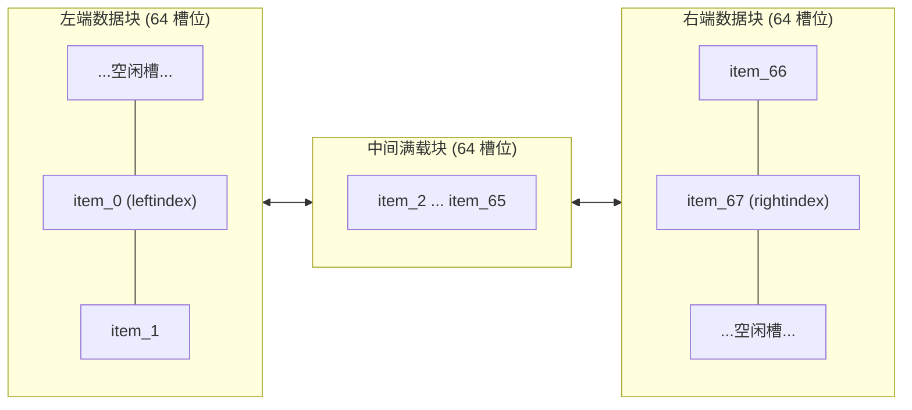
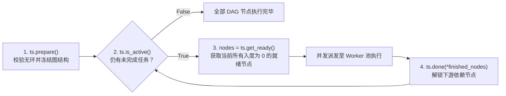

# 进阶容器与算法标准库

内置的 `list`、`dict` 与 `set` 足以应付 80% 的日常业务，但在高频队列吞吐、实时 Top-K 聚合、多级配置覆盖、海量数值紧凑存储以及复杂 DAG 任务编排场景下，强行混用基础容器往往导致时间复杂度从 `O(1)` 悄然退化至 `O(n)` 甚至 `O(n^2)`，或者造成数倍的内存浪费。

本篇深入剖析 Python 标准库中经过 C 语言高度优化的四组核心数据结构与算法模块：**`collections` 专用容器家族**、**`heapq` 二叉堆与优先队列**、**`bisect` 有序序列二分查找**，以及 **`array` 紧凑数值数组与 `graphlib` 拓扑排序调度器**。

---

## `collections` 高性能专用容器深度实战

### `deque`：双端块链表与有界滑动窗口

#### 底层原理：为什么不能用 `list.pop(0)` 当队列？

CPython 中的 `list` 本质上是一块**连续的动态指针数组（Dynamic Array）**。在尾部执行 `append()` 或 `pop()` 均摊复杂度为 `O(1)`；但一旦在头部执行 `list.pop(0)` 或 `list.insert(0, x)`，解释器就必须使用 `memmove` 将后续全部 `n - 1` 个元素指针向前或向后整体平移一格，单次开销高达 **`O(n)`**！如果在 `100,000` 个元素的队列上循环执行 `list.pop(0)`，总耗时将雪崩为 `O(n^2)`。

`collections.deque`（Double-Ended Queue）在底层采用了**定长指针块组成的双向链表（Doubly-linked list of fixed-size blocks，CPython 默认每块存放 64 个对象指针）**：



这种混合结构兼顾了双向链表与连续数组的优点：

- **头尾双端 `O(1)` 增删**：`append`、`appendleft`、`pop`、`popleft` 均无需移动已有元素，严格 `O(1)`；
- **优异的 CPU 缓存局部性**：相比每个节点单独 `malloc` 的传统链表，64 元素分块大幅减少了指针跳转与内存碎片；
- **代价权衡**：**随机中间索引访问 `d[k]` 复杂度为 `O(n)`**（需沿块链表逐块跳转定位）。若业务以随机按下标读取为主，应继续使用 `list`。

| 操作类别 | `list` 时间复杂度 | `collections.deque` 时间复杂度 | 说明 |
| :--- | :--- | :--- | :--- |
| 尾部追加入栈 / 弹出 (`append` / `pop`) | 均摊 `O(1)` | **严格 `O(1)`** | 两者均可安全充当 LIFO 栈 |
| 头部插入 / 出队 (`insert(0, x)` / `pop(0)` vs `appendleft` / `popleft`) | **`O(n)`（严禁高频调用）** | **严格 `O(1)`** | FIFO 队列与 BFS 广度优先搜索必须用 `deque` |
| 按下标随机读取 (`seq[len(seq) // 2]`) | **`O(1)`** | `O(n)` | 需要二分查找或频繁切片时必须用 `list` |

#### `maxlen` 定长滑动窗口与 `rotate` 环形轮转

- **`deque(iterable, maxlen=N)`**：创建固定容量上限的双端队列。一旦队列已满，从任意一端压入新元素时，**另一端最老的元素会自动静默弹出丢弃**——这使其成为实现 `tail -n` 最近日志缓存、实时滑动窗口指标统计的零样板神器。
- **`d.rotate(k)`**：原地环形旋转元素。`k > 0` 时将右端末尾 `k` 个元素移至左端开头；`k < 0` 时将左端前 `|k|` 个元素移至右端末尾（等价于轮询调度器 Round-Robin）。

!!! warning "注意 `extendleft(iterable)` 的逆序入队特性"

    `d.extendleft([1, 2, 3])` 等价于依次对每个元素调用 `appendleft(1)`、`appendleft(2)`、`appendleft(3)`，因此最终在队列左端呈现的顺序是**反过来的 `[3, 2, 1, ...]`**！

```python
from collections import deque

# 1. 标准 FIFO 队列与 extendleft 逆序现象验证
q = deque(["b", "c"])
q.appendleft("a")
q.append("d")
assert list(q) == ["a", "b", "c", "d"]
assert q.popleft() == "a"

q.extendleft(["x", "y"])  # 先 appendleft('x')，再 appendleft('y')
assert list(q) == ["y", "x", "b", "c", "d"]

# 2. maxlen 定长滑动窗口：保留最近 3 条报错记录并实时维护窗口均值
recent_latencies: deque[int] = deque(maxlen=3)
for ms in [12, 18, 24, 30, 42]:
    recent_latencies.append(ms)
# 前两次的 12, 18 已被自动挤出
assert list(recent_latencies) == [24, 30, 42]
assert sum(recent_latencies) / len(recent_latencies) == 32.0

# 3. rotate(-1) 实现极简 Round-Robin 上游节点轮询器
upstreams = deque(["node-1:8080", "node-2:8080", "node-3:8080"])
picked = []
for _ in range(5):
    picked.append(upstreams[0])
    upstreams.rotate(-1)  # 当前队首移至队尾
assert picked == ["node-1:8080", "node-2:8080", "node-3:8080", "node-1:8080", "node-2:8080"]
```

---

### `defaultdict`：一维分组聚合与递归树形字典

`collections.defaultdict(default_factory)` 继承自内置 `dict`，其唯一魔法在于重写了 **`__missing__(key)`** 钩子：仅当通过 `d[key]` 访问不存在的键时，才会无参调用 `default_factory()` 生成默认值、存入字典并返回（注意：`d.get(key)` **不会**触发 `__missing__`，依然返回 `None`）。

相比 `dict.setdefault(key, [])`：

- `setdefault(key, [])` **无论键是否已存在**，在函数调用传参阶段都会先在堆上白白分配一个新的空列表 `[]`；
- `defaultdict(list)` 仅在键真正缺失时才在 C 层按需调用 `list()`，循环聚合百万条记录时速度更快、意图也更清晰。

#### 进阶技巧：一行定义无限深度树形字典（Autovivification）

当构建任意层级的目录树、前缀树（Trie）或多维嵌套统计指标时，可以将 `defaultdict` 的工厂函数递归指向自身：

```python
from collections import defaultdict

# 1. 一维一对多分组聚合（部门 -> 员工列表，标签 -> 去重文章 ID 集合）
records = [("infra", "alice"), ("ai", "bob"), ("infra", "charlie"), ("ai", "bob")]
dept_members: defaultdict[str, set[str]] = defaultdict(set)
for dept, user in records:
    dept_members[dept].add(user)

assert dept_members == {"infra": {"alice", "charlie"}, "ai": {"bob"}}
# 注意：get() 不会触发默认值插入，避免只读查询污染字典键空间
assert dept_members.get("nonexistent") is None
assert "nonexistent" not in dept_members

# 2. 递归树形字典构造（无需逐层判断 key in dict）
def nested_tree() -> defaultdict:
    return defaultdict(nested_tree)

catalog = nested_tree()
catalog["cloud"]["aws"]["compute"]["instance"] = "c7g.xlarge"
catalog["cloud"]["gcp"]["storage"]["bucket"] = "logs-archive"

assert catalog["cloud"]["aws"]["compute"]["instance"] == "c7g.xlarge"
```

---

### `Counter`：多重集合（Multiset）计数与代数运算

`collections.Counter` 是专为频次统计与多重集合（允许元素重复出现的集合，又称 Bag）设计的 `dict` 子类：

- **缺失键安全返回 `0`**：访问未出现过的键 `c["unknown"]` 直接返回 `0`（既不抛 `KeyError`，也不会像 `defaultdict(int)` 那样把该键写入字典）；
- **`most_common(k)`**：返回频次最高的前 `k` 个 `(elem, count)` 元组（当 `k` 远小于总键数时，底层自动走 `heapq.nlargest` 的 `O(n log k)` 堆选择路径而非全量排序）；
- **`total()`**（Python 3.10+）：计算所有计数值之和；
- **`elements()`**：按每个元素的计数值重复展开为迭代器（计数值 `<= 0` 的元素会被自动忽略）；
- **四则与集合数学运算符**：注意数学运算符 **`+`、`-`、`&`、`|` 会自动丢弃结果中计数值 `<= 0` 的非正数项**（保持严格多重集合语义），而原地方法 `c.subtract(other)` 与 `c.update(other)` 则**保留 `0` 和负数**（适合库存扣减欠货对账）。

| 表达式 / 方法 | 运算语义 | 是否保留 `0` 与负数？ |
| :--- | :--- | :--- |
| `c1 + c2` | 对应计数相加 `c1[x] + c2[x]` | 否（仅保留 `> 0`） |
| `c1 - c2` | 对应计数相减 `c1[x] - c2[x]` | **否（小于等于 0 的项直接抹除）** |
| `c1 & c2` | 多重集合交集 `min(c1[x], c2[x])` | 否（仅保留 `> 0`） |
| `c1 \| c2` | 多重集合并集 `max(c1[x], c2[x])` | 否（仅保留 `> 0`） |
| `+c` / `-c` | 一元正号过滤全部 `> 0` 项 / 一元负号翻转负项为正 | 否 |
| `c1.subtract(c2)` | 原地减去 `c2` 的计数值 | **是（精确记录零库存与负差额）** |

```python
from collections import Counter

# 1. 词频统计、Top-K 与 total()
words = ["err_timeout", "ok", "ok", "err_db", "ok", "err_timeout", "err_auth"]
stats = Counter(words)
assert stats.total() == 7
assert stats.most_common(2) == [("ok", 3), ("err_timeout", 2)]
assert stats["never_seen"] == 0 and "never_seen" not in stats

# 2. 多重集合运算实战：仓库配货满足度校验与差额计算
warehouse_stock = Counter(cpu=4, ram=8, ssd=2)
order_demand = Counter(cpu=2, ram=10, ssd=2, gpu=1)

# 订单还缺哪些配件？（order_demand - warehouse_stock 自动抹去已满足项，仅剩缺货项！）
shortage = order_demand - warehouse_stock
assert shortage == Counter(ram=2, gpu=1)

# 当前库存最多能立刻交付哪些配件？（交集取 min）
fulfillable = warehouse_stock & order_demand
assert fulfillable == Counter(cpu=2, ram=8, ssd=2)

# 按计数展开元素序列
assert sorted(shortage.elements()) == ["gpu", "ram", "ram"]

# 3. subtract() 保留零和负值，用于财务/库存精确账本变动
ledger = Counter(apple=5, banana=3)
ledger.subtract(Counter(apple=5, banana=6))
assert ledger["apple"] == 0 and ledger["banana"] == -3
# 一元 + 运算符一键清理所有 <= 0 的条目
assert +ledger == Counter()
```

---

### `ChainMap`：零拷贝多层配置优先级视图

在构建成熟的后端服务或 CLI 工具时，配置项往往遵循经典的四层覆盖优先级：**命令行参数（CLI） > 操作系统环境变量（ENV） > 本地配置文件（File） > 内置默认配置（Defaults）**。

如果使用 `{**defaults, **file_cfg, **env_cfg, **cli_cfg}` 或 `defaults | file_cfg | ...` 合并成一张新字典，不仅每次都要拷贝全部键值，而且一旦底层热加载更新了 `file_cfg`，合并后的副本不会同步更新，你也无法追溯某个键值究竟来自哪一层。

`collections.ChainMap(*maps)` 将多个字典串联成一个**单一的逻辑视图**：

- **读取操作（`cm[k]`、`k in cm`、`get`）**：从 `cm.maps[0]`（最高优先级）向后依次扫描，命中第一个包含该键的字典即刻返回；
- **写入与删除操作（`cm[k] = v`、`del cm[k]`）**：**永远只修改最顶层映射 `cm.maps[0]`**！如果某个键只存在于底层 `defaults` 中，执行 `del cm[k]` 会直接抛出 `KeyError`，绝不会误删底层默认字典；
- **`cm.new_child(m=None)` 与 `cm.parents`**：在最前端压入一层新的局部字典（`O(1)` 开销），天然契合模板引擎、解释器 AST 求值中的**嵌套词法作用域栈（Lexical Scope Stack）**。

```python
from collections import ChainMap

defaults = {"host": "127.0.0.1", "port": 8000, "debug": False, "workers": 4}
file_cfg = {"host": "0.0.0.0", "workers": 8}
env_cfg = {"port": 9000}
cli_cfg = {"debug": True}  # 仅包含用户显式传入的非 None 参数

# 按优先级从高到低传入 ChainMap（零拷贝视图）
config = ChainMap(cli_cfg, env_cfg, file_cfg, defaults)

assert config["debug"] is True           # 命中第 1 层 cli_cfg
assert config["port"] == 9000            # 命中第 2 层 env_cfg
assert config["workers"] == 8            # 命中第 3 层 file_cfg
assert config["host"] == "0.0.0.0"       # 命中第 3 层 file_cfg（遮蔽了 defaults）

# 底层字典热更新时，ChainMap 视图立即可见
file_cfg["workers"] = 16
assert config["workers"] == 16

# new_child 派生单次请求的临时覆盖上下文，不影响全局配置
req_config = config.new_child({"timeout": 5, "debug": False})
assert req_config["debug"] is False
assert req_config.parents["debug"] is True  # 退出子作用域恢复原视图
```

---

## 堆与优先队列（`heapq`）

### 二叉最小堆数组表示与原地维护原语

Python 标准库 `heapq` 没有设计一个独立的 `Heap` 类，而是直接提供了一组在**普通 `list` 上原地维护二叉最小堆（Binary Min-Heap）**的函数。

在一棵基于 0 起始下标数组的完全二叉树中，无需任何左右子节点指针，仅凭算术下标即可定位父子关系：对于任意索引 `i`，其左孩子位于 `2*i + 1`，右孩子位于 `2*i + 2`，父节点位于 `(i - 1) // 2`。最小堆时刻保证每个父节点的值都**小于或等于**其左右孩子，因此 **`heap[0]` 永远是全局最小元素**（但注意 `heap[1]`、`heap[2]` 并不保证整体有序，切勿把堆列表当成已排序数组切片！）。

| 函数签名 | 时间复杂度 | 行为与性能优化要点 |
| :--- | :--- | :--- |
| `heapq.heapify(x)` | **`O(n)`** | 自底向上原地重排列表 `x` 为合法最小堆（比逐个 `heappush` 的 `O(n log n)` 更快且零额外内存） |
| `heapq.heappush(heap, item)` | `O(log n)` | 尾部追加元素并沿父节点链上浮调整 |
| `heapq.heappop(heap)` | `O(log n)` | 弹出并返回最小元素 `heap[0]`，将末尾元素移至堆顶下沉调整 |
| `heapq.heappushpop(heap, item)` | `O(log n)` | 先压入 `item` 再弹出最小值（若 `item <= heap[0]` 则直接返回 `item`，无需动堆，适合维护固定容量最大 Top-K 最小堆） |
| `heapq.heapreplace(heap, item)` | `O(log n)` | **先弹出 `heap[0]`** 再压入 `item`（即便 `item` 比原堆顶更小也会入堆；仅一次下沉，更快） |

#### 如何构建最大堆（Max-Heap）？

`heapq` 传统上以最小堆为核心：

- **通用跨版本做法**：对于数值优先级 `score`，入堆时存入相反数 **`-score`**，出堆后再取反恢复（若为复杂不可取反对象，可封装一个反转 `__lt__` 的轻量包装类）；
- **Python 3.14+ 原生最大堆补充**：自 Python 3.14 起，`heapq` 模块正式公开了原生最大堆系列函数（`heapify_max`、`heappush_max`、`heappop_max`、`heappushpop_max`、`heapreplace_max`），可直接对任意支持 `<` 比较的对象维护最大堆而无需手动取负！

```python
import heapq

# 1. O(n) 原地建堆与有序弹出
nums = [42, 15, 8, 23, 4, 16]
heapq.heapify(nums)
assert nums[0] == 4  # 堆顶必为最小值

heapq.heappush(nums, 2)
assert heapq.heappop(nums) == 2
assert heapq.heappushpop(nums, 10) == 4  # 压入 10 并弹出当时的最小堆顶 4

# 2. 数值取负构建跨版本兼容的最大堆
scores = [75, 92, 88, 64]
max_heap = [-s for s in scores]
heapq.heapify(max_heap)
assert -heapq.heappop(max_heap) == 92
assert -heapq.heappop(max_heap) == 88
```

---

### 自定义任务优先队列标准范式：`(priority, seq_id, task)`

在实战中实现任务调度器时，新手常把元组 `(priority, task)` 直接塞进堆里，上线后一旦遇到**两个任务优先级相同**，程序会瞬间崩溃：

`TypeError: '<' not supported between instances of 'Job' and 'Job'`

原因在于 Python 元组按字典序逐位比较：当第 0 位 `priority` 相等时，解释器会继续比较第 1 位 `task` 对象（而普通字典或业务类通常没有定义 `<` 运算符，即便定义了也可能打乱同优先级的先后到达顺序）。

**工业界标准解法**是引入 `itertools.count()` 生成全局唯一递增序号 `seq_id`，构造三元组 **`(priority, seq_id, task)`**：

1. 因为任意两次入队的 `seq_id` 绝不可能相等，元组比较最多进行到第 1 位就必定分出大小，**永远不会触碰第 2 位的 `task` 对象**；
2. 对于 `priority` 相同的任务，`seq_id` 更小的先出堆，天然保证了严格的 **FIFO（先进先出）调度公平性**！

```python
import heapq
import itertools
from dataclasses import dataclass


@dataclass
class DeployTask:
    service: str
    payload: dict  # dict 不支持 < 比较！


class PriorityScheduler:
    def __init__(self) -> None:
        self._heap: list[tuple[int, int, DeployTask]] = []
        self._counter = itertools.count()

    def push(self, priority: int, task: DeployTask) -> None:
        # priority 越小优先级越高；同优先级按 next(self._counter) 严格保持 FIFO
        entry = (priority, next(self._counter), task)
        heapq.heappush(self._heap, entry)

    def pop(self) -> DeployTask:
        _, _, task = heapq.heappop(self._heap)
        return task

    def __len__(self) -> int:
        return len(self._heap)


scheduler = PriorityScheduler()
scheduler.push(priority=2, task=DeployTask("billing", {"region": "ap-east"}))
scheduler.push(priority=1, task=DeployTask("auth-hotfix-1", {"urgent": True}))
scheduler.push(priority=1, task=DeployTask("auth-hotfix-2", {"urgent": True}))

# 两个优先级同为 1 的任务既不会因 dict 不可比较而报错，又严格保持入队先后顺序
assert scheduler.pop().service == "auth-hotfix-1"
assert scheduler.pop().service == "auth-hotfix-2"
assert scheduler.pop().service == "billing"
```

---

### Top-K 选择（`nlargest` / `nsmallest`）与多路归并（`heapq.merge`）

#### Top-K 选型决策法则

从规模为 `N` 的数据流中提取前 `K` 大或前 `K` 小元素时，应按 `K` 与 `N` 的比例选型：

- **`K == 1`**：直接用内置 **`min(it, key=...)` / `max(it, key=...)`**，单趟 C 循环 `O(N)` 最快；
- **`K` 远小于 `N`（例如从 100 万条请求中取最慢的 10 条）**：使用 **`heapq.nlargest(K, it, key=...)` / `nsmallest(...)`**，内部仅维护一个大小为 `K` 的小堆，时间复杂度 `O(N log K)`，额外内存仅 `O(K)`（可流式消费无限长生成器而不爆内存）；
- **`K` 接近 `N`**：直接调用 **`sorted(it, key=... )[:K]`**，底层 Timsort 在 C 层整块排序反而比高频堆调整更快。

#### `heapq.merge(*iterables, key=None, reverse=False)`：多路有序流惰性归并

假设你有 16 台服务器各自按时间戳升序写入的数 GB 日志文件，想把它们合并成一个全局严格按时间递增的事件流。如果全部读进内存调用 `sorted()` 会立刻触发 OOM（内存溢出）。

`heapq.merge` 假设传入的每一个可迭代对象**自身已经有序**，它在内部仅维护一个容量等于“输入流个数 `M`”的极小堆，每次从堆顶产出最小记录并从对应那一路流中拉取下一条记录补位——**返回一个惰性生成器，内存占用恒为 `O(M)`**！

```python
import heapq

# 1. Top-K 慢查询筛选：O(N log K) 空间仅需保存 2 个元素
queries = [
    {"sql": "SELECT 1", "ms": 2.1},
    {"sql": "SELECT * FROM logs", "ms": 840.5},
    {"sql": "UPDATE users ...", "ms": 15.3},
    {"sql": "JOIN huge_orders ...", "ms": 1290.0},
]
top2_slow = heapq.nlargest(2, queries, key=lambda q: q["ms"])
assert [q["ms"] for q in top2_slow] == [1290.0, 840.5]

# 2. heapq.merge 惰性归并多路已按时间排序的监控事件流（支持 key 参数）
node_a_stream = [(1001, "A:boot"), (1005, "A:ready"), (1012, "A:req")]
node_b_stream = [(1002, "B:boot"), (1005, "B:sync"), (1009, "B:req")]
node_c_stream = [(1000, "C:init"), (1015, "C:done")]

merged_iter = heapq.merge(node_a_stream, node_b_stream, node_c_stream, key=lambda ev: ev[0])
# 惰性按需拉取前 4 条全局最早事件
first_four = [next(merged_iter) for _ in range(4)]
assert first_four == [
    (1000, "C:init"),
    (1001, "A:boot"),
    (1002, "B:boot"),
    (1005, "A:ready"),
]
```

---

## 有序序列二分查找（`bisect`）

在已升序排列的随机访问序列（如 `list`）上，线性查找 `x in seq` 或 `seq.index(x)` 需要 `O(n)` 时间，而 `bisect` 模块利用 C 实现的二分查找将其压缩至 **`O(log n)`**（在 100 万元素列表中最多只需约 20 次比较）。

### `bisect_left` vs `bisect_right`：重复元素边界的精确语义

两者唯一的区别在于遇到**与目标值相等的已有元素**时，新插入点落在相等元素区间的**最左端**还是**最右端**：

假设有序列表 `a = [10, 20, 20, 20, 30]`，查找目标 `x = 20`：

- **`i = bisect.bisect_left(a, 20)` -> 返回索引 `1`**：
  左半区 `a[:i]` 全部**严格小于** `x`（`< 20`），右半区 `a[i:]` 全部**大于等于** `x`（`>= 20`）。即：**第一个 `>= x` 的元素位置**。
- **`j = bisect.bisect_right(a, 20)`（别名 `bisect.bisect`） -> 返回索引 `4`**：
  左半区 `a[:j]` 全部**小于等于** `x`（`<= 20`），右半区 `a[j:]` 全部**严格大于** `x`（`> 20`）。即：**第一个 `> x` 的元素位置**。
- **重要推论**：有序数组中值等于 `x` 的元素出现总次数恰好等于 **`bisect_right(a, x) - bisect_left(a, x)`**（仅耗时 `O(log n)`，远快于 `a.count(x)` 的 `O(n)` 全表扫描！）。

```python
import bisect

data = [10, 20, 20, 20, 30, 40]

left_idx = bisect.bisect_left(data, 20)
right_idx = bisect.bisect_right(data, 20)
assert left_idx == 1 and right_idx == 4
# O(log n) 统计目标值出现次数
assert (right_idx - left_idx) == 3


def binary_search_exact(sorted_seq: list[int], target: int) -> int:
    """精确二分查找：命中返回最左下标，未命中返回 -1。"""
    idx = bisect.bisect_left(sorted_seq, target)
    if idx < len(sorted_seq) and sorted_seq[idx] == target:
        return idx
    return -1


assert binary_search_exact(data, 20) == 1
assert binary_search_exact(data, 25) == -1
```

---

### 无分支区间查表定级、`insort` 与 `key` 参数

#### 利用 `bisect` 消除冗长 `if-elif-else` 阶梯

在考核评级、阶梯计费、延迟分桶（Histogram Bucketing）场景中，预先定义一组有序分界阈值 `breakpoints`，即可用一行 `bisect` 映射出对应等级：

- 当分界点属于**下一档的包含下界**（例如 `[60, 70, 80, 90]` 中刚好考 `60` 分算及格 `D` 而非不及格 `F`）时，必须使用 **`bisect_right`**！
- 当分界点属于**当前档的包含上界**（例如 HTTP 响应体积 `<= 1024` 算小包）时，则使用 **`bisect_left`**。

#### `insort` 动态保序插入与 Python 3.10+ `key` 参数

- `bisect.insort_left(a, x)` / `insort_right(a, x)` 在找到插入位置后自动调用 `a.insert(idx, x)` 保持列表有序。**性能提示**：查找虽为 `O(log n)`，但底层数组搬移仍是 `O(n)`；若面临数十万次高频交替随机插入与范围查询，应考虑第三方库 `sortedcontainers.SortedList`。
- 自 Python 3.10 起，`bisect` 全系列函数均支持 **`key=` 关键字参数**，可直接对 `dataclass` 或字典组成的有序列表按指定属性做二分检索。

```python
import bisect
from dataclasses import dataclass

# 1. 区间查表定级：成绩阶梯 [0, 60) -> F, [60, 70) -> D, [70, 80) -> C, [80, 90) -> B, [90, +inf) -> A
BREAKPOINTS = [60, 70, 80, 90]
GRADES = ["F", "D", "C", "B", "A"]

def score_to_grade(score: int) -> str:
    # 恰为边界值 60 时，bisect_right 返回 1 -> GRADES[1] == 'D'
    return GRADES[bisect.bisect_right(BREAKPOINTS, score)]

assert [score_to_grade(s) for s in [59, 60, 75, 89, 90, 100]] == ["F", "D", "C", "B", "A", "A"]


# 2. Python 3.10+ key 参数：在按时间戳升序排列的快照列表中查找指定时刻对应的最近配置版本
@dataclass(frozen=True)
class ConfigSnapshot:
    effective_ts: int
    version: str


snapshots = [
    ConfigSnapshot(1000, "v1.0"),
    ConfigSnapshot(2000, "v1.1"),
    ConfigSnapshot(3500, "v2.0"),
]

# 查找 ts=2800 时正在生效的版本（最后一个 effective_ts <= 2800 的快照）
pos = bisect.bisect_right(snapshots, 2800, key=lambda s: s.effective_ts) - 1
assert pos == 1 and snapshots[pos].version == "v1.1"

# 使用 insort_right 按 effective_ts 顺序插入新版本快照
bisect.insort_right(snapshots, ConfigSnapshot(2500, "v1.2"), key=lambda s: s.effective_ts)
assert [s.version for s in snapshots] == ["v1.0", "v1.1", "v1.2", "v2.0"]
```

---

## 紧凑数值数组与图拓扑排序

### `array.array`：连续 C 内存布局对比 `list` 内存开销

Python 的 `list` 存储的是指向任意 PyObject 的 **8 字节内存指针**，而每一个独立的 `int`（28 字节起）或 `float`（24 字节）在 CPython 堆上都携带着引用计数与类型指针头（Object Header）。这意味着存储 **100 万个双精度浮点数**时，`list[float]` 实际消耗超过 **`32 MB`** 内存且指针散落各处；而标准库 `array.array('d', ...)` 直接在连续内存块中紧凑排布原生 C `double` 值（无对象头、无指针间接层），精确仅占 **`8,000,000` 字节（约 `7.63 MB`）**！

常用类型码（Typecode）速查：

| 类型码 | 对应 C 语言类型 | Python 映射类型 | 最小元素字节大小 |
| :--- | :--- | :--- | :--- |
| `'b'` / `'B'` | `signed char` / `unsigned char` | `int` | `1` 字节（`-128~127` / `0~255`） |
| `'h'` / `'H'` | `signed short` / `unsigned short` | `int` | `2` 字节 |
| `'i'` / `'I'` | `signed int` / `unsigned int` | `int` | 通常 `4` 字节 |
| `'q'` / `'Q'` | `signed long long` / `unsigned long long` | `int` | `8` 字节（64 位整数） |
| `'f'` / `'d'` | `float` / `double` | `float` | `4` 字节（单精度） / **`8` 字节（双精度）** |

!!! tip "`array.array` vs `numpy.ndarray` 的定位边界"

    如果项目需要矩阵乘法、广播向量化算术或多维张量切片，毫无疑问应引入第三方科学计算基石 `NumPy`；但在**零第三方依赖的轻量级标准库脚本、守护进程或嵌入式工具**中，使用 `array.array` 配合 `memoryview` 零拷贝切片与 `tobytes()` / `frombytes()` 二进制流直读直写，是削减 75% 内存占用的最佳内置方案。

```python
from array import array
import sys

# 对比存放 10,000 个双精度浮点数时容器与元素的内存足迹差异
N = 10_000
py_list = [float(i) for i in range(N)]
c_array = array("d", (float(i) for i in range(N)))

# sys.getsizeof(list) 仅统计指针数组本身，需加上内部独立 float 对象的大小才反映真实开销
list_total_bytes = sys.getsizeof(py_list) + sum(sys.getsizeof(x) for x in py_list)
array_total_bytes = sys.getsizeof(c_array)

assert c_array.itemsize == 8
assert array_total_bytes < list_total_bytes // 3  # array 内存开销不到 list 的三分之一

# 支持缓冲区协议 (Buffer Protocol)：通过 memoryview 实现零拷贝切片视图与原地修改
mv = memoryview(c_array)
sub_view = mv[100:105]
sub_view[0] = 999.5
assert c_array[100] == 999.5

# 高速序列化为原始字节流并还原
raw_bytes = c_array[:3].tobytes()
restored = array("d")
restored.frombytes(raw_bytes)
assert list(restored) == [0.0, 1.0, 2.0]
```

---

### `graphlib.TopologicalSorter`：DAG 依赖解析与并行调度循环

在构建包管理器、数据库迁移脚本排序、Excel 公式重算或 CI/CD 任务流水线时，核心模型都是 **有向无环图（DAG，Directed Acyclic Graph）的拓扑排序**。Python 3.9+ 标准库内置的 `graphlib.TopologicalSorter` 同时提供了**线性静态排序**、**精确环路诊断**与**分层动态并行调度状态机**三大核心能力。

!!! danger "极易写反的依赖方向：`{节点: {前置依赖集合}}`"

    在初始化 `TopologicalSorter(graph)` 或调用 `ts.add(node, *predecessors)` 时，**第一个键 `node` 是“后执行的派生任务”**，而后面的集合/参数 `predecessors` 是**“必须先执行完毕的前置依赖项”**！例如 `"deploy"` 依赖 `"test"` 和 `"build"`，必须写成 `{"deploy": {"test", "build"}}`，最终拓扑序才会先产出 `"build"` / `"test"`，最后产出 `"deploy"`。

#### 1. 线性拓扑排序 `static_order()` 与环路捕获 `CycleError`

- 若只需单线程按合法顺序依次执行所有节点，调用 `list(ts.static_order())` 即可；
- 若图中存在死锁环路（如 `A` 依赖 `B`，`B` 依赖 `C`，`C` 又依赖 `A`），`prepare()` 或 `static_order()` 会立即抛出 `graphlib.CycleError`，其中 **`err.args[1]` 直接包含首尾闭合的环路节点列表**，可直接格式化进错误报告！

#### 2. 动态并行调度状态机（压榨最大并发度）

在多核进程池或 `asyncio` 协程池中，我们希望同一时刻把所有“前置依赖均已就绪”的任务同时并发跑起来，一旦某个任务率先完成，立即解锁唤醒依赖它的下游任务。标准调度循环遵循严格四步协议：



下面通过完整代码演示静态拓扑排序、环路精确提取以及分层并发调度器的实现：

```python
from graphlib import CycleError, TopologicalSorter

# 1. 静态线性拓扑序：定义微服务构建流水线依赖关系 (key 依赖于 value 集合)
pipeline_deps = {
    "lint": set(),
    "compile": set(),
    "unit_test": {"compile", "lint"},
    "docker_image": {"unit_test"},
    "e2e_test": {"docker_image"},
    "publish": {"e2e_test"},
}

linear_plan = list(TopologicalSorter(pipeline_deps).static_order())
# 验证任意任务一定排在它的所有前置依赖之后
pos_map = {step: idx for idx, step in enumerate(linear_plan)}
for step, deps in pipeline_deps.items():
    assert all(pos_map[dep] < pos_map[step] for dep in deps)

# 2. 循环依赖检测与闭环路径提取
cyclic_deps = {
    "service_a": {"service_b"},
    "service_b": {"service_c"},
    "service_c": {"service_a"},
}
try:
    list(TopologicalSorter(cyclic_deps).static_order())
    raise AssertionError("应当检测到循环依赖")
except CycleError as exc:
    cycle_path = exc.args[1]
    # 首尾元素相同，完整展示闭环链条
    assert cycle_path[0] == cycle_path[-1]
    assert set(cycle_path) == {"service_a", "service_b", "service_c"}

# 3. 动态并行任务调度循环：使用 prepare() / is_active() / get_ready() / done()
ts = TopologicalSorter()
ts.add("report", "agg_sales", "agg_users")
ts.add("agg_sales", "fetch_orders")
ts.add("agg_users", "fetch_profiles")

ts.prepare()  # 冻结图并完成入度初始化与环路检查
parallel_waves: list[tuple[str, ...]] = []

while ts.is_active():
    ready_batch = ts.get_ready()
    # 生产异步/多线程环境中，ready_batch 可为空（等待飞行中的任务返回后调用 done）；
    # 在本同步批次模拟中，每轮将当前就绪层全部并发执行并一次性标记 done：
    parallel_waves.append(tuple(sorted(ready_batch)))
    ts.done(*ready_batch)

# 第 1 波同时拉取两路数据源，第 2 波同时聚合两张报表，第 3 波汇总最终报告！
assert parallel_waves == [
    ("fetch_orders", "fetch_profiles"),
    ("agg_sales", "agg_users"),
    ("report",),
]
```

---

## 练习与实战

### 练习 1：基于定长 `deque` 与 `Counter` 构建滑动窗口实时热点监控器

在高流量 API 网关中，我们需要只统计**最近 `window_size` 次请求**中出现频次最高的客户端 IP（超出窗口的旧请求必须从频次计数中实时扣减归零并清理，防止内存无限增长）。

请编写一个类 `SlidingWindowTopK`，包含方法：

- `__init__(self, window_size: int)`：初始化固定窗口容量；
- `record(self, item: str) -> None`：记录一次新事件；若窗口已满，将被挤出的最老事件从内部 `Counter` 中减 `1`（当某键计数降为 `0` 时用 `del` 从 `Counter` 中彻底移除该键，保证内存严格 `O(window_size)`）；
- `top_k(self, k: int) -> list[tuple[str, int]]`：返回当前窗口内频次最高的前 `k` 个 `(item, count)`。

??? success "点击查看答案与解析"
    **解析：**
    注意不能直接设置 `deque(maxlen=window_size)` 后直接 `append`，因为自动挤出时 `deque` 不会返回被丢弃的旧元素，我们就无法知道该去 `Counter` 里给哪个键减 `1`！正确做法是在 `len(self._window) == self._window_size` 时显式调用 `oldest = self._window.popleft()` 拿到被淘汰的元素并同步递减清理 `Counter`。
    
    ```python
    from collections import Counter, deque
    
    
    class SlidingWindowTopK:
        def __init__(self, window_size: int) -> None:
            if window_size <= 0:
                raise ValueError("window_size must be positive")
            self._window_size = window_size
            self._window: deque[str] = deque()
            self._counts: Counter[str] = Counter()
    
        def record(self, item: str) -> None:
            if len(self._window) == self._window_size:
                evicted = self._window.popleft()
                self._counts[evicted] -= 1
                if self._counts[evicted] == 0:
                    del self._counts[evicted]
    
            self._window.append(item)
            self._counts[item] += 1
    
        def top_k(self, k: int) -> list[tuple[str, int]]:
            return self._counts.most_common(k)
    
    
    monitor = SlidingWindowTopK(window_size=4)
    for ip in ["1.1.1.1", "1.1.1.1", "2.2.2.2", "3.3.3.3", "2.2.2.2", "2.2.2.2"]:
        monitor.record(ip)
    
    # 最近 4 次请求为 ['2.2.2.2', '3.3.3.3', '2.2.2.2', '2.2.2.2']，最早的两次 '1.1.1.1' 已完全滑出窗口并被清理
    assert "1.1.1.1" not in monitor._counts
    assert monitor.top_k(2) == [("2.2.2.2", 3), ("3.3.3.3", 1)]
    ```

### 练习 2：利用 `bisect` 与 `heapq` 实现一致性哈希环（Consistent Hashing）路由查找

分布式缓存集群常用**一致性哈希环**将缓存键路由到顺时针方向最近的物理节点上。假设环空间为 `[0, 2**32)`，已将各节点的虚拟哈希点升序存放在列表 `ring_hashes: list[int]` 中，对应节点名存放在等长列表 `ring_nodes: list[str]` 中。

请编写函数 `route_key(ring_hashes: list[int], ring_nodes: list[str], key_hash: int) -> str`：

1. 使用 `bisect` 在 `O(log N)` 时间内找到环上**第一个哈希值 `>= key_hash`** 的位置；
2. 若 `key_hash` 大于环上最大的节点哈希值，则按环形语义**回绕到索引 `0`**（第一个节点）；返回命中的节点名称。

??? success "点击查看答案与解析"
    **解析：**
    寻找“第一个 `>= key_hash` 的位置”正是 **`bisect.bisect_left`** 的精确定义！当 `key_hash` 超过环上最大值时，`bisect_left` 返回 `len(ring_hashes)`，对其取模 `% len(ring_hashes)`（或条件归零）即可优雅完成环形首尾闭合。
    
    ```python
    import bisect
    
    
    def route_key(ring_hashes: list[int], ring_nodes: list[str], key_hash: int) -> str:
        if not ring_hashes:
            raise ValueError("Hash ring cannot be empty")
        idx = bisect.bisect_left(ring_hashes, key_hash)
        if idx == len(ring_hashes):
            idx = 0  # 顺时针跨越环末尾，回绕至最小哈希节点
        return ring_nodes[idx]
    
    
    hashes = [100, 500, 1200, 3000]
    nodes = ["cache-a", "cache-b", "cache-c", "cache-d"]
    
    assert route_key(hashes, nodes, 100) == "cache-a"    # 精确命中边界 100 -> bisect_left 返回 0
    assert route_key(hashes, nodes, 650) == "cache-c"    # 落在 (500, 1200] 区间 -> 顺时针命中 1200
    assert route_key(hashes, nodes, 3500) == "cache-a"   # 超过最大节点 3000 -> 环形回绕至索引 0
    ```

### 练习 3：基于 `graphlib.TopologicalSorter` 计算 DAG 工作流关键路径最短总工时

给定一个软件编译工程的任务耗时字典 `durations: dict[str, int]`（单位：秒）以及前置依赖图 `deps: dict[str, set[str]]`（假设拥有无限并行核数，任何入度为 `0` 的就绪任务都可以立即开始执行；一个任务的开始时刻等于其所有前置依赖任务**最早完成时刻的最大值**）。

请编写函数 `compute_critical_makespan(durations: dict[str, int], deps: dict[str, set[str]]) -> int`：

1. 使用 `TopologicalSorter` 获取合法计算顺序（若存在循环依赖，捕获 `CycleError` 并转化为 `ValueError("Cyclic dependency detected")`）；
2. 按拓扑序递推每个任务的最早完成时间 `finish_time[task]`，返回整个工程全部完成所需的最短总工时（Makespan）。

??? success "点击查看答案与解析"
    **解析：**
    在 DAG 上求关键路径长度是拓扑排序最经典的动态规划应用：因为按 `static_order()` 遍历到节点 `u` 时，它的所有前置依赖 `p in deps[u]` 必然已经计算完毕，直接利用状态转移方程 `finish[u] = durations[u] + max((finish[p] for p in deps[u]), default=0)` 即可在线性时间 `O(V + E)` 内精确算出总工期。
    
    ```python
    from graphlib import CycleError, TopologicalSorter
    
    
    def compute_critical_makespan(
        durations: dict[str, int],
        deps: dict[str, set[str]],
    ) -> int:
        full_graph: dict[str, set[str]] = {task: set(deps.get(task, set())) for task in durations}
        sorter = TopologicalSorter(full_graph)
        try:
            order = list(sorter.static_order())
        except CycleError as exc:
            raise ValueError("Cyclic dependency detected") from exc
    
        finish_time: dict[str, int] = {}
        for task in order:
            prereqs = full_graph[task]
            earliest_start = max((finish_time[p] for p in prereqs), default=0)
            finish_time[task] = earliest_start + durations[task]
    
        return max(finish_time.values(), default=0)
    
    
    task_secs = {"fetch": 3, "compile_core": 10, "compile_ui": 6, "bundle": 4}
    task_deps = {
        "fetch": set(),
        "compile_core": {"fetch"},
        "compile_ui": {"fetch"},
        "bundle": {"compile_core", "compile_ui"},
    }
    # 关键路径为 fetch(3) -> compile_core(10) -> bundle(4)，总耗时 17 秒（compile_ui 的 6 秒被并行掩盖）
    assert compute_critical_makespan(task_secs, task_deps) == 17
    
    try:
        compute_critical_makespan({"a": 1, "b": 2}, {"a": {"b"}, "b": {"a"}})
        raise AssertionError("Should raise ValueError on cycle")
    except ValueError as err:
        assert "Cyclic" in str(err)
    ```
