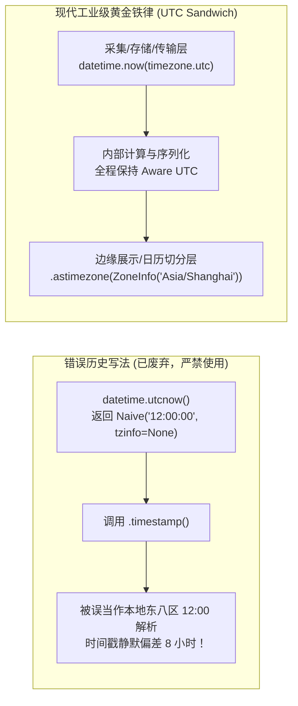

# 日期、时间与时区工程

在软件工程史上，因时区混用、夏令时跳变与系统时钟回拨导致的线上资损与故障数不胜数：定时任务在凌晨重复扣款两次、跨国订单因服务器环境变量差异偏移 8 小时、NTP 自动校时导致超时计算得出负数从而卡死连接池。

要写出无懈可击的时间处理代码，首先必须在心智上严格区分三种截然不同的概念：**日历挂钟读数（Civil / Wall Time）**、**宇宙绝对瞬时点（Absolute Instant）**与**单调流逝时长（Monotonic Elapsed Duration）**。本篇系统梳理 Python 现代标准库（`datetime`、`zoneinfo`、`calendar` 与 `time`）的完整工程规范与避坑指南。

---

## Naive 与 Aware 对象的本质分野

### `datetime` 四大不可变核心类型与算术陷阱

标准库 `datetime` 模块中的所有日期时间对象均为**不可变（Immutable）且可哈希（Hashable）**的值对象，任何加减修改都会返回新实例：

| 类型 | 表示语义 | 核心属性与构造示例 | 工程注意事项 |
| :--- | :--- | :--- | :--- |
| `datetime.date` | 纯日历日期（年、月、日） | `date(2026, 11, 26)`、`date.today()` | 适合生日、法定节假日、财务结算自然日 |
| `datetime.time` | 一天内的墙上时刻（精确至微秒） | `time(14, 30, 0, tzinfo=...)` | 适合每日固定闹钟规则（如每天 `"09:30"` 开盘） |
| `datetime.datetime` | 日期 + 时刻组合（可携带 `tzinfo`） | `datetime.now(timezone.utc)` | **注意继承陷阱**：`datetime` 是 `date` 的子类，`isinstance(dt, date)` 返回 `True`！ |
| `datetime.timedelta` | 两个时刻之间的固定时间跨度 | `timedelta(days=7, hours=2, minutes=30)` | 内部仅归一化存储 **`days`、`seconds`、`microseconds` 三字段** |

!!! danger "高频线上 Bug：切勿误用 `td.seconds` 获取总秒数！"

    在 `timedelta` 内部表示中，时间差被拆分为整数天 `days`（可为负）与**不足一天的剩余秒数 `seconds`（取值永远在 `0 ~ 86399` 之间）**！例如 `timedelta(days=2, hours=1).seconds` 的值是 **`3600`** 而不是 `176400`！计算时间差的总秒数时，**必须一律调用方法 `td.total_seconds()`**。

```python
from datetime import date, datetime, time, timedelta, timezone

# 1. date / time 组合与 datetime 子类判定陷阱
d = date(2026, 11, 26)
t = time(21, 30, 0)
combined = datetime.combine(d, t, tzinfo=timezone.utc)

assert isinstance(combined, date) is True  # datetime 继承自 date！
# 若函数需严格区分纯 date 与 datetime，必须先判 datetime 或用 type(x) is date：
def is_pure_date(obj: object) -> bool:
    return isinstance(obj, date) and not isinstance(obj, datetime)

assert is_pure_date(d) is True and is_pure_date(combined) is False

# 2. timedelta 不可变算术与 total_seconds() 铁律
span = timedelta(days=1, hours=2, minutes=30)
assert span.days == 1
assert span.seconds == 9000                # 仅包含 2h30m 的秒数，不含那 1 天！
assert span.total_seconds() == 95400.0     # 1*86400 + 9000 = 95400 秒（正确获取总秒数）

future_dt = combined + span
assert (future_dt - combined) == span
```

---

### 为什么现代 Python 废弃并严禁使用 `utcnow()`？

Python 将 `datetime` 与 `time` 实例严格划分为两个互不相容的世界：

- **Naive 对象（无时区感知）**：`dt.tzinfo is None`（或 `dt.tzinfo.utcoffset(dt) is None`）。它仅仅代表“某块不知挂在地球哪个角落的钟表上显示着 `2026-11-26 12:00:00`”，无法唯一映射到物理时间轴。
- **Aware 对象（有时区感知）**：携带明确的 `tzinfo` 偏移规则，精确锚定宇宙时间轴上的唯一物理瞬时点。Python **禁止将 Naive 与 Aware 对象直接比较大小或相减**（会立即抛出 `TypeError`）。

#### `datetime.utcnow()` 与 `utcfromtimestamp()` 的致命设计缺陷

自 **Python 3.12** 起，调用 `datetime.utcnow()` 与 `datetime.utcfromtimestamp()` 会正式触发 **`DeprecationWarning`**（并计划在未来版本移除）。它们之所以臭名昭著，是因为它们违反直觉地返回了一个 **`tzinfo=None` 的 Naive 对象**！

更为凶险的是：Python 的 `.timestamp()` 与 `.astimezone()` 方法规定——**任何传入的 Naive 对象都会被默认当作“当前操作系统本地时区（Local Time）”来解析**！这意味着在中国标准时间（`UTC+8`）的服务器上写下 `datetime.utcnow().timestamp()`，算出的时间戳会比真实此刻硬生生**倒退 8 个小时（28800 秒）**！



!!! tip "时间工程黄金铁律（UTC Everywhere）"

    1. **获取当前时刻**：永远使用 **`datetime.now(timezone.utc)`**（在 Python 3.11+ 中也可使用等价简写常量 `from datetime import UTC; datetime.now(UTC)`）。
    2. **三明治架构（UTC Sandwich）**：数据库持久化（`TIMESTAMPTZ` 或 UTC 纪元整数）、微服务 RPC / JSON 传输、后台队列与日志时间戳，**100% 统一使用 Aware UTC**；仅在前端渲染展示或按业务所在地法律时区切分“自然日账单”的最外层边界，才显式转换为目标时区。

```python
from datetime import UTC, datetime, timezone

# Python 3.11+ 中 datetime.UTC 即为 timezone.utc 的官方别名
assert UTC is timezone.utc

now_utc = datetime.now(UTC)
assert now_utc.tzinfo is timezone.utc
assert now_utc.utcoffset().total_seconds() == 0.0

# Aware 与 Naive 直接比较或相减会被类型系统严格拦截，防止静默混算
naive_dt = datetime(2026, 11, 26, 12, 0, 0)
try:
    _ = now_utc - naive_dt
    raise AssertionError("Naive 与 Aware 相减应当抛出 TypeError")
except TypeError as exc:
    assert "offset-naive and offset-aware" in str(exc)
```

---

## 标准库时区引擎 `zoneinfo`（PEP 615）与夏令时剖析

### IANA 时区标识与跨平台 `tzdata` 依赖

在 Python 3.9 引入标准库 `zoneinfo`（PEP 615）之前，社区长期被迫使用第三方库 `pytz`——而 `pytz` 因早年先于 PEP 495 设计，直接在构造函数传入 `datetime(..., tzinfo=pytz.timezone('Asia/Shanghai'))` 会取到 1900 年上海地方平时 `+08:06` 的诡异错误，必须调用专有的 `.localize()` 与 `.normalize()`，极易踩坑。

现代 Python 的 **`zoneinfo.ZoneInfo`** 完整实现了 PEP 495 规范，直接无缝对接标准 `datetime` 构造器与 `.astimezone()`：

- **使用标准 IANA 地理区域名称**：如 `"Asia/Shanghai"`、`"Asia/Tokyo"`、`"America/New_York"`、`"Europe/London"`、`"UTC"`。**切勿使用固定偏移 `timezone(timedelta(hours=-5))` 冒充纽约时区**，因为固定偏移无法自动感知冬令时（`UTC-5`）与夏令时（`UTC-4`）的动态切换，也无法反映各国历史上更改过的法定标准时。
- **跨平台 `tzdata` 数据包机制**：`zoneinfo` 默认优先读取操作系统自带的时区数据库（如 Linux / macOS 上的 `/usr/share/zoneinfo`）。然而 **Windows 操作系统以及极简容器镜像（如精简版 Alpine / Distroless）默认不包含 IANA 时区文件**！在编写跨平台应用或打包库时，应在 `pyproject.toml` 中声明官方维护的纯数据包依赖 `tzdata`（如 `tzdata>=2024.2`），当系统目录缺失时 `zoneinfo` 会自动无缝回退加载 `tzdata` 包，避免运行时抛出 `ZoneInfoNotFoundError`。

---

### `.astimezone(tz)` vs `.replace(tzinfo=tz)` 的陷阱对比

这是时区转换中最常写错的一对方法：

| 方法调用 | 挂钟读数（年月日时分秒） | 底层物理绝对时刻（Timestamp） | 正确适用场景 |
| :--- | :--- | :--- | :--- |
| **`dt.astimezone(target_tz)`** | **自动按时差换算改变** | **严格保持不变** | 将已知 Aware 时间（如 UTC）**转换到另一时区查看** |
| **`dt.replace(tzinfo=target_tz)`** | **原封不动保留** | **发生改变（或从无到有绑定）** | **仅用于**给原本就代表该时区挂钟读数的 Naive 对象贴上时区标签 |

```python
from datetime import UTC, datetime
from zoneinfo import ZoneInfo

SHANGHAI = ZoneInfo("Asia/Shanghai")
NEW_YORK = ZoneInfo("America/New_York")

# 已知一个准确的 UTC 时刻：2026-11-26 14:00:00Z
utc_event = datetime(2026, 11, 26, 14, 0, 0, tzinfo=UTC)

# 1. 正确做法：使用 .astimezone() 换算到上海 (UTC+8) 和纽约 (11月冬令时 EST, UTC-5)
cn_event = utc_event.astimezone(SHANGHAI)
ny_event = utc_event.astimezone(NEW_YORK)

assert (cn_event.hour, ny_event.hour) == (22, 9)
# 三个对象虽然挂钟小时数不同，但代表宇宙中完全相同的同一秒（== 为 True，时间戳完全一致）！
assert utc_event == cn_event == ny_event
assert utc_event.timestamp() == cn_event.timestamp() == ny_event.timestamp()

# 2. 错误示范：对 Aware 对象误调 .replace(tzinfo=...) 会硬改物理时刻！
wrong_cn = utc_event.replace(tzinfo=SHANGHAI)  # 强行变成北京时间 14:00（即 06:00 UTC），平白早了 8 小时！
assert wrong_cn != utc_event
assert (utc_event - wrong_cn).total_seconds() == 8 * 3600

# 3. .replace(tzinfo=...) 的正确用途：将业务明确约定为“北京时间”的 Naive 表单输入绑定为 Aware
user_input_naive = datetime(2026, 11, 26, 22, 0, 0)
bound_cn = user_input_naive.replace(tzinfo=SHANGHAI)
assert bound_cn == utc_event
```

---

### 夏令时（DST）切换：消失时间（Gap）与重叠时间（`fold=0/1`）

中国自 1992 年起不再实行夏令时（全年恒定 `UTC+8`），但北美与欧洲每年都会经历两次时钟跳变。以美国东部时间 `ZoneInfo("America/New_York")` 在 **2026 年**的两次切换为例：

1. **春季拨快 1 小时 -> “消失时间（Gap / Non-existent Time）”**：
   2026 年 3 月 8 日凌晨 `01:59:59`（冬令时 EST，`UTC-5`）的下一秒，当地挂钟直接跳到 **`03:00:00`**（夏令时 EDT，`UTC-4`）。因此，纽约当地日历上**根本不存在 `2026-03-08 02:30:00` 这个挂钟时刻**！
2. **秋季回拨 1 小时 -> “重叠时间（Ambiguous Time）”与 `fold` 属性（PEP 495）**：
   2026 年 11 月 1 日凌晨 `01:59:59`（夏令时 EDT，`UTC-4`）的下一秒，当地挂钟被拨回 **`01:00:00`**（冬令时 EST，`UTC-5`），把 `01:00 ~ 01:59` 这一个小时**重新走第二遍**！
   为了区分这两个一模一样的挂钟时刻 `2026-11-01 01:30:00`，Python `datetime` 提供了 **`fold` 属性（取值 `0` 或 `1`）**：
   - **`fold=0`（默认值）**：表示回拨前**第一次**经过 `01:30`（仍处于夏令时 EDT，`UTC-4`）；
   - **`fold=1`**：表示回拨后**第二次**经过 `01:30`（已进入标准冬令时 EST，`UTC-5`，物理时刻比 `fold=0` 晚整整 `3600` 秒）。

!!! warning "跨夏令时加减 `timedelta` 的时间线算术铁律"

    在 Python 中，对同一个 `ZoneInfo` 下的 Aware 对象直接执行 `dt + timedelta(hours=2)` 执行的是**“本地挂钟算术（Wall-clock Arithmetic）”**（直接把小时数加 2，不考虑中间被吞掉或重复的 1 小时）！如果你需要精确表达**“物理真实流逝 2 小时后”**，必须遵循：**先 `.astimezone(UTC)` 转到 UTC 加上 `timedelta`，再 `.astimezone(tz)` 转回本地时区**！

```python
from datetime import UTC, datetime, timedelta
from zoneinfo import ZoneInfo

NY = ZoneInfo("America/New_York")

# 1. 剖析秋季回拨“重叠时间 (Ambiguous Time)”：2026-11-01 01:30 出现了两次！
ambiguous_first = datetime(2026, 11, 1, 1, 30, tzinfo=NY, fold=0)   # 第 1 次：EDT (UTC-4)
ambiguous_second = datetime(2026, 11, 1, 1, 30, tzinfo=NY, fold=1)  # 第 2 次：EST (UTC-5)

assert ambiguous_first.tzname() == "EDT" and ambiguous_first.utcoffset() == timedelta(hours=-4)
assert ambiguous_second.tzname() == "EST" and ambiguous_second.utcoffset() == timedelta(hours=-5)

# 转换回绝对 UTC 时间轴后，可以清晰看到两者相差整整 3600 秒（1 小时）！
assert ambiguous_first.astimezone(UTC) == datetime(2026, 11, 1, 5, 30, tzinfo=UTC)
assert ambiguous_second.astimezone(UTC) == datetime(2026, 11, 1, 6, 30, tzinfo=UTC)
assert (ambiguous_second.timestamp() - ambiguous_first.timestamp()) == 3600.0

# 2. 剖析春季拨快“消失时间 (Gap)”检测原理：2026-03-08 02:30 在真实世界不存在
# 若将假想的本地时间转到 UTC 再转回原时区，挂钟读数无法还原（会跳变到 03:30 或 01:30），即可判定落在 Gap 内！
non_existent = datetime(2026, 3, 8, 2, 30, tzinfo=NY)
roundtrip = non_existent.astimezone(UTC).astimezone(NY)
assert (roundtrip.hour, roundtrip.minute) != (non_existent.hour, non_existent.minute)

# 3. 跨越春季拨快点的算术对比：2026-03-08 01:30 EST 真实过去 2 小时后是几点？
before_spring = datetime(2026, 3, 8, 1, 30, tzinfo=NY)  # 对应 06:30 UTC
# 正确物理时间线加法：06:30 UTC + 2h = 08:30 UTC -> 对应纽约夏令时 EDT (UTC-4) 的 04:30！
real_2h_later = (before_spring.astimezone(UTC) + timedelta(hours=2)).astimezone(NY)
assert (real_2h_later.hour, real_2h_later.minute, real_2h_later.tzname()) == (4, 30, "EDT")
```

---

## 时间戳、ISO 8601 序列化与日历计算

### Unix Epoch 时间戳与增强型 ISO 8601 解析

1. **Unix 时间戳互转**：
   - `Aware_dt.timestamp() -> float`：返回自 `1970-01-01T00:00:00Z` 起的秒数（浮点小数位保存微秒）；
   - **`datetime.fromtimestamp(ts, tz=UTC)`**：将时间戳还原为 `datetime` 时，**务必显式传入 `tz=UTC`（或目标 `ZoneInfo`）**！省略 `tz` 参数会产生受宿主机 `$TZ` 环境变量摆布的本地 Naive 对象。
2. **ISO 8601 标准序列化与 Python 3.11+ `fromisoformat()`**：
   - `dt.isoformat(timespec="seconds" | "milliseconds")` 生成跨语言通用的标准字符串（如 `'2026-11-26T13:45:00+00:00'`）；
   - 在 Python 3.10 及以前，`datetime.fromisoformat()` 曾因不支持 Web 前端 `Date.toISOString()` 默认产出的末尾 `'Z'`（Zulu UTC 标记）而饱受诟病；**自 Python 3.11 起，`fromisoformat()` 已升级为完整的标准 ISO 8601 解析器**，原生支持末尾 `'Z'`、紧凑日期 `'20261126T134500Z'` 与任意精度小数秒，且 C 层解析速度比 `strptime` 快一个数量级！

```python
from datetime import UTC, datetime

# 1. 时间戳安全互转（始终携带显式 tz=UTC）
epoch_sec = 1_795_700_000.5
dt_utc = datetime.fromtimestamp(epoch_sec, tz=UTC)
assert dt_utc.timestamp() == epoch_sec

# 2. Python 3.11+ fromisoformat 直接解析前端/OpenAPI 常见的 'Z' 结尾与紧凑格式
parsed_z = datetime.fromisoformat("2026-11-26T13:45:30.125Z")
parsed_offset = datetime.fromisoformat("2026-11-26T21:45:30.125+08:00")
assert parsed_z == parsed_offset
assert parsed_z.tzinfo is not None and parsed_z.utcoffset().total_seconds() == 0

# 控制 isoformat 输出精度（如毫秒级并可将 '+00:00' 规范展示）
iso_ms = parsed_z.isoformat(timespec="milliseconds")
assert iso_ms == "2026-11-26T13:45:30.125+00:00"
```

---

### `strftime` / `strptime` 高频格式符速查与避坑

当对接非 ISO 8601 的遗留日志、银行报文或人类可读报表时，使用 `dt.strftime(fmt)`（格式化为字符串）与 `datetime.strptime(text, fmt)`（解析字符串为 `datetime`）：

| 格式指令 | 含义与取值范围 | 示例输出 | 常见误用避坑提示 |
| :--- | :--- | :--- | :--- |
| **`%Y`** | 四位完整公历年份 | `2026` | 跨年 ISO 周历请勿与 `%V` 混用（应配 `%G`） |
| **`%m`** | 补零两位月份（`01~12`） | `11` | **切勿与分钟 `%M` 大小写混淆！** |
| **`%d`** | 补零两位月内日期（`01~31`） | `26` | — |
| **`%H`** | **24 小时制**补零小时（`00~23`） | `21` | **切勿误写成 `%I`（12 小时制 `01~12`，下午会丢 12 小时）！** |
| **`%M`** | 补零两位分钟（`00~59`） | `38` | — |
| **`%S`** | 补零两位秒数（`00~59`） | `05` | — |
| **`%f`** | 6 位补零微秒（`000000~999999`） | `125000` | 解析 3 位毫秒时，`strptime` 的 `%f` 也能自动兼容识别 |
| **`%z`** | UTC 偏移量（`+HHMM` 或 `+HH:MM`） | `+0800` | `strptime` 中的 `%z` 同时支持解析 `+0800`、`+08:00` 与 `Z`！ |
| **`%G-%V-%u`** | ISO 8601 周历年 - 周数(`01~53`) - 星期(`1~7`) | `2026-48-4` | 年末年初跨周统计周报时，必须用 `%G` 而非 `%Y` |

```python
from datetime import datetime

# 解析 Nginx / Apache 常见带时区偏移的日志时间戳（%z 原生生成 Aware datetime！）
raw_ts = "26/Nov/2026:21:38:05 +0800"
# 注意：%b 依赖当前 C Locale 英文月份名；在纯数字协议中优先使用 %Y-%m-%d %H:%M:%S%z
numeric_ts = "2026-11-26 21:38:05 +08:00"
dt = datetime.strptime(numeric_ts, "%Y-%m-%d %H:%M:%S %z")

assert dt.tzinfo is not None
assert dt.utcoffset().total_seconds() == 8 * 3600
assert dt.strftime("%Y/%m/%d %H:%M:%S") == "2026/11/26 21:38:05"
```

---

### `calendar` 模块高频日历计算

由于公历每个月的天数不固定（`28 / 29 / 30 / 31` 天），`timedelta` 故意不支持 `months=` 或 `years=` 参数。涉及闰年判定与月末天数计算时，标准库 `calendar` 模块提供了最权威的工具：

- **`calendar.isleap(year) -> bool`**：按“四年一闰、百年不闰、四百年再闰”规则判断闰年（如 `2024` 为 `True`，`2100` 为 `False`，`2000` 为 `True`）；
- **`calendar.leapdays(y1, y2) -> int`**：返回左闭右开年份区间 `[y1, y2)` 内包含的闰年总数；
- **`calendar.monthrange(year, month) -> tuple[int, int]`**：返回二元组 `(first_weekday, num_days)`，其中第 0 项为当月 1 号是星期几（`0` 代表周一，`6` 代表周日），**第 1 项即为该年该月的准确总天数**！

```python
import calendar
from datetime import date

assert calendar.isleap(2024) is True
assert calendar.isleap(2026) is False
assert calendar.leapdays(2020, 2026) == 2  # 包含 2020 与 2024 两个闰年

# 获取 2024 年 2 月（闰月）与 2026 年 2 月（平月）的月末最后一天
_, days_2024_feb = calendar.monthrange(2024, 2)
_, days_2026_feb = calendar.monthrange(2026, 2)
assert days_2024_feb == 29 and days_2026_feb == 28

def end_of_month(d: date) -> date:
    """返回给定日期所在自然月的最后一天。"""
    _, last_day = calendar.monthrange(d.year, d.month)
    return d.replace(day=last_day)

assert end_of_month(date(2026, 2, 10)) == date(2026, 2, 28)
assert end_of_month(date(2024, 2, 10)) == date(2024, 2, 29)
```

---

## 系统时钟与高精度计时（`time` 模块）

在操作系统底层，维护着多套职责截然不同的硬件与内核时钟。选错计时函数是导致基准测试失真或超时控制器在 NTP 校时期间失灵的直接原因。

### 四大核心时钟对比选型表

| 时钟函数（及 `_ns` 纳秒整数版） | 单调不回退？ | 包含 `sleep` / I/O 等待？ | 零点基准 | 核心工程用途 |
| :--- | :---: | :---: | :--- | :--- |
| **`time.time()`** / `time_ns()` | **否（会回跳！）** | 是 | Unix Epoch (`1970-01-01Z`) | 获取现实日历时间戳；**严禁用于测耗时或设超时** |
| **`time.monotonic()`** / `monotonic_ns()` | **是（严格单调）** | 是 | 未定义（仅差值有意义） | **超时控制（Deadline）、任务调度器、限流器、缓存 TTL** |
| **`time.perf_counter()`** / `perf_counter_ns()` | **是（严格单调）** | 是 | 未定义（仅差值有意义） | **微基准测试（Micro-benchmark）、接口/SQL 端到端耗时统计** |
| **`time.process_time()`** / `process_time_ns()` | **是（单调累加）** | **否（纯 CPU 周期）** | 进程启动累计 CPU 时间 | **纯算法 CPU 开销评估**（自动排除网络等待与 `sleep` 时间） |

!!! tip "优先使用 `_ns()` 整数纳秒后缀函数"

    `time.perf_counter()` 与 `time.time()` 返回 64 位双精度浮点数 `float`（尾数仅 53 bit 精度，当秒数较大时纳秒末位会产生浮点舍入损失）。在 Python 3.7+ 中，四个时钟全部提供了对应的 **`_ns()` 版本**（`time_ns`、`monotonic_ns`、`perf_counter_ns`、`process_time_ns`），直接返回任意精度整数 `int`（`1 ms = 1_000_000 ns`，`1 s = 1_000_000_000 ns`），既无浮点精度损失又省去小数运算误差。

下面通过一段同时包含**纯 CPU 计算**与 **`time.sleep()` 挂起等待**的实验，直观展示 `perf_counter_ns` 与 `process_time_ns` 的本质差异：

```python
import time

wall_start = time.perf_counter_ns()
cpu_start = time.process_time_ns()

# 阶段 A：执行一段真实的 CPU 计算
checksum = sum(i * i for i in range(50_000))
assert checksum > 0

# 阶段 B：模拟网络/磁盘阻塞挂起 30 毫秒（期间线程让出 CPU，几乎不消耗 CPU 时间！）
time.sleep(0.03)

wall_elapsed_ms = (time.perf_counter_ns() - wall_start) / 1_000_000
cpu_elapsed_ms = (time.process_time_ns() - cpu_start) / 1_000_000

# 端到端真实流逝时间必定 >= 30ms（包含了 sleep 的 30ms）
assert wall_elapsed_ms >= 28.0
# 而进程纯 CPU 时间不包含 sleep 挂起时段，因此明显小于端到端总耗时！
assert cpu_elapsed_ms < wall_elapsed_ms

# 验证 monotonic_ns 单调性契约
m1 = time.monotonic_ns()
m2 = time.monotonic_ns()
assert m2 >= m1
```

---

## 练习与实战

### 练习 1：实现夏令时状态诊断器（正常时刻 vs 消失时间 Gap vs 重叠时间 Fold）

在编写面向全球用户的预约排班系统（如跨国会议或航班提醒）时，用户选择一个本地日期时刻（Naive `datetime`）与所在时区（`ZoneInfo`）。我们需要提前校验该本地时刻在当天日历上是否合法且唯一：

请编写函数 `classify_local_time(naive_dt: datetime, tz: ZoneInfo) -> str`，返回以下三种状态字符串之一：

1. **`"nonexistent"`（夏令时拨快导致的消失时间 Gap）**：将该本地时间分别以 `fold=0` 绑定 `tz` 后执行 `.astimezone(UTC).astimezone(tz)` 往返转换，若转换回来的年月日时分秒与原 `naive_dt` 不一致，说明该挂钟时间根本不存在；
2. **`"ambiguous"`（夏令时回拨导致的重叠时间）**：若非 Gap，比较 `fold=0` 与 `fold=1` 两个实例的 `utcoffset()`，若两者偏移量不同，说明该挂钟时刻在当天出现了两次；
3. **`"normal"`**：常规唯一合法时刻。

??? success "点击查看答案与解析"
    **解析：**
    这是 PEP 495 标准推荐的权威判别算法：
    - 落在 **Gap（消失窗口）** 内的时间无论 `fold` 设为 `0` 还是 `1`，转到绝对时间轴 UTC 再映射回本地时区后，挂钟读数都会跳出该空白窗口（例如纽约 `02:30` 会变成 `03:30`）；
    - 落在 **Fold（重叠窗口）** 内的时间在 `fold=0` 时对应夏令时偏移（如 `-04:00`），在 `fold=1` 时对应标准时偏移（如 `-05:00`），两者的 `utcoffset()` 必然不等；其余全年普通时刻下 `fold=0` 与 `fold=1` 的 `utcoffset()` 完全相同。
    
    ```python
    from datetime import UTC, datetime
    from zoneinfo import ZoneInfo
    
    
    def classify_local_time(naive_dt: datetime, tz: ZoneInfo) -> str:
        if naive_dt.tzinfo is not None:
            raise ValueError("Expected a naive datetime")
    
        dt0 = naive_dt.replace(tzinfo=tz, fold=0)
        dt1 = naive_dt.replace(tzinfo=tz, fold=1)
    
        # 往返 UTC 验证挂钟读数是否守恒：不守恒则必然落在春季拨快的消失区间 (Gap)
        rt0 = dt0.astimezone(UTC).astimezone(tz)
        if rt0.replace(tzinfo=None) != naive_dt:
            return "nonexistent"
    
        # 挂钟读数合法时，若 fold=0 与 fold=1 的 UTC 偏移不同，则落在秋季回拨的重叠区间 (Ambiguous)
        if dt0.utcoffset() != dt1.utcoffset():
            return "ambiguous"
    
        return "normal"
    
    
    ny_tz = ZoneInfo("America/New_York")
    sh_tz = ZoneInfo("Asia/Shanghai")
    
    assert classify_local_time(datetime(2026, 3, 8, 2, 30), ny_tz) == "nonexistent"
    assert classify_local_time(datetime(2026, 11, 1, 1, 30), ny_tz) == "ambiguous"
    assert classify_local_time(datetime(2026, 6, 15, 10, 0), ny_tz) == "normal"
    assert classify_local_time(datetime(2026, 3, 8, 2, 30), sh_tz) == "normal"  # 上海无夏令时，全年 normal
    ```

### 练习 2：利用 `divmod` 与 `calendar.monthrange` 实现安全的自然月加减函数

订阅制 SaaS 账单系统常需要计算“签约日往后推 `N` 个自然月（或往前推 `-N` 个月）的扣款日”。如果用户在 `2026-01-31` 签约月度会员，下月（2026 年 2 月只有 28 天）的扣款日必须安全钳位到月末 **`2026-02-28`**，而不能粗暴 `replace(month=2)` 触发 `ValueError: day is out of range for month`。

请编写纯标准库函数 `add_months(base: date, months: int) -> date`，支持任意正整数、零或负整数跨年月份偏移，并自动将超出目标月最大天数的日期钳位至目标月最后一天。

??? success "点击查看答案与解析"
    **解析：**
    将“年份 + 1~12 月”先转换为以 `0` 为基数的总月数索引 `total_months = base.year * 12 + (base.month - 1) + months`，然后使用内置 **`divmod(total_months, 12)`** 即可一步算出任意正负跨年后的 `(target_year, month_zero_based)`（无需写任何正负分支循环！）。最后用 `min(base.day, calendar.monthrange(target_year, target_month)[1])` 安全钳位日号。
    
    ```python
    import calendar
    from datetime import date
    
    
    def add_months(base: date, months: int) -> date:
        total_month_idx = base.year * 12 + (base.month - 1) + months
        target_year, rem_month = divmod(total_month_idx, 12)
        target_month = rem_month + 1
    
        _, max_day = calendar.monthrange(target_year, target_month)
        clamped_day = min(base.day, max_day)
        return date(target_year, target_month, clamped_day)
    
    
    assert add_months(date(2026, 1, 31), 1) == date(2026, 2, 28)     # 平年 2 月钳位至 28 日
    assert add_months(date(2024, 1, 31), 1) == date(2024, 2, 29)     # 闰年 2 月钳位至 29 日
    assert add_months(date(2026, 11, 15), 3) == date(2027, 2, 15)    # 正向跨年
    assert add_months(date(2026, 3, 31), -1) == date(2026, 2, 28)    # 反向回退并钳位
    assert add_months(date(2026, 1, 10), -13) == date(2024, 12, 10)  # 跨多年反向回退
    ```

### 练习 3：基于 `time.monotonic_ns` 与可注入时钟实现抗校时令牌桶限流器

编写一个单机内存级令牌桶限流器类 `TokenBucket`：

- `__init__(self, rate_per_sec: float, capacity: float, clock_ns=time.monotonic_ns)`：
  - `rate_per_sec` 为每秒匀速补充的令牌数，`capacity` 为桶的最大突发容量（初始时桶为满载状态 `tokens = capacity`）；
  - 默认使用 **`time.monotonic_ns`** 抵御操作系统 NTP 时间跳变，同时支持传入自定义 `clock_ns` 无参函数以便在单元测试中手动推进虚拟时钟（无需真实 `sleep` 等待！）。
- `allow(self, cost: float = 1.0) -> bool`：先根据距离上次结算流逝的单调纳秒数按比例补充令牌（上限不超过 `capacity`），若当前令牌 `>= cost` 则扣减并返回 `True`，否则不扣减直接返回 `False`。

??? success "点击查看答案与解析"
    **解析：**
    将时钟源设计为依赖注入参数 `clock_ns: Callable[[], int] = time.monotonic_ns` 是高可测性时间工程的黄金实践：生产环境默认享受内核单调时钟保护，而在单元测试中只需用一个闭包列表封装虚拟纳秒计数器，即可在 `0.01 ms` 内精确验证跨越数秒的限流恢复行为！
    
    ```python
    from collections.abc import Callable
    import time
    
    
    class TokenBucket:
        def __init__(
            self,
            rate_per_sec: float,
            capacity: float,
            clock_ns: Callable[[], int] = time.monotonic_ns,
        ) -> None:
            if rate_per_sec <= 0 or capacity <= 0:
                raise ValueError("rate_per_sec and capacity must be positive")
            self._rate = rate_per_sec
            self._capacity = float(capacity)
            self._tokens = float(capacity)
            self._clock_ns = clock_ns
            self._last_ns = self._clock_ns()
    
        def allow(self, cost: float = 1.0) -> bool:
            now_ns = self._clock_ns()
            elapsed_sec = max(0, now_ns - self._last_ns) / 1_000_000_000
            self._last_ns = now_ns
    
            # 按流逝时间线性补充令牌，并钳位在桶最大容量以内
            self._tokens = min(self._capacity, self._tokens + elapsed_sec * self._rate)
            if self._tokens >= cost:
                self._tokens -= cost
                return True
            return False
    
    
    # 使用可控虚拟单调时钟做零延迟确定性单元测试：每秒恢复 2 个令牌，桶容量 3
    fake_now = [1_000_000_000]
    bucket = TokenBucket(rate_per_sec=2.0, capacity=3.0, clock_ns=lambda: fake_now[0])
    
    # 初始满桶 3 个令牌：连续 3 次请求通过，第 4 次立即被限流拒绝
    assert [bucket.allow() for _ in range(4)] == [True, True, True, False]
    
    # 推进虚拟单调时钟 0.5 秒（500_000_000 ns）-> 精确补充 0.5 * 2.0 = 1.0 个令牌
    fake_now[0] += 500_000_000
    assert bucket.allow() is True
    assert bucket.allow() is False
    ```
