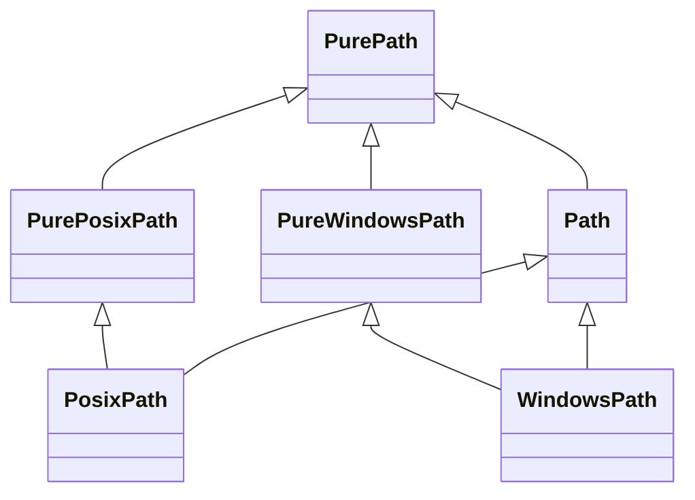
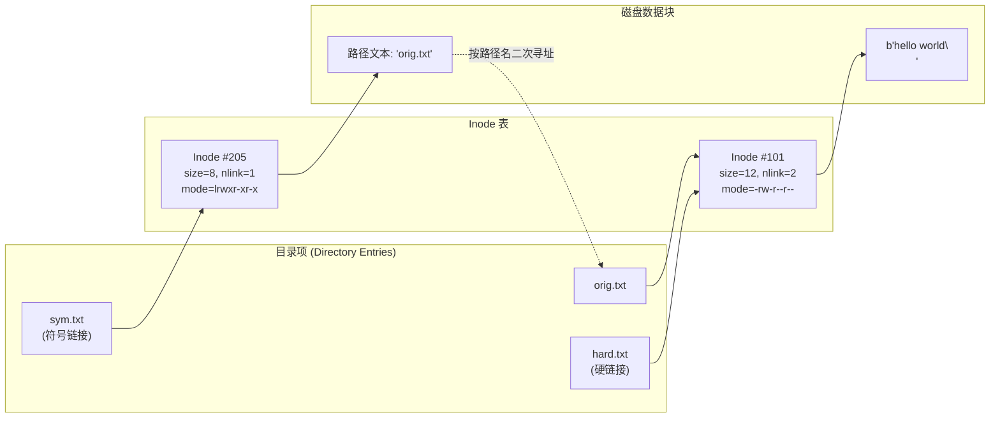
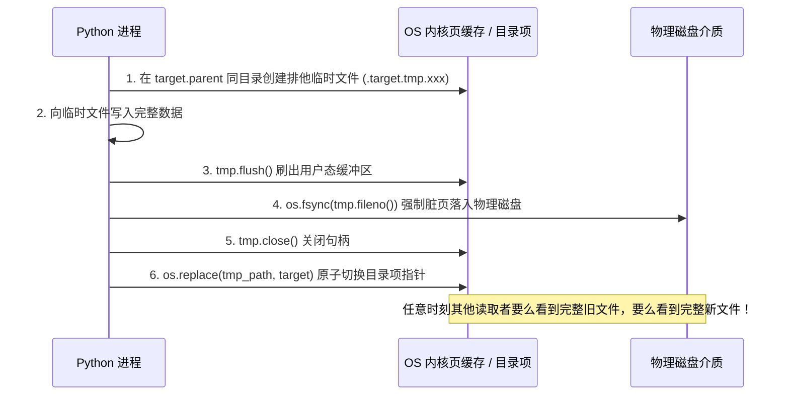

# 文件系统、路径与目录操作

在早期 Python 代码中，路径往往被当作普通字符串（`str`）处理，散落在 `os.path`、`os`、`glob` 与 `shutil` 等多个过程式模块之间——开发者不得不反复编写 `os.path.dirname(os.path.abspath(__file__))` 这类深层嵌套调用，稍有不慎还会在跨平台斜杠（`/` 与 `\`）拼接或前缀校验上埋下安全隐患。

现代 Python 以 **`pathlib.Path` 面向对象路径模型**为核心，将路径词法解析、目录树遍历、元数据查询与基本文件读写收拢到了统一的对象接口之下；再配合 `shutil` 高阶目录树工具、`tempfile` 安全临时空间以及 `os.fsync` + `os.replace` 原子落盘原语，即可构建出跨平台一致、并发安全且崩溃自愈的生产级文件操作层。

---

## 面向对象路径模型（`pathlib.Path`）

### 纯路径（`PurePath`）与具体路径（`Path`）的职责分层

`pathlib` 将“路径字符串词法运算”与“真实操作系统 I/O 系统调用”严格解耦为两层继承体系：



| 类型家族 | 代表类 | 是否发起系统调用 | 核心适用场景 |
| :--- | :--- | :--- | :--- |
| **纯路径（Pure Paths）** | `PurePath`、`PurePosixPath`、`PureWindowsPath` | **绝不访问磁盘** | 纯内存路径拼接、拆分与跨平台解析（例如在 Linux 日志分析服务中解析采集自 Windows 客户端的 `C:\Users\app\error.log`） |
| **具体路径（Concrete Paths）** | `Path`（自动实例化为 `PosixPath` 或 `WindowsPath`） | **支持磁盘 I/O** | 日常业务开发首选：除继承全部纯路径词法属性外，直接提供 `stat()`、`iterdir()`、`walk()`、`open()`、`mkdir()` 等系统交互方法 |

实例化基类 `Path(...)` 时，`pathlib` 会根据当前解释器所在的 `os.name` 自动返回对应的具体子类（在 Linux/macOS 上返回 `PosixPath`，在 Windows 上返回 `WindowsPath`）。若尝试在 POSIX 系统上直接实例化具体类 `WindowsPath("C:/Temp")`，Python 会立即抛出 `UnsupportedOperation`（3.13+，`NotImplementedError` 的子类），因为当前内核不支持 Windows 文件系统调用；此时应改用纯路径 `PureWindowsPath`：

```python
from pathlib import Path, PurePosixPath, PureWindowsPath

# 在任意操作系统（包括 Linux / macOS）上安全解析 Windows 路径词法结构
win_log = PureWindowsPath(r"C:\ProgramData\Kosmigen\logs\worker.2026.log.gz")
assert win_log.drive == "C:"
assert win_log.root == "\\"
assert win_log.anchor == "C:\\"
assert win_log.name == "worker.2026.log.gz"

# 在任意操作系统上生成标准 POSIX 远端路径（如对象存储 Key 或 SFTP 路径）
s3_key = PurePosixPath("datasets") / "2026" / "train.parquet"
assert str(s3_key) == "datasets/2026/train.parquet"

# 具体路径实现了 os.PathLike 协议，可直接传给 open()、os、shutil 等所有标准库函数
local_path = Path("docs") / "notes" / "overview.md"
assert hasattr(local_path, "__fspath__")
```

### `/` 运算符拼接、核心组成部分拆解与路径变换

`PurePath` 重载了除法运算符 `__truediv__`（`/`），用于替代繁琐的 `os.path.join()`，并自动归一化多余的连续斜杠或点号目录 `'.'`。路径对象的各个组成部分均暴露为只读属性，无需手动做脆弱的 `split(".")` 或 `rsplit("/", 1)`：

| 属性 / 方法 | 返回值示例（以 `Path("/srv/data/archive.tar.gz")` 为例） | 语义说明 |
| :--- | :--- | :--- |
| `p.parts` | `('/', 'srv', 'data', 'archive.tar.gz')` | 按平台分隔符拆解后的不可变组件元组 |
| `p.parent` | `Path('/srv/data')` | 词法上的直接父目录（不解析 `..` 或符号链接） |
| `p.parents` | `[Path('/srv/data'), Path('/srv'), Path('/')]` | 所有祖先目录组成的不可变序列（支持索引 `p.parents[1]` 与切片） |
| `p.name` | `'archive.tar.gz'` | 路径最后一段完整文件名（含全部扩展名） |
| `p.stem` | `'archive.tar'` | 去除**最后一段后缀**后的主文件名 |
| `p.suffix` | `'.gz'` | **最后一段**扩展名（带前导点 `'.'`，无扩展名时为 `''`） |
| `p.suffixes` | `['.tar', '.gz']` | 全部扩展名组成的列表 |
| `p.with_name(new)` | `p.with_name("index.json")` -> `Path('/srv/data/index.json')` | 替换整个 `name`，保持父目录不变 |
| `p.with_stem(new)` | `p.with_stem("backup.tar")` -> `Path('/srv/data/backup.tar.gz')` | 仅替换 `stem`，保留最后一段 `suffix` |
| `p.with_suffix(ext)` | `p.with_suffix(".xz")` -> `Path('/srv/data/archive.tar.xz')` | 替换最后一段 `suffix`（传入 `""` 则移除最后一段后缀） |

```python
from pathlib import PurePosixPath

archive = PurePosixPath("/srv/data/2026/archive.tar.gz")

# 1. 组件拆解
assert archive.parts == ("/", "srv", "data", "2026", "archive.tar.gz")
assert archive.parent == PurePosixPath("/srv/data/2026")
assert archive.parents[1] == PurePosixPath("/srv/data")
assert archive.name == "archive.tar.gz"
assert archive.stem == "archive.tar"
assert archive.suffix == ".gz"
assert archive.suffixes == [".tar", ".gz"]

# 2. 不可变路径变换（原对象不变，返回新路径实例）
checksum_file = archive.with_name(f"{archive.name}.sha256")
assert checksum_file == PurePosixPath("/srv/data/2026/archive.tar.gz.sha256")

recompressed = archive.with_suffix(".zst")
assert recompressed == PurePosixPath("/srv/data/2026/archive.tar.zst")

# 若需彻底剥离多级复合扩展名（如 .tar.gz），可循环剥离或基于 suffixes 计算
pure_stem = archive.name.removesuffix("".join(archive.suffixes))
assert pure_stem == "archive"
```

!!! warning "警惕 `/` 拼接右侧包含前导斜杠时的覆盖行为"

    与 `os.path.join()` 相同，当 `/` 右侧的操作数是一个**绝对路径**（例如以 `"/"` 开头）时，左侧已拼接的所有父路径前缀会被**静默丢弃并直接重置为右侧根路径**：

    ```python
    from pathlib import PurePosixPath

    base = PurePosixPath("/var/app/uploads")
    # 右侧以 "/" 开头，左侧 /var/app/uploads 被完全覆盖！
    assert (base / "/etc/passwd") == PurePosixPath("/etc/passwd")
    ```

    拼接外部输入路径片段前，绝不能假设 `base / untrusted` 一定落在 `base` 之下——必须配合下文的 `resolve()` + `is_relative_to()` 执行边界校验。

对于中小型配置文件或状态文件，`Path` 还提供了免写 `with open(...)` 样板代码的快捷读写方法（底层自动打开并确保关闭文件句柄）：

- `p.read_text(encoding="utf-8")` / `p.write_text(data, encoding="utf-8")`：一次性读写完整文本（**务必显式传入 `encoding="utf-8"`**）；
- `p.read_bytes()` / `p.write_bytes(b"...")`：一次性读写完整原始字节；
- `p.mkdir(parents=True, exist_ok=True)`：递归创建缺失的多级父目录，且目录已存在时不抛异常（对标 `mkdir -p`）。

### 工作目录 `Path.cwd()` vs 脚本锚定目录 `Path(__file__).resolve().parent`

新手最常踩中的部署故障之一是：**在本地 IDE 里运行正常的脚本，一旦放到 `cron` 定时任务、CI 流水线或上级目录执行就报 `FileNotFoundError`**。根源在于混淆了“进程当前工作目录”与“源码文件所在目录”：

- **`Path.cwd()`（Current Working Directory）**：返回**启动 Python 进程时用户所在的终端目录**。任何相对路径（如 `Path("configs/app.toml")`）都是相对于 `Path.cwd()` 解析的；只要换一个目录调用脚本，相对路径就会整体漂移。
- **`Path(__file__).resolve().parent`（脚本物理锚点）**：`__file__` 记录了当前 `.py` 模块文件自身的路径；先调用 `.resolve()` 将其转换为消除了软链接和 `..` 的规范绝对路径，再取 `.parent`，就能得到**与进程启动位置彻底无关**的固定基准目录。

```python
from pathlib import Path

# 假设项目结构为：project_root/src/app/loader.py 与 project_root/configs/default.toml
# 在真实模块中写为：MODULE_DIR = Path(__file__).resolve().parent
simulated_file = Path("/opt/kosmigen/src/app/loader.py")
module_dir = simulated_file.resolve().parent
project_root = module_dir.parents[1]  # 向上回溯两级定位仓库根目录
config_path = project_root / "configs" / "default.toml"

assert config_path == Path("/opt/kosmigen/configs/default.toml")

# 解析用户主目录（跨平台兼容 Linux/macOS 的 HOME 与 Windows 的 USERPROFILE）
user_cache = Path("~/.cache/kosmigen").expanduser()
assert user_cache == Path.home() / ".cache" / "kosmigen"
```

### 安全边界校验：`resolve()` 与 `is_relative_to()` 防目录穿越漏洞

在 Web 文件下载接口、多租户附件存储或插件资源加载器中，如果直接将客户端传入的文件名拼接到根目录下读取，攻击者可以通过以下三种经典手法触发**目录穿越漏洞（Path Traversal / CWE-22）**：

1. **相对回溯序列**：传入 `../../../etc/passwd` 跳出沙箱根目录；
2. **绝对路径重置**：传入 `/etc/shadow` 利用 `/` 运算符直接覆盖左侧根目录；
3. **同前缀旁路目录绕过**：若开发者错误地用字符串前缀 `str(target).startswith(str(root))` 校验，当根目录为 `/srv/uploads` 时，攻击者传入 `../uploads_backup/db.sql` 解析为 `/srv/uploads_backup/db.sql`，字符串前缀匹配居然返回 `True`！

标准库正确且唯一的防御范式是：**先对沙箱根目录和候选目标路径分别调用 `.resolve()`（消解全部 `..`、`.` 并追踪所有符号链接到真实物理路径），再用 `candidate.is_relative_to(safe_root)` 按路径组件粒度做严格归属判定**：

```python
from pathlib import Path
import tempfile


class PathTraversalError(PermissionError):
    """检测到越界访问沙箱目录外部的路径请求。"""


def safe_join(sandbox_root: Path, untrusted_path: str) -> Path:
    """将不可信路径安全限制在 sandbox_root 内部，拦截 ../、绝对路径与恶意软链接。"""
    root_resolved = sandbox_root.resolve()
    # 即使 untrusted_path 是 "/etc/passwd" 或 "../../secret" 或指向外部的软链接，
    # resolve() 都会算出最终真实物理绝对路径
    candidate_resolved = (root_resolved / untrusted_path).resolve()

    if not candidate_resolved.is_relative_to(root_resolved):
        raise PathTraversalError(
            f"路径越界拒绝访问: {untrusted_path!r} -> {candidate_resolved}"
        )
    return candidate_resolved


with tempfile.TemporaryDirectory() as tmp:
    base = Path(tmp)
    sandbox = base / "uploads"
    sibling_secret = base / "uploads_secret"
    sandbox.mkdir()
    sibling_secret.mkdir()

    normal_file = sandbox / "2026" / "report.pdf"
    normal_file.parent.mkdir()
    normal_file.write_bytes(b"%PDF-1.7")

    secret_file = sibling_secret / "keys.pem"
    secret_file.write_text("PRIVATE KEY", encoding="utf-8")

    # 在沙箱内部植入一个指向沙箱外机密文件的恶意符号链接
    evil_symlink = sandbox / "innocent_link.txt"
    evil_symlink.symlink_to(secret_file)

    # 1. 合法子路径顺利通过
    resolved = safe_join(sandbox, "2026/../2026/report.pdf")
    assert resolved == normal_file.resolve()

    # 2. 拦截 ../ 穿越、绝对路径覆盖、同前缀旁路目录与恶意符号链接逃逸
    for payload in [
        "../../etc/passwd",
        "/etc/passwd",
        "../uploads_secret/keys.pem",
        "innocent_link.txt",
    ]:
        blocked = False
        try:
            safe_join(sandbox, payload)
        except PathTraversalError:
            blocked = True
        assert blocked, f"未能拦截攻击载荷: {payload}"
```

---

## 目录遍历、模式筛选与异常容错

### `iterdir()`、`glob()` / `rglob()` 与 `fnmatch`

针对不同深度的目录检索需求，Python 提供了从单层枚举到通配符匹配的组合工具：

1. **`Path.iterdir()`**：惰性迭代当前目录下的**直接子项**（不含 `.` 和 `..`，不递归进入子目录，结果顺序取决于底层文件系统，需确定性顺序时套一层 `sorted()`）。底层封装了 `os.scandir()`，遍历大目录时比先构造完整列表省内存。
2. **`Path.glob(pattern)` 与 `Path.rglob(pattern)`**：支持通配符 `*`（单层任意字符）、`?`（单个字符）、`[seq]`（字符集）以及 `**`（跨任意层级目录递归匹配）。`p.rglob("*.py")` 等价于 `p.glob("**/*.py")`。
3. **`fnmatch` 与 `Path.full_match()`**：当已经拿到了路径或文件名字符串列表（例如从 `Path.walk()` 或 Git 变更清单获取），**不应再次访问磁盘跑 `glob`**，而应使用纯内存模式匹配：
   - `fnmatch.fnmatch(name, pat)`：遵循宿主操作系统的大小写敏感规则（Linux 区分大小写，Windows 不区分）；
   - `fnmatch.fnmatchcase(name, pat)`：跨平台强制区分大小写；
   - `Path.full_match(pat)`（Python 3.13+）：支持包含 `**` 递归通配符的纯内存路径匹配。

```python
import fnmatch
from pathlib import Path, PurePosixPath
import tempfile

with tempfile.TemporaryDirectory() as tmp:
    root = Path(tmp)
    (root / "src" / "pkg").mkdir(parents=True)
    (root / "src" / "main.py").write_text("# main\n", encoding="utf-8")
    (root / "src" / "pkg" / "utils.py").write_text("# utils\n", encoding="utf-8")
    (root / "README.md").write_text("# readme\n", encoding="utf-8")

    # iterdir() 只枚举顶层直接子项：src 与 README.md
    top_names = sorted(p.name for p in root.iterdir())
    assert top_names == ["README.md", "src"]

    # rglob("*.py") 递归检索所有层级的 Python 源文件
    py_rel_paths = sorted(p.relative_to(root).as_posix() for p in root.rglob("*.py"))
    assert py_rel_paths == ["src/main.py", "src/pkg/utils.py"]

# 纯内存通配符筛选（不触发任何磁盘 I/O）
assert fnmatch.fnmatchcase("worker_01.py", "worker_[0-9][0-9].py") is True
assert PurePosixPath("src/pkg/utils.py").full_match("src/**/*.py") is True
```

### Python 3.12+ 原生 `Path.walk()` 深度实战：目录剪枝与并发容错

虽然 `rglob("*.py")` 写起来简短，但它在大型工程仓库中有一个致命性能缺陷：**无法在深入递归前跳过黑名单目录**。如果仓库下有包含 5 万个文件的 `node_modules`、`.venv` 或 `.git`，`rglob("*.py")` 依然会把这 5 万个无关目录和文件全部遍历一遍！

Python 3.12 正式引入了原生的 **`Path.walk(top_down=True, on_error=None, follow_symlinks=False)`**，每次迭代产出三元组 `(dirpath, dirnames, filenames)`：

- `dirpath` 直接是 `Path` 实例（相比旧式 `os.walk` 省去了手工 `Path(dirpath)` 转换）；
- `dirnames` 与 `filenames` 均为当前层级的名称字符串列表（`list[str]`）；
- **子树剪枝（Pruning）**：在默认 `top_down=True`（自顶向下先序遍历）模式下，`Path.walk` 允许调用方**原地修改（In-place Mutation）`dirnames` 列表**（如 `dirnames[:] = [...]` 或 `dirnames.remove(...)`），被剔除的子目录将**完全不会被后续递归访问**；
- **两层异常容错**：
  1. **目录无读取权限（`PermissionError`）**：进入受限子目录（如 `/root` 或权限 `0o000` 的目录）时，`scandir` 抛出的 `OSError` 会交给 `on_error` 回调函数处理，记录告警即可继续扫描其余目录树，不会导致整个任务崩溃；
  2. **扫描期文件并发消失（`FileNotFoundError`）**：文件系统并非静态快照！在 `walk` 列出 `filenames` 之后、业务代码调用 `(dirpath / name).stat()` 之前的微秒级窗口内，其他进程可能刚好删除了临时文件（如 Vim `.swp`、编译器中间产物或轮转日志）。这种经典的 **TOCTOU（Time-of-Check to Time-of-Use）竞态**必须用 `try ... except FileNotFoundError` 就地消化。

!!! warning "剪枝必须原地修改 `dirnames[:]`，不可重新赋值局部变量"

    写成 `dirnames = [d for d in dirnames if d not in SKIP_DIRS]` 只是让局部循环变量指向了一个新列表对象，`Path.walk` 内部持有的原列表毫不知情，黑名单目录依然会被全量遍历！必须使用切片赋值 **`dirnames[:] = [...]`** 原地修改列表内容。

```python
from dataclasses import dataclass, field
import os
from pathlib import Path
import sys
import tempfile

SKIP_DIRS = frozenset({".git", "__pycache__", "node_modules", ".venv", ".mypy_cache"})


@dataclass
class ScanReport:
    py_files: list[Path] = field(default_factory=list)
    total_bytes: int = 0
    skipped_errors: list[str] = field(default_factory=list)


def scan_python_project(root: Path) -> ScanReport:
    report = ScanReport()

    def handle_walk_error(err: OSError) -> None:
        report.skipped_errors.append(f"{type(err).__name__}: {err.filename}")

    for dirpath, dirnames, filenames in root.walk(
        top_down=True,
        on_error=handle_walk_error,
        follow_symlinks=False,  # 严防指向祖先目录的符号链接造成无限死循环
    ):
        # 1. 原地剪枝并排序：跳过重型无关目录，且保证遍历顺序跨平台确定可复现
        dirnames[:] = sorted(d for d in dirnames if d not in SKIP_DIRS)

        for name in sorted(filenames):
            if not name.endswith(".py"):
                continue
            file_path = dirpath / name
            try:
                # 使用 follow_symlinks=False 避免跟随断链或外部大文件
                st = file_path.stat(follow_symlinks=False)
            except FileNotFoundError:
                # 2. 容忍扫描中途被并发进程清理掉的瞬态文件
                continue
            except PermissionError as err:
                report.skipped_errors.append(f"PermissionError: {err.filename}")
                continue

            report.py_files.append(file_path.relative_to(root))
            report.total_bytes += st.st_size

    return report


with tempfile.TemporaryDirectory() as tmp:
    repo = Path(tmp)
    (repo / "src").mkdir()
    (repo / "src" / "core.py").write_text("x = 1\n", encoding="utf-8")

    # 构造应被剪枝跳过的重型目录
    (repo / "node_modules" / "pkg").mkdir(parents=True)
    (repo / "node_modules" / "pkg" / "ignored.py").write_text("y = 2\n", encoding="utf-8")
    (repo / "__pycache__").mkdir()
    (repo / "__pycache__" / "stale.py").write_text("z = 3\n", encoding="utf-8")

    # 在非 root 的 POSIX 环境下构造一个无权限读取的子目录验证 on_error 容错
    locked_dir = repo / "restricted"
    locked_dir.mkdir()
    expect_perm_error = sys.platform != "win32" and getattr(os, "geteuid", lambda: -1)() != 0
    if expect_perm_error:
        locked_dir.chmod(0o000)

    try:
        result = scan_python_project(repo)
        assert result.py_files == [Path("src/core.py")]
        assert result.total_bytes == len(b"x = 1\n")
        if expect_perm_error:
            assert len(result.skipped_errors) == 1
            assert "PermissionError" in result.skipped_errors[0]
    finally:
        # 恢复权限以便 TemporaryDirectory 正常清理
        if expect_perm_error:
            locked_dir.chmod(0o700)
```

---

## 文件元数据、权限与软硬链接

### `stat()` vs `lstat()`、元数据字段与断链（Broken Symlink）识别

每次调用 `p.exists()`、`p.is_file()` 或 `p.is_dir()`，底层都会触发一次系统调用获取 `os.stat_result`。如果需要同时判断文件类型、读取字节大小和修改时间，**应直接调用一次 `p.stat()`（或 `p.lstat()`）复用返回的 `stat_result` 对象**，避免在热路径中发起三四次冗余系统调用：

- **`p.stat()`**：默认 `follow_symlinks=True`，如果 `p` 是符号链接，返回的是**最终目标文件**的元数据（若目标已不存在则抛出 `FileNotFoundError`）；
- **`p.lstat()`**：等价于 `p.stat(follow_symlinks=False)`，不跟随符号链接，直接返回**符号链接文件自身**的元数据。

常用 `stat_result` 核心字段：

| 字段 | 类型与单位 | 工程要点 |
| :--- | :--- | :--- |
| `st_size` | `int`（字节） | 普通文件的精确字节长度；目录或符号链接的大小因文件系统实现而异 |
| `st_mtime_ns` | `int`（纳秒整数） | **内容最后修改时间**（推荐优先使用 `_ns` 整数后缀，避免 `float` 秒级时间戳的 IEEE 754 精度损失） |
| `st_ino` / `st_dev` | `int` | 文件的 **inode 编号**与所在挂载设备号；`(st.st_dev, st.st_ino)` 二元组在同一台机器上唯一标识一个物理文件实体 |
| `st_nlink` | `int` | 指向该 inode 的硬链接目录项计数 |
| `st_mode` | `int`（位掩码） | 同时编码了**文件类型位**（普通文件/目录/软链/套接字）与 **POSIX 权限位**（`rwxrwxrwx`） |

在自动化清理脚本或备份工具中，极易在**断链（Broken / Dangling Symlink，即目标文件已被删除的孤儿软链接）**上写出逻辑 Bug。务必牢记以下真值对照表：

| 方法调用 | 普通存在文件 | 有效符号链接（目标存在） | **断链（目标已删除的符号链接）** | 完全不存在的路径 |
| :--- | :---: | :---: | :---: | :---: |
| `p.exists()` | `True` | `True` | **`False`**（因目标不存在！） | `False` |
| `p.exists(follow_symlinks=False)` | `True` | `True` | **`True`**（软链自身仍在目录中） | `False` |
| `p.is_symlink()` | `False` | `True` | **`True`** | `False` |
| `p.is_file()` | `True` | `True`（若目标是文件） | **`False`** | `False` |

因此，判定一个路径是否为**断链**的精确条件是：`p.is_symlink() and not p.exists()`。

### 硬链接（`hardlink_to`）与符号链接（`symlink_to`）底层 inode 原理对比

在类 Unix 文件系统中，“文件名”并不直接绑定磁盘数据块，而是通过 **目录项（Directory Entry / dentry） -> inode 元数据节点 -> 磁盘数据块（Data Blocks）** 三级结构寻址：



| 对比维度 | 硬链接 `new_link.hardlink_to(target)` | 符号链接 / 软链接 `new_link.symlink_to(target)` |
| :--- | :--- | :--- |
| **底层本质** | 同一个物理文件实体的**平等别名**，直接指向目标的同一个 `st_ino` | 拥有**独立 `st_ino`** 的特殊文件，内容仅保存目标路径字符串 |
| **原文件名被 `unlink()` 删除后** | `st_nlink` 减 1；只要 `st_nlink >= 1`，**文件内容与另外的硬链接完全不受影响** | 目标一旦删除，符号链接立即失效沦为**断链（Broken Symlink）** |
| **跨文件系统 / 跨磁盘分区** | **不支持**（不同挂载分区各自维护独立的 inode 编号空间，抛 `EXDEV`） | **支持**（因为只是保存一段路径文本） |
| **链接目录** | **操作系统禁止**（防止在文件树中产生无法回收的硬链接环路） | **支持**（Windows 创建目录软链需传 `target_is_directory=True` 且可能需开发者模式权限） |

!!! note "注意 `hardlink_to` 的参数方向"

    与 `symlink_to` 完全一致，调用方对象是**即将新建的链接路径**，参数是**已存在的目标路径**：`new_link.hardlink_to(existing_target)`（早期 Python 3.8 曾短暂出现过参数反过来的 `link_to`，现已彻底废弃移除）。

```python
from pathlib import Path
import tempfile

with tempfile.TemporaryDirectory() as tmp:
    d = Path(tmp)
    orig = d / "dataset.bin"
    orig.write_bytes(b"payload-v1")

    hard = d / "dataset_hard.bin"
    sym = d / "dataset_sym.bin"

    # 创建硬链接与符号链接（注意：符号链接写入相对路径更利于整个目录迁移）
    hard.hardlink_to(orig)
    sym.symlink_to("dataset.bin")

    # 1. 硬链接与原文件共享完全相同的 (st_dev, st_ino)，且硬链接计数变为 2
    assert orig.stat().st_ino == hard.stat().st_ino
    assert orig.stat().st_nlink == 2
    # 符号链接自身（lstat）拥有独立的 inode，readlink() 可读取其记录的路径字面量
    assert sym.lstat().st_ino != orig.stat().st_ino
    assert sym.readlink() == Path("dataset.bin")

    # 2. 删除原文件名 orig：硬链接依然完好可读，而符号链接瞬间变成断链！
    orig.unlink()

    assert hard.exists() is True
    assert hard.stat().st_nlink == 1
    assert hard.read_bytes() == b"payload-v1"

    # 精确识别断链：is_symlink() 为 True，但 exists() 为 False
    assert sym.is_symlink() is True
    assert sym.exists() is False
    assert sym.exists(follow_symlinks=False) is True
```

### `chmod` 与 `stat` 模块 POSIX 权限位控制

在 Linux / macOS 服务器环境中，生成 SSH 私钥、API 凭证文件或可执行部署脚本时，必须显式收紧 POSIX 权限位，防止同机其他低权限用户偷窥敏感凭据：

- **直接赋予完整权限掩码**：使用清晰直观的八进制字面量（如 `0o600` 仅属主可读写、`0o644` 属主读写其余只读、`0o755` 属主读写执行其余读和执行）；
- **在保留现有权限基础上增量修改**：读取 `current = stat.S_IMODE(p.stat().st_mode)`，再结合 `stat` 模块常量做按位或 `|`（添加权限）或按位与取反 `& ~`（移除权限），最后用 `stat.filemode()` 输出类 `ls -l` 的可读权限串。

```python
import os
from pathlib import Path
import stat
import sys
import tempfile

with tempfile.TemporaryDirectory() as tmp:
    secret_key = Path(tmp) / "id_ed25519"
    secret_key.write_text("PRIVATE-KEY-MATERIAL\n", encoding="utf-8")

    # 1. 私钥/凭证文件标准做法：强制设为 0o600（-rw-------）
    secret_key.chmod(0o600)

    script = Path(tmp) / "deploy.sh"
    script.write_text("#!/usr/bin/env sh\necho ok\n", encoding="utf-8")
    script.chmod(0o644)

    # 2. 在原有权限基础上增量添加属主可执行位（u+x），并彻底剥离组和其他用户写权限（go-w）
    current_mode = stat.S_IMODE(script.stat().st_mode)
    new_mode = (current_mode | stat.S_IXUSR) & ~(stat.S_IWGRP | stat.S_IWOTH)
    script.chmod(new_mode)

    if sys.platform != "win32":
        assert stat.S_IMODE(secret_key.stat().st_mode) == 0o600
        assert stat.filemode(secret_key.stat().st_mode) == "-rw-------"
        assert stat.S_IMODE(script.stat().st_mode) == 0o744
        assert os.access(script, os.X_OK) is True
```

---

## 高级目录操作、临时空间与工业级原子写入

### `shutil` 高阶文件树工具箱

`pathlib.Path` 故意只提供单文件/空目录的基础原语（例如 `Path.rmdir()` 遇到非空目录会抛 `OSError`），涉及跨设备移动、整棵目录树递归拷贝/删除与系统磁盘探测时，标准搭档是 **`shutil` 模块**：

| 函数 | 核心能力与工程细节 |
| :--- | :--- |
| `shutil.copyfile(src, dst)` | 仅流式复制文件字节内容，不复制权限位与时间戳 |
| `shutil.copy(src, dst)` | 复制文件内容 + POSIX 权限位（`dst` 可以是目标目录路径） |
| **`shutil.copy2(src, dst)`** | 复制文件内容 + 权限位 + **`mtime` 等完整文件系统元数据**（备份与归档整理首选） |
| `shutil.copytree(src, dst, dirs_exist_ok=True, ignore=...)` | 递归拷贝整棵目录树；`dirs_exist_ok=True` 允许合并写入已存在的目标目录，配合 `shutil.ignore_patterns("*.pyc", "__pycache__")` 过滤垃圾文件 |
| `shutil.move(src, dst)` | 同一文件系统内直接执行零拷贝重命名；跨磁盘分区时自动退化为 `copy2` + 删除源路径 |
| `shutil.rmtree(path, onexc=...)` | 递归删除整棵非空目录树（Python 3.12+ 推荐使用 `onexc` 回调处理 Windows 只读文件删除失败，替代已废弃的 `onerror`） |
| `shutil.which(cmd)` | 在环境变量 `PATH` 中定位可执行文件的绝对路径（对标 Shell 的 `which`，调用外部 CLI 前必做预检） |
| `shutil.disk_usage(path)` | 返回命名元组 `(total, used, free)`（单位字节），在落盘超大导出包或模型权重前预检剩余空间 |

```python
import os
from pathlib import Path
import shutil
import stat
import tempfile

with tempfile.TemporaryDirectory() as tmp:
    work = Path(tmp)
    src_dir = work / "src_pkg"
    (src_dir / "__pycache__").mkdir(parents=True)
    (src_dir / "app.py").write_text("print('hi')\n", encoding="utf-8")
    (src_dir / "__pycache__" / "app.cpython-314.pyc").write_bytes(b"\x00\x01")

    # 1. copytree 配合 ignore_patterns 过滤缓存产物，并支持合并到已存在目录
    dst_dir = work / "release_pkg"
    dst_dir.mkdir()
    shutil.copytree(
        src_dir,
        dst_dir,
        dirs_exist_ok=True,
        ignore=shutil.ignore_patterns("__pycache__", "*.pyc"),
    )
    assert (dst_dir / "app.py").is_file()
    assert not (dst_dir / "__pycache__").exists()

    # 2. rmtree 配合 Python 3.12+ onexc 自动解除只读属性后重试删除
    readonly_file = dst_dir / "locked.cfg"
    readonly_file.write_text("lock=1\n", encoding="utf-8")
    readonly_file.chmod(stat.S_IREAD)

    def remove_readonly(func, path, exc: BaseException) -> None:
        if isinstance(exc, PermissionError):
            os.chmod(path, stat.S_IWRITE | stat.S_IREAD)
            func(path)
        else:
            raise exc

    shutil.rmtree(dst_dir, onexc=remove_readonly)
    assert not dst_dir.exists()

    # 3. 探测系统可执行程序与当前挂载分区剩余空间
    usage = shutil.disk_usage(work)
    assert usage.total > 0 and usage.free >= 0
    assert shutil.which("python3") is not None or shutil.which("python") is not None
```

### `tempfile` 安全临时空间与 Python 3.12+ `delete_on_close=False`

在多进程并发任务或服务器后台作业中，**严禁手工硬编码诸如 `Path("/tmp/export.csv")` 的固定临时路径**——这不仅会在两个请求同时执行时相互覆写污染数据，还会暴露可预测路径名，在共享多用户机器上招致符号链接抢占攻击（Symlink Attack）。

标准库 `tempfile` 利用密码学随机后缀与排他创建标志（`O_CREAT | O_EXCL`）提供两类安全基础设施：

1. **`tempfile.TemporaryDirectory()`（绝大多数场景首选）**：创建一个权限为 `0o700`（仅当前用户可访问）的独立临时目录。在 `with` 块内部你可以自由用 `Path(tmp_dir) / "output.parquet"` 创建任意数量的子文件并随意开关读写，离开 `with` 块时自动递归销毁整个目录。
2. **`tempfile.NamedTemporaryFile(..., delete_on_close=False)`（Python 3.12+ 跨平台重大改进）**：
   - 在旧版 Python 中，`NamedTemporaryFile` 默认 `delete=True`，在 Linux/macOS 上打开状态下外部进程还能按文件名读取，但在 **Windows 上打开的文件持有排他共享锁**，其他进程（如 `ffmpeg`、`sqlite3` CLI）按路径打开会立刻报错 `PermissionError`；而一旦你在 `with` 块内调用 `f.close()` 释放锁，旧版又会在关闭瞬间把文件直接删掉！
   - Python 3.12 新增了 **`delete_on_close=False`**：允许你在 `with` 块中写入完毕后**先安全调用 `f.close()` 释放操作系统文件锁**，把 `f.name` 交给任何外部工具或读取函数自由打开，直到最终离开 `with` 作用域（无论是正常结束还是抛异常退出）时，才由上下文管理器确保清理删除该临时文件：

```python
from pathlib import Path
import tempfile

with tempfile.NamedTemporaryFile(
    mode="w",
    encoding="utf-8",
    suffix=".json",
    delete_on_close=False,  # Python 3.12+：关闭文件句柄时不立即删除，留到退出 with 块再删
) as tmp_file:
    tmp_path = Path(tmp_file.name)
    tmp_file.write('{"status": "ready"}\n')
    tmp_file.close()  # 释放句柄锁，在 Windows / Linux / macOS 上均可被其他句柄安全重开

    # 模拟外部消费者按路径独立打开并读取
    loaded = tmp_path.read_text(encoding="utf-8")
    assert loaded == '{"status": "ready"}\n'
    assert tmp_path.exists() is True

# 退出 with 块后，临时文件已被自动彻底清理
assert tmp_path.exists() is False
```

### 工业级原子写入模式（Atomic Write Pattern）

思考一个极其普遍的隐患：直接执行 `config_path.write_text(new_json, encoding="utf-8")`（或 `open(config_path, "w")`）更新关键配置文件、检查点索引或本地状态文件时，操作系统底层到底发生了什么？

1. `open(..., "w")` 携带 `O_TRUNC` 标志，**在写入第一个新字节之前，内核就已经把目标原有文件截断成了 0 字节**；
2. 如果在序列化或写入中途抛出异常、容器因 OOM 被 `SIGKILL` 强杀或宿主机断电，磁盘上留下的就是**半截残缺的损坏文件**，导致服务下次重启时解析崩溃，连旧版配置也一并丢失；
3. 即便没有崩溃，并发读取该文件的另一个进程或线程也可能在写入中途读到空文件或写了一半的**撕裂数据（Torn Read）**。

工业界消除“半截文件”与“并发读撕裂”的标准解法是**同目录临时文件 + `fsync` 持久化刷盘 + `os.replace` 原子替换**四步协议：



!!! warning "原子写入的两条生命线：同目录创建 + `os.fsync()`"

    1. **临时文件必须建在 `dir=target.parent`（目标文件同一目录）下**：如果默认建在 `/tmp`（往往是独立的 `tmpfs` 内存盘挂载点），而目标文件位于 `/var/lib/app`（数据盘挂载点），最后一步 `os.replace()` 会直接失败并抛出 `OSError: [Errno 18] Invalid cross-device link`（`EXDEV`），因为内核级原子重命名只能在**同一个文件系统内**修改目录项指针。
    2. **必须在 `replace` 之前执行 `flush()` + `os.fsync()`**：若省略 `os.fsync()`，断电重启时可能出现“目录项已经指向新 inode，但新文件的数据块还没来得及从内存刷入物理磁盘”，导致重启后变成全零空文件。

下面是一个可直接复用于生产代码的通用上下文管理器 `atomic_write_text`，支持保留已有目标文件的权限位，并在任意异常（含 `KeyboardInterrupt`）发生时确保清理残留临时文件：

```python
from collections.abc import Iterator
from contextlib import contextmanager
import os
from pathlib import Path
import stat
import sys
import tempfile
from typing import TextIO


@contextmanager
def atomic_write_text(
    target: Path,
    *,
    encoding: str = "utf-8",
    default_mode: int = 0o644,
) -> Iterator[TextIO]:
    """在同一目录通过临时文件 + fsync + os.replace 原子更新目标文本文件。"""
    target = Path(target)
    parent = target.parent
    parent.mkdir(parents=True, exist_ok=True)

    # 若目标文件原本已存在，记住其原有的 POSIX 权限位；否则使用 default_mode
    try:
        preserved_mode = stat.S_IMODE(target.stat().st_mode)
    except FileNotFoundError:
        preserved_mode = default_mode

    fd, raw_tmp_path = tempfile.mkstemp(
        prefix=f".{target.name}.",
        suffix=".tmp",
        dir=parent,  # 关键：强制与 target 位于同一文件系统目录
    )
    tmp_path = Path(raw_tmp_path)

    try:
        os.chmod(fd, preserved_mode) if sys.platform != "win32" else None
        with os.fdopen(fd, mode="w", encoding=encoding) as f:
            yield f
            # 正常写完后：先刷出 Python 用户态缓冲区，再强制内核落盘
            f.flush()
            os.fsync(f.fileno())

        # 文件句柄安全关闭后，执行内核级原子覆盖替换（跨 POSIX 与 Windows 均支持覆盖已存在目标）
        os.replace(tmp_path, target)

        # 进阶持久化：在 POSIX 上同步父目录元数据，确保新目录项本身也已持久化
        if sys.platform != "win32" and hasattr(os, "O_DIRECTORY"):
            dir_fd = os.open(parent, os.O_RDONLY | os.O_DIRECTORY)
            try:
                os.fsync(dir_fd)
            finally:
                os.close(dir_fd)
    except BaseException:
        # 无论发生业务异常还是 KeyboardInterrupt，确保不留任何孤儿 .tmp 文件
        tmp_path.unlink(missing_ok=True)
        raise


with tempfile.TemporaryDirectory() as tmp:
    cfg = Path(tmp) / "settings.json"

    # 1. 首次原子创建
    with atomic_write_text(cfg) as f:
        f.write('{"version": 1}\n')
    assert cfg.read_text(encoding="utf-8") == '{"version": 1}\n'

    # 2. 模拟写入新版本到一半时进程抛出异常崩溃
    try:
        with atomic_write_text(cfg) as f:
            f.write('{"version": 2, "corrupted": ')  # 半截非法 JSON
            raise RuntimeError("disk quota or serialization failure")
    except RuntimeError:
        pass

    # 旧版本文件毫发无损，且目录下没有任何残留 .tmp 垃圾文件！
    assert cfg.read_text(encoding="utf-8") == '{"version": 1}\n'
    assert list(Path(tmp).iterdir()) == [cfg]
```

---

## 练习与实战

### 练习 1：实现防穿越、防断链且限制后缀白名单的静态资源定位器

编写函数 `resolve_static_asset(static_root: Path, request_path: str, allowed_suffixes: set[str]) -> Path`，模拟 Web 静态文件服务的安全寻址逻辑，需同时满足以下要求：

1. 将客户端请求路径（如 `"/assets/css/../js/app.mjs"`，注意客户端路径常带前导 `"/"`）安全映射到 `static_root` 内部：前导 `"/"` 应被视为相对于 `static_root` 的子路径而非操作系统根目录，但任何试图通过 `..` 或恶意符号链接跳出 `static_root` 的行为都必须抛出 `PermissionError`。
2. 校验解析后的文件扩展名（忽略大小写）必须在 `allowed_suffixes`（如 `{".css", ".mjs", ".png"}`）白名单内，否则抛出 `PermissionError`。
3. 目标必须是一个真实存在的普通文件（拒绝目录和失效断链），否则抛出 `FileNotFoundError`。

??? success "点击查看答案与解析"

    **核心思路**：HTTP URL 路径常以 `"/"` 开头（如 `"/js/app.mjs"`），若直接执行 `static_root / request_path`，前导斜杠会覆盖掉 `static_root`！因此应先剥离前导 `"/"` 与 `"\\"`（`lstrip("/\\")`），再对 `static_root` 和拼接后的候选路径双双执行 `.resolve()`，通过 `is_relative_to()` 拦截一切 `..` 穿越与软链接逃逸，最后校验扩展名白名单与 `is_file()`。

    ```python
    from pathlib import Path
    import tempfile


    def resolve_static_asset(
        static_root: Path,
        request_path: str,
        allowed_suffixes: set[str],
    ) -> Path:
        root_resolved = static_root.resolve()
        # 剥离 URL 风格前导斜杠，防止 Path.__truediv__ 重置根路径
        rel_part = request_path.lstrip("/\\")
        candidate = (root_resolved / rel_part).resolve()

        # 1. 严格沙箱边界校验（同时防御 ../ 与指向外部的符号链接）
        if not candidate.is_relative_to(root_resolved) or candidate == root_resolved:
            raise PermissionError(f"禁止越界访问: {request_path!r}")

        # 2. 后缀白名单校验（统一转为小写比较）
        normalized_allow = {s.lower() for s in allowed_suffixes}
        if candidate.suffix.lower() not in normalized_allow:
            raise PermissionError(f"不允许的文件类型: {candidate.suffix!r}")

        # 3. 必须是真实存在的普通文件（拒绝目录与断链）
        if not candidate.is_file():
            raise FileNotFoundError(f"静态资源不存在: {request_path!r}")

        return candidate


    with tempfile.TemporaryDirectory() as tmp:
        base = Path(tmp)
        pub = base / "public"
        (pub / "js").mkdir(parents=True)
        app_js = pub / "js" / "app.mjs"
        app_js.write_text("export default 1;\n", encoding="utf-8")
        env_file = pub / ".env"
        env_file.write_text("SECRET=123\n", encoding="utf-8")

        outside = base / "outside.mjs"
        outside.write_text("// secret\n", encoding="utf-8")
        (pub / "js" / "escape.mjs").symlink_to(outside)

        allow = {".css", ".mjs", ".png"}

        # 合法请求（带前导斜杠与合法内部归一化）
        assert resolve_static_asset(pub, "/js/../js/app.mjs", allow) == app_js.resolve()

        # 拦截 ../ 逃逸与符号链接逃逸、拦截敏感后缀 .env
        for bad_req in ["/../../etc/passwd", "/js/escape.mjs", "/.env"]:
            try:
                resolve_static_asset(pub, bad_req, allow)
                raise AssertionError(f"应拒绝请求: {bad_req}")
            except PermissionError:
                pass

        # 不存在的文件抛 FileNotFoundError
        try:
            resolve_static_asset(pub, "/js/missing.mjs", allow)
            raise AssertionError("应抛 FileNotFoundError")
        except FileNotFoundError:
            pass
    ```

### 练习 2：使用 `Path.walk()` 编写去重硬链接且自动清理断链的目录巡检器

在包含大量硬链接快照备份的存储目录中，如果直接累加每个文件的 `st_size`，指向同一 inode 的多个硬链接会被重复计算多次，导致统计体积远大于真实磁盘占用。请基于 Python 3.12+ `Path.walk()` 编写函数 `inspect_and_prune_storage(root: Path, ignore_dirs: set[str]) -> tuple[int, list[Path]]`：

1. 使用原地修改 `dirnames[:]` 跳过 `ignore_dirs` 中的子目录；
2. 发现任何**断链（Broken Symlink）**时，记录其相对于 `root` 的路径并将其从磁盘安全删除（`unlink(missing_ok=True)`）；对有效符号链接则不计入普通文件体积且不跟随遍历；
3. 对普通文件按 `(st_dev, st_ino)` 去重累加真实物理字节大小，返回 `(unique_physical_bytes, removed_broken_links)`。

??? success "点击查看答案与解析"

    **核心思路**：在遍历 `filenames` 时，先检查 `is_symlink()`——若 `not file_path.exists()` 则判定为断链并清理，若是有效软链则直接跳过（避免重复计入目标体积）；对于普通文件调用 `stat(follow_symlinks=False)`，用集合 `seen_inodes` 记录已统计过的 `(st.st_dev, st.st_ino)` 二元组，确保多个硬链接只累加一次字节数。

    ```python
    from pathlib import Path
    import tempfile


    def inspect_and_prune_storage(
        root: Path,
        ignore_dirs: set[str],
    ) -> tuple[int, list[Path]]:
        seen_inodes: set[tuple[int, int]] = set()
        unique_bytes = 0
        removed_broken: list[Path] = []

        for dirpath, dirnames, filenames in root.walk(top_down=True, follow_symlinks=False):
            # 原地剪枝忽略目录
            dirnames[:] = sorted(d for d in dirnames if d not in ignore_dirs)

            # 注意：指向不存在目录的断链在部分平台上也可能出现在 dirnames 或 filenames 中，统一检查
            for entry_name in sorted(dirnames + filenames):
                entry = dirpath / entry_name
                if entry.is_symlink():
                    if not entry.exists():
                        removed_broken.append(entry.relative_to(root))
                        entry.unlink(missing_ok=True)
                    continue

                if entry_name in dirnames:
                    continue

                try:
                    st = entry.stat(follow_symlinks=False)
                except FileNotFoundError:
                    continue

                inode_key = (st.st_dev, st.st_ino)
                if inode_key not in seen_inodes:
                    seen_inodes.add(inode_key)
                    unique_bytes += st.st_size

        return unique_bytes, sorted(removed_broken)


    with tempfile.TemporaryDirectory() as tmp:
        storage = Path(tmp)
        (storage / "snap1").mkdir()
        (storage / "snap2").mkdir()
        (storage / ".trash").mkdir()

        # 写入 100 字节原始文件，并在 snap2 中创建指向同一 inode 的硬链接
        f1 = storage / "snap1" / "model.bin"
        f1.write_bytes(b"A" * 100)
        f2 = storage / "snap2" / "model.bin"
        f2.hardlink_to(f1)

        # 在忽略目录中放干扰文件
        (storage / ".trash" / "junk.bin").write_bytes(b"B" * 500)

        # 创建一个有效软链和一个失效断链
        (storage / "snap2" / "valid_ref.bin").symlink_to(f1)
        broken = storage / "snap2" / "dangling.bin"
        broken.symlink_to(storage / "non_existent_target.bin")

        total_bytes, cleaned = inspect_and_prune_storage(storage, ignore_dirs={".trash"})

        # 硬链接去重后真实物理体积仅为 100 字节，而非 200 字节
        assert total_bytes == 100
        assert cleaned == [Path("snap2/dangling.bin")]
        assert not broken.exists(follow_symlinks=False)
        assert (storage / "snap2" / "valid_ref.bin").is_symlink()
    ```

### 练习 3：基于原子写入实现崩溃安全的本地计数器持久化组件

实现函数 `increment_persistent_counter(state_file: Path, key: str, delta: int = 1) -> int`：

1. 如果 `state_file` 不存在，视初始状态为空字典 `{}`；若已存在，读取其中的 UTF-8 JSON 字典并将 `key` 对应的整数累加 `delta`。
2. 必须采用**同目录临时文件 + `flush()` + `os.fsync()` + `os.replace()`** 原子落盘更新 `state_file`，返回更新后的计数值。
3. 编写测试验证连续累加正确性，并模拟序列化/写入阶段故障，证明原有 JSON 状态文件不会被截断或损坏。

??? success "点击查看答案与解析"

    **核心思路**：读取旧 JSON（捕获首次运行的 `FileNotFoundError`），在内存中计算出完整的新字典并序列化为字符串，随后在 `state_file.parent` 同目录下创建排他临时文件，完成写入、`flush()` 与 `os.fsync()` 后调用 `os.replace()` 原子替换目标文件。

    ```python
    import json
    import os
    from pathlib import Path
    import tempfile


    def atomic_save_bytes(target: Path, payload: bytes) -> None:
        target.parent.mkdir(parents=True, exist_ok=True)
        fd, tmp_name = tempfile.mkstemp(
            prefix=f".{target.name}.",
            suffix=".tmp",
            dir=target.parent,
        )
        tmp_path = Path(tmp_name)
        try:
            with os.fdopen(fd, "wb") as f:
                f.write(payload)
                f.flush()
                os.fsync(f.fileno())
            os.replace(tmp_path, target)
        except BaseException:
            tmp_path.unlink(missing_ok=True)
            raise


    def increment_persistent_counter(state_file: Path, key: str, delta: int = 1) -> int:
        try:
            data = json.loads(state_file.read_text(encoding="utf-8"))
        except FileNotFoundError:
            data = {}

        new_val = int(data.get(key, 0)) + delta
        data[key] = new_val
        encoded = (json.dumps(data, ensure_ascii=False, indent=2) + "\n").encode("utf-8")
        atomic_save_bytes(state_file, encoded)
        return new_val


    with tempfile.TemporaryDirectory() as tmp:
        counter_path = Path(tmp) / "state" / "counters.json"
        assert increment_persistent_counter(counter_path, "processed_jobs") == 1
        assert increment_persistent_counter(counter_path, "processed_jobs", delta=4) == 5
        assert increment_persistent_counter(counter_path, "failed_jobs", delta=2) == 2

        snapshot_before = counter_path.read_bytes()

        # 模拟传入非法类型触发异常时，原文件保持完整且无残留临时文件
        try:
            increment_persistent_counter(counter_path, "processed_jobs", delta="bad")  # type: ignore[arg-type]
        except TypeError:
            pass

        assert counter_path.read_bytes() == snapshot_before
        assert list(counter_path.parent.iterdir()) == [counter_path]
    ```
