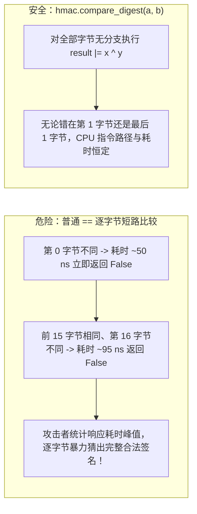

# 哈希摘要、安全随机与编码基础

在构建用户认证、API 网关验签、分布式数据分片或文件完整性校验系统时，“哈希”、“随机数”、“唯一 ID”与“Base64 编码”是出镜率最高的四组基础设施，却也是线上安全漏洞的重灾区：**把受 `PYTHONHASHSEED` 随机化影响的内置 `hash()` 写入数据库导致重启后全量失联**、**直接用裸 SHA-256 存储用户密码**、**用普通 `==` 比对签名引入时序侧信道攻击**、**用 `random` 模块生成重置密码验证码**，或是**误把 Base64 编码当成数据加密**。

本文将厘清密码学原语与通用工具之间的严格边界，深入剖析 `hashlib`、`hmac`、`secrets`、Python 3.14 全新标准库 `uuid.uuid7()` 以及 `base64` / `urllib.parse` 的工业级正确用法。

---

## 密码学哈希摘要（`hashlib`）

### 进程内随机化 `hash()` vs 密码学单向散列（`hashlib`）

初学者极易混淆 Python 内置函数 `hash(obj)` 与标准库 `hashlib`——两者的设计目标截然相反：

| 对比维度 | 内置 `hash(obj)` | `hashlib` 密码学摘要（如 SHA-256、BLAKE2b） |
| :--- | :--- | :--- |
| **核心用途** | 进程内存内 `dict` / `set` 哈希表快速寻址 | 跨进程/跨机器唯一内容指纹、防篡改校验、数字签名摘要 |
| **跨进程确定性** | **不确定！** 默认受环境变量 `PYTHONHASHSEED` 随机种子扰动，**每次重启 Python 进程都会算出完全不同的整数**（防御 HashDoS 哈希碰撞拒绝服务攻击） | **绝对确定**：相同输入字节流在任何时间、任何操作系统与编程语言中必定产出完全一致的摘要字节 |
| **输出长度与抗碰撞** | 64 位有符号整数，极易构造碰撞，**无抗逆向安全性** | 256~512 位定长字节，具备**强抗碰撞性**与**单向不可逆性** |

!!! warning "严禁将内置 `hash()` 结果持久化落盘或用于分布式分片路由"

    如果你在代码中写下 `shard_id = hash(user_id) % 16` 并将数据写入对应分库，一旦服务滚动重启，`PYTHONHASHSEED` 重新随机生成，同一个 `user_id` 就会路由到完全错误的数据库分片！跨进程持久化的确定性哈希必须改用 `hashlib`（例如 `int.from_bytes(hashlib.blake2b(user_id.encode(), digest_size=8).digest()) % 16`）。

### 主流密码学哈希算法选型

`hashlib` 底层绑定了经过硬件指令集（如 Intel/ARM SHA-NI）深度优化的 OpenSSL 与内置实现，选型时应遵循现代密码学标准：

| 算法名称 | 摘要位数 | 安全状态 | 性能与工程选型定位 |
| :--- | :---: | :--- | :--- |
| `md5` / `sha1` | 128 / 160 bit | **已攻破（存在实用级碰撞攻击）** | **严禁用于任何防伪签名、证书或安全校验**；仅在兼容老旧协议非安全校验和时传入 `usedforsecurity=False` |
| **`sha256`** / `sha512` | 256 / 512 bit | **安全（NIST SHA-2 标准）** | 现代 CPU 普遍内置硬件加速，生态兼容性最广，**软件包校验、JWT、云厂商 API 签名首选** |
| **`sha3_256`** | 256 bit | **安全（Keccak 海绵结构）** | 内部数学结构与 SHA-2 完全独立，**天然免疫长度扩展攻击（Length Extension Attack）** |
| **`blake2b`** / `blake2s` | 最高 512 / 256 bit（可自定义 `digest_size`） | **安全** | 软件纯算吞吐速度甚至快于 MD5！支持原生密钥 MAC 模式（`key=`）与域分离标签（`person=`），**高性能内容寻址与内部去重指纹首选** |

所有哈希构造器只接收**字节序列（`bytes` / `bytearray` / `memoryview`）**，传入 `str` 前必须显式 `.encode("utf-8")`：

```python
import hashlib

payload = "Kosmigen-2026-发布包".encode("utf-8")

# 1. 标准 SHA-256 十六进制摘要（64 个十六进制字符 = 32 字节 = 256 位）
sha256_hex = hashlib.sha256(payload).hexdigest()
assert len(sha256_hex) == 64

# 2. BLAKE2b 支持按需指定输出字节长度 digest_size 与业务域隔离标签 person
short_fingerprint = hashlib.blake2b(
    payload,
    digest_size=16,
    person=b"doc-dedup-v1",
).hexdigest()
assert len(short_fingerprint) == 32
```

### 流式增量 `update()` 与 Python 3.11+ `hashlib.file_digest()`

密码学哈希函数本质上是流式状态机：连续调用 `h.update(chunk1); h.update(chunk2)` 计算出的摘要，与一次性调用 `h.update(chunk1 + chunk2)` **严格等价**。

对于数 GB 的 ISO 镜像或模型权重文件，Python 3.11+ 专门提供了 **`hashlib.file_digest(fileobj, digest)`**——它直接在底层 C 代码中管理大块读取缓冲并在合适时机释放 GIL（部分平台还能直接卸载给 OpenSSL BIO 层），既免去了手写分块循环的样板代码，又比手写 Python 循环更快：

```python
import hashlib
import io
from pathlib import Path
import tempfile

# 1. 验证流式增量 update() 与单次计算结果严格一致
stream_hasher = hashlib.sha256()
for part in [b"part-alpha|", b"part-beta|", b"part-gamma"]:
    stream_hasher.update(part)

assert stream_hasher.digest() == hashlib.sha256(b"part-alpha|part-beta|part-gamma").digest()

# 2. 使用 Python 3.11+ hashlib.file_digest 高效计算二进制文件校验和
with tempfile.TemporaryDirectory() as tmp:
    artifact = Path(tmp) / "weights.bin"
    artifact.write_bytes(b"model-layer-weights-" * 10_000)

    # 注意：传入 file_digest 的流必须以二进制可读模式（"rb"）打开
    with artifact.open("rb") as f:
        digest_obj = hashlib.file_digest(f, "sha256")

    assert digest_obj.hexdigest() == hashlib.sha256(artifact.read_bytes()).hexdigest()

    # file_digest 同样支持内存二进制流 io.BytesIO
    mem_digest = hashlib.file_digest(io.BytesIO(b"hello"), "blake2b")
    assert mem_digest.hexdigest() == hashlib.blake2b(b"hello").hexdigest()
```

### 口令安全存储：为何严禁存裸 SHA-256？随机盐 + 慢哈希密钥派生（`scrypt` / `pbkdf2_hmac`）

在用户注册登录模块中，**直接执行 `hashlib.sha256(password.encode()).hexdigest()` 存入数据库是一级安全事故**，原因有二：

1. **彩虹表预计算攻击（Rainbow Table）**：没有独立随机盐值（Salt）时，全网所有使用相同常见密码的用户都会生成完全一致的哈希值，攻击者拖库后查表即可瞬间批量反查明文；
2. **GPU 高速暴力穷举**：SHA-256 的设计目标是**算得极快**——单张现代消费级显卡每秒可暴力计算超过 **100 亿次** SHA-256！即便拼接了随机盐，8 位以内的混合密码在几分钟内就会被暴力跑穿。

存储人类口令的唯一正确方式是使用**每用户独立的密码学随机盐（至少 16 字节）+ 刻意设计得“又慢又耗内存”的密钥派生函数（KDF）**：

- **`hashlib.scrypt`（标准库零依赖首选）**：属于**内存硬化（Memory-hard）算法**，计算一次不仅消耗 CPU 周期，还强制占用数 MB 连续内存随机读写（由成本参数 `n`、`r`、`p` 控制），令缺乏大容量高速显存通道的 ASIC/GPU 矿机并行优势大幅失效；
- **`hashlib.pbkdf2_hmac`（FIPS 合规兼容常用）**：通过成百上千轮（OWASP 建议 `sha256` 至少 **600,000 次迭代**）重复 HMAC 拖慢暴力破解速度（若允许引入第三方库，现代 Web 项目也常选用密码哈希竞赛冠军 `argon2-cffi` 的 Argon2id）。

```python
import base64
import hashlib
import hmac
import secrets


def hash_password(
    password: str,
    *,
    n: int = 2**14,
    r: int = 8,
    p: int = 1,
) -> str:
    """使用随机 16B 盐 + hashlib.scrypt 生成自包含的口令存储字符串。"""
    salt = secrets.token_bytes(16)
    derived_key = hashlib.scrypt(
        password.encode("utf-8"),
        salt=salt,
        n=n,
        r=r,
        p=p,
        maxmem=32 * 1024 * 1024,
        dklen=32,
    )
    salt_b64 = base64.b64encode(salt).decode("ascii")
    dk_b64 = base64.b64encode(derived_key).decode("ascii")
    # 将算法标识、成本参数、盐值与派生密钥打包为单字段自描述文本，便于日后平滑升级参数
    return f"scrypt:{n}:{r}:{p}:{salt_b64}:{dk_b64}"


def verify_password(password: str, stored_record: str) -> bool:
    """解析自描述口令哈希记录，并以恒定时间比较校验口令。"""
    algo, n_s, r_s, p_s, salt_b64, dk_b64 = stored_record.split(":")
    if algo != "scrypt":
        raise ValueError(f"不支持的口令哈希算法: {algo!r}")

    salt = base64.b64decode(salt_b64)
    expected_dk = base64.b64decode(dk_b64)
    candidate_dk = hashlib.scrypt(
        password.encode("utf-8"),
        salt=salt,
        n=int(n_s),
        r=int(r_s),
        p=int(p_s),
        maxmem=32 * 1024 * 1024,
        dklen=len(expected_dk),
    )
    # 必须使用恒定时间比较函数，防止时序侧信道泄漏！
    return hmac.compare_digest(candidate_dk, expected_dk)


# 相同明文密码两次哈希，因每次随机生成新盐，产出的存储串完全不同（彻底防御彩虹表）
rec1 = hash_password("Correct-Horse-Battery-Staple!")
rec2 = hash_password("Correct-Horse-Battery-Staple!")
assert rec1 != rec2

assert verify_password("Correct-Horse-Battery-Staple!", rec1) is True
assert verify_password("Wrong-Password", rec1) is False

# 补充对照：标准库 PBKDF2-HMAC-SHA256 调用方式
pbkdf2_dk = hashlib.pbkdf2_hmac("sha256", b"my-pass", secrets.token_bytes(16), iterations=600_000)
assert len(pbkdf2_dk) == 32
```

---

## 消息认证码与恒定时间比较（`hmac`）

### API / Webhook 签名防篡改原理：`hmac`

当支付网关或代码托管平台向你的后端推送 Webhook 回调事件时，你如何确认这段 JSON 报文确实是由合作方发出的、且在公网传输途中没有被中间人把充值金额从 `10` 篡改成 `10000`？

千万不要手写 `hashlib.sha256(secret_key + body)`！因为 SHA-256 采用 Merkle–Damgård 迭代结构，直接前缀拼接密钥会暴露给经典的**哈希长度扩展攻击（Length Extension Attack）**——攻击者无需知道 `secret_key`，仅凭旧摘要就能合法追加任意恶意后缀并算出有效的新摘要。

标准解法是使用 RFC 2104 定义的**哈希消息认证码 `hmac` 模块**（通过内外两层异或填充掩码彻底封死长度扩展漏洞）：

- 流式增量计算：`mac = hmac.new(secret_key, msg=None, digestmod=hashlib.sha256)`；
- 单次快速计算（Python 3.7+ C 加速路径）：`hmac.digest(secret_key, msg, "sha256")`。

### 为什么 `==` 存在短路时序侧信道漏洞？必须使用 `hmac.compare_digest`

算出服务端期望的签名 `expected_sig` 后，如果直接写 `if client_sig == expected_sig:`，就埋下了一颗隐蔽的**时序侧信道攻击（Timing Attack）**地雷：



- **普通 `==` 的短路优化**：为了性能，Python 的 `str.__eq__` 和 `bytes.__eq__` 一旦发现第 `0` 个字节不相等就立即退出循环返回 `False`。攻击者先固定后 31 个字节，遍历测试第 `0` 字节的 256 种取值——**唯独猜中正确首字节的那组请求会进入第 `1` 字节的比较，平均耗时略微变长**！利用统计学多次采样滤除网络抖动，攻击者只需几万次请求即可在线性时间内逐字节破解整个签名。
- **`hmac.compare_digest(a, b)` 的恒定时间承诺**：只要 `a` 与 `b` 类型一致（同为 `bytes` 或同为纯 ASCII `str`）且长度相等，底层 C 函数会完整扫描每一个字节做按位异或或运算而不提前跳转退出，从根源上抹平耗时差异：

```python
import hashlib
import hmac
import time


def sign_webhook_payload(secret: bytes, timestamp: int, raw_body: bytes) -> str:
    """签发带时间戳绑定的 Webhook 签名（格式对标主流云服务 v1=<hex>）。"""
    # 将时间戳与原始请求体用分隔符绑定在一起签名，防止攻击者截获旧合法报文做重放攻击
    signing_input = f"{timestamp}.".encode("ascii") + raw_body
    digest_hex = hmac.new(secret, signing_input, hashlib.sha256).hexdigest()
    return f"v1={digest_hex}"


def verify_webhook_request(
    secret: bytes,
    timestamp: int,
    raw_body: bytes,
    signature_header: str,
    *,
    now_epoch: int,
    tolerance_seconds: int = 300,
) -> bool:
    """校验时间戳新鲜度（防重放）并使用 hmac.compare_digest 恒定时间验签。"""
    if abs(now_epoch - timestamp) > tolerance_seconds:
        return False

    expected = sign_webhook_payload(secret, timestamp, raw_body)
    # 确保传入 compare_digest 的两端均为纯 ASCII 字符串（或均为 bytes）
    if not signature_header.isascii():
        return False
    return hmac.compare_digest(expected, signature_header)


webhook_secret = b"whsec_live_9f8e7d6c5b4a3210"
now_ts = int(time.time())
body = b'{"event":"invoice.paid","amount":2900}'

valid_sig = sign_webhook_payload(webhook_secret, now_ts, body)

# 1. 合法请求验签通过
assert verify_webhook_request(webhook_secret, now_ts, body, valid_sig, now_epoch=now_ts) is True

# 2. 篡改请求体中的任意 1 个字节 -> 验签拒绝
tampered_body = b'{"event":"invoice.paid","amount":9900}'
assert verify_webhook_request(webhook_secret, now_ts, tampered_body, valid_sig, now_epoch=now_ts) is False

# 3. 截获 10 分钟前的合法旧报文重放 -> 超出 300s 窗口被拒绝
assert (
    verify_webhook_request(webhook_secret, now_ts - 600, body, valid_sig, now_epoch=now_ts)
    is False
)
```

---

## 伪随机（`random`）与密码学安全随机（`secrets`）

### 梅森旋转伪随机 vs 操作系统熵池安全随机

Python 标准库同时提供 `random` 与 `secrets` 两个随机模块，它们服务于两条绝不可混用的工程轨道：

| 维度 | `random` 模块（PRNG） | `secrets` 模块（CSPRNG） |
| :--- | :--- | :--- |
| **底层算法 / 熵源** | **MT19937 梅森旋转算法**（纯数学递推，内部状态仅 624 个 `uint32`） | **操作系统内核密码学熵源**（`os.urandom`：硬件中断噪声 + ChaCha20/AES-CTR 确定性随机比特生成器） |
| **可预测性** | **完全可预测！** 观察连续 624 次 `getrandbits(32)` 输出即可 100% 逆向克隆生成器并预测未来一切输出 | **计算上不可预测**，即使掌握此前生成的亿万个令牌也无法推测下一个比特 |
| **可复现性（Seed）** | **支持指定种子 `seed` 精确复现序列** | **不支持设种子**（每次必定真随机） |
| **适用场景** | 数据集划分洗牌、蒙特卡洛仿真、AB 实验分流模拟、游戏非博彩随机 | **API Key、Session Token、CSRF 令牌、短信验证码、密码重置链接、加密盐/IV** |

### `random` 工程实践：用独立实例 `random.Random(seed)` 避免污染全局状态

在单元测试或科学实验中需要“固定随机种子以复现结果”时，**切忌直接调用模块顶层的 `random.seed(42)`**！因为模块级函数共享同一个进程全局默认实例——你在某个工具函数里重置了全局种子，会导致同一进程内其他组件（如负载均衡随机抖动 Retry Jitter 或并发线程）的随机序列全部被意外重置甚至重复。

正确做法是**显式实例化彼此隔离的 `rng = random.Random(seed)` 对象**，并掌握四大抽样原语的区别：

- `rng.choice(seq)`：从非空序列中等概率抽取 1 个元素；
- `rng.choices(population, weights=..., k=n)`：**有放回抽样**（支持权重列表 `weights` 或累积权重 `cum_weights`，同一元素可能被重复抽中多次）；
- `rng.sample(population, k=n)`：**无放回抽样**（保证选出的 `k` 个元素互不重复，常用于抽奖或拆分验证集，原序列保持不变）；
- `rng.shuffle(mutable_seq)`：基于 Fisher–Yates 算法**原地打乱**可变列表（返回值为 `None`）。

```python
import random

# 两个独立实例拥有完全隔离的 MT19937 状态，互不干扰且可 100% 确定性复现
rng_a = random.Random(2026)
rng_b = random.Random(2026)

items = ["alpha", "beta", "gamma", "delta", "epsilon"]
# 无放回抽取 3 个不重复样本
sample_a = rng_a.sample(items, k=3)
sample_b = rng_b.sample(items, k=3)
assert sample_a == sample_b and len(set(sample_a)) == 3

# 有放回加权抽样（例如按 90% / 10% 灰度流量比例路由）
routed = rng_a.choices(["stable_v1", "canary_v2"], weights=[90, 10], k=100)
assert len(routed) == 100 and set(routed).issubset({"stable_v1", "canary_v2"})

# 原地洗牌
deck = [1, 2, 3, 4, 5]
rng_a.shuffle(deck)
assert sorted(deck) == [1, 2, 3, 4, 5]
```

### `secrets` 模块：生成安全 API Key、会话令牌与无偏验证码

凡是涉及身份凭证与权限校验的随机值，一律使用 `secrets` 模块提供的四个核心函数：

1. **`secrets.token_bytes(nbytes=32)`**：返回 `nbytes` 个原始密码学随机字节（适合 AES 密钥、HMAC 密钥、口令盐值）。
2. **`secrets.token_hex(nbytes=32)`**：返回十六进制字符串。**务必注意字节数与字符数的 2 倍关系**：每个字节对应 2 个十六进制字符，因此 `token_hex(16)` 返回的是 **32 个字符**的字符串！
3. **`secrets.token_urlsafe(nbytes=32)`**：返回去除末尾 `=` 填充的 URL 安全 Base64 字符串（每 3 字节编码为 4 字符，`token_urlsafe(24)` 恰好产出整洁的 32 字符高熵令牌，具备 192 bit 熵强度）。
4. **`secrets.randbelow(exclusive_upper_bound)` 与 `secrets.choice(seq)`**：底层采用拒绝采样（Rejection Sampling）消除了取模偏差（Modulo Bias），确保 `[0, n)` 内每个整数出现概率严格均等。

```python
import secrets
import string

# 1. 生成带可识别前缀的 192-bit 高熵 API Key（便于 GitHub Secret Scanning 自动识别泄漏）
api_key = f"ksm_live_{secrets.token_urlsafe(24)}"
assert api_key.startswith("ksm_live_") and len(api_key) == len("ksm_live_") + 32

# 2. 注意 token_hex(nbytes) 参数是字节数而非字符长度！
hex_session_id = secrets.token_hex(16)  # 16 字节 = 128 bit 熵 = 32 个 hex 字符
assert len(hex_session_id) == 32

# 3. 生成严格等概率的 6 位数字验证码（自动前补零，如 "004829"）
otp_code = f"{secrets.randbelow(1_000_000):06d}"
assert len(otp_code) == 6 and otp_code.isdigit()

# 4. 生成保证同时包含大小写字母、数字与特殊符号的 16 位随机初始密码
alphabet = string.ascii_letters + string.digits + "!@#%^&*"
while True:
    temp_pwd = "".join(secrets.choice(alphabet) for _ in range(16))
    if (
        any(c.islower() for c in temp_pwd)
        and any(c.isupper() for c in temp_pwd)
        and any(c.isdigit() for c in temp_pwd)
        and any(c in "!@#%^&*" for c in temp_pwd)
    ):
        break
assert len(temp_pwd) == 16
```

---

## 全局唯一标识符（`uuid`）与通用传输编码

### `uuid4` vs Python 3.14 新增 `uuid7`（时间戳单调有序 ID）与 `uuid5`

在分布式微服务与分库分表架构中，自增整数主键（`AUTO_INCREMENT`）不仅依赖中心化数据库协调，对外暴露在 URL 中（如 `/orders/10042`）还会让竞争对手轻易遍历爬虫并推算全站每日订单量。因此 128 位的 **UUID（RFC 9562）** 成为了分布式标识事实标准。

然而长期以来用 `uuid.uuid4()`（纯随机）直接充当关系型数据库主键一直存在一个著名的存储引擎痛点：**聚簇索引随机页分裂（B+ Tree Page Splitting）**。**Python 3.14 在标准库 `uuid` 模块中正式原生内置了新一代行业标准 `uuid.uuid7()`**，彻底化解了这一矛盾：

```text
UUIDv7 128-bit 二进制位布局 (RFC 9562):
 0                   1                   2                   3
 0 1 2 3 4 5 6 7 8 9 0 1 2 3 4 5 6 7 8 9 0 1 2 3 4 5 6 7 8 9 0 1
+-+-+-+-+-+-+-+-+-+-+-+-+-+-+-+-+-+-+-+-+-+-+-+-+-+-+-+-+-+-+-+-+
|                           unix_ts_ms                          |
+-+-+-+-+-+-+-+-+-+-+-+-+-+-+-+-+-+-+-+-+-+-+-+-+-+-+-+-+-+-+-+-+
|          unix_ts_ms           |  ver  |       rand_a          |
+-+-+-+-+-+-+-+-+-+-+-+-+-+-+-+-+-+-+-+-+-+-+-+-+-+-+-+-+-+-+-+-+
|var|                        rand_b                             |
+-+-+-+-+-+-+-+-+-+-+-+-+-+-+-+-+-+-+-+-+-+-+-+-+-+-+-+-+-+-+-+-+
|                            rand_b                             |
+-+-+-+-+-+-+-+-+-+-+-+-+-+-+-+-+-+-+-+-+-+-+-+-+-+-+-+-+-+-+-+-+
* 高 48 bit: Unix 毫秒级时间戳（字典序天然按创建时间递增，可用至公元 10889 年）
* ver (4 bit): 版本号 0111 (7)    * var (2 bit): RFC 变体位 10
* 其余 74 bit: 单调计数器与密码学安全随机比特（防同毫秒内多机并发碰撞）
```

| UUID 版本 | 标准库函数 | 生成机制与有序性 | 最佳适用场景 |
| :--- | :--- | :--- | :--- |
| **UUIDv4** | `uuid.uuid4()` | 122 位纯密码学随机，**完全无序** | 不揭示生成时间的外部公开凭证、跟踪 Trace ID、无需建聚簇索引的对象键 |
| **UUIDv7**（**Python 3.14+**） | **`uuid.uuid7()`** | **48 位毫秒时间戳前缀 + 74 位单调/随机位，按时间严格递增** | **PostgreSQL / MySQL InnoDB 分布式表主键首选**（顺序追加写 B+ 树右叶，消除随机 I/O 页分裂，且原生可按主键做时间范围游标分页！） |
| **UUIDv5** | `uuid.uuid5(ns, name)` | 基于命名空间 UUID + 名称字符串的 **SHA-1 确定性散列** | **幂等去重键**（相同业务输入永远算出同一个 UUID，无需查库即可确定目标 ID） |

!!! tip "UUIDv7 的隐私权衡提示"

    因为 `uuid7` 高 48 位直接编码了精确到毫秒的 Unix 时间戳（可通过 `u.time` 直接读取），若将其直接作为公开 URL 资源 ID 暴露给外部用户，对方就能精确获知该账号或订单的创建时刻。如果业务对创建时间保密敏感，可采用**“内部数据库聚簇主键用 `uuid7`、对外公开 API 标识列用独立 `uuid4`（或短随机令牌）”**的双标识模式。

```python
import sys
import time
import uuid

# 1. UUIDv4：纯随机，每次不同，不携带时间信息
u4 = uuid.uuid4()
assert u4.version == 4 and len(u4.bytes) == 16

# 2. UUIDv5：命名空间确定性 ID（非常适合幂等写入去重）
id_first = uuid.uuid5(uuid.NAMESPACE_URL, "https://kosmigen.com/notes/python")
id_second = uuid.uuid5(uuid.NAMESPACE_URL, "https://kosmigen.com/notes/python")
assert id_first == id_second and id_first.version == 5

# 3. Python 3.14+ 原生 UUIDv7：兼具全局唯一性与字典序/字节序单调递增
if sys.version_info >= (3, 14):
    first_u7 = uuid.uuid7()
    time.sleep(0.002)  # 推进 2 毫秒
    second_u7 = uuid.uuid7()

    assert first_u7.version == 7
    # 无论是对象比较、16 字节原始二进制比较还是 36 字符标准字符串比较，均严格递增！
    assert first_u7 < second_u7
    assert first_u7.bytes < second_u7.bytes
    assert str(first_u7) < str(second_u7)
    # .time 属性直接返回 Unix 毫秒整数时间戳
    assert second_u7.time >= first_u7.time + 1
```

### `base64`（标准 vs URL 安全去填充）与十六进制（Hex）编解码

必须重申一个铁律：**Base64 和 Hex 只是公开透明的二进制文本表示法（Encoding），零机密性可言，绝对不是加密（Encryption）！** 它们存在的唯一目的是将任意不可打印的二进制字节（如加密密文、图片缩略图、签名摘要）安全地塞进只接受 ASCII 文本的 JSON 字段、HTTP Header 或 URL 中。

1. **标准 Base64 vs URL 安全 Base64（`urlsafe_b64encode`）**：
   - 标准字母表最后两个符号是 `+` 和 `/`，一旦直接拼进 URL 路径或查询参数，`/` 会被当成目录分隔符，`+` 在表单解析中会被翻译成空格，直接破坏数据！
   - `base64.urlsafe_b64encode` 将 `+`、`/` 分别替换为 URL 安全的连字符 `-` 和下划线 `_`。
2. **无填充 Base64url（Unpadded Base64url，JWT / OAuth PKCE 标准写法）**：
   - Base64 默认在末尾补 1~2 个 `=` 凑齐 4 字符倍数，而 `=` 在 URL 查询串中又恰好是键值分隔符，需要额外转义为 `%3D`。
   - 工业界标准协议（如 JWT）统一约定**编码时剥离末尾 `=`，解码前按 `(-len(s) % 4)` 自动补回 `=`**：
3. **Hex 编解码**：直接调用内置 `bytes.hex()` 与 `bytes.fromhex()`，体积膨胀为原始字节的 `200%`（Base64 仅膨胀为约 `133%`），但全由 `0-9a-f` 构成，肉眼排障最清晰。

```python
import base64


def b64url_encode_nopad(data: bytes) -> str:
    """编码为紧凑无 '=' 填充的 URL 安全 Base64 字符串（符合 RFC 7515 JWT 规范）。"""
    return base64.urlsafe_b64encode(data).rstrip(b"=").decode("ascii")


def b64url_decode_nopad(token: str) -> bytes:
    """自动补齐 '=' 填充并解码无填充 Base64url 字符串。"""
    padding = "=" * (-len(token) % 4)
    return base64.urlsafe_b64decode(token + padding)


# 故意挑选会产生 '+'、'/'（0xfb, 0xff）且长度非 3 倍数的字节序列进行验证
tricky_bytes = b"\xfb\xff\xfe\x01"

std_b64 = base64.b64encode(tricky_bytes).decode("ascii")
assert "+" in std_b64 and "/" in std_b64 and std_b64.endswith("==")

compact_b64url = b64url_encode_nopad(tricky_bytes)
assert "+" not in compact_b64url and "/" not in compact_b64url and "=" not in compact_b64url
assert b64url_decode_nopad(compact_b64url) == tricky_bytes

# 标准 Base64 严格校验模式（validate=True 拒绝混入非 Base64 字母表的脏字符）
invalid_rejected = False
try:
    base64.b64decode("YWJj@GVm", validate=True)
except ValueError:
    invalid_rejected = True
assert invalid_rejected is True

# 原生 Hex 编解码（支持包含空格分隔符的可读十六进制串解析）
assert tricky_bytes.hex() == "fbfffe01"
assert bytes.fromhex("fb ff fe 01") == tricky_bytes
```

### `urllib.parse`：安全的 URL 查询参数构造与路径转义

在调用外部 REST API 或拼接重定向地址时，**严禁使用 f-string 直接将外部变量塞进 URL 字符串**（例如 `f"https://api.kosmigen.com/items/{item_id}?tag={tag}"`）：如果 `tag` 的值是 `"a&role=admin#"`，`&` 会注入额外查询参数，`#` 会把后续所有参数截断为客户端锚点！

标准库 `urllib.parse` 提供了完备的 RFC 3986 编码解析工具，其中最关键的是区分**路径段转义 `quote`** 与**查询字典编码 `urlencode`**：

- **路径段参数（Path Segment）必须用 `quote(val, safe="")`**：注意 `quote` 的默认参数是 `safe="/"`（默认不转义斜杠 `/`）！如果 `item_id` 是用户输入的 `"../../admin"` 或 `"a/b"`，不传 `safe=""` 就会导致 URL 路径层级逃逸；传入 `safe=""` 才会将 `/` 严格编码为 `%2F`，并将空格编码为 `%20`。
- **查询字符串字典（Query String）用 `urlencode(params, doseq=True)`**：自动对键和值执行 `quote_plus`（空格转为 `+`，`&`、`=`、中文全部转为百分号编码），`doseq=True` 支持将列表值 `{"tag": ["py", "io"]}` 展开为重复键 `tag=py&tag=io`。
- **反向解析查询串用 `parse_qs(qs, keep_blank_values=True)`**（返回 `dict[str, list[str]]`）或保序元组列表 `parse_qsl()`。

```python
from urllib.parse import parse_qs, quote, urlencode, urlsplit, urlunsplit

# 1. 安全转义包含斜杠、空格与特殊字符的动态路径段（务必指定 safe=""！）
raw_repo_id = "org/sub project#1"
safe_segment = quote(raw_repo_id, safe="")
assert safe_segment == "org%2Fsub%20project%231"

# 2. 安全编码包含特殊注入字符与多值列表的查询参数
query_params = {
    "q": "python & rust=fast",
    "tag": ["stdlib", "security"],
    "empty": "",
}
encoded_query = urlencode(query_params, doseq=True)

full_url = urlunsplit(
    ("https", "api.kosmigen.com", f"/v1/repos/{safe_segment}/issues", encoded_query, "")
)
assert full_url == (
    "https://api.kosmigen.com/v1/repos/org%2Fsub%20project%231/issues"
    "?q=python+%26+rust%3Dfast&tag=stdlib&tag=security&empty="
)

# 3. 完整拆解并无损还原查询字典（keep_blank_values=True 保留值为空的键 empty=""）
parsed = urlsplit(full_url)
restored_qs = parse_qs(parsed.query, keep_blank_values=True)
assert restored_qs == {
    "q": ["python & rust=fast"],
    "tag": ["stdlib", "security"],
    "empty": [""],
}
```

---

## 练习与实战

### 练习 1：实现基于 `file_digest` 的目录内容完整性清单（Manifest）生成与防篡改核验器

在发布软件包或同步机器学习数据集时，常随目录附带一份 `SHA256SUMS` 清单文件。请编写两个函数：

1. `generate_manifest(root_dir: Path) -> str`：递归扫描 `root_dir` 下所有普通文件（忽略 `SHA256SUMS` 自身），按 POSIX 相对路径字典序排序，使用 `hashlib.file_digest(f, "sha256")` 计算每个文件的十六进制摘要，生成每行格式为 `"<sha256_hex>  <posix_rel_path>"` 的清单文本；
2. `verify_manifest(root_dir: Path, manifest_text: str) -> list[str]`：逐行核对清单中每个文件是否存在且摘要完全一致（使用 `hmac.compare_digest` 比对十六进制摘要），返回所有**缺失或摘要不匹配**的相对路径列表（全部通过则返回空列表 `[]`）。

??? success "点击查看答案与解析"

    **核心思路**：通过 `root_dir.rglob("*")` 收集普通文件并统一转换为跨平台一致的 `.relative_to(root_dir).as_posix()` 排序；读取二进制文件流交由 `hashlib.file_digest(f, "sha256")` 高效计算摘要；校验阶段捕获文件被删引发的 `FileNotFoundError`，并用 `hmac.compare_digest` 校验摘要一致性。

    ```python
    import hashlib
    import hmac
    from pathlib import Path
    import tempfile


    def generate_manifest(root_dir: Path) -> str:
        entries: list[tuple[str, str]] = []
        for path in root_dir.rglob("*"):
            if not path.is_file() or path.name == "SHA256SUMS":
                continue
            rel_posix = path.relative_to(root_dir).as_posix()
            with path.open("rb") as f:
                hex_digest = hashlib.file_digest(f, "sha256").hexdigest()
            entries.append((rel_posix, hex_digest))

        entries.sort(key=lambda item: item[0])
        return "".join(f"{digest}  {rel}\n" for rel, digest in entries)


    def verify_manifest(root_dir: Path, manifest_text: str) -> list[str]:
        corrupted: list[str] = []
        for raw_line in manifest_text.splitlines():
            if not (line := raw_line.strip()):
                continue
            expected_hex, rel_posix = line.split("  ", maxsplit=1)
            target = (root_dir / rel_posix).resolve()
            if not target.is_relative_to(root_dir.resolve()) or not target.is_file():
                corrupted.append(rel_posix)
                continue
            with target.open("rb") as f:
                actual_hex = hashlib.file_digest(f, "sha256").hexdigest()
            if not hmac.compare_digest(actual_hex, expected_hex):
                corrupted.append(rel_posix)
        return corrupted


    with tempfile.TemporaryDirectory() as tmp:
        pkg = Path(tmp)
        (pkg / "bin").mkdir()
        (pkg / "README.md").write_text("v1.0 release\n", encoding="utf-8")
        (pkg / "bin" / "app.py").write_text("print('ok')\n", encoding="utf-8")

        manifest = generate_manifest(pkg)
        assert verify_manifest(pkg, manifest) == []

        # 模拟攻击者篡改 bin/app.py 1 个字符并删除 README.md
        (pkg / "bin" / "app.py").write_text("print('evil')\n", encoding="utf-8")
        (pkg / "README.md").unlink()

        failed_files = verify_manifest(pkg, manifest)
        assert failed_files == ["README.md", "bin/app.py"]
    ```

### 练习 2：利用 Python 3.14 `uuid7`、无填充 Base64url 与 HMAC 构建紧凑型自校验会话令牌

设计一套无需查库即可在网关层快速验签并拦截过期请求的紧凑无状态令牌（类似精简版 JWT），格式为 `<payload_b64url>.<sig_b64url>`：

1. `issue_session_token(secret: bytes, user_id: str, ttl_ms: int, *, now_ms: int | None = None) -> str`：生成一个 `uuid.uuid7()`（Python 3.14+；若低于 3.14 可回退 `uuid4`）作为唯一令牌 ID `jti`，将 JSON `{"uid": user_id, "jti": str(jti), "exp_ms": issued_ms + ttl_ms}` 编码为无 `=` 填充的 Base64url 字符串作为第一段；再用 `hmac.digest(secret, payload_b64.encode("ascii"), "sha256")` 计算签名并编码为无填充 Base64url 作为第二段。
2. `verify_session_token(secret: bytes, token: str, *, now_ms: int) -> dict | None`：校验格式合法性、使用 `hmac.compare_digest` 恒定时间校验签名，并检查 `now_ms < exp_ms`；全部通过则返回载荷字典，任何签名伪造、格式破坏或过期均返回 `None`。

??? success "点击查看答案与解析"

    **核心思路**：载荷先序列化为紧凑 UTF-8 JSON 再做去填充 `urlsafe_b64encode`，签名直接针对 ASCII 编码后的载荷段计算 `HMAC-SHA256`（避免在签名验证通过前调用 `json.loads` 解析不可信输入！这是认证网关的核心安全准则：先验签、后反序列化）。

    ```python
    import base64
    import hmac
    import json
    import secrets
    import sys
    import time
    import uuid


    def _b64u_enc(raw: bytes) -> str:
        return base64.urlsafe_b64encode(raw).rstrip(b"=").decode("ascii")


    def _b64u_dec(text: str) -> bytes:
        pad = "=" * (-len(text) % 4)
        return base64.urlsafe_b64decode(text + pad)


    def issue_session_token(
        secret: bytes,
        user_id: str,
        ttl_ms: int,
        *,
        now_ms: int | None = None,
    ) -> str:
        if sys.version_info >= (3, 14):
            jti_obj = uuid.uuid7()
            issued_ms = jti_obj.time if now_ms is None else now_ms
        else:
            jti_obj = uuid.uuid4()
            issued_ms = int(time.time() * 1000) if now_ms is None else now_ms

        claims = {
            "uid": user_id,
            "jti": str(jti_obj),
            "exp_ms": issued_ms + ttl_ms,
        }
        payload_b64 = _b64u_enc(
            json.dumps(claims, separators=(",", ":"), ensure_ascii=False).encode("utf-8")
        )
        sig_bytes = hmac.digest(secret, payload_b64.encode("ascii"), "sha256")
        return f"{payload_b64}.{_b64u_enc(sig_bytes)}"


    def verify_session_token(
        secret: bytes,
        token: str,
        *,
        now_ms: int,
    ) -> dict | None:
        if token.count(".") != 1 or not token.isascii():
            return None
        payload_b64, sig_b64 = token.split(".", maxsplit=1)

        # 关键安全顺序：必须在反序列化 payload 之前完成恒定时间 HMAC 验签！
        expected_sig_b64 = _b64u_enc(
            hmac.digest(secret, payload_b64.encode("ascii"), "sha256")
        )
        if not hmac.compare_digest(sig_b64, expected_sig_b64):
            return None

        try:
            claims = json.loads(_b64u_dec(payload_b64).decode("utf-8"))
        except (ValueError, UnicodeDecodeError):
            return None

        if not isinstance(claims, dict) or now_ms >= int(claims.get("exp_ms", 0)):
            return None
        return claims


    signing_key = secrets.token_bytes(32)
    base_ms = 1_795_700_000_000
    tok = issue_session_token(signing_key, "usr_42", ttl_ms=60_000, now_ms=base_ms)

    # 1. 有效期内正常通过校验，且没有出现任何 '='、'+'、'/' 字符
    assert "=" not in tok and "+" not in tok and "/" not in tok
    parsed_claims = verify_session_token(signing_key, tok, now_ms=base_ms + 10_000)
    assert parsed_claims is not None and parsed_claims["uid"] == "usr_42"

    # 2. 过期令牌被拒绝
    assert verify_session_token(signing_key, tok, now_ms=base_ms + 60_000) is None

    # 3. 篡改载荷或签名任意字符立即被拦截
    tampered = tok[:-2] + ("AA" if not tok.endswith("AA") else "BB")
    assert verify_session_token(signing_key, tampered, now_ms=base_ms + 1_000) is None
    ```

### 练习 3：构建带 HMAC 预签名的防篡改限时下载链接（Presigned Download URL）

对象存储（如 AWS S3 / Cloudflare R2）广泛采用“预签名 URL”授权客户端在限定时间内直接下载私有文件。请结合 `urllib.parse`、`hmac` 与 `secrets` 实现：

1. `create_presigned_url(base_url: str, object_key: str, secret: bytes, expires_at: int) -> str`：对 `object_key` 的每一级路径段做安全 URL 转义（但保留合法的层级 `"/"` 或整体按规范拼接并对文件名特殊字符转义），附加随机请求随机数 `nonce`（8 字节 hex）、过期秒级时间戳 `expires` 以及针对 `f"{method}\n{normalized_path}\n{expires}\n{nonce}"` 计算的 HMAC-SHA256 十六进制签名 `sig`。
2. `validate_presigned_url(url: str, secret: bytes, *, now_epoch: int) -> bool`：解析 URL 的路径与查询参数，检查未过期并使用 `hmac.compare_digest` 验证签名是否合法（攻击者一旦修改路径中的文件名或调大 `expires` 参数，验签必须立刻失败）。

??? success "点击查看答案与解析"

    **核心思路**：将 HTTP 方法、规范化后的 URL 路径 `parsed.path`、`expires` 与 `nonce` 用换行符拼成规范签名串（Canonical Request），从而把**目标文件路径与过期时间死死绑定在同一个 HMAC 摘要上**；无论客户端在 URL 上篡改下载路径还是延长 `expires` 时间戳，服务端重新拼装出的规范签名串都会变化，进而被 `hmac.compare_digest` 精准拦截。

    ```python
    import hashlib
    import hmac
    import secrets
    from urllib.parse import parse_qs, quote, urlencode, urlsplit, urlunsplit


    def _compute_url_sig(secret: bytes, path: str, expires: str, nonce: str) -> str:
        canonical = f"GET\n{path}\n{expires}\n{nonce}".encode("utf-8")
        return hmac.new(secret, canonical, hashlib.sha256).hexdigest()


    def create_presigned_url(
        base_url: str,
        object_key: str,
        secret: bytes,
        expires_at: int,
    ) -> str:
        base = urlsplit(base_url)
        # 逐段使用 safe="" 严格转义文件名中的 ?、#、空格与 %，再以 '/' 连接合法对象层级
        escaped_segments = [quote(seg, safe="") for seg in object_key.strip("/").split("/")]
        full_path = base.path.rstrip("/") + "/" + "/".join(escaped_segments)

        expires_str = str(expires_at)
        nonce = secrets.token_hex(8)
        sig = _compute_url_sig(secret, full_path, expires_str, nonce)

        query = urlencode({"expires": expires_str, "nonce": nonce, "sig": sig})
        return urlunsplit((base.scheme, base.netloc, full_path, query, ""))


    def validate_presigned_url(url: str, secret: bytes, *, now_epoch: int) -> bool:
        parts = urlsplit(url)
        qs = parse_qs(parts.query, keep_blank_values=True)
        try:
            expires_str = qs["expires"][0]
            nonce = qs["nonce"][0]
            provided_sig = qs["sig"][0]
            expires_int = int(expires_str)
        except (KeyError, IndexError, ValueError):
            return False

        if now_epoch > expires_int or not provided_sig.isascii():
            return False

        expected_sig = _compute_url_sig(secret, parts.path, expires_str, nonce)
        return hmac.compare_digest(provided_sig, expected_sig)


    storage_secret = secrets.token_bytes(32)
    signed_url = create_presigned_url(
        "https://cdn.kosmigen.com/private",
        "2026/报告 #1 & 附件.pdf",
        storage_secret,
        expires_at=2_000_000_000,
    )

    # 1. 未过期且未篡改：验证通过
    assert validate_presigned_url(signed_url, storage_secret, now_epoch=1_999_999_900) is True

    # 2. 链接已过期：验证失败
    assert validate_presigned_url(signed_url, storage_secret, now_epoch=2_000_000_001) is False

    # 3. 攻击者企图将 URL 中的 expires 篡改延长 1000 秒：因未掌握 secret 重算 sig，验证失败！
    extended_url = signed_url.replace("expires=2000000000", "expires=2000001000")
    assert validate_presigned_url(extended_url, storage_secret, now_epoch=1_999_999_900) is False
    ```
