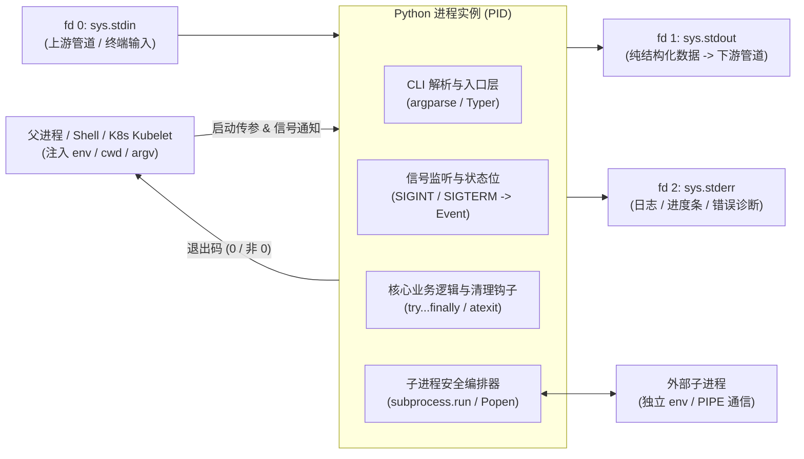
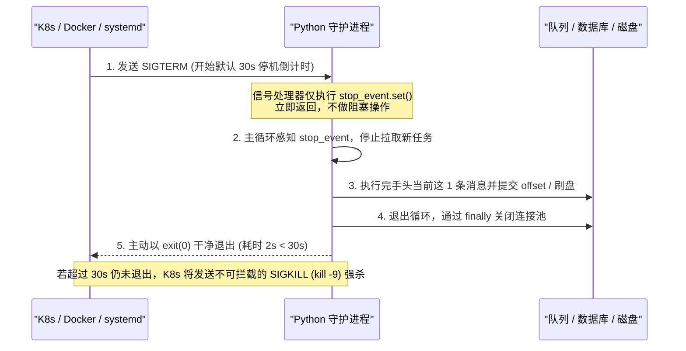

# 系统编程、子进程与 CLI 开发

任何一个真正投入生产环境的 Python 程序，都不是漂浮在真空里的纯函数，而是操作系统内核调度的一个**进程（Process）**。它从父进程继承环境变量与工作目录，通过标准三流（`stdin` / `stdout` / `stderr`）接入管道与日志采集器，派生并编排外部子进程（如 `git`、`ffmpeg`、编译器或容器命令），接收来自容器编排器（Docker / Kubernetes / `systemd`）的停机信号，并在终止时通过退出状态码向调度方汇报成败。

本章从 POSIX / 跨平台进程模型出发，系统拆解运行环境隔离、标准流契约、`subprocess` 安全编排与防死锁管道、`signal` 优雅停机机制，以及从标准库 `argparse` 到现代 `Typer` / `Rich` 的工程级 CLI 设计范式。



---

## 进程运行环境、标准流与退出契约

### 读取与构造隔离环境变量（`os.environ` vs 独立 `env` 字典）

在现代十二要素应用（12-Factor App）与云原生部署中，数据库连接串、API 密钥与运行模式均通过**进程环境变量（Environment Variables）**注入，而非硬编码在配置文件中。

Python 启动时会将当前进程的环境变量块映射为类字典对象 `os.environ`（底层类型为 `os._Environ`）：

1. **防御式读取可选配置 vs 快速失败读取必填密钥**：
    - 可选配置使用 `os.environ.get("LOG_LEVEL", "INFO")` 并显式转换类型（环境变量的键值**永远是 `str`**，切勿写出 `bool(os.environ.get("DEBUG", "false"))` 这种把 `"false"` 判为 `True` 的常见 Bug！）；
    - 核心密钥使用 `os.environ["DATABASE_URL"]`，缺失时在启动阶段立即抛出 `KeyError` 阻断服务带病上线。
2. **严禁在运行期随意原地修改 `os.environ`**：
    - `os.environ` 是**进程全局可变状态**。在多线程或异步并发服务中动态修改 `os.environ["API_KEY"] = ...`，不仅会引发底层 C 库 `setenv`/`getenv` 的线程安全隐患，还会污染同一进程内其他并发任务。
3. **为子进程构造显式隔离的 `env` 字典**：
    - 当需要向子进程传递特定环境变量时，应基于 `os.environ` 浅拷贝构造新字典传入 `subprocess.run(..., env=child_env)`；
    - 当调用**不可信的外部插件或第三方脚本**时，切勿直接全盘继承父进程的 `os.environ`（否则父进程的 `AWS_SECRET_ACCESS_KEY`、`OPENAI_API_KEY` 会直接泄露给子进程），而应采用**最小白名单透传**策略。

```python
import os

def parse_env_bool(raw: str | None, *, default: bool = False) -> bool:
    """安全解析布尔型环境变量，避免 bool('false') == True 的陷阱。"""
    if raw is None:
        return default
    normalized = raw.strip().lower()
    if normalized in {"1", "true", "yes", "on"}:
        return True
    if normalized in {"0", "false", "no", "off"}:
        return False
    raise ValueError(f"非法布尔环境变量值: {raw!r}")

def build_sanitized_child_env(extra: dict[str, str] | None = None) -> dict[str, str]:
    """采用白名单构建子进程环境变量，防止父进程敏感凭据泄露。"""
    safe_keys = ("PATH", "HOME", "USERPROFILE", "SYSTEMROOT", "LANG", "LC_ALL", "TMPDIR", "TEMP", "TMP")
    env = {k: os.environ[k] for k in safe_keys if k in os.environ}
    # 强制子进程使用 UTF-8 I/O 与无缓冲输出，便于实时日志采集
    env["PYTHONUTF8"] = "1"
    env["PYTHONUNBUFFERED"] = "1"
    if extra:
        env.update(extra)
    return env

assert parse_env_bool("false") is False
assert parse_env_bool("1") is True

# 模拟父进程持有敏感密钥，验证白名单子环境不会继承该密钥
isolated = build_sanitized_child_env({"WORKER_MODE": "sandbox"})
assert isolated["WORKER_MODE"] == "sandbox"
assert "AWS_SECRET_ACCESS_KEY" not in isolated
```

### 进程 ID（PID / PPID）与工作目录陷阱

每个运行中的进程都由操作系统分配唯一的整数标识符 **PID**（`os.getpid()`），并记录创建它的父进程 **PPID**（`os.getppid()`）。它们常用于生成结构化日志上下文、编写锁文件（PID File）诊断信息或构造进程级唯一临时文件名。

与之相伴的另一个进程级全局属性是**当前工作目录（Current Working Directory, CWD）**，可通过 `Path.cwd()`（或 `os.getcwd()`）读取：

- **CWD 取决于“在哪里启动命令”，而非“脚本文件存放在哪里”**：在 `/tmp` 下执行 `python /opt/app/main.py` 时，`Path.cwd()` 是 `/tmp`，而代码所在目录则是 `Path(__file__).resolve().parent`。
- **工程铁律：绝不在业务函数中调用 `os.chdir()`**：`os.chdir()` 会瞬间改变整个进程内所有线程、所有协程解析相对路径的基准目录，引发极难复现的并发文件读写错位。需要指定子进程工作目录时，**始终使用 `subprocess.run(..., cwd=target_dir)`**。

```python
import os
from pathlib import Path

pid = os.getpid()
ppid = os.getppid()
cwd = Path.cwd()

assert isinstance(pid, int) and pid > 0
assert isinstance(ppid, int) and ppid >= 0
assert cwd.is_dir()
```

### UNIX 标准三流契约（`stdin` / `stdout` / `stderr`）

UNIX 哲学之所以能用简单的管道符 `|` 将无数小工具组合成强大的数据处理流水线（例如 `my-tool --input raw.log | jq '.latency_ms' | head -n 20`），完全依赖于所有命令行程序共同遵守**标准三流职责分离契约**：

| 标准流对象 | 底层文件描述符 | 核心职责契约 | 默认缓冲策略 |
| :--- | :--- | :--- | :--- |
| **`sys.stdin`** | `fd = 0` | **流式读取上游输入**：按行迭代（`for line in sys.stdin:`）或分块读取，严禁无脑 `sys.stdin.read()` 将数 GB 管道流一次性塞爆内存 | 缓冲块读取 |
| **`sys.stdout`** | `fd = 1` | **仅输出纯粹的结构化结果**（JSON / JSONL / CSV / 纯文本结果），供下游管道程序解析或重定向落盘（`> result.json`） | 连接交互终端（TTY）时为**行缓冲**；接入管道或文件时退化为 **8 KB 块缓冲** |
| **`sys.stderr`** | `fd = 2` | **输出一切非数据结果的信息**：运行日志、告警、错误堆栈、调试耗时以及面向人类的进度条 | 始终为**行缓冲**，确保崩溃前最后一行报错能立即刷出 |

!!! warning "严禁把调试日志 `print()` 到 `sys.stdout`"

    如果你的脚本在 `stdout` 先打印了一行 `"Processing 100 files..."`，再打印最终的 JSON 字符串，那么当用户执行 `python script.py | jq .` 时，`jq` 会在第一行直接报语法解析失败！所有日志必须走 `logging`（默认输出至 `sys.stderr`）或显式指定 `print(..., file=sys.stderr)`。

此外，当脚本作为上游接入管道（如 `python gen.py | head -n 5`）时，下游 `head` 读满 5 行后会直接关闭管道读端；此时上游继续向 `sys.stdout` 写入会收到内核发送的 `SIGPIPE`，Python 将其转化为 **`BrokenPipeError`**。优雅的 CLI 应当静默捕获该异常并关闭描述符，避免向终端刷出一堆无意义的 Traceback：

```python
import io
import json
import sys
from typing import TextIO

def transform_jsonl_stream(in_stream: TextIO, out_stream: TextIO, err_stream: TextIO) -> int:
    """遵循 UNIX 三流契约：stdin 逐行流式消费，stdout 仅输出合法 JSONL，stderr 输出统计诊断。"""
    processed = 0
    skipped = 0
    for lineno, raw_line in enumerate(in_stream, start=1):
        line = raw_line.strip()
        if not line:
            continue
        try:
            record = json.loads(line)
        except json.JSONDecodeError as exc:
            # 诊断告警严格走 stderr，绝不污染 stdout 结构化数据流
            print(f"[WARN] line {lineno} invalid JSON: {exc.msg}", file=err_stream)
            skipped += 1
            continue

        enriched = {"id": record["id"], "score": record.get("score", 0) * 10}
        out_stream.write(json.dumps(enriched, ensure_ascii=False) + "\n")
        processed += 1

    print(f"[INFO] done: processed={processed}, skipped={skipped}", file=err_stream)
    return 0 if processed > 0 else 1

# 使用内存流验证三流严格分离
fake_in = io.StringIO('{"id": "u1", "score": 9}\nBROKEN_JSON\n{"id": "u2", "score": 7}\n')
fake_out = io.StringIO()
fake_err = io.StringIO()

exit_code = transform_jsonl_stream(fake_in, fake_out, fake_err)
assert exit_code == 0
# stdout 每一行都是纯净可解析的 JSON
parsed_rows = [json.loads(row) for row in fake_out.getvalue().splitlines()]
assert parsed_rows == [{"id": "u1", "score": 90}, {"id": "u2", "score": 70}]
# stderr 包含所有告警与汇总信息
assert "[WARN] line 2 invalid JSON" in fake_err.getvalue()
assert "processed=2, skipped=1" in fake_err.getvalue()
```

### `isatty()` 终端交互检测与退出状态码规范（`sys.exit` 与 `atexit`）

优秀的 CLI 工具能够自动感知自己当前是“与人类在终端交互”，还是“运行在 CI 流水线 / 管道重定向中”，核心手段就是调用流对象的 **`.isatty()`** 方法：

- **`sys.stdout.isatty()`**：当用户在终端直接运行命令时返回 `True`（可启用 ANSI 彩色高亮与表格美化）；当输出被重定向到文件（`> out.txt`）或管道（`| grep foo`）时返回 `False`（必须自动关闭 ANSI 颜色转义序列如 `\x1b[32m`，否则日志文件里会充斥乱码字符！同时遵循社区标准检查环境变量 `NO_COLOR`）。
- **`sys.stdin.isatty()`**：返回 `False` 说明用户正在通过管道或 `< input.txt` 喂入数据，或者运行在无头 CI 容器中——此时若缺少必填参数，**必须立即报错退出，绝不能调用 `input("请输入密码: ")` 导致 CI 流水线永久挂起超时**！

在程序结束时，进程必须通过 `0 ~ 255` 之间的整数**退出状态码（Exit Status Code）**向父进程或 Shell（在 POSIX Shell 中可通过 `` `$?` `` 查看）传递执行结果：

| 退出状态码 | POSIX / 社区通用语义 | 典型触发方式 |
| :--- | :--- | :--- |
| **`0`** | **完全成功（Success）** | `main()` 返回 `0` 并执行 `sys.exit(0)`，或脚本自然执行到底 |
| **`1`** | **通用业务或运行时错误** | 文件处理失败、外部依赖不可达、断言校验未通过（未捕获异常崩溃时解释器也默认返回 `1`） |
| **`2`** | **命令行参数或用法错误** | 缺少必填选项、非法子命令（`argparse` 解析失败时自动以状态码 `2` 退出） |
| **`126` / `127`** | **命令不可执行 / 未找到命令** | 权限不足无法执行，或 `` `$PATH` `` 中不存在目标二进制 |
| **`128 + N`** | **进程因致命信号 `N` 终止** | `130`（`128 + 2`，用户按下 `Ctrl+C` 即 `SIGINT`）；`137`（`128 + 9`，被 `SIGKILL` / OOM 强杀）；`143`（`128 + 15`，收到 `SIGTERM`） |

在控制退出与资源回收时，需要厘清三个关键机制：

1. **`sys.exit(code)` 的本质是抛出 `SystemExit(code)`**：它并非粗暴地杀死进程，而是沿着调用栈正常展开——所有外层的 **`finally` 块、`with` 上下文管理器以及 `atexit` 清理钩子都会被完整执行**。切记不要在普通业务代码中调用 `os._exit(code)`（后者会直接发起内核系统调用立即终止进程，跳过一切缓冲区刷盘和 `finally` 块，仅用于 `os.fork()` 子进程异常兜底）。
2. **`atexit` 模块的 LIFO（后进先出）清理链**：通过 `atexit.register(fn)` 注册的钩子会按**注册顺序的逆序**在解释器正常关闭或触发 `SystemExit` 时执行，适合清理进程级临时目录或关闭全局连接池。
3. **`atexit` 的能力边界**：若进程收到未注册处理器的 `SIGTERM`，或收到不可拦截的 `SIGKILL`，`atexit` 钩子**不会执行**。关键文件状态必须配合原子写入与下一节介绍的 `signal` 处理器保障。

```python
import os
import sys

def should_use_ansi_color(stream, env: dict[str, str] | None = None) -> bool:
    """结合 NO_COLOR 规范与 isatty() 判断是否输出 ANSI 终端颜色。"""
    current_env = os.environ if env is None else env
    if current_env.get("NO_COLOR"):
        return False
    if current_env.get("TERM") == "dumb":
        return False
    return hasattr(stream, "isatty") and stream.isatty()

# StringIO / 管道流不是 TTY，自动禁用颜色控制码
import io
assert should_use_ansi_color(io.StringIO()) is False
```

---

## 外部子进程调用与管道安全编排（`subprocess`）

在早期的 Python 脚本中，常见 `os.system()`、`os.popen()` 等遗留接口。现代 Python 工程中，**`subprocess` 模块是启动和管理外部子进程的唯一标准入口**——90% 以上的同步调用场景应首选高级函数 `subprocess.run()`，而仅在需要流式实时交互或多进程管道编排时才下沉到 `subprocess.Popen`。

### 首选高级接口：`subprocess.run()` 全特性实战

`subprocess.run()` 负责启动子进程、等待其执行完毕，并返回包含完整执行摘要的 `CompletedProcess` 对象。生产级调用推荐显式指定以下关键参数：

- **列表形式传参 `["cmd", "arg1", "arg2"]`**：直接经由操作系统 `execve`（Windows 为 `CreateProcess`）传参，清晰无歧义；
- **`capture_output=True`**：同时捕获子进程的 `stdout` 与 `stderr` 到内存（等价于同时设置 `stdout=subprocess.PIPE, stderr=subprocess.PIPE`）；
- **`text=True, encoding="utf-8", errors="replace"`**：将捕获的原始 `bytes` 按 UTF-8 自动解码为 `str`，并用 `errors="replace"` 防止外部工具偶发输出非 UTF-8 字节导致父进程抛出 `UnicodeDecodeError` 崩溃；
- **`check=True`**：当子进程返回非零退出码时，自动抛出 **`subprocess.CalledProcessError`**（其 `.returncode`、`.stdout`、`.stderr` 属性完整保留了报错现场），避免忘记手写 `if res.returncode != 0:` 导致静默忽略失败；
- **`timeout=seconds`**：防止外部命令因网络挂起或等待交互输入永久卡死；超时后 `subprocess.run()` 会**自动强杀子进程、回收僵尸进程状态**，随后抛出 **`subprocess.TimeoutExpired`**。

```python
import subprocess
import sys

# 1. 正常调用：使用 sys.executable 确保跨平台指向当前虚拟环境的 Python 解释器
res = subprocess.run(
    [sys.executable, "-c", "import sys; print('ok_data'); print('diag_msg', file=sys.stderr)"],
    capture_output=True,
    text=True,
    encoding="utf-8",
    check=True,
    timeout=5.0,
)
assert res.returncode == 0
assert res.stdout.strip() == "ok_data"
assert res.stderr.strip() == "diag_msg"

# 2. check=True 自动将非零退出码转为结构化异常 CalledProcessError
try:
    subprocess.run(
        [sys.executable, "-c", "import sys; print('bad config', file=sys.stderr); sys.exit(2)"],
        capture_output=True,
        text=True,
        encoding="utf-8",
        check=True,
        timeout=5.0,
    )
    caught_error = False
except subprocess.CalledProcessError as exc:
    caught_error = (exc.returncode == 2 and "bad config" in exc.stderr)

assert caught_error is True

# 3. timeout 超时自动终止并回收挂起的子进程
try:
    subprocess.run(
        [sys.executable, "-c", "import time; time.sleep(10)"],
        capture_output=True,
        text=True,
        timeout=0.05,
    )
    timed_out = False
except subprocess.TimeoutExpired as exc:
    timed_out = (exc.timeout == 0.05)

assert timed_out is True
```

### 安全红线：命令注入（Command Injection）漏洞剖析与 `shlex` 工具

在安全审计（如 Bandit `B602` / Ruff `S602` 规则）中，**拼接外部输入并开启 `shell=True`** 是等级最高的远程代码执行（RCE）高危漏洞之一。

理解其本质差异需要看清操作系统底层发生了什么：

- **`shell=False`（默认且安全）**：Python 直接调用内核 `execve` 启动目标可执行文件，列表中的每个元素原封不动地作为该程序的 `argv[1]`, `argv[2]`……**期间根本没有 `/bin/sh` 或 `cmd.exe` 介入**！即便参数中包含 `; rm -rf /`、`&&`、`|`、反引号或 `` `$(whoami)` ``，在目标程序眼中也仅仅是一串包含特殊字符的普通文件名或普通字符串，绝无可能被当作第二条命令执行。
- **`shell=True`（高危）**：Python 实际启动的是 `/bin/sh -c "你拼出来的整条字符串"`。Shell 解释器会严格按照语法把字符串里的 `;`、`&&`、`||`、`|`、`` `...` `` 解析为多条独立命令执行！

```python
import shlex
import subprocess
import sys

# 假设这是从 Web 请求或文件名参数收到的恶意输入
malicious_input = "hello.txt; echo INJECTED_SECRET"

# 安全做法：shell=False + 参数列表
# 目标程序会把整串 "hello.txt; echo INJECTED_SECRET" 当成单个普通字符串参数！
safe_res = subprocess.run(
    [sys.executable, "-c", "import sys; print('ARG:', repr(sys.argv[1]))", malicious_input],
    capture_output=True,
    text=True,
    encoding="utf-8",
    check=True,
)
assert safe_res.stdout.strip() == "ARG: 'hello.txt; echo INJECTED_SECRET'"

# 辅助工具 1：shlex.split() —— 将静态配置文件中的命令字符串安全拆分为 argv 列表（自动处理引号）
raw_config_cmd = 'git commit -m "fix: handle spaces in title" --no-verify'
parsed_argv = shlex.split(raw_config_cmd)
assert parsed_argv == ["git", "commit", "-m", "fix: handle spaces in title", "--no-verify"]

# 辅助工具 2：shlex.quote() —— 仅用于生成远程 SSH 命令或日志展示时的 POSIX Shell 单引号转义
escaped = shlex.quote(malicious_input)
assert escaped == "'hello.txt; echo INJECTED_SECRET'"
```

!!! danger "安全铁律"

    1. 本地执行外部二进制时，**100% 坚持 `shell=False` + 字符串列表传参**。哪怕你需要管道、重定向或通配符（`*.log`），也应分别用 `Popen` 管道参数、`stdout=open(...)` 与 `Path.glob("*.log")` 在 Python 侧原生完成，而不要为了省事开启 `shell=True`。
    2. `shlex.quote()` 仅遵循 POSIX Shell（如 `sh` / `bash` / `zsh`）转义规则，**在 Windows `cmd.exe` 下完全无效**！因此本地调用绝不能依赖“`shell=True` + `shlex.quote()`”，列表传参才是跨平台根治方案。

### 底层流式接口 `subprocess.Popen`：实时消费、管道串联与防死锁原理

当子进程是一场持续 20 分钟的模型训练或编译任务，你希望**边运行边逐行实时打印日志**；或者你需要像 Shell 管道 `cmd1 | cmd2` 那样让两个子进程内核态直连传输流式数据时，一次性等待结束的 `subprocess.run()` 就不再适用，此时需要使用底层类 **`subprocess.Popen`**。

#### 1. 实时逐行流式读取长耗时子进程输出

使用 `with subprocess.Popen(...) as proc:` 上下文管理器可以确保退出代码块时自动关闭管道文件描述符并执行 `proc.wait()` 回收子进程，彻底避免句柄泄漏与僵尸进程（Zombie Process）：

```python
import subprocess
import sys

captured_lines: list[str] = []

# 将 stderr 合并进 stdout（stderr=subprocess.STDOUT），单流逐行实时消费，杜绝双管道互锁
with subprocess.Popen(
    [
        sys.executable,
        "-u",  # -u 强制子进程无缓冲实时刷出每一行
        "-c",
        "import sys\nfor i in range(3):\n    print(f'step-{i}')\nprint('warn-end', file=sys.stderr)",
    ],
    stdout=subprocess.PIPE,
    stderr=subprocess.STDOUT,
    text=True,
    encoding="utf-8",
) as proc:
    assert proc.stdout is not None
    for line in proc.stdout:
        captured_lines.append(line.rstrip("\n"))

assert proc.returncode == 0
assert captured_lines == ["step-0", "step-1", "step-2", "warn-end"]
```

#### 2. 多进程无 Shell 管道串联（`p1 | p2`）

无需开启 `shell=True`，我们可以直接把上游 `p1.stdout` 传给下游 `p2` 的 `stdin`。注意一个极其关键的系统编程细节：启动 `p2` 之后，**父进程必须立即调用 `p1.stdout.close()`**，释放父进程自己持有的那份管道读端引用——只有这样，当下游 `p2` 提前退出时，上游 `p1` 才能第一时间收到内核的 `SIGPIPE` 终止运行，而不是傻等父进程手里的文件描述符！

```python
import subprocess
import sys

# 等价于安全版 Shell 管道：producer | consumer（全程 shell=False）
with subprocess.Popen(
    [sys.executable, "-c", "for w in ('apple', 'banana', 'apricot'): print(w)"],
    stdout=subprocess.PIPE,
    text=True,
    encoding="utf-8",
) as p1:
    with subprocess.Popen(
        [sys.executable, "-c", "import sys; print(','.join(s.strip().upper() for s in sys.stdin if s.startswith('a')))"],
        stdin=p1.stdout,
        stdout=subprocess.PIPE,
        text=True,
        encoding="utf-8",
    ) as p2:
        assert p1.stdout is not None
        p1.stdout.close()  # 释放父进程对管道句柄的额外引用，确保 EOF / SIGPIPE 正常传导
        final_out, _ = p2.communicate(timeout=5.0)
    p1.wait(timeout=5.0)

assert final_out.strip() == "APPLE,APRICOT"
```

#### 3. 经典生产死锁：对挂载了 `PIPE` 的子进程直接调用 `p.wait()`

这是 Python 系统编程面试与线上排障最经典的死锁事故：

```python
# 【严禁模仿的死锁反模式！】
# p = subprocess.Popen(cmd, stdout=subprocess.PIPE, stderr=subprocess.PIPE)
# p.wait()  # <--- 一旦子进程输出超过操作系统管道缓冲区大小，此处将永久死锁！
```

**死锁底层根源剖析**：
操作系统内核为匿名管道（Pipe）分配的环形缓冲区容量是有限且很小的（在 Linux 与 macOS 上通常仅为 **64 KB**，Windows 上甚至可能只有 **4 KB**）。
1. 当子进程疯狂打印超过 64 KB 的输出填满内核管道缓冲区后，子进程下一次执行内核 `write(stdout)` 系统调用时会被操作系统**挂起阻塞**，苦苦等待父进程把管道里的数据读走腾出空间；
2. 与此同时，父进程根本没有去读 `p.stdout`，而是直接调用了 `p.wait()`，阻塞在 `waitpid()` 系统调用上苦苦等待子进程运行结束！
3. **父等子退出、子等父读管道**——双方互相持有对方前进的条件，陷入永久死锁（同理，若分别设置了 `stdout=PIPE` 和 `stderr=PIPE`，你在主线程先执行 `p.stdout.read()` 读到底，而子进程此时恰恰先把 `stderr` 写满了 64 KB 阻塞住，同样会永久死锁！）。

**标准根治方案**：

- 如果需要一次性拿回全部 `stdout` 和 `stderr` 并等待退出，**永远使用 `out, err = p.communicate(input=..., timeout=...)`**！`communicate()` 在底层使用 I/O 多路复用（POSIX `selectors`）或独立辅助读取线程（Windows）**并发抽干** `stdout` 与 `stderr` 管道，绝不让内核管道缓冲区堵死，随后安全等待子进程退出。
- 如果必须逐行实时流式读取，应像上文示例那样设置 **`stderr=subprocess.STDOUT`** 将两路输出合并为单一管道顺序消费，或者使用两个独立线程 / `asyncio.create_subprocess_exec` 并发消费双管道。

```python
import subprocess
import sys

# 生成 256 KB 输出（远超 64 KB 内核管道缓冲区上限），验证 p.communicate() 丝滑排空绝不死锁
heavy_script = "import sys; sys.stdout.write('A' * (256 * 1024)); sys.stderr.write('E' * (128 * 1024))"
with subprocess.Popen(
    [sys.executable, "-c", heavy_script],
    stdout=subprocess.PIPE,
    stderr=subprocess.PIPE,
    text=True,
    encoding="utf-8",
) as proc:
    stdout_data, stderr_data = proc.communicate(timeout=5.0)

assert len(stdout_data) == 256 * 1024
assert len(stderr_data) == 128 * 1024
assert proc.returncode == 0
```

---

## 操作系统信号处理与优雅停机（`signal`）

当你的后台消费守护进程、定时任务 Worker 或微服务部署到 Docker、Kubernetes 或 `systemd` 上时，每一次发版滚动更新、缩容或节点维护，编排平台都需要先停止旧容器。如果程序不懂得正确响应操作系统信号，就会在写出一半文件、提交一半数据库事务或处理一半消息时被直接腰斩，造成线上脏数据与请求报错。

### 核心信号语义对比：`SIGINT`、`SIGTERM` 与 `SIGKILL`

信号（Signal）是操作系统内核向进程发送的软中断通知。工程中最核心的三个终止类信号如下：

| 信号名称 | 标准编号 | 典型触发来源 | Python 默认行为 | 能否被捕获/忽略 |
| :--- | :--- | :--- | :--- | :--- |
| **`SIGINT`** | `2` | 人类在终端按下 `Ctrl + C` | Python 默认注册了处理器，将其转换为在主线程抛出的 **`KeyboardInterrupt`** 异常（会触发 `finally` 与 `atexit`） | **能** |
| **`SIGTERM`** | `15` | `kill <pid>`、`docker stop`、**Kubernetes 驱逐 Pod**、`systemd stop` 的默认礼貌终止信号 | **操作系统默认行为：直接终止进程！注意 Python 默认不会把 `SIGTERM` 转为异常，导致 `finally` 和 `atexit` 全部被跳过！** | **能**（生产守护进程必须显式注册处理器！） |
| **`SIGKILL`** | `9` | `kill -9 <pid>`、Linux OOM Killer、或容器超过宽限期（如 K8s 默认 30 秒未退）后的强制处决 | 内核直接销毁进程上下文并回收全部内存页与句柄 | **绝对不能！** 任何语言均无法捕获、阻塞或忽略 |



### 信号处理器的重入红线与跨平台差异

使用标准库 `signal.signal(signum, handler)` 注册自定义处理器时，必须牢记两条底层运行机制：

1. **永远只在主线程（Main Thread）执行**：即便进程中有 20 个工作线程，Python 解释器也规定只有主线程允许调用 `signal.signal()` 注册处理器，且内核信号到达后，解释器总是在**主线程两条字节码指令之间**调用 `handler(signum, frame)`。
2. **信号处理器内部必须极简且无锁（防重入死锁）**：信号可能在主线程执行任意代码的瞬间打断它——假如主线程正执行到 `logging.info(...)` 内部并持有了日志模块的内部互斥锁，此时 `SIGTERM` 到达，而你的 `handler` 函数里居然也写了一句 `logging.info("收到停机信号")`！主线程会在 `handler` 里试图再次获取那把锁，从而**自己把自己死锁**！
    - **正确姿势**：信号处理器内**只做一件事**——修改布尔属性或调用无阻塞的 `stop_event.set()`，把日志打印、刷盘、关闭连接全部留给正常的主循环与 `finally` 块去做。
3. **平台差异说明**：
    - Linux 与 macOS（POSIX）完整支持 `SIGINT`、`SIGTERM`、`SIGHUP`（常用于通知热重载配置）、`SIGUSR1` 等信号及 `signal.Signals(signum).name`；
    - Windows 没有原生 POSIX 信号机制，C 运行时模拟支持 `SIGINT`（`Ctrl+C`）与 `SIGBREAK`（`Ctrl+Break`）；虽然 Windows Python 也允许注册 `signal.SIGTERM`，但外部进程无法向其发送 POSIX `SIGTERM`，Windows 服务通常通过 `SIGINT` / 控制台事件触发停机。通过遍历 `(signal.SIGINT, signal.SIGTERM)` 注册可编写跨平台兼容代码。

### 工业级优雅停机（Graceful Shutdown）实战循环

下面实现一个可直接复用于生产后台 Worker 的 `GracefulShutdown` 上下文控制器：它接管 `SIGINT` 与 `SIGTERM`，支持**“拒收新批次 -> 完整处理完当前批次 -> 刷盘释放资源 -> 恢复原信号处理器”**的标准生命周期，同时保留了“运维连续按两次 `Ctrl+C` 时允许立即强制中断”的逃生通道：

```python
import os
import signal
import threading
from types import FrameType


class GracefulShutdown:
    """工业级优雅停机上下文管理器：首次收到信号置位停机标志，再次收到恢复默认强退。"""

    def __init__(self) -> None:
        self._stop_event = threading.Event()
        self.received_signal: int | None = None
        self._original_handlers: dict[int, object] = {}

    @property
    def should_stop(self) -> bool:
        return self._stop_event.is_set()

    def wait(self, timeout: float) -> bool:
        """可中断休眠：代替死板的 time.sleep(timeout)，信号到达瞬间立即唤醒返回 True！"""
        return self._stop_event.wait(timeout=timeout)

    def _handle_signal(self, signum: int, _frame: FrameType | None) -> None:
        # 处理器内严禁调用 logging / print / I/O，仅设置原子状态与 Event
        if not self._stop_event.is_set():
            self.received_signal = signum
            self._stop_event.set()
        else:
            # 第二次收到中断信号时直接抛出 KeyboardInterrupt 逃生，防止清理逻辑卡死
            raise KeyboardInterrupt(f"Forced exit on repeated signal {signum}")

    def __enter__(self) -> "GracefulShutdown":
        for sig in (signal.SIGINT, signal.SIGTERM):
            self._original_handlers[sig] = signal.getsignal(sig)
            signal.signal(sig, self._handle_signal)
        return self

    def __exit__(self, exc_type, exc_val, exc_tb) -> None:
        # 退出作用域时复原进程原先的信号处理器，方便单元测试反复调用
        for sig, orig in self._original_handlers.items():
            signal.signal(sig, orig)


# 实战验证：模拟 Worker 正在处理第 2 个批次中途收到 SIGTERM
processed_batches: list[str] = []
flushed_to_disk = False
pending_queue = ["batch-1", "batch-2", "batch-3", "batch-4"]

with GracefulShutdown() as lifecycle:
    try:
        for batch in pending_queue:
            # 1. 每轮拉取新任务前先检查停机标志：已置位则拒收后续新批次
            if lifecycle.should_stop:
                break

            # 2. 模拟批次执行中途容器编排器发来 SIGTERM
            if batch == "batch-2":
                os.kill(os.getpid(), signal.SIGTERM)

            # 3. 当前正在处理的 batch-2 不会被腰斩，而是完整执行到底以保证业务原子性
            processed_batches.append(batch)
    finally:
        # 4. 无论因信号停机还是正常跑完，finally 必定执行刷盘与连接释放！
        flushed_to_disk = True

assert lifecycle.received_signal == signal.SIGTERM
assert processed_batches == ["batch-1", "batch-2"]  # batch-2 完整收尾，batch-3/4 拒收留给新实例
assert flushed_to_disk is True
```

!!! tip "细节亮点：用 `stop_event.wait(timeout)` 替代主循环里的 `time.sleep(timeout)`"

    很多定时轮询脚本在主循环末尾写 `time.sleep(30)`。一旦进入休眠，即使第 1 秒收到了 `SIGTERM` 置位了 `should_stop = True`，主循环也必须傻等满 30 秒醒来后才会检查标志退出（极易撞上 K8s 30 秒强杀线）！改用 `lifecycle.wait(30.0)` 后，平时等效休眠 30 秒，而**一旦 `SIGTERM` 触发 `self._stop_event.set()`，线程会在微秒级瞬间唤醒并立即进入停机清理流程**。

---

## 命令行工具（CLI）工程化设计

切勿在正式工程脚本中手写 `sys.argv[1]` 下标切片来解析参数——手写解析不仅缺少自动生成的 `--help` 文档、类型转换与错误提示，一旦参数顺序微调或混入布尔开关就会全面崩溃。

### 标准库 `argparse` 完整工程实战

Python 标准库内置的 `argparse` 零外部依赖、功能完备，非常适合基础设施脚本、打包构建工具以及不能引入第三方包的轻量级 CLI。设计高质量 `argparse` 程序遵循三大工程模式：

1. **`build_parser()` 与 `main(argv: Sequence[str] | None = None) -> int` 解耦**：允许测试代码直接传入字符串列表 `main(["cache", "prune", "--max-age", "24"])` 在内存里毫秒级完成全链路断言，无需启动慢速子进程，更不会污染全局 `sys.argv`。
2. **互斥参数组 `add_mutually_exclusive_group()`**：在语法解析层直接拦截诸如同时传入 `--json` 与 `--quiet` 之类自相矛盾的选项组合。
3. **`add_subparsers(..., required=True)` + `set_defaults(handler=...)` 分发模式**：模仿 `git`、`docker`、`uv` 构建清晰的多级子命令树，每个子命令直接绑定各自的处理函数，彻底消灭冗长的 `if args.cmd == "a": ... elif args.cmd == "b": ...` 面条代码。

```python
import argparse
from collections.abc import Sequence
import json
from pathlib import Path
import sys


def positive_int(raw: str) -> int:
    """自定义 argparse 类型校验器：非法时抛出 ArgumentTypeError 自动生成友好报错。"""
    try:
        value = int(raw)
    except ValueError as exc:
        raise argparse.ArgumentTypeError(f"期望整数，实际收到 {raw!r}") from exc
    if value <= 0:
        raise argparse.ArgumentTypeError(f"必须为正整数，实际收到 {value}")
    return value


def handle_scan(args: argparse.Namespace) -> dict[str, object]:
    """子命令 scan 的业务处理器。"""
    matched = sorted(str(p.name) for p in args.target.glob(args.pattern))[: args.limit]
    return {"command": "scan", "target": str(args.target), "count": len(matched), "files": matched}


def handle_clean(args: argparse.Namespace) -> dict[str, object]:
    """子命令 clean 的业务处理器。"""
    return {"command": "clean", "dry_run": args.dry_run, "force": args.force}


def build_parser() -> argparse.ArgumentParser:
    parser = argparse.ArgumentParser(
        prog="opsctl",
        description="工程化资产扫描与清理命令行工具示例",
    )
    # 全局累加型短长选项：-v -> 1, -vv -> 2
    parser.add_argument("-v", "--verbose", action="count", default=0, help="提升 stderr 诊断日志详细度")

    # 顶层互斥输出模式组：--json 与 --quiet 不可同时指定
    out_group = parser.add_mutually_exclusive_group()
    out_group.add_argument("--json", action="store_true", help="以单行 JSON 格式向 stdout 输出结果")
    out_group.add_argument("-q", "--quiet", action="store_true", help="静默模式，仅通过退出码表达结果")

    # 构建类似 git / uv 的多级子命令体系
    subparsers = parser.add_subparsers(dest="subcommand", required=True, metavar="<subcommand>")

    # 子命令 1：opsctl scan <target> [--pattern *.py] [--limit 10]
    scan_parser = subparsers.add_parser("scan", help="扫描目标目录下的匹配文件")
    scan_parser.add_argument("target", type=Path, help="待扫描的目标目录路径（位置参数）")
    scan_parser.add_argument("-p", "--pattern", default="*.md", help="Glob 匹配模式（默认: *.md）")
    scan_parser.add_argument("-n", "--limit", type=positive_int, default=50, help="最大返回条数（正整数）")
    scan_parser.set_defaults(handler=handle_scan)

    # 子命令 2：opsctl clean (--dry-run | --force)
    clean_parser = subparsers.add_parser("clean", help="清理过期构建产物")
    mode_group = clean_parser.add_mutually_exclusive_group(required=True)
    mode_group.add_argument("--dry-run", action="store_true", help="仅预览待删除项，不实际修改磁盘")
    mode_group.add_argument("-f", "--force", action="store_true", help="确认执行物理清理")
    clean_parser.set_defaults(handler=handle_clean)

    return parser


def main(argv: Sequence[str] | None = None) -> int:
    parser = build_parser()
    args = parser.parse_args(argv)
    if args.verbose > 0:
        print(f"[DEBUG] verbosity={args.verbose}, subcommand={args.subcommand}", file=sys.stderr)

    # 直接多态调用子命令绑定的 handler，无需手写 if-elif 分支！
    payload = args.handler(args)
    if not args.quiet:
        if args.json:
            print(json.dumps(payload, ensure_ascii=False))
        else:
            print(f"[{payload['command']}] done -> {payload}")
    return 0


# 1. 验证 scan 子命令：位置参数自动转为 Path、正整数转换与 --json 输出模式
import io
from contextlib import redirect_stdout, redirect_stderr

stdout_buf, stderr_buf = io.StringIO(), io.StringIO()
with redirect_stdout(stdout_buf), redirect_stderr(stderr_buf):
    rc = main(["-vv", "--json", "scan", ".", "--pattern", "*.toml", "--limit", "5"])

assert rc == 0
assert "[DEBUG] verbosity=2, subcommand=scan" in stderr_buf.getvalue()
result_obj = json.loads(stdout_buf.getvalue())
assert result_obj["command"] == "scan"

# 2. 验证互斥参数组拦截：同时传入 --dry-run 与 --force 自动以退出码 2 终止
try:
    with redirect_stderr(io.StringIO()):
        main(["clean", "--dry-run", "--force"])
    rejected_mutex = False
except SystemExit as exc:
    rejected_mutex = (exc.code == 2)

assert rejected_mutex is True
```

### 现代 Python CLI 生态演进：`Typer` 与 `Rich` 设计模式

当你要开发一款包含数十个子命令、自动生成 Shell Tab 补全脚本（Bash / Zsh / Fish / PowerShell）且对开发者体验（DX）要求极高的现代开发者工具时，Python 社区已经演化出极其成熟的第三方黄金组合——**`Typer` + `Rich`**：

| 技术方案 | 参数声明方式 | 核心优势 | 最佳适用定位 |
| :--- | :--- | :--- | :--- |
| **`argparse`（标准库）** | 命令式 `add_argument()` | **零第三方依赖**、Python 开箱即用、启动开销极低、永不因外部包版本破坏兼容 | 运维脚本、CI/CD 构建脚本、底层基础库附带的轻量级 CLI |
| **`Click`（生态基石）** | 函数装饰器 `@click.option()` | 高度可组合的插件化架构、强大的测试运行器 `CliRunner`（Flask / Black 等工具底层） | 需要动态插件挂载的大型多模块 CLI 框架 |
| **`Typer`（现代首选）** | **原生类型注解 + `Annotated`** | 基于 `Click` 内核（与 FastAPI 同作者），函数签名即 CLI 定义，自动校验类型并内置自动补全与 `Rich` 彩色帮助页 | 现代业务 CLI、AI 工程脚手架、内部研发平台客户端 |
| **`Rich`（终端渲染层）** | `Console` / `Table` / `Progress` | 自动适配 TTY 能力（管道重定向时自动剥离颜色与动画），提供漂亮的进度条、树形图、表格与富文本 Traceback | 所有需要向人类展示进度、对比表格与美观诊断输出的终端应用 |

在结合 `Typer` 与 `Rich` 时，最核心的工程模式依然是坚守前文的 **UNIX 标准三流契约**：实例化两个独立的 `Console`——**把进度条、Spinner 动画与告警面板全部绑定到 `err_console = Console(stderr=True)`**，而把最终给下游脚本消费的机器可读输出留给 `stdout`：

```python
# 现代生态架构示例（需安装第三方依赖：uv add typer rich）
from pathlib import Path
from typing import Annotated
import json
import typer
from rich.console import Console
from rich.progress import track
from rich.table import Table

app = typer.Typer(help="现代类型驱动 CLI 示例", no_args_is_help=True)
# 关键设计：人类可读的富文本与进度动画一律走 stderr，保持 stdout 纯净！
err_console = Console(stderr=True)


@app.command()
def inspect(
    target: Annotated[Path, typer.Argument(exists=True, file_okay=False, help="待分析目录")],
    ext: Annotated[str, typer.Option("--ext", "-e", help="文件后缀名")] = ".py",
    output_json: Annotated[bool, typer.Option("--json", help="向 stdout 输出纯 JSON")] = False,
) -> None:
    files = sorted(target.rglob(f"*{ext}"))
    rows: list[dict[str, object]] = []

    # Rich 的 track 在 stderr 非 TTY 时会自动降级，不会污染重定向日志
    for path in track(files, description="Scanning files...", console=err_console):
        rows.append({"file": str(path.relative_to(target)), "bytes": path.stat().st_size})

    if output_json:
        # stdout 仅输出纯净 JSON，完美支持 `mycli inspect . --json | jq`
        print(json.dumps(rows, ensure_ascii=False))
        return

    table = Table(title=f"Directory Report ({ext})")
    table.add_column("File", style="cyan")
    table.add_column("Size (Bytes)", justify="right", style="green")
    for item in rows:
        table.add_row(str(item["file"]), str(item["bytes"]))
    err_console.print(table)
```

---

## 练习与实战

### 练习 1：实现防超时、防凭据泄露的安全外部命令执行器

编写函数 `run_isolated_python(code: str, *, extra_env: dict[str, str] | None = None, timeout: float = 2.0) -> dict[str, object]`，满足以下生产安全规范：

1. 使用 `subprocess.run()` 和 `sys.executable` 在子进程中执行 `-c <code>`（严禁使用 `shell=True`）；
2. 子进程**不得继承**父进程 `os.environ` 中的未知敏感变量，仅保留基础系统路径变量（`PATH`, `SYSTEMROOT`, `HOME` 等存在的键）并合并 `extra_env`；
3. 若子进程在 `timeout` 秒内正常结束（无论退出码是否为 0），返回 `{"ok": returncode == 0, "code": returncode, "stdout": ..., "stderr": ..., "timed_out": False}`；
4. 若子进程超时，捕获 `subprocess.TimeoutExpired`，返回 `{"ok": False, "code": None, "stdout": "", "stderr": "timeout", "timed_out": True}`。

??? success "点击查看答案与解析"

    **核心思路**：通过白名单字典推导式过滤 `os.environ` 切断父进程敏感凭据向下透传；使用列表传参 `[sys.executable, "-c", code]` 杜绝命令注入，并暂不开启 `check=True` 以便统一收集非零退出码与 `stderr`，同时专门捕获 `subprocess.TimeoutExpired` 将超时转化为结构化结果返回。

    ```python
    import os
    import subprocess
    import sys

    def run_isolated_python(
        code: str,
        *,
        extra_env: dict[str, str] | None = None,
        timeout: float = 2.0,
    ) -> dict[str, object]:
        whitelist = ("PATH", "HOME", "USERPROFILE", "SYSTEMROOT", "LANG", "LC_ALL", "TMPDIR", "TEMP", "TMP")
        child_env = {k: os.environ[k] for k in whitelist if k in os.environ}
        child_env["PYTHONUTF8"] = "1"
        if extra_env:
            child_env.update(extra_env)

        try:
            proc = subprocess.run(
                [sys.executable, "-c", code],
                env=child_env,
                capture_output=True,
                text=True,
                encoding="utf-8",
                errors="replace",
                timeout=timeout,
            )
        except subprocess.TimeoutExpired:
            return {
                "ok": False,
                "code": None,
                "stdout": "",
                "stderr": "timeout",
                "timed_out": True,
            }

        return {
            "ok": proc.returncode == 0,
            "code": proc.returncode,
            "stdout": proc.stdout.strip(),
            "stderr": proc.stderr.strip(),
            "timed_out": False,
        }

    # 1. 验证凭据隔离与显式 extra_env 注入
    os.environ["_TEST_PARENT_SECRET"] = "TOP_SECRET_123"
    try:
        r1 = run_isolated_python(
            "import os; print(os.environ.get('_TEST_PARENT_SECRET', 'HIDDEN'), os.environ['TASK_ID'])",
            extra_env={"TASK_ID": "job-42"},
        )
        assert r1 == {"ok": True, "code": 0, "stdout": "HIDDEN job-42", "stderr": "", "timed_out": False}
    finally:
        os.environ.pop("_TEST_PARENT_SECRET", None)

    # 2. 验证超时自动强杀与回收
    r2 = run_isolated_python("import time; time.sleep(5)", timeout=0.05)
    assert r2["timed_out"] is True and r2["ok"] is False
    ```

### 练习 2：排查并修复 `Popen.wait()` 大输出管道死锁

某同学编写了如下函数运行子进程并检查退出状态，当子进程仅打印几行日志时一切正常，但一旦子进程输出达到数百 KB，整个线上任务便会永久卡死：

```python
# 存在死锁隐患的缺陷代码：
def buggy_run_and_count_lines(script: str) -> tuple[int, int]:
    p = subprocess.Popen([sys.executable, "-c", script], stdout=subprocess.PIPE, stderr=subprocess.PIPE, text=True)
    code = p.wait()  # 当输出填满 OS 管道缓冲区时永久死锁！
    lines = len(p.stdout.read().splitlines())
    return code, lines
```

请解释死锁原因，并用**两种不同的安全方式**重写该函数：
1. `safe_via_communicate(script: str) -> tuple[int, int]`：使用 `p.communicate()` 并发排空双管道并统计 `stdout` 行数；
2. `safe_via_streaming(script: str) -> tuple[int, int]`：不把全部文本一次性驻留在内存中，而是合并流或流式逐行计数，做到 `O(1)` 内存占用！并用输出 15,000 行文本（约 300 KB）的子进程脚本同时验证两者。

??? success "点击查看答案与解析"

    **死锁根因**：当子进程产生约 300 KB 输出时，会填满操作系统内核为管道分配的约 64 KB 环形缓冲区，导致子进程阻塞在 `write()` 系统调用上等待父进程读取管道；而父进程却先调用了 `p.wait()` 阻塞等待子进程退出，形成环路等待死锁。

    - 方案一使用 `proc.communicate()`，在等待子进程退出的同时自动并发读取排空 `stdout` 与 `stderr`；
    - 方案二在父进程主循环中直接逐行迭代 `proc.stdout`（将 `stderr` 重定向至 `DEVNULL` 或合并至 `STDOUT`），一边消费一边释放管道空间，内存开销恒定为单行大小！

    ```python
    import subprocess
    import sys

    def safe_via_communicate(script: str) -> tuple[int, int]:
        with subprocess.Popen(
            [sys.executable, "-c", script],
            stdout=subprocess.PIPE,
            stderr=subprocess.PIPE,
            text=True,
            encoding="utf-8",
        ) as proc:
            out, _err = proc.communicate(timeout=5.0)
            return proc.returncode, len(out.splitlines())

    def safe_via_streaming(script: str) -> tuple[int, int]:
        line_count = 0
        with subprocess.Popen(
            [sys.executable, "-c", script],
            stdout=subprocess.PIPE,
            stderr=subprocess.DEVNULL,
            text=True,
            encoding="utf-8",
        ) as proc:
            assert proc.stdout is not None
            for _line in proc.stdout:
                line_count += 1
            code = proc.wait(timeout=5.0)
            return code, line_count

    # 生成 15,000 行（约 300 KB，远超 64 KB 管道容量）输出进行压测验证
    heavy_line_script = "for i in range(15000): print(f'log_record_index_{i:06d}')"
    assert safe_via_communicate(heavy_line_script) == (0, 15000)
    assert safe_via_streaming(heavy_line_script) == (0, 15000)
    ```

### 练习 3：设计支持 `argparse` 多子命令与标准三流分离的键值工具

请使用 `argparse` 实现一个内存可测的 CLI 入口函数 `kv_cli(argv: Sequence[str], store: dict[str, str], stdout: TextIO, stderr: TextIO) -> int`，支持以下两个子命令：

1. `set <key> <value> [--nx]`：将 `key` 设为 `value`；若开启 `--nx`（仅当不存在时写入）且 `key` 已存在，则**不覆盖原值**，向 `stderr` 打印告警并以退出码 `1` 返回；成功写入则向 `stdout` 输出 JSON `{"ok": true, "key": ...}` 并返回 `0`。
2. `get <key> [--default VAL]`：读取 `key` 的值并以 JSON `{"key": ..., "value": ...}` 写入 `stdout` 返回 `0`；若 `key` 不存在且未提供 `--default`，向 `stderr` 输出缺失报错并返回退出码 `1`。

??? success "点击查看答案与解析"

    **核心思路**：通过 `add_subparsers(required=True)` 定义 `set` 与 `get` 两个独立子解析器，并利用 `set_defaults(handler=...)` 将子命令与处理函数直接绑定；所有正常 JSON 结构化响应写入 `stdout`，而冲突告警与键缺失诊断严格写入 `stderr` 并配合语义化退出码 `0` / `1`。

    ```python
    import argparse
    from collections.abc import Sequence
    import io
    import json
    from typing import TextIO

    def _cmd_set(args: argparse.Namespace, store: dict[str, str], stdout: TextIO, stderr: TextIO) -> int:
        if args.nx and args.key in store:
            print(f"[ERROR] key {args.key!r} already exists (--nx)", file=stderr)
            return 1
        store[args.key] = args.value
        stdout.write(json.dumps({"ok": True, "key": args.key}) + "\n")
        return 0

    def _cmd_get(args: argparse.Namespace, store: dict[str, str], stdout: TextIO, stderr: TextIO) -> int:
        if args.key not in store and args.default is None:
            print(f"[ERROR] key {args.key!r} not found", file=stderr)
            return 1
        val = store.get(args.key, args.default)
        stdout.write(json.dumps({"key": args.key, "value": val}) + "\n")
        return 0

    def kv_cli(argv: Sequence[str], store: dict[str, str], stdout: TextIO, stderr: TextIO) -> int:
        parser = argparse.ArgumentParser(prog="kv")
        sub = parser.add_subparsers(dest="cmd", required=True)

        p_set = sub.add_parser("set")
        p_set.add_argument("key")
        p_set.add_argument("value")
        p_set.add_argument("--nx", action="store_true")
        p_set.set_defaults(handler=_cmd_set)

        p_get = sub.add_parser("get")
        p_get.add_argument("key")
        p_get.add_argument("--default", default=None)
        p_get.set_defaults(handler=_cmd_get)

        args = parser.parse_args(argv)
        return args.handler(args, store, stdout, stderr)

    mem_store: dict[str, str] = {}
    out, err = io.StringIO(), io.StringIO()

    # 1. 首次写入成功
    assert kv_cli(["set", "host", "127.0.0.1", "--nx"], mem_store, out, err) == 0
    # 2. 再次带 --nx 写入同名键 -> 返回退出码 1，告警走 stderr，不污染 stdout
    assert kv_cli(["set", "host", "10.0.0.1", "--nx"], mem_store, out, err) == 1
    assert mem_store["host"] == "127.0.0.1"
    assert "already exists" in err.getvalue()

    # 3. 读取存在键与带默认值的缺失键
    out_get = io.StringIO()
    assert kv_cli(["get", "host"], mem_store, out_get, err) == 0
    assert kv_cli(["get", "port", "--default", "8080"], mem_store, out_get, err) == 0
    lines = [json.loads(s) for s in out_get.getvalue().splitlines()]
    assert lines == [{"key": "host", "value": "127.0.0.1"}, {"key": "port", "value": "8080"}]
    ```
