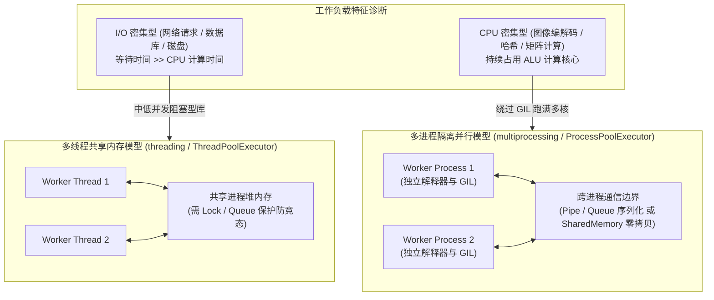

# 多线程、多进程与并发同步原语

在单核性能增长放缓而网络、磁盘等待耗时远高于 CPU 指令周期的今天，能否正确驾驭**并发（Concurrency）**与**并行（Parallelism）**，直接决定了服务的吞吐上限与稳定性。然而，并发编程也是一把双刃剑：一旦脱离单线程顺序执行的保护伞，共享可变状态引发的**竞态条件（Race Condition）**、锁顺序反转引发的**死锁（Deadlock）**、无界缓冲引发的**内存溢出（OOM）**以及多线程 `fork` 引发的底层 C 锁卡死便会接踵而至。

本章从负载特征与开销模型出发，深入拆解 `threading` 同步原语、`queue` 有界背压与 Python 3.13+ 原生 `shutdown()` 机制、`multiprocessing` 启动模型（含 Python 3.14 默认安全演进）与零拷贝共享内存，最终落脚于现代工程首选的 `concurrent.futures` 统一高层执行器。



---

## 并发与并行选型模型

### 并发（Concurrency）与并行（Parallelism）辨析

很多开发者将“并发”和“并行”混为一谈，但在系统架构层面，两者描述的是完全不同的维度（正如 Go 语言创始人 Rob Pike 的经典总结）：

- **并发（Concurrency）是关于“同时应对（Dealing with）许多事情”的程序组织结构**：在一段宏观时间窗口内，多个任务的生命周期相互重叠、交替推进。即便在**单核 CPU** 上，当线程 A 发起网络读取进入内核态休眠等待网卡中断时，调度器立即切入线程 B 执行请求解析——通过把等待空隙重叠起来，单核也能同时推进数百个请求。
- **并行（Parallelism）是关于“同一物理纳秒同时执行（Doing）许多事情”的硬件运行状态**：依赖多核 CPU，4 个物理核心在同一时刻各自真正执行不同的机器指令流，把原本 40 秒的纯数学计算缩短到约 10 秒。

### I/O 密集型 vs CPU 密集型负载特征与 GIL 边界

在标准 CPython 构建中，**全局解释器锁（GIL, Global Interpreter Lock）**确保同一进程内同一时刻最多只有一个线程在执行 Python 字节码。但这绝不意味着 Python 多线程“没有用”，关键取决于负载站在 GIL 的哪一侧：

| 负载类型 | 运行期行为特征 | CPython GIL 行为 | 首选标准库方案 |
| :--- | :--- | :--- | :--- |
| **I/O 密集型（I/O-Bound）** | 95% 以上的时间阻塞在网卡收发、DNS 解析、磁盘读写或 `time.sleep` | **发起底层系统调用前自动释放 GIL**，系统调用返回后再重新申请 GIL；各线程在内核态完美并发等待 | 中低并发（数十~数百）选 **`ThreadPoolExecutor`**；超高并发（数千~数万）选 **`asyncio`** |
| **C/Rust 原生扩展重计算** | 调用 `hashlib` 大块摘要、`zlib`/`zstd` 压缩、`numpy` 矩阵乘法 | 优质原生扩展进入纯 C/Rust 内存循环前会**主动释放 GIL（`Py_BEGIN_ALLOW_THREADS`）** | **`ThreadPoolExecutor`** 即可直接跑满多核，且无需跨进程拷贝数组！ |
| **纯 Python CPU 密集型** | 在 Python 层执行循环迭代、JSON/AST 遍历、正则匹配、纯 Python 算法 | 线程持续霸占 GIL 直至达到切换间隔（默认 `5 ms`，见 `sys.getswitchinterval()`）才被迫让出，多核退化为单核轮流执行 | **`ProcessPoolExecutor`**（每个子进程拥有独立解释器与独立 GIL，真正多核并行） |

!!! note "Python 3.13 / 3.14 自由线程（Free-Threading）演进"

    自 PEP 703 与 PEP 779 起，CPython 提供了可选的无 GIL 自由线程构建（如 `python3.14t`）。在无 GIL 构建下，纯 Python 多线程也能直接并行利用多核 CPU；但请注意：**移除 GIL 只移除了“解释器自身的内部锁”，绝不会让你的业务代码自动变线程安全**——相反，原本靠粗粒度 GIL 侥幸掩盖的数据竞争会更剧烈地暴露，因此掌握本章的锁与队列原语反而更加重要！

### 任务粒度、上下文切换与跨进程序列化成本

并发并非“开的工作者越多越快”。根据阿姆达尔定律（Amdahl's Law）与通信开销模型，真实加速比受三大物理成本制约：

1. **线程创建与抢占切换成本**：每新建一个操作系统线程需分配独立调用栈（默认数 MB 虚拟内存），内核抢占式上下文切换耗时约 `1 ~ 5 µs` 且会导致 CPU L1/L2 缓存失效。若一次性裸开 5,000 个线程，CPU 将陷入调度颠簸（Thrashing）。
2. **进程启动与 IPC `pickle` 序列化成本**：新建子进程耗时在毫秒至数十毫秒级；更致命的是，父子进程内存隔离，传参和返回结果默认必须经过 **`pickle.dumps()` -> 内核管道传输 -> `pickle.loads()`**。
3. **任务粒度（Granularity）法则**：如果你把“对 100 万个整数分别求平方”拆成 100 万次单独的跨进程提交，序列化与管道往返耗时将比单线程直接算**慢上百倍**！多进程并行必须采用**分块批处理（Chunking，令单次任务计算耗时至少达到数十毫秒级）**或使用后文介绍的**共享内存（`SharedMemory`）**。

---

## 多线程与同步原语（`threading`）

### `Thread` 生命周期、`daemon=True` 守护语义与 `threading.local()`

底层模块 `threading` 直接映射操作系统原生线程（POSIX `pthread` 或 Windows Thread）：

- **标准生命周期**：实例化 `t = threading.Thread(target=fn, args=(...), name="worker-1")` 时操作系统尚未分配线程；调用 `t.start()` 后才真正派生内核线程并发执行；主线程调用 **`t.join(timeout=...)`** 阻塞等待其结束汇合。注意同一个 `Thread` 对象只能 `start()` 一次。
- **`daemon=True`（守护线程）的真实退出语义**：
    - Python 进程退出的判定条件是：**所有非守护线程（`daemon=False`，默认）均已运行结束**。只要还有一个普通子线程卡在死循环里，主线程执行到底后进程也不会退出！
    - 反之，标记为 `daemon=True` 的线程仅作为后台陪跑（如心跳上报、内存指标采样）：一旦所有非守护线程结束，解释器会**立即强行销毁所有守护线程**——此时守护线程正在执行的代码会被突然截断，**其 `finally` 块不会完整执行，未刷盘的文件可能损坏**！因此，凡是涉及写磁盘、写数据库或网络事务提交的工作线程，绝不能简单依赖 `daemon=True` 一关了之，而应配合 `Event` 或 `Queue.shutdown()` 显式通知并 `join()` 回收。
- **`threading.local()` 线程局部存储（Thread-Local Storage）**：创建一个全局看起来是同一个对象、但每个线程读写属性时底层自动隔离到各自独立字典的容器，常用于缓存**非线程安全但可按线程复用的重资源**（如每个工作线程各自持有一条独立的 `sqlite3.Connection` 或日志追踪上下文）：

```python
import threading

# 每个线程访问 tls.trace_id 时互不干扰，物理隔离
tls = threading.local()
observed: dict[str, str] = {}
obs_lock = threading.Lock()

def handle_request(worker_name: str, req_id: str) -> None:
    tls.trace_id = req_id
    # 即使并发交错，当前线程读回的永远是自己写入的 req_id
    with obs_lock:
        observed[worker_name] = tls.trace_id

threads = [
    threading.Thread(target=handle_request, args=(f"t-{i}", f"req-{i:03d}"))
    for i in range(4)
]
for t in threads:
    t.start()
for t in threads:
    t.join()

assert observed == {"t-0": "req-000", "t-1": "req-001", "t-2": "req-002", "t-3": "req-003"}
```

### 竞态条件（Race Condition）复现与互斥锁（`Lock` / `RLock`）

当多个线程同时对同一个可变对象执行**“读取 -> 计算 -> 写回（Read-Modify-Write）”**操作时，哪怕源码只有短短一行 `balance += amount`，在字节码层面也至少拆分为读取旧值、加法运算、写回属性三步。一旦操作系统或解释器在“读取旧值”之后、“写回新值”之前发生线程切换，后写回的线程就会直接覆盖掉前一个线程刚算出的增量，造成经典的**更新丢失（Lost Update）**！

我们来亲手复现这一线上资金扣减事故，并用 **`threading.Lock`** 修复它：

```python
import threading
import time


class UnsafeAccount:
    def __init__(self, balance: int = 0) -> None:
        self.balance = balance

    def deposit(self, amount: int) -> None:
        # 复现非原子 Read-Modify-Write：在读取与写回之间发生线程切换导致更新丢失！
        current = self.balance
        time.sleep(0.0001)  # 模拟一次极短暂的日志/校验切换窗口
        self.balance = current + amount


class SafeAccount:
    def __init__(self, balance: int = 0) -> None:
        self.balance = balance
        self._lock = threading.Lock()

    def deposit(self, amount: int) -> None:
        # 始终使用 with self._lock: 上下文管理器，保证即使抛异常也必定释放锁！
        with self._lock:
            current = self.balance
            time.sleep(0.0001)
            self.balance = current + amount


unsafe_acc = UnsafeAccount()
safe_acc = SafeAccount()

t_unsafe = [threading.Thread(target=unsafe_acc.deposit, args=(10,)) for _ in range(20)]
t_safe = [threading.Thread(target=safe_acc.deposit, args=(10,)) for _ in range(20)]

for t in t_unsafe + t_safe:
    t.start()
for t in t_unsafe + t_safe:
    t.join()

# 未加锁账户必定发生严重的更新丢失（远小于 200），而加锁账户精确等于 200
assert unsafe_acc.balance < 200
assert safe_acc.balance == 200
```

#### 何时必须用可重入锁 `threading.RLock`？

普通互斥锁 `threading.Lock` 是**不认主人**的：哪怕是**同一个线程**已经拿到了 `self._lock`，如果在未释放前再次申请同一把 `self._lock`（例如类的公开方法 `deposit_with_bonus()` 先加锁，内部又调用了同样需要加同一把锁的 `deposit()` 方法），普通 `Lock` 会**当场自己把自己永久死锁**！

此时应改用**可重入锁 `threading.RLock`（Reentrant Lock）**：它在内部记录 `(持有者线程 ID, 递归获取计数)`——同一线程允许嵌套 `acquire()` 任意次，只要退出相应次数的 `with self._rlock:` 使计数归零，锁便正常释放给其他线程：

```python
import threading


class Ledger:
    def __init__(self) -> None:
        self._rlock = threading.RLock()
        self.entries: list[int] = []

    def add_entry(self, val: int) -> None:
        with self._rlock:  # 嵌套第 2 次获取：同一线程直接放行，计数变为 2
            self.entries.append(val)

    def add_pair(self, a: int, b: int) -> None:
        with self._rlock:  # 第 1 次获取：记录当前线程为 owner，计数变为 1
            self.add_entry(a)
            self.add_entry(b)


ledger = Ledger()
ledger.add_pair(1, 2)
assert ledger.entries == [1, 2]
```

### 协作同步原语全景：`Event`、`Condition`、`BoundedSemaphore` 与 `Barrier`

除了保护临界区的互斥锁，`threading` 还提供了四类专职于**线程间节奏协调与并发限流**的高阶同步原语：

| 同步原语 | 核心内部状态 | 典型工程场景 | 关键注意事项 |
| :--- | :--- | :--- | :--- |
| **`Event`** | 单个布尔标志位（初值 `False`） | 主线程向所有后台线程广播**启动发令枪**或**优雅停机信号** | `wait(timeout)` 在标志为 `True` 时零阻塞立即通过 |
| **`Condition`** | 一把锁 + 等待线程队列 | 复杂状态谓词等待（如连接池归还唤醒、手写定制缓冲池） | **严禁用 `if` 检查条件！必须用 `while not pred:` 或 `cond.wait_for(pred)` 抵御虚假唤醒（Spurious Wakeup）** |
| **`BoundedSemaphore(N)`** | 最大上限固定为 `N` 的令牌计数器 | 限制最多允许 `N` 个线程同时访问数据库连接或外部限流 API | 相比普通 `Semaphore`，若因 Bug 多调了一次 `release()` 使计数超过初始值 `N`，会**立即抛出 `ValueError`** 暴露缺陷！ |
| **`Barrier(parties)`** | 阶段汇合栅栏（满 `parties` 个线程到达后同时放行） | 多线程并行压测同时起跑、分阶段网格数值模拟 | 若某线程崩溃可调用 `barrier.abort()` 令其余等待线程立即收到 `BrokenBarrierError` 脱离苦等 |

下面通过一段紧凑可运行的代码同时验证 `Condition.wait_for()`、`BoundedSemaphore` 与 `Barrier` 的协作效果：

```python
import threading
import time

# 1. BoundedSemaphore：严格限制并发峰值绝不超过 2，且拦截多余 release()
limiter = threading.BoundedSemaphore(2)
try:
    limiter.release()  # 未 acquire 却直接 release -> 立即报错拦截 Bug！
    caught_over_release = False
except ValueError:
    caught_over_release = True
assert caught_over_release is True

# 2. Barrier + Condition：3 个工作线程先在栅栏处对齐起跑，完成后通过 Condition 唤醒汇总者
start_barrier = threading.Barrier(parties=3, timeout=2.0)
ready_cond = threading.Condition()
completed_workers: list[int] = []

def staged_worker(worker_id: int) -> None:
    # 等待全部 3 个线程就绪后再同时冲线执行
    start_barrier.wait()
    with limiter:
        time.sleep(0.01)
    with ready_cond:
        completed_workers.append(worker_id)
        ready_cond.notify_all()

workers = [threading.Thread(target=staged_worker, args=(i,)) for i in range(3)]
for w in workers:
    w.start()

with ready_cond:
    # wait_for 内部自动用 while 循环重检谓词，彻底免疫操作系统虚假唤醒
    all_done = ready_cond.wait_for(lambda: len(completed_workers) == 3, timeout=2.0)

for w in workers:
    w.join()

assert all_done is True
assert sorted(completed_workers) == [0, 1, 2]
```

### 死锁（Deadlock）复现与“全局固定锁序 / 超时锁”预防策略

当线程 1 持有锁 A 并等待获取锁 B，而同一时刻线程 2 恰好持有锁 B 并等待获取锁 A（例如 `transfer(acct_a, acct_b)` 与 `transfer(acct_b, acct_a)` 并发执行），便满足了死锁的**循环等待（Circular Wait）**条件——双方将永远卡死直到天荒地老。

工程上消灭多锁死锁有两套标准武器：

1. **首选根治方案——全局固定加锁顺序（Canonical Lock Ordering）**：无论业务调用方传入的是 `(acct_a, acct_b)` 还是 `(acct_b, acct_a)`，在真正加锁前一律先按对象的**全局唯一不变键（如账户 `account_id` 或 `id(lock)`）从小到大排序**，严格按照“先锁小 ID，再锁大 ID”的顺序加锁。这从数学上彻底斩断了环形等待图的闭合可能！
2. **兜底防御方案——带超时的锁获取（`lock.acquire(timeout=...)`）**：当动态锁集合无法提前静态排序时，使用上下文管理器封装带超时的 `acquire(timeout)`，超时拿不到锁时立即释放已持有的锁并退避重试。

```python
from contextlib import contextmanager
from dataclasses import dataclass, field
import threading


@dataclass
class BankAccount:
    account_id: int
    balance: int
    lock: threading.Lock = field(default_factory=threading.Lock, repr=False)


@contextmanager
def acquire_ordered(*accounts: BankAccount):
    """按 account_id 严格升序加锁，从根源消除 AB-BA 死锁，并在退出时逆序释放。"""
    # 去重并按唯一主键升序排列（防止自我转账 transfer(a, a) 重复锁同一对象）
    unique_sorted = sorted({acc.account_id: acc for acc in accounts}.values(), key=lambda a: a.account_id)
    acquired: list[threading.Lock] = []
    try:
        for acc in unique_sorted:
            acc.lock.acquire()
            acquired.append(acc.lock)
        yield
    finally:
        for lk in reversed(acquired):
            lk.release()


def safe_transfer(src: BankAccount, dst: BankAccount, amount: int) -> None:
    if src.account_id == dst.account_id:
        return
    with acquire_ordered(src, dst):
        if src.balance >= amount:
            src.balance -= amount
            dst.balance += amount


a1 = BankAccount(account_id=101, balance=1000)
a2 = BankAccount(account_id=202, balance=1000)

# 高强度双向对冲并发转账：由于全局升序先锁 101 再锁 202，绝对不会发生死锁，且总金额严格守恒！
t_forward = [threading.Thread(target=safe_transfer, args=(a1, a2, 5)) for _ in range(100)]
t_backward = [threading.Thread(target=safe_transfer, args=(a2, a1, 3)) for _ in range(100)]
for t in t_forward + t_backward:
    t.start()
for t in t_forward + t_backward:
    t.join()

assert a1.balance + a2.balance == 2000
assert a1.balance == 800 and a2.balance == 1200
```

---

## 线程安全队列与生产者-消费者背压（`queue`）

在多线程工程实践中有一条黄金忠告：**“不要通过共享内存来通信，而要通过通信来共享数据。”** 与其让十几个线程拿着好几把 `Lock` 和 `Condition` 小心翼翼地修改全局字典，不如用标准库 `queue` 模块把它们解耦成清晰的**生产者-消费者流水线（Producer-Consumer Pipeline）**。

### 三种队列语义：`Queue`、`PriorityQueue` 与 `LifoQueue`

`queue` 模块内置了完整的互斥锁与条件变量通知机制，所有 `.put()` 与 `.get()` 调用天然线程安全：

- **`queue.Queue(maxsize=0)`**：标准先进先出（FIFO）队列，用于任务分发流水线；
- **`queue.PriorityQueue(maxsize=0)`**：基于最小堆（`heapq`）实现的优先级队列，数值越小越先出队。**工程技巧**：务必用 `@dataclass(order=True)` 将业务负载标记为 `compare=False`，防止两个同优先级任务去比较不可排序的 `dict` 抛出 `TypeError`；
- **`queue.LifoQueue(maxsize=0)`**：后进先出栈（LIFO），常用于需要优先复用最近刚归还的热连接池或深度优先图搜索。

```python
from dataclasses import dataclass, field
import queue


@dataclass(order=True)
class PrioritizedJob:
    priority: int
    seq: int  # 同优先级下按提交序号 FIFO 打破平局
    payload: dict[str, object] = field(compare=False)


pq: queue.PriorityQueue[PrioritizedJob] = queue.PriorityQueue()
pq.put(PrioritizedJob(priority=10, seq=1, payload={"task": "low"}))
pq.put(PrioritizedJob(priority=1, seq=2, payload={"task": "urgent-a"}))
pq.put(PrioritizedJob(priority=1, seq=3, payload={"task": "urgent-b"}))

order = [pq.get_nowait().payload["task"] for _ in range(3)]
assert order == ["urgent-a", "urgent-b", "low"]
```

### 有界队列 `Queue(maxsize=N)` 与内存安全背压（Backpressure）

线上服务最危险的反模式之一就是随手写下无界队列 **`q = queue.Queue()`**（默认 `maxsize=0` 代表容量无限）：
当上游日志读取线程每秒塞入 `10,000` 条消息，而下游数据库写入线程遇到网络抖动降速到每秒仅能消费 `200` 条时，每秒净积压 `9,800` 个对象——短短几分钟内，队列就会吃光服务器全部物理内存，触发 Linux OOM Killer 强杀整个进程！

**有界队列 `Queue(maxsize=N)`** 正是单机内存级**背压（Backpressure）**的标准实现：
- 一旦队列中未取走的元素达到上限 `N`，上游生产者再次调用 `q.put(item)` 时会被**自动挂起阻塞**（或配合 `timeout` 抛出 `queue.Full` 执行快速降级丢弃），迫使上游放慢读取磁盘/网卡的速度，将整条流水线的内存占用严格锁死在 `O(N)` 常数级！
- 搭配消费者处理完元素后调用的 **`q.task_done()`**，主线程可通过 **`q.join()`** 精确等待队列中最后一条在途任务真正处理完毕（而不仅仅是“被取出了队列”）。

### 多生产者多消费者优雅退出：哨兵值 vs Python 3.13+ 原生 `Queue.shutdown()`

如何通知阻塞在 `q.get()` 上的 `C` 个消费者线程“所有 `P` 个生产者都已经收工，大家处理完剩余库存就可以下班了”？

1. **传统哨兵模式（Sentinel Pattern，兼容 Python `<= 3.12`）**：等所有生产者线程 `join()` 结束后，由协调者向队列精确投递 `C` 个特殊标记对象 `_STOP = object()`（或者某消费者拿到 `_STOP` 后再 `q.put(_STOP)` 接力传给下一个兄弟线程）。一旦生产者和消费者数量动态伸缩，哨兵计数极易写漏导致个别线程永久挂起。
2. **现代首选：Python 3.13+ 原生 `Queue.shutdown(immediate=False)` 与 `queue.ShutDown` 异常**！
    - 调用 **`q.shutdown()`**（默认 `immediate=False`）后：
        - 任何后续试图调用 `q.put()` 的生产者会立即收到 `queue.ShutDown` 异常（拒收新数据）；
        - 消费者继续正常 `q.get()` 抽干队列里已经积压的所有存量任务；**一旦队列排空，所有当前阻塞及后续调用 `q.get()` 的消费者线程都会整齐划一地收到 `queue.ShutDown` 异常**，干净利落地跳出 `while True` 循环！
    - 若传入 `q.shutdown(immediate=True)`，则直接丢弃未消费积压项并立即唤醒所有阻塞在 `put()` 和 `get()` 上的线程抛出 `ShutDown`，适用于紧急熔断中止。

```python
import queue
import threading

# 实战：3 个生产者 + 2 个消费者 + 有界背压队列 (maxsize=4) + Python 3.13+ 原生 shutdown()
bounded_q: queue.Queue[int] = queue.Queue(maxsize=4)
results: list[int] = []
res_lock = threading.Lock()


def producer(start: int, count: int) -> None:
    for val in range(start, start + count):
        # 当队列满 4 个元素时自动阻塞施加背压，内存绝不无限膨胀
        bounded_q.put(val)


def consumer() -> None:
    while True:
        try:
            item = bounded_q.get()
        except queue.ShutDown:
            # 队列已关闭且存量元素全部排空，优雅退出循环！
            break
        try:
            with res_lock:
                results.append(item * 2)
        finally:
            bounded_q.task_done()


producers = [threading.Thread(target=producer, args=(i * 10, 5)) for i in range(3)]
consumers = [threading.Thread(target=consumer) for _ in range(2)]

for t in producers + consumers:
    t.start()

# 1. 等待全部上游生产者投递完毕
for p in producers:
    p.join()

# 2. 宣布关闭队列（无需计算消费者人数投递哨兵！存量 15 条任务会被自动排空后唤醒所有消费者）
bounded_q.shutdown()
bounded_q.join()

for c in consumers:
    c.join()

assert len(results) == 15
assert sorted(results) == sorted(x * 2 for i in range(3) for x in range(i * 10, i * 10 + 5))
```

---

## 多进程与跨进程通信（`multiprocessing`）

当面对纯 Python CPU 密集型计算（图像特征提取、大规模文本清洗、密码学仿真）时，`multiprocessing` 通过创建多个独立的操作系统进程，让每个子进程拥有各自独立的虚拟地址空间与独立的 Python 解释器实例，彻底绕开单进程 GIL 限制。

### 三种启动方式深度对比：`spawn`、`forkserver` 与 `fork`（及 Python 3.14 重大变革）

在不同操作系统与不同 Python 版本下，子进程的底层诞生机制存在本质差异，这也是无数“在本地跑得好好的，上线就死锁或崩溃”事故的根源：

| 启动方式 | 底层创建机制 | 平台默认状态（Python 3.14 基准） | 速度与内存特征 | 多线程安全性与约束 |
| :--- | :--- | :--- | :--- | :--- |
| **`spawn`** | 启动一个**全新的 Python 解释器可执行进程**，重新导入主模块并反序列化执行目标函数 | **Windows 与 macOS 默认**（POSIX 无句柄传递能力时的回退默认） | 启动较慢，内存完全干净隔离 | **100% 线程安全**；所有参数与目标函数**必须支持 `pickle` 序列化**，且**必须加 `if __name__ == "__main__":`** |
| **`forkserver`** | 首次需要时先启动一个极简、纯净的**单线程服务器进程**；后续每要创建新 Worker，均请求该干净服务进程派生子进程 | **Python 3.14 起成为 Linux 默认启动方式！**（取代了延续十余年的 `fork` 默认） | 兼顾干净隔离与较快的后续派生速度 | **线程安全**（彻底避开对业务多线程父进程直接 `fork`）；**同样要求可 `pickle` 且必须加 `if __name__ == "__main__":`** |
| **`fork`** | 直接调用内核 `os.fork()`，按写时复制（Copy-on-Write）瞬间克隆父进程当前内存页 | Python `<= 3.13` 时的 Linux 旧默认；**3.14 起仅在显式指定时启用，不推荐** | 启动极快，只读大对象可直接通过内存页继承 | **极度危险！只要父进程中存在后台线程（如日志、gRPC、OpenSSL、连接池线程），直接 `fork` 极易触发底层互斥锁永久死锁！** |

!!! warning "深度原理解析：为什么多线程进程调用 `fork` 会导致诡异死锁？"

    根据 POSIX 标准，当一个拥有 5 个线程的父进程调用 `os.fork()` 时，内核克隆出的子进程完整复制了父进程那一瞬间的全部内存状态，但**子进程里只保留了调用 `fork()` 的那 1 个线程，其余 4 个线程在子进程里人间蒸发了**！
    假如在 `fork()` 发生的纳秒瞬间，父进程里的线程 2 正好执行到 C 底层 `malloc()` 或 Python `logging` 内部并**锁住了某把互斥锁 M**——那么子进程继承过来的锁 M 也处于“已锁定”状态，但唯一能解锁它的线程 2 在子进程里根本不存在！随后子进程只要打印一行日志或分配一次内存去申请锁 M，就会**永久死锁，连 `Ctrl+C` 都救不回来**。
    这正是 macOS 早在 Python 3.8 就切换为 `spawn`，而 **Python 3.14（`gh-84559`）终于在 Linux 上也正式废除 `fork` 默认地位、全面切换为安全的 `forkserver` / `spawn` 语义**的根本原因！

#### 为什么必须加 `if __name__ == "__main__":` 保护？

在 `spawn` 与 `forkserver` 模式下，新启动的子进程并不知道你要调用的函数长什么样，它必须先**重新导入（`import`）你的主脚本文件**以拿到函数定义（此时主脚本在子进程中的 `__name__` 为 `"__mp_main__"` 而非 `"__main__"`）。

如果你把 `Process(...).start()` 或 `ProcessPoolExecutor()` 直接裸写在脚本顶层而没有包裹在 `if __name__ == "__main__":` 里：
父进程启动子进程 A -> 子进程 A 导入主脚本 -> 导入过程中又执行顶层的 `Process().start()` 去启动孙子进程 B -> 孙子进程 B 又导入主脚本……瞬间演化为耗尽系统进程表的**进程炸弹（Fork Bomb）**（CPython 检测到正在引导阶段再次派生进程时会紧急抛出 `RuntimeError: An attempt has been made to start a new process before the current process has finished its bootstrapping phase`）。

此外，工程中切勿调用修改全局状态的 `multiprocessing.set_start_method()`（在库代码中调用会与宿主程序冲突报错），**推荐始终使用 `ctx = multiprocessing.get_context("spawn")` 创建显式上下文对象**，确保开发机（macOS/Windows）与生产容器（Linux）行为 100% 一致！同时牢记：**传给子进程的目标函数必须定义在模块顶层**，不能使用局部嵌套函数或 `lambda`（否则 `pickle` 无法按模块路径定位该函数）。

### 跨进程通信（IPC）：`Pipe` 与 `multiprocessing.Queue`

由于父子进程虚拟内存完全隔离，在子进程里修改全局变量 `RESULT.append(x)` 对父进程**完全不可见**。跨进程交换常规对象主要有两种通道：

- **`ctx.Pipe(duplex=True)`**：底层基于操作系统的匿名管道或 UNIX 域套接字对，提供两端连接对象 `(conn1, conn2)`，仅支持**两个进程点对点**高速收发（`send(obj)` / `recv()`），开销最小；
- **`ctx.Queue(maxsize=N)`**：在管道之上叠加了跨进程信号量锁与后台喂料线程（Feeder Thread），支持**多生产者进程 - 多消费者进程**安全并发读写。

```python
import multiprocessing as mp


def ipc_square_worker(in_q: mp.Queue, out_q: mp.Queue) -> None:
    """顶层跨进程 Worker：从输入队列取任务，计算后写入输出队列。"""
    while True:
        item = in_q.get()
        if item is None:  # 跨进程队列使用 None 哨兵通知退出
            break
        out_q.put((item, item * item))


if __name__ == "__main__":
    # 显式使用 spawn 上下文，保证 Windows / macOS / Linux 行为严格一致
    ctx = mp.get_context("spawn")
    task_q = ctx.Queue(maxsize=8)
    result_q = ctx.Queue()

    proc = ctx.Process(target=ipc_square_worker, args=(task_q, result_q))
    proc.start()

    for n in (3, 7, 11):
        task_q.put(n)
    task_q.put(None)  # 发送结束哨兵

    # 注意：先从跨进程 Queue 取完结果，再 proc.join()（若塞入超大对象未读就先 join 会卡住 feeder 线程）
    collected = dict(result_q.get(timeout=5.0) for _ in range(3))
    proc.join(timeout=5.0)

    assert proc.exitcode == 0
    assert collected == {3: 9, 7: 49, 11: 121}
```

### 零拷贝共享内存（`multiprocessing.shared_memory.SharedMemory`）

假设你在内存中有一块 **400 MB 的浮点特征矩阵或图像像素缓冲区**，需要让 4 个子进程各自并行处理其中四分之一的切片。如果走 `Queue` 或 `ProcessPoolExecutor.map` 传参，Python 会把这 400 MB 数据 `pickle` 序列化拷贝进管道，再在子进程里反序列化分配新内存——内存瞬间暴涨数倍，CPU 光花在搬运字节上的时间就足以抵消多核并行的全部收益！

Python 标准库 **`multiprocessing.shared_memory.SharedMemory`** 直接调用操作系统内核级共享内存（POSIX `shm_open` + `mmap` / Windows Named File Mapping），允许父进程向内核申请一块物理内存页，各子进程仅需传入一个几十字节的字符串名称 `name`，即可在各自进程内通过缓冲区协议（`memoryview`、`array` 或 `numpy.ndarray(..., buffer=shm.buf)`）**零拷贝原地读写同一块物理内存**！

!!! danger "共享内存生命周期铁律：`close()` 与 `unlink()` 缺一不可"

    操作系统内核的共享内存块独立于单个进程存活！
    - **所有访问过它的进程（含父进程和每个子进程）**使用完毕后都必须调用 **`shm.close()`** 解除本进程虚拟地址映射；
    - **创建它的主控父进程**在 `try ... finally` 中还必须且只能调用一次 **`shm.unlink()`** 通知内核彻底销毁该共享内存段（否则即使 Python 进程退出，在 Linux `/dev/shm` 下仍会残留内存泄漏！也可以直接使用 `multiprocessing.managers.SharedMemoryManager` 上下文管理器自动托管销毁）。

```python
import multiprocessing as mp
from multiprocessing.shared_memory import SharedMemory


def scale_slice_inplace(shm_name: str, total_len: int, start: int, end: int, factor: int) -> None:
    """子进程仅接收轻量字符串 shm_name，零拷贝挂载共享内存并原地修改自己负责的无重叠分片。"""
    existing_shm = SharedMemory(name=shm_name)
    try:
        # 将原始字节缓冲区零拷贝映射为 64 位有符号整数视图 ('q' = int64, 每元素 8 字节)
        int_view = existing_shm.buf.cast("q")
        try:
            assert len(int_view) == total_len
            # 由于各子进程严格操作互不重叠的 [start, end) 区间，甚至无需跨进程加锁！
            for idx in range(start, end):
                int_view[idx] *= factor
        finally:
            int_view.release()  # 必须在 close() 前释放导出的 memoryview 视图引用！
    finally:
        existing_shm.close()


if __name__ == "__main__":
    ctx = mp.get_context("spawn")
    count = 8
    byte_size = count * 8  # 8 个 int64

    shm = SharedMemory(create=True, size=byte_size)
    try:
        # 1. 父进程初始化共享内存数据：[0, 1, 2, 3, 4, 5, 6, 7]
        init_view = shm.buf.cast("q")
        for i in range(count):
            init_view[i] = i
        init_view.release()

        # 2. 启动 2 个子进程，零拷贝原地将前半段和后半段分别乘以 10
        p1 = ctx.Process(target=scale_slice_inplace, args=(shm.name, count, 0, 4, 10))
        p2 = ctx.Process(target=scale_slice_inplace, args=(shm.name, count, 4, 8, 10))
        p1.start()
        p2.start()
        p1.join(timeout=5.0)
        p2.join(timeout=5.0)

        # 3. 父进程直接从同一块物理内存读取并行计算结果
        res_view = shm.buf.cast("q")
        final_values = list(res_view)
        res_view.release()
        assert final_values == [0, 10, 20, 30, 40, 50, 60, 70]
    finally:
        shm.close()
        shm.unlink()  # 通知操作系统内核销毁共享内存块，绝不泄漏！
```

---

## 现代统一高层执行器（`concurrent.futures`）

在 90% 的日常业务开发中，我们**不应该手工 `new Thread()` 或手工 `Process().start()`**——频繁销毁重建线程/进程既浪费系统资源，又难以控制最大并发数与收集返回值异常。

标准库 **`concurrent.futures`** 提供了工业级池化抽象：**`ThreadPoolExecutor`**（线程池）与 **`ProcessPoolExecutor`**（进程池）。两者共享完全一致的 `Executor` 与 `Future` 编程接口，只需修改一行类名即可在多线程与多进程间平滑切换！

### 核心编排模式：`submit`、`map`、`as_completed` 与 `wait`

使用 `with ThreadPoolExecutor(max_workers=...) as pool:` 上下文管理器时，离开 `with` 块会自动调用 `pool.shutdown(wait=True)` 等待池内任务安全收尾并回收全部工作线程/进程。其四大核心调度方法对比如下：

| 调度方式 | 返回值顺序与语义 | 异常处理特征 | 最佳适用场景 |
| :--- | :--- | :--- | :--- |
| **`pool.submit(fn, *args)`** | 立即返回代表未来结果的 **`Future` 对象** | 子任务抛出的异常被静默捕获封存在 `Future` 内，直到调用 **`fut.result()`** 时才在主线程重新抛出 | 异构任务编排、需要为每个任务绑定回调或精细取消 |
| **`pool.map(fn, iter, chunksize=1)`** | 返回惰性迭代器，**严格按输入 `iter` 的原始顺序**产出结果 | 迭代到出错元素的位置时原样抛出子任务异常 | 批量同构数据转换（**注意：`ProcessPoolExecutor.map` 处理上千小任务时务必调大 `chunksize=64` 摊薄 IPC 成本！**） |
| **`as_completed(fs, timeout=...)`** | **谁先算完先产出谁的 `Future`！** 不受慢任务队头阻塞（Head-of-Line Blocking） | 在循环内对每个刚完成的 `fut` 单独 `try: fut.result() except ...` 隔离故障 | 并发抓取多个响应速度悬殊的 API，边完成边流式落库或更新进度条 |
| **`wait(fs, return_when=...)`** | 返回 `(done_set, not_done_set)` 二元组 | 支持 `ALL_COMPLETED`、`FIRST_COMPLETED`（竞速对冲请求）或 **`FIRST_EXCEPTION`（一处报错立即止损取消剩余排队任务）** | 超时批次截止线控制、快速失败熔断编排 |

```python
from concurrent.futures import (
    FIRST_EXCEPTION,
    ProcessPoolExecutor,
    ThreadPoolExecutor,
    as_completed,
    wait,
)
import multiprocessing as mp
import time


def io_fetch_task(url_id: int, delay: float) -> tuple[int, str]:
    """模拟耗时悬殊的网络 I/O 请求；url_id == 99 模拟远端报错。"""
    time.sleep(delay)
    if url_id == 99:
        raise ConnectionError(f"upstream {url_id} unreachable")
    return url_id, f"payload-{url_id}"


def cpu_count_primes(limit: int) -> int:
    """顶层纯 Python CPU 计算函数（供 ProcessPoolExecutor 跨进程调用）。"""
    count = 0
    for num in range(2, limit):
        if all(num % d != 0 for d in range(2, int(num**0.5) + 1)):
            count += 1
    return count


if __name__ == "__main__":
    # 1. ThreadPoolExecutor + as_completed：慢任务在前 (0.06s)，快任务在后 (0.01s)，验证“谁先完成先消费谁”！
    completion_order: list[int] = []
    errors: dict[int, str] = {}
    specs = [(1, 0.06), (2, 0.01), (99, 0.02)]

    with ThreadPoolExecutor(max_workers=3, thread_name_prefix="io-worker") as tpool:
        # 经典工程模式：用字典 {Future: 原始请求元信息} 反向映射上下文
        fut_to_id = {tpool.submit(io_fetch_task, uid, d): uid for uid, d in specs}
        for fut in as_completed(fut_to_id, timeout=2.0):
            uid = fut_to_id[fut]
            try:
                _, data = fut.result()
                completion_order.append(uid)
            except ConnectionError as exc:
                errors[uid] = str(exc)

    # 快任务 uid=2 (0.01s) 必定先于慢任务 uid=1 (0.06s) 被消费，且 uid=99 异常被精准隔离！
    assert completion_order == [2, 1]
    assert 99 in errors

    # 2. wait(..., return_when=FIRST_EXCEPTION) + 排队任务取消演示
    with ThreadPoolExecutor(max_workers=1) as single_pool:
        f_fail = single_pool.submit(io_fetch_task, 99, 0.005)
        f_running = single_pool.submit(io_fetch_task, 3, 0.05)  # 紧随 f_fail 被唯一工作线程领走执行
        f_queued = single_pool.submit(io_fetch_task, 4, 0.05)   # 排在第 3 位，尚在等待队列中未启动
        done, not_done = wait([f_fail, f_running, f_queued], return_when=FIRST_EXCEPTION)
        assert f_fail in done
        # 尚在等待队列中排队的 f_queued 必定可被成功取消！
        assert f_queued.cancel() is True

    # 3. ProcessPoolExecutor + chunksize：无缝切换为多进程池并行执行 CPU 计算
    ctx = mp.get_context("spawn")
    with ProcessPoolExecutor(max_workers=2, mp_context=ctx) as ppool:
        prime_counts = list(ppool.map(cpu_count_primes, [100, 500, 1000, 2000], chunksize=2))
    assert prime_counts == [25, 95, 168, 303]
```

!!! tip "`Future.cancel()` 的能力边界"

    请务必注意：`fut.cancel()` **只能取消仍在执行器等待队列中排队、尚未被工作线程/进程领走执行的任务**（返回 `True`）。一旦某个任务已经进入运行态（`fut.running() == True`），由于操作系统不允许安全地从外部强杀一个正在持锁运行的函数，`fut.cancel()` 将直接返回 `False`！若希望运行中的任务也能响应中止，仍需向任务函数传入 `threading.Event` 在循环内部主动检查退出。

---

## 练习与实战

### 练习 1：修复“检查后再操作（Check-Then-Act）”竞态漏洞并实现线程安全限额扣减器

某秒杀库存扣减类最初编写如下：

```python
class BrokenInventory:
    def __init__(self, stock: int) -> None:
        self.stock = stock

    def reserve(self, qty: int) -> bool:
        if self.stock >= qty:
            # 一旦在此处发生线程切换，多个线程会同时通过上面的 if 检查，导致库存被扣成负数（超卖）！
            self.stock -= qty
            return True
        return False
```

请编写线程安全版本 `SafeInventory`，要求：
1. 支持 `reserve(qty: int) -> bool`（库存充足时原子扣减并返回 `True`，不足时保持不变并返回 `False`，绝不超卖）；
2. 支持嵌套调用的批量预占方法 `reserve_bundle(quantities: list[int]) -> bool`：要么列表中的所有数量**全部成功扣减**，要么库存不足以覆盖总和时**一件都不扣**（要求内部复用 `reserve()` 方法且不会发生同一线程自死锁！）；
3. 启动 30 个并发线程对初始库存为 `100` 的实例各抢购 `10` 件，验证恰好只有 10 个线程成功且最终库存严格为 `0`。

??? success "点击查看答案与解析"

    **核心思路**：使用可重入锁 **`threading.RLock`** 守护整个库存检查与扣减的临界区。由于 `RLock` 允许同一持有线程嵌套进入，外层 `reserve_bundle()` 先获取锁做总量原子预判，再循环复用内部同样获取 `self._lock` 的 `reserve()` 方法时不会触发自死锁，同时对外屏蔽了其他并发线程的中途插队。

    ```python
    import threading
    import time

    class SafeInventory:
        def __init__(self, stock: int) -> None:
            self.stock = stock
            self._lock = threading.RLock()

        def reserve(self, qty: int) -> bool:
            if qty <= 0:
                raise ValueError("qty must be positive")
            with self._lock:
                if self.stock >= qty:
                    time.sleep(0.0002)  # 故意放大竞争窗口以验证锁的严密性
                    self.stock -= qty
                    return True
                return False

        def reserve_bundle(self, quantities: list[int]) -> bool:
            with self._lock:
                total_needed = sum(quantities)
                if self.stock < total_needed:
                    return False
                for q in quantities:
                    # 同一线程嵌套调用同样持 self._lock 的 reserve()，RLock 安全放行！
                    assert self.reserve(q) is True
                return True

    inv = SafeInventory(stock=100)
    outcomes: list[bool] = []
    out_lock = threading.Lock()

    def buyer_worker() -> None:
        ok = inv.reserve(10)
        with out_lock:
            outcomes.append(ok)

    buyers = [threading.Thread(target=buyer_worker) for _ in range(30)]
    for b in buyers:
        b.start()
    for b in buyers:
        b.join()

    # 30 人各抢 10 件（共 300 件需求），严格只有 10 人成功，库存精确归零绝无超卖！
    assert outcomes.count(True) == 10
    assert outcomes.count(False) == 20
    assert inv.stock == 0

    # 验证可重入原子包预占
    inv2 = SafeInventory(stock=25)
    assert inv2.reserve_bundle([10, 20]) is False and inv2.stock == 25
    assert inv2.reserve_bundle([10, 15]) is True and inv2.stock == 0
    ```

### 练习 2：使用有界队列与 `Queue.shutdown()` 构建带背压的多阶段日志聚合流水线

请使用 Python 3.13+ 的 `queue.Queue(maxsize=3)` 与原生 `.shutdown()` 机制，编写函数 `run_pipeline(raw_batches: list[list[int]], num_workers: int = 3) -> dict[str, int]`：

1. 启动 `len(raw_batches)` 个生产者线程，将各自批次内的整数逐条 `put` 进容量仅为 `3` 的有界队列；
2. 启动 `num_workers` 个消费者线程，不断从队列取出整数 `x`，忽略负数，对非负数累加计数与平方和，并在捕获 `queue.ShutDown` 时安全退出；
3. 主线程协调所有生产者结束、调用 `q.shutdown()` 排空存量任务并汇合所有消费者，最终返回 `{"valid_count": ..., "square_sum": ...}`。

??? success "点击查看答案与解析"

    **核心思路**：有界队列 `Queue(maxsize=3)` 保证无论上游批次有多大，内存队列最多驻留 3 个待处理元素；所有生产者 `join()` 完毕后只需调用一次 `q.shutdown()`（默认 `immediate=False`），全部消费者就会在把存量元素消费一空后自动收到 `queue.ShutDown` 退出，省去了手工按 `num_workers` 投递哨兵对象的繁琐耦合。

    ```python
    import queue
    import threading

    def run_pipeline(raw_batches: list[list[int]], num_workers: int = 3) -> dict[str, int]:
        q: queue.Queue[int] = queue.Queue(maxsize=3)
        stats_lock = threading.Lock()
        valid_count = 0
        square_sum = 0

        def produce(batch: list[int]) -> None:
            for item in batch:
                q.put(item)

        def consume() -> None:
            nonlocal valid_count, square_sum
            local_cnt = 0
            local_sum = 0
            while True:
                try:
                    val = q.get()
                except queue.ShutDown:
                    break
                try:
                    if val >= 0:
                        local_cnt += 1
                        local_sum += val * val
                finally:
                    q.task_done()
            # 线程退出前一次性合并局部累加结果，大幅减少锁竞争频率！
            with stats_lock:
                valid_count += local_cnt
                square_sum += local_sum

        producers = [threading.Thread(target=produce, args=(b,)) for b in raw_batches]
        workers = [threading.Thread(target=consume) for _ in range(num_workers)]

        for t in producers + workers:
            t.start()
        for p in producers:
            p.join()

        q.shutdown()
        q.join()
        for w in workers:
            w.join()

        return {"valid_count": valid_count, "square_sum": square_sum}

    batches = [[1, -2, 3, 4], [5, -9, 6], [7, 8, -1, 10]]
    res = run_pipeline(batches, num_workers=3)
    expected_nums = [x for b in batches for x in b if x >= 0]
    assert res == {
        "valid_count": len(expected_nums),
        "square_sum": sum(x * x for x in expected_nums),
    }
    ```

### 练习 3：基于 `ProcessPoolExecutor` 与 `SharedMemory` 实现并行直方图统计

给定一段长度为 `N` 的无符号字节数据（`bytes`，每个字节取值 `0 ~ 255`），请结合 `SharedMemory`（避免把大字节串重复 `pickle` 传给每个子进程）与 `ProcessPoolExecutor`，实现并行字节频次统计：

1. 定义模块顶层函数 `partial_byte_histogram(shm_name: str, start: int, end: int) -> list[int]`：子进程通过 `shm_name` 零拷贝挂载共享内存，仅扫描 `[start, end)` 分片并返回长度为 `256` 的局部频次列表；
2. 定义调度函数 `parallel_histogram(data: bytes, workers: int = 2) -> list[int]`：在 `try ... finally` 中创建 `SharedMemory` 写入 `data`，按 `workers` 切分无重叠区间提交给 `ProcessPoolExecutor(mp_context=mp.get_context("spawn"))`，汇总各分片频次列表，并确保退出时完整执行 `close()` 与 `unlink()`。

??? success "点击查看答案与解析"

    **核心思路**：遵循 **Map-Reduce 数据并行模式**——输入大数组放入 `SharedMemory` 实现跨进程零拷贝只读共享（只传递字符串 `shm_name` 与整数区间坐标 `(start, end)`），输出则是极轻量级的 256 个整数组成的局部计数桶，最后在父进程加总归约，既彻底免除了大块输入 `pickle` 复制，又无需在共享内存上加跨进程互斥锁！

    ```python
    from concurrent.futures import ProcessPoolExecutor
    import multiprocessing as mp
    from multiprocessing.shared_memory import SharedMemory

    def partial_byte_histogram(shm_name: str, start: int, end: int) -> list[int]:
        shm = SharedMemory(name=shm_name)
        try:
            counts = [0] * 256
            buf = shm.buf
            for idx in range(start, end):
                counts[buf[idx]] += 1
            return counts
        finally:
            shm.close()

    def parallel_histogram(data: bytes, workers: int = 2) -> list[int]:
        if not data:
            return [0] * 256
        n = len(data)
        shm = SharedMemory(create=True, size=n)
        try:
            shm.buf[:n] = data
            step = (n + workers - 1) // workers
            ranges = [(i, min(i + step, n)) for i in range(0, n, step)]

            total = [0] * 256
            ctx = mp.get_context("spawn")
            with ProcessPoolExecutor(max_workers=workers, mp_context=ctx) as pool:
                futures = [pool.submit(partial_byte_histogram, shm.name, s, e) for s, e in ranges]
                for fut in futures:
                    part = fut.result(timeout=5.0)
                    for byte_val, c in enumerate(part):
                        total[byte_val] += c
            return total
        finally:
            shm.close()
            shm.unlink()

    if __name__ == "__main__":
        sample = (b"kosmigen_python_314_shared_memory!" * 500)
        hist = parallel_histogram(sample, workers=2)
        assert sum(hist) == len(sample)
        assert hist[ord("p")] == sample.count(b"p")
        assert hist[ord("!")] == 500
    ```
