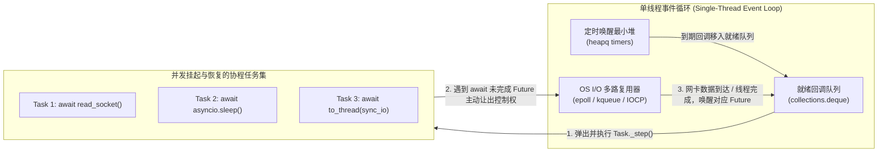
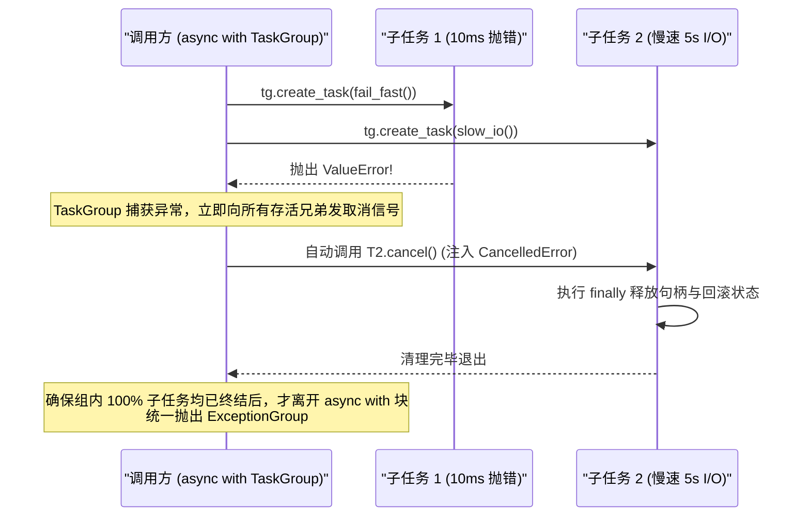

# 异步编程与 asyncio 结构化并发

当一个网关、爬虫集群或大模型推理代理服务需要同时维持 **10,000 条并发网络连接**（如流式 SSE、WebSocket 或慢速上游 API 调用）时，传统的“一连接一线程”模型会撞上物理内存与内核调度的天花板：10,000 个操作系统线程光调用栈就要消耗数十 GB 虚拟内存，高频抢占式切换更是会让 CPU 疲于奔命。

Python 标准库 **`asyncio`** 采用截然不同的架构：**在单个操作系统线程内运行事件循环（Event Loop），借助内核非阻塞 I/O 多路复用（Linux `epoll`、macOS `kqueue`、Windows `IOCP`）同时监听成千上万个套接字，并通过轻量级用户态协程（每 `Task` 仅数 KB 内存）在 `await` 挂起点协作式切换**。配合 Python 3.11+ 引入的 **`asyncio.TaskGroup` 结构化并发**与 **`asyncio.timeout` 上下文超时原语**，现代异步 Python 在保持极高并发吞吐的同时，终于具备了媲美同步代码的确定性资源回收与异常安全保障。



---

## `asyncio` 事件循环架构与核心三元组

### 单线程事件循环与非阻塞 I/O 多路复用运行模型

理解 `asyncio` 的第一把钥匙是彻底建立**“单线程 + 协作式让出”**的心智模型：

1. **全程只有一个主线程在跑 Python 字节码**：除非你显式调用 `asyncio.to_thread()` 把任务扔进线程池，否则无论你创建了 10 个还是 50,000 个异步 `Task`，它们都在**同一个操作系统线程**里交替执行。
2. **`await` 是唯一的上下文切换路标**：在多线程模型中，操作系统随时可能在任意两行代码中间强行打断当前线程；而在 `asyncio` 中，只要两行代码之间**没有出现 `await`（或 `async for` / `async with`）**，这段代码对事件循环而言就是**绝对不可打断的原子块**！（但请注意：一旦跨越了 `await` 挂起点，其他协程就可能在此期间修改共享状态，因此跨 `await` 的状态读写依然需要 `asyncio.Lock` 保护。）
3. **事件循环的每一次心跳（Tick）**：
    - 从 `Ready` 队列依次取出已就绪的回调（驱动 `Task` 向前运行直到下一个未完成的 `await` 挂起）；
    - 计算距离最近一个定时器（如 `asyncio.sleep` 或 `timeout`）还有多少毫秒；
    - 调用操作系统 `selector.select(timeout)` 阻塞等待——一旦任意一个非阻塞 Socket 可读/可写，内核立即一次性返回所有就绪句柄，事件循环将等待这些句柄的 `Future` 标记为完成，从而把对应的 `Task` 重新推入下一轮 `Ready` 队列！

### 核心三元组辨析：`Coroutine` vs `Task` vs `Future`

初学异步编程最容易踩坑的地方，就是分不清“调用了一个 `async def` 函数”和“真正把它并发调度起来”之间的本质区别：

| 核心对象 | 如何产生 | 底层角色与状态特征 | 并发行为关键点 |
| :--- | :--- | :--- | :--- |
| **`Coroutine`（协程对象）** | 直接调用 `coro = fetch()` | **惰性未启动的状态机蓝图**。此时函数体内的第一行代码**根本没有执行**！若丢弃不 `await`，GC 时会报 `RuntimeWarning: coroutine was never awaited` | 若连续写 `await fetch(1); await fetch(2)`，第二个协程必须等第一个彻底跑完才开始创建运行——**这是纯串行，毫无并发可言！** |
| **`Task`（异步任务）** | `t = asyncio.create_task(coro)` 或 `tg.create_task(coro)` | **`Future` 的子类，协程的调度包装器**。调用瞬间立即向事件循环就绪队列注册，只要当前协程一遇到 `await` 让出，所有已注册的 `Task` 便**立刻并发推进**！ | 真正实现单线程并发的执行单元；支持 `.cancel()`、`.done()` 与读取结果 |
| **`Future`（期物）** | `loop.create_future()`（主要由框架/库内部创建） | **代表“未来某个时刻才会填好的结果槽位”**。本身不含协程字节码，仅提供 `.set_result(val)` / `.set_exception(exc)` 唤醒等待它的协程 | 连接底层回调式网络 I/O、定时器、线程池与上层 `await` 语法的桥梁 |

下面的代码直观对比了“直接 `await` 协程（串行耗时相加）”与“包装为 `Task`（并发耗时取最大值）”的天壤之别：

```python
import asyncio
import time


async def simulated_rpc(name: str, delay: float) -> str:
    await asyncio.sleep(delay)
    return f"ok:{name}"


async def demo_triad() -> None:
    # 1. 验证直接调用 async def 仅返回未执行的协程对象，函数体尚未启动
    coro = simulated_rpc("lazy", 0.01)
    assert asyncio.iscoroutine(coro) is True
    assert await coro == "ok:lazy"

    # 2. 误区：连续直接 await 两个协程对象 -> 严格串行！(总耗时 >= 0.04 + 0.04 = 0.08s)
    t0 = time.perf_counter()
    r1 = await simulated_rpc("serial-1", 0.04)
    r2 = await simulated_rpc("serial-2", 0.04)
    serial_cost = time.perf_counter() - t0
    assert (r1, r2) == ("ok:serial-1", "ok:serial-2")

    # 3. 正确：通过 create_task (或 TaskGroup) 立刻挂入事件循环 -> 真正并发！(总耗时约 0.04s)
    t1 = time.perf_counter()
    task_a = asyncio.create_task(simulated_rpc("conc-1", 0.04))
    task_b = asyncio.create_task(simulated_rpc("conc-2", 0.04))
    # 验证 Task 本质上就是 Future 的子类
    assert isinstance(task_a, asyncio.Future) is True
    c1, c2 = await task_a, await task_b
    concurrent_cost = time.perf_counter() - t1

    assert (c1, c2) == ("ok:conc-1", "ok:conc-2")
    assert concurrent_cost < serial_cost * 0.8


asyncio.run(demo_triad())
```

### `asyncio.run()` 生命周期与“同步阻塞卡死事件循环心跳”头号生产事故

`asyncio.run(main())` 是启动异步程序的标准顶层入口。它在幕后承担了一整套严谨的生命周期闭环：
1. 创建一个全新的事件循环并绑定为当前线程循环；
2. 将入口协程包装为主 `Task` 运行至结束；
3. 若退出时循环内仍有未结束的残留任务，自动向它们发送 `cancel()` 并等待回收；
4. 调用 `loop.shutdown_asyncgens()` 清理所有未关闭的异步生成器，调用 `loop.shutdown_default_executor()` 关闭 `to_thread` 使用的默认线程池，最后彻底关闭事件循环（若需要在多次顶层调用间复用同一个事件循环，可使用 Python 3.11+ 的 `with asyncio.Runner() as runner: runner.run(...)`）。

#### 复现与诊断异步服务的头号生产事故：协程内误调同步阻塞代码

在 FastAPI、aiohttp 或异步 Agent 服务中，线上最常见的雪崩事故莫过于：**某位开发者在一个 `async def` 接口里随手调了一次 `time.sleep(2)`、`requests.get(...)`（同步 HTTP 库）或一段耗时 500ms 的同步大 JSON/正则解析**。

后果有多严重？因为整个事件循环只有一个线程！当协程 A 调 `time.sleep(2)` 时，它**没有通过 `await` 把控制权归还给事件循环，而是直接把唯一的操作系统线程挂死了整整 2 秒**！在这 2 秒内，该进程上其余 5,000 个健康连接的心跳、响应发送、超时定时器全部像冰封一样彻底停摆！

下面我们编写一个事件循环心跳延迟监测器（Event Loop Lag Probe），亲手复现并量化这一事故：

```python
import asyncio
import time


async def measure_loop_lag(use_bad_blocking_sleep: bool) -> float:
    """启动每 10ms 跳动一次的心跳协程，测量另一协程执行期间造成的最大事件循环卡顿延迟。"""
    max_lag_ms = 0.0
    stop = False

    async def heartbeat_monitor() -> None:
        nonlocal max_lag_ms
        interval = 0.01  # 期望每 10ms 精准唤醒一次
        while not stop:
            expected = time.perf_counter() + interval
            await asyncio.sleep(interval)
            lag_ms = max(0.0, (time.perf_counter() - expected) * 1000)
            max_lag_ms = max(max_lag_ms, lag_ms)

    monitor_task = asyncio.create_task(heartbeat_monitor())
    await asyncio.sleep(0.015)  # 让监控协程先进入稳定运行

    if use_bad_blocking_sleep:
        # 【头号生产事故复现】：在 async def 内直接调用同步 time.sleep(0.06)，冻结整个事件循环！
        time.sleep(0.06)
    else:
        # 正确做法：使用非阻塞 await asyncio.sleep(0.06)，期间心跳监控丝滑运行！
        await asyncio.sleep(0.06)

    await asyncio.sleep(0.015)
    stop = True
    await monitor_task
    return max_lag_ms


bad_lag = asyncio.run(measure_loop_lag(use_bad_blocking_sleep=True))
good_lag = asyncio.run(measure_loop_lag(use_bad_blocking_sleep=False))

# 误用 time.sleep(0.06) 直接把并发心跳卡死了约 50ms+，而 asyncio.sleep 卡顿接近 0！
assert bad_lag >= 40.0
assert good_lag < 25.0
```

!!! tip "开启 `debug=True` 自动揪出线上慢回调元凶"

    在开发环境或压测排障时，可以通过 `asyncio.run(main(), debug=True)`（或设置环境变量 `PYTHONASYNCIODEBUG=1`）启用事件循环调试模式，并通过 `asyncio.get_running_loop().slow_callback_duration = 0.05` 设置阈值（默认 `0.1s`）。一旦有任何一个协程单步同步占用 CPU 或阻塞系统调用超过 50 毫秒，Python 会自动向日志打印精确到文件名与行号的 `Executing <Task ...> took 0.062 seconds` 告警，瞬间定位罪魁祸首！

---

## 结构化并发（Structured Concurrency，Python 3.11+）

### 散装 `create_task` 的两大致命隐患与 `asyncio.gather()` 的历史局限

在 Python 3.11 之前，开发者习惯用散装 `asyncio.create_task()` 或 `asyncio.gather()` 组织并发，但这两种传统做法在复杂故障场景下隐藏着极深的工程陷阱：

1. **“射后不理（Fire-and-Forget）”任务的弱引用被 GC 静默销毁陷阱**：
    - 如果你在函数里写了一句 `asyncio.create_task(send_audit_log())` 却**没有把返回的 `Task` 对象赋值给任何持久变量**——由于事件循环内部对运行中的任务**只保存弱引用（Weak Reference）**，一旦触发垃圾回收（GC），这个还在半路等网络响应的任务可能**无声无息地被销毁腰斩**！而且即使它在后台抛出了异常，也只会在进程结束或对象析构时打印一句无人捕获的 `Task exception was never retrieved`。
    - **官方补救规范**：如果确实需要脱离当前请求生命周期的后台任务，必须建立强引用集合并在完成回调 `add_done_callback` 中自动移除。
2. **`asyncio.gather()` 在部分失败时的“孤儿任务泄漏”**：
    - 当执行 `await asyncio.gather(t1, t2, t3)`（默认 `return_exceptions=False`）且 `t1` 在第 10 毫秒抛出异常时，`gather()` 会**立即将 `t1` 的异常向外抛出**；但可怕的是，**`t2` 和 `t3` 根本没有被取消**！它们会沦为脱缰的后台孤儿任务继续运行——此时外层的 `async with db.transaction():` 可能早已因为捕获了 `t1` 的异常而回滚并关闭了数据库连接，`t2` 随后再去写库就会触发连环二次崩溃！
    - 若开启 `gather(..., return_exceptions=True)`，则即使第一个任务已经证明认证彻底失败，也必须傻等最慢的任务跑完全程，且返回列表里混杂着正常值与 `Exception` 实例，类型检查极其别扭。

```python
import asyncio

# 官方推荐的独立后台任务强引用登记模式（防止中途被 GC 静默回收）
background_tasks: set[asyncio.Task[str]] = set()
audit_done = False


async def send_audit_log() -> str:
    global audit_done
    await asyncio.sleep(0.01)
    audit_done = True
    return "logged"


async def spawn_safe_background_demo() -> None:
    task = asyncio.create_task(send_audit_log())
    background_tasks.add(task)
    # 任务完成瞬间自动从集合中移除自身引用，既防提前 GC，又防长期内存泄漏
    task.add_done_callback(background_tasks.discard)
    assert task in background_tasks
    await task
    assert len(background_tasks) == 0 and audit_done is True


asyncio.run(spawn_safe_background_demo())
```

### `asyncio.TaskGroup` 核心范式与生命周期铁律

Python 3.11（PEP 654）正式引入了受 Trio Nursery 启发的**结构化并发原语 `asyncio.TaskGroup`**。它的核心设计哲学只有一句话：**并发子任务的生命周期绝不允许逃逸出创建它的词法代码块（`async with` 作用域）！**



`async with asyncio.TaskGroup() as tg:` 严格保证三大工程不变式：

1. **自动阻塞汇合**：离开 `async with` 右大括号前，隐式等待组内通过 `tg.create_task()` 创建的所有子任务（包括子任务内部再动态追加进 `tg` 的任务）全部执行完毕；
2. **故障连带自动取消**：只要组内**任意一个**子任务抛出非 `CancelledError` 的未捕获异常，`TaskGroup` 会**第一时间自动 `cancel()` 组内所有尚未完成的其余兄弟任务**，避免浪费算力并杜绝孤儿任务泄漏；
3. **清理完成后汇总抛错**：`TaskGroup` 会耐心等待所有被取消的兄弟任务跑完各自的 `finally` 清理逻辑，等最后一个任务彻底停稳后，将期间发生的所有未捕获异常打包为一个 **`ExceptionGroup`** 统一抛出！

### 结合 `except*`（`ExceptionGroup`）优雅分流处理并发错误

由于在并发环境中，可能有两个子任务在同一轮事件循环 Tick 中各自抛出了不同类型的异常（如一个抛 `TimeoutError`、另一个抛 `ValueError`），传统的单一 `except` 只能捕获一个异常而丢弃另一个。Python 3.11+ 专门为 `TaskGroup` 配套了 **`except*`** 语法，支持按异常类型对 `ExceptionGroup` 进行精准匹配分流（且**多个匹配的 `except*` 分支会自上而下依次执行**）：

```python
import asyncio


async def fetch_profile(uid: int) -> dict[str, object]:
    await asyncio.sleep(0.01)
    if uid < 0:
        raise ValueError(f"invalid uid={uid}")
    return {"uid": uid, "role": "member"}


async def fetch_quota(service: str, *, simulate_down: bool = False) -> int:
    try:
        await asyncio.sleep(0.05)
        if simulate_down:
            raise ConnectionError(f"{service} connection reset")
        return 100
    finally:
        # 当兄弟任务报错触发 TaskGroup 连带取消时，这里的 finally 保证 100% 先跑完再退出 async with！
        cleaned_flags.append(f"cleaned:{service}")


cleaned_flags: list[str] = []


async def run_structured_demo() -> tuple[list[str], list[str]]:
    val_errors: list[str] = []
    net_errors: list[str] = []

    try:
        async with asyncio.TaskGroup() as tg:
            t_bad_user = tg.create_task(fetch_profile(-1))          # 10ms 后抛 ValueError
            t_slow_svc = tg.create_task(fetch_quota("billing"))     # 原本需 50ms，会被立即自动取消！
    except* ValueError as eg:
        val_errors.extend(str(e) for e in eg.exceptions)
    except* ConnectionError as eg:
        net_errors.extend(str(e) for e in eg.exceptions)

    # 关键断言：离开 async with 块时，被取消的慢速兄弟任务 t_slow_svc 必定已经终结且跑完了 finally！
    assert t_slow_svc.cancelled() is True
    return val_errors, net_errors


v_errs, n_errs = asyncio.run(run_structured_demo())
assert v_errs == ["invalid uid=-1"]
assert n_errs == []
assert cleaned_flags == ["cleaned:billing"]
```

---

## 任务取消传播（Cancellation）与现代超时原语

### `task.cancel()` 注入机制与 `CancelledError` 继承自 `BaseException` 的深意

在 `asyncio` 中，取消一个任务并不是像 `SIGKILL` 那样从外部直接抹除栈帧，而是**协作式异常注入**：
当你调用 `task.cancel()` 时，事件循环会在该协程当前挂起的 **`await` 表达式处向其内部 `throw(asyncio.CancelledError)`**，让协程有机会沿着调用栈正常展开并执行每一层 `try ... finally` 与 `async with __aexit__` 资源释放。

**为什么自 Python 3.8 起，核心团队特意将 `asyncio.CancelledError` 的父类从 `Exception` 改成了顶层 `BaseException`（与 `KeyboardInterrupt`、`SystemExit` 平级）？**
因为在真实业务代码中，充满了形如 `try: await call_api() except Exception as exc: logger.warning(exc); retry()` 的兜底逻辑。如果 `CancelledError` 继承自 `Exception`，那么当 `TaskGroup` 或 `asyncio.timeout()` 试图取消该任务时，`CancelledError` 就会被业务代码当成普通网络报错吞掉甚至继续无限重试，导致超时控制彻底失效！

### 清理铁律：`try ... finally` 资源释放与“绝不吞掉 `CancelledError`”

编写可安全取消的协程代码，必须死守以下两条铁律：

1. **若仅需在退出时关闭句柄或归还资源，直接写 `try ... finally`（或 `async with`），根本不需要手写 `except asyncio.CancelledError:`**——`CancelledError` 穿透栈帧时会自动先执行 `finally`（`finally` 中甚至允许执行短促的 `await conn.aclose()` 异步清理），随后继续向上冒泡通知事件循环“我已成功取消”。
2. **如果你为了记录特定取消指标或执行回滚，确实写了 `except asyncio.CancelledError:`，处理完毕后必须执行裸 `raise` 将其原样重新抛出！** 如果你在捕获 `CancelledError` 后吞掉了它并正常 `return`，在 Python 3.11+ 中会导致外层的 `asyncio.timeout()` 无法识别任务是因超时而中止的，直接破坏结构化并发的取消记账（`task.cancelling()` 计数失衡）！

#### `asyncio.shield()`：保护不可中断的关键状态提交

假设用户点击支付后，你的协程刚刚收到银行扣款成功的响应，正准备执行 `await save_order_paid(order_id)` 落库，偏偏在这一毫秒前端断开连接取消了外层请求任务！为了防止“钱扣了但本地没落库”，可以用 **`await asyncio.shield(save_task)`** 给内部任务套上一层防弹衣：

- 当外层被取消时，`shield()` 会**立即向外层调用者抛出 `CancelledError`**（不阻碍外层响应取消），但**拦截向内部 `save_task` 传递取消信号**，让内部落库协程在事件循环后台完整执行到底！（注意：仍需保存内部 `Task` 的强引用以防 GC 回收。）

```python
import asyncio


async def demo_shield_commit() -> None:
    committed_to_db = False

    async def critical_db_commit() -> str:
        nonlocal committed_to_db
        await asyncio.sleep(0.04)
        committed_to_db = True
        return "COMMITTED"

    # 显式持有内部 Task 强引用，再用 shield 保护它免受外层取消波及
    inner_commit = asyncio.create_task(critical_db_commit())

    async def request_handler() -> str:
        return await asyncio.shield(inner_commit)

    outer_req = asyncio.create_task(request_handler())
    await asyncio.sleep(0.01)
    outer_req.cancel()  # 模拟客户端中途断开取消外层请求

    try:
        await outer_req
        outer_cancelled = False
    except asyncio.CancelledError:
        outer_cancelled = True

    # 外层立即响应了取消，而受 shield 保护的内部关键落库任务毫发无损地跑到了终点！
    assert outer_cancelled is True
    assert await inner_commit == "COMMITTED"
    assert committed_to_db is True


asyncio.run(demo_shield_commit())
```

### 现代超时原语：`asyncio.timeout()` 与 `timeout_at()`（Python 3.11+）

在 Python 3.11 之前，超时控制依赖 `await asyncio.wait_for(coro, timeout=2.0)`，但它每次只能包裹单个协程，且需要额外分配包装任务。

现代 Python 全面推荐使用上下文管理器 **`async with asyncio.timeout(delay):`** 与基于单调绝对时钟（`loop.time()`）的 **`async with asyncio.timeout_at(when):`**：

1. **单预算覆盖多步流程**：一个 `async with asyncio.timeout(1.5):` 块内可以连续包裹“DNS 解析 + 建立连接 + 读取响应头 + 读取响应体”四步 `await`，共享同一个 1.5 秒总预算，绝不会像每个阶段单独设 1.5 秒那样最坏拖成 6 秒！
2. **精确转换标准内置 `TimeoutError`**：一旦超时到期，上下文管理器向当前任务注入内部取消信号，并在离开 `async with` 块时自动消费该取消计数、对外干净地抛出内置 **`TimeoutError`**（Python 3.11+ 中 `asyncio.TimeoutError` 已统一为内置 `TimeoutError` 的别名）。
3. **支持运行期动态续期（`cm.reschedule()`）**：例如接收大文件流时，每收到一个数据块就调用 `cm.reschedule(loop.time() + 5.0)` 顺延空闲超时线。
4. **与 `TaskGroup` 黄金组合**：将 `async with asyncio.timeout(delay):` 包在 `async with asyncio.TaskGroup() as tg:` **外层**（或内层包住创建过程），一旦整体超时，会自动触发 `TaskGroup` 将组内所有并发子任务一并取消并清理干净，最终在外层仅需简单捕获一个普通的 `TimeoutError`！

```python
import asyncio


async def worker_step(step_id: int, cost: float) -> int:
    await asyncio.sleep(cost)
    return step_id


async def demo_modern_timeout() -> None:
    # 1. timeout 包裹整个 TaskGroup：任一任务拖延超限，整组子任务自动联动取消并抛出内置 TimeoutError
    try:
        async with asyncio.timeout(0.03):
            async with asyncio.TaskGroup() as tg:
                t_fast = tg.create_task(worker_step(1, 0.005))
                t_hang = tg.create_task(worker_step(2, 0.200))  # 模拟上游挂起
        timed_out = False
    except TimeoutError:
        timed_out = True

    assert timed_out is True
    assert t_fast.done() and t_fast.result() == 1
    assert t_hang.cancelled() is True  # 超时瞬间已被自动取消回收，绝无后台泄漏！

    # 2. timeout_at + reschedule 动态续期示例
    loop = asyncio.get_running_loop()
    async with asyncio.timeout_at(loop.time() + 0.02) as cm:
        await asyncio.sleep(0.01)
        # 收到心跳包，动态将截止时间向后顺延 0.1s
        cm.reschedule(loop.time() + 0.10)
        await asyncio.sleep(0.03)
    assert cm.expired() is False


asyncio.run(demo_modern_timeout())
```

---

## 异步并发流控、上下文变量与阻塞桥接

### `asyncio.Semaphore` 并发度限流：防止瞬间打垮下游服务

初学者学会 `TaskGroup` 后最常犯的线上事故是：手里有 5,000 个待抓取 URL 或 2,000 条待向量化的文本，直接一个 `for` 循环把 5,000 个 `tg.create_task(call_llm(item))` 一股脑塞进事件循环！
虽然你的 Python 进程撑得住 5,000 个协程，但瞬间同时发出的 5,000 个连接不仅会直接耗尽本机文件描述符（报 `OSError: [Errno 24] Too many open files`），还会瞬间触发下游数据库或大模型网关的 `429 Too Many Requests` 限流封禁。

标准解法是在 `TaskGroup` 外创建 **`sem = asyncio.Semaphore(max_concurrency)`**，并在每个子协程真正发起网络请求前使用 **`async with sem:`** 获取令牌，精确将任意时刻在途并发请求数压制在安全水位线以内：

```python
import asyncio


async def bounded_batch_fetch(items: list[int], max_concurrency: int) -> tuple[list[int], int]:
    sem = asyncio.Semaphore(max_concurrency)
    in_flight = 0
    peak_in_flight = 0

    async def limited_worker(x: int) -> int:
        nonlocal in_flight, peak_in_flight
        async with sem:
            in_flight += 1
            peak_in_flight = max(peak_in_flight, in_flight)
            try:
                await asyncio.sleep(0.005)
                return x * 10
            finally:
                in_flight -= 1

    async with asyncio.TaskGroup() as tg:
        tasks = [tg.create_task(limited_worker(x)) for x in items]

    return [t.result() for t in tasks], peak_in_flight


out, peak = asyncio.run(bounded_batch_fetch(list(range(25)), max_concurrency=4))
assert out == [i * 10 for i in range(25)]
# 尽管一次性提交了 25 个任务，任意时刻真实在途并发数严格 <= 4！
assert 1 <= peak <= 4
```

### 有界 `asyncio.Queue` 构建异步背压流水线

当数据源本身是源源不断的流（如消费消息队列或分页拉取百万级记录），连一次性把 100 万个 `Task` 对象创建在内存里都不划算时，应使用**有界异步队列 `asyncio.Queue(maxsize=N)` + 固定数量常驻 Worker 协程**模式。

与线程版 `queue.Queue` 同步演进，**Python 3.13+ 也为 `asyncio.Queue` 原生引入了 `.shutdown()` 方法与 `asyncio.QueueShutDown` 异常**，彻底告别手写 `None` 哨兵计数：

```python
import asyncio


async def async_pipeline_demo() -> list[str]:
    # 容量上限为 3：当下游消费慢时，await q.put() 自动挂起上游生产者实现零丢包背压
    q: asyncio.Queue[int] = asyncio.Queue(maxsize=3)
    processed: list[str] = []

    async def producer() -> None:
        for i in range(10):
            await q.put(i)
        # Python 3.13+ 原生关闭：存量元素消费完后自动向所有消费者抛出 QueueShutDown
        q.shutdown()

    async def worker(worker_tag: str) -> None:
        while True:
            try:
                item = await q.get()
            except asyncio.QueueShutDown:
                break
            try:
                await asyncio.sleep(0.002)
                processed.append(f"{worker_tag}:{item}")
            finally:
                q.task_done()

    async with asyncio.TaskGroup() as tg:
        tg.create_task(producer())
        for idx in range(3):
            tg.create_task(worker(f"w{idx}"))

    return processed


res_items = asyncio.run(async_pipeline_demo())
assert len(res_items) == 10
assert sorted(int(s.split(":")[1]) for s in res_items) == list(range(10))
```

### `contextvars.ContextVar`：跨协程切换的请求级上下文隔离

在传统的同步多线程 Web 框架（如 Flask）中，我们常用 `threading.local()` 存放当前请求的 `request_id` 或登录用户身份，以便深层日志函数无需层层传参就能读取。

**但如果在 `asyncio`（如 FastAPI）中误用 `threading.local()`，会发生灾难性的“请求串味”事故！** 因为所有并发请求协程都跑在**同一个操作系统线程**上：请求 A 刚把 `tls.request_id = "REQ-A"` 写进去并进入 `await db.query()`，紧接着请求 B 切进来执行 `tls.request_id = "REQ-B"`；等请求 A 从 `await` 恢复醒来打印日志时，读出来的竟然变成了别人的 `"REQ-B"`！

标准库 **`contextvars.ContextVar`** 正是为此而生的协程安全上下文局部存储：
- 每当调用 `create_task()`（或 `tg.create_task()`）时，新任务会自动**浅拷贝继承父任务那一刻的 `Context` 快照**；
- 并发兄弟任务各自调用 `request_id_var.set(...)` 只会修改自己私有的上下文映射，在事件循环切换 `Task` 时解释器会自动切换底层激活的 `Context`，**100% 杜绝并发请求相互污染**！

```python
import asyncio
import contextvars
import threading

# 对比实验：threading.local 在单线程多协程切换下彻底串味 vs ContextVar 严密隔离
broken_tls = threading.local()
request_id_var: contextvars.ContextVar[str] = contextvars.ContextVar("request_id", default="anonymous")


async def get_current_audit_tag() -> tuple[str, str]:
    """深层工具函数：无需显式传参，直接从上下文读取当前请求的追踪 ID。"""
    await asyncio.sleep(0.01)
    return getattr(broken_tls, "req_id", ""), request_id_var.get()


async def handle_http_request(rid: str) -> tuple[str, str]:
    broken_tls.req_id = rid
    token = request_id_var.set(rid)
    try:
        # 跨越 await 挂起点，期间另一个并发请求会插队修改状态！
        return await get_current_audit_tag()
    finally:
        request_id_var.reset(token)


async def verify_context_isolation() -> None:
    async with asyncio.TaskGroup() as tg:
        t_a = tg.create_task(handle_http_request("REQ-ALPHA"))
        t_b = tg.create_task(handle_http_request("REQ-BETA"))

    tls_a, cvar_a = t_a.result()
    tls_b, cvar_b = t_b.result()

    # threading.local 被后执行的请求覆盖串味，两个协程读到了同一个值！
    assert tls_a == tls_b == "REQ-BETA"
    # ContextVar 在任意切换下严格隔离，各自精准读回自己的请求 ID！
    assert cvar_a == "REQ-ALPHA" and cvar_b == "REQ-BETA"


asyncio.run(verify_context_isolation())
```

### 阻塞桥接：`asyncio.to_thread()` 安全卸载同步库

现实工程中，你不可能把全世界所有第三方库都重写成异步版——比如标准库 `sqlite3`、企业内部遗留的同步加密/数据库 SDK、或者耗时几十毫秒的大文件同步压缩读写。如果直接在协程里硬调它们，又会触发前文演示的“卡死事件循环心跳”事故。

`await asyncio.to_thread(func, /, *args, **kwargs)` 是标准库提供的黄金桥接器：
1. 它自动将同步函数 `func(*args, **kwargs)` 提交给事件循环内置的后台 **`ThreadPoolExecutor`** 执行，当前协程则在事件循环层安全挂起让出控制权，**主线程事件循环全程零阻塞**；
2. 不仅如此，`asyncio.to_thread()` 在底层会自动调用 `contextvars.copy_context()`，**将当前协程的 `ContextVar`（如 `request_id`）无缝复制到工作线程中生效**！

```python
import asyncio
import contextvars
import time

trace_var: contextvars.ContextVar[str] = contextvars.ContextVar("trace", default="none")


def legacy_blocking_disk_io(payload: str) -> str:
    """模拟无法异步化的遗留同步阻塞 SDK（内部包含同步 sleep，但会自动继承协程的 ContextVar！）。"""
    time.sleep(0.03)
    return f"[{trace_var.get()}] saved:{payload.upper()}"


async def bridge_demo() -> None:
    trace_var.set("req-9527")
    t0 = time.perf_counter()

    # 将 3 个各耗时 30ms 的同步阻塞调用通过 to_thread 并发卸载到后台线程池
    async with asyncio.TaskGroup() as tg:
        tasks = [tg.create_task(asyncio.to_thread(legacy_blocking_disk_io, f"doc-{i}")) for i in range(3)]

    elapsed = time.perf_counter() - t0
    outputs = [t.result() for t in tasks]

    # 3 个各 30ms 的同步 I/O 并发完成（远小于串行的 90ms），且工作线程精准拿到了 trace_var！
    assert elapsed < 0.08
    assert outputs == [
        "[req-9527] saved:DOC-0",
        "[req-9527] saved:DOC-1",
        "[req-9527] saved:DOC-2",
    ]


asyncio.run(bridge_demo())
```

!!! warning "`asyncio.to_thread()` 不是纯 Python CPU 重计算的银弹"

    牢记上一篇讲过的 GIL 边界：`asyncio.to_thread()` 底层跑在**线程池**里。对于同步网络/磁盘 I/O（底层释放 GIL），它能完美并发且不卡事件循环；但如果你塞进去的是一段耗时 3 秒的**纯 Python CPU 密集计算**，工作线程抢占 GIL 期间依然会拖慢主线程事件循环的响应速度！对于纯 Python CPU 重负载，应使用 `await asyncio.get_running_loop().run_in_executor(process_pool, cpu_fn, arg)` 卸载到**进程池（`ProcessPoolExecutor`）**。

---

## 练习与实战

### 练习 1：重构存在“孤儿任务泄漏”的旧式 `gather` 代码为 `TaskGroup` + `except*`

假设我们需要并发校验用户的“账户状态”、“风控评分”与“余额充足度”三项微服务。在旧式 `asyncio.gather()` 下，若“账户状态”在 5ms 时报错，慢速的“余额锁定”任务仍会在后台泄漏执行并错误修改 `side_effects` 列表。

请编写基于结构化并发的函数 `verify_checkout(user_ok: bool, risk_ok: bool) -> dict[str, object]`：
1. 使用 `async with asyncio.TaskGroup() as tg:` 并发启动三个协程：
    - `check_user()`：耗时 `0.005s`，若 `not user_ok` 抛出 `PermissionError("banned_user")`；
    - `check_risk()`：耗时 `0.005s`，若 `not risk_ok` 抛出 `ValueError("high_risk")`；
    - `reserve_slow_ledger(audit_log)`：耗时 `0.05s`，若未被取消则向 `audit_log` 追加 `"COMMITTED"`，若在等待期间被取消则在 `finally` 中向 `audit_log` 追加 `"ROLLED_BACK"`（且绝不吞掉 `CancelledError`！）。
2. 使用 `except* PermissionError` 与 `except* ValueError` 分类捕获错误，返回 `{"ok": ..., "perm_errors": [...], "risk_errors": [...], "audit": audit_log}`，验证当 `user_ok=False, risk_ok=False` 时两个错误同时被捕获，且慢速账本任务必定被自动取消并记录 `"ROLLED_BACK"`！

??? success "点击查看答案与解析"

    **核心思路**：`TaskGroup` 在检测到 `check_user` 与 `check_risk` 抛错的同一轮或相邻 Tick 内立即向仍在 `asyncio.sleep(0.05)` 挂起的 `reserve_slow_ledger` 发送取消信号；后者在 `try ... finally` 中通过 `cancelled` 标志识别未正常完成而记录 `"ROLLED_BACK"`，且不拦截 `CancelledError`；外层两个 `except*` 分支依次运行，将两类异构异常完整归档。

    ```python
    import asyncio

    async def verify_checkout(user_ok: bool, risk_ok: bool) -> dict[str, object]:
        audit_log: list[str] = []
        perm_errors: list[str] = []
        risk_errors: list[str] = []

        async def check_user() -> str:
            await asyncio.sleep(0.005)
            if not user_ok:
                raise PermissionError("banned_user")
            return "user_verified"

        async def check_risk() -> str:
            await asyncio.sleep(0.005)
            if not risk_ok:
                raise ValueError("high_risk")
            return "risk_passed"

        async def reserve_slow_ledger() -> str:
            completed = False
            try:
                await asyncio.sleep(0.05)
                completed = True
                audit_log.append("COMMITTED")
                return "reserved"
            finally:
                if not completed:
                    audit_log.append("ROLLED_BACK")

        try:
            async with asyncio.TaskGroup() as tg:
                tg.create_task(check_user())
                tg.create_task(check_risk())
                tg.create_task(reserve_slow_ledger())
        except* PermissionError as eg:
            perm_errors.extend(str(e) for e in eg.exceptions)
        except* ValueError as eg:
            risk_errors.extend(str(e) for e in eg.exceptions)

        ok = not perm_errors and not risk_errors
        return {
            "ok": ok,
            "perm_errors": perm_errors,
            "risk_errors": risk_errors,
            "audit": audit_log,
        }

    # 1. 双重校验同时失败：两类错误通过 except* 同时捕获，慢任务立即被取消回滚，绝无孤儿泄漏！
    r_fail = asyncio.run(verify_checkout(user_ok=False, risk_ok=False))
    assert r_fail == {
        "ok": False,
        "perm_errors": ["banned_user"],
        "risk_errors": ["high_risk"],
        "audit": ["ROLLED_BACK"],
    }

    # 2. 全部校验通过：正常提交
    r_ok = asyncio.run(verify_checkout(user_ok=True, risk_ok=True))
    assert r_ok == {
        "ok": True,
        "perm_errors": [],
        "risk_errors": [],
        "audit": ["COMMITTED"],
    }
    ```

### 练习 2：实现带单任务独立超时与全局并发限流的韧性批量抓取器

在真实微服务聚合场景中，我们往往希望**“单个慢节点超时降级为默认值，而不拖垮整批其余正常节点，且全局并发度不超过 `limit`”**。

请编写异步函数 `resilient_batch_call(delays: list[float], *, limit: int = 3, per_item_timeout: float = 0.03) -> list[str]`：
1. 输入 `delays` 为每个任务的模拟网络耗时（秒）；
2. 使用 `asyncio.Semaphore(limit)` 限制同时进入网络等待的任务数不超过 `limit`（注意：**超时计时应在拿到信号量令牌真正开始发请求之后才起算**，避免排队等令牌的时间被误算作网络超时！）；
3. 对每个单次请求使用 `async with asyncio.timeout(per_item_timeout):` 控制超时，成功返回 `"ok:{idx}"`，超时捕获 `TimeoutError` 返回降级结果 `"timeout:{idx}"`；
4. 使用 `asyncio.TaskGroup` 并发驱动全部任务并按输入顺序返回结果列表。

??? success "点击查看答案与解析"

    **核心思路**：注意 `async with sem:` 与 `async with asyncio.timeout(...):` 的嵌套顺序——必须**外层先获取 `sem` 信号量，内层再开启 `asyncio.timeout`**！如果把 `timeout` 放在 `sem` 外面，排在第 20 位的任务光在信号量门口排队就可能把超时预算耗光，造成大面积误判超时。单任务在内部消化 `TimeoutError` 降级返回，从而不触发外层 `TaskGroup` 的全局熔断。

    ```python
    import asyncio

    async def resilient_batch_call(
        delays: list[float],
        *,
        limit: int = 3,
        per_item_timeout: float = 0.03,
    ) -> list[str]:
        sem = asyncio.Semaphore(limit)
        active = 0
        max_active = 0

        async def call_one(idx: int, delay: float) -> str:
            nonlocal active, max_active
            # 外层先排队领并发令牌，拿到令牌真正发起请求时才启动单次超时秒表！
            async with sem:
                active += 1
                max_active = max(max_active, active)
                try:
                    async with asyncio.timeout(per_item_timeout):
                        await asyncio.sleep(delay)
                        return f"ok:{idx}"
                except TimeoutError:
                    return f"timeout:{idx}"
                finally:
                    active -= 1

        async with asyncio.TaskGroup() as tg:
            tasks = [tg.create_task(call_one(i, d)) for i, d in enumerate(delays)]

        assert max_active <= limit
        return [t.result() for t in tasks]

    # 8 个任务（即使总排队时间 > 0.03s，快任务 0.005s 也不会因排队误超时；仅 0.08s 慢任务精准降级）
    test_delays = [0.005, 0.08, 0.005, 0.005, 0.09, 0.005, 0.005, 0.005]
    outcomes = asyncio.run(resilient_batch_call(test_delays, limit=2, per_item_timeout=0.03))
    assert outcomes == [
        "ok:0",
        "timeout:1",
        "ok:2",
        "ok:3",
        "timeout:4",
        "ok:5",
        "ok:6",
        "ok:7",
    ]
    ```

### 练习 3：结合 `ContextVar` 与 `asyncio.to_thread` 构建链路追踪感知的混合 I/O 处理器

请编写一个模拟异步网关层的组件：
1. 定义模块级上下文变量 `tenant_var: ContextVar[str]`（默认值 `"public"`）；
2. 编写一个**同步阻塞函数** `sync_query_tenant_storage(key: str) -> str`（内部使用 `time.sleep(0.01)` 模拟同步 SQLite/磁盘读取，但不得接收 `tenant` 参数，必须直接从 `tenant_var.get()` 读取租户标识并返回 `f"{tenant}:{key}"`）；
3. 编写异步请求入口 `handle_tenant_batch(tenant_id: str, keys: list[str]) -> list[str]`：设置当前请求的 `tenant_var`（并在 `finally` 中 `reset` 还原），使用 `TaskGroup` + `asyncio.to_thread` 并发查询该租户的所有 `keys`；
4. 在顶层并发运行 `"tenant-A"` 和 `"tenant-B"` 两个租户的批量请求，验证全程既不阻塞事件循环，又严格保持租户上下文零串味！

??? success "点击查看答案与解析"

    **核心思路**：在每个租户的顶层协程入口通过 `token = tenant_var.set(tenant_id)` 绑定私有上下文；当 `tg.create_task()` 派生子任务、以及子任务调用 `asyncio.to_thread()` 跨入后台工作线程时，Python 标准库会自动沿调用链复制并激活对应的 `Context` 快照，使同步底层存储函数无需污染函数签名即可无感、安全地读取准确的租户隔离标识。

    ```python
    import asyncio
    import contextvars
    import time

    tenant_var: contextvars.ContextVar[str] = contextvars.ContextVar("tenant", default="public")

    def sync_query_tenant_storage(key: str) -> str:
        time.sleep(0.01)
        return f"{tenant_var.get()}:{key}"

    async def handle_tenant_batch(tenant_id: str, keys: list[str]) -> list[str]:
        token = tenant_var.set(tenant_id)
        try:
            async with asyncio.TaskGroup() as tg:
                tasks = [
                    tg.create_task(asyncio.to_thread(sync_query_tenant_storage, k))
                    for k in keys
                ]
            return [t.result() for t in tasks]
        finally:
            tenant_var.reset(token)

    async def main_test() -> None:
        assert tenant_var.get() == "public"
        async with asyncio.TaskGroup() as tg:
            fa = tg.create_task(handle_tenant_batch("tenant-A", ["k1", "k2", "k3"]))
            fb = tg.create_task(handle_tenant_batch("tenant-B", ["x1", "x2"]))

        assert fa.result() == ["tenant-A:k1", "tenant-A:k2", "tenant-A:k3"]
        assert fb.result() == ["tenant-B:x1", "tenant-B:x2"]
        # 验证 reset(token) 后外层上下文恢复初始默认值
        assert tenant_var.get() == "public"

    asyncio.run(main_test())
    ```
