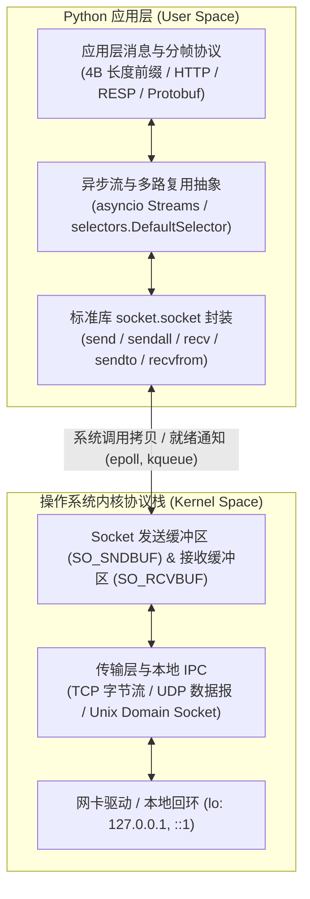
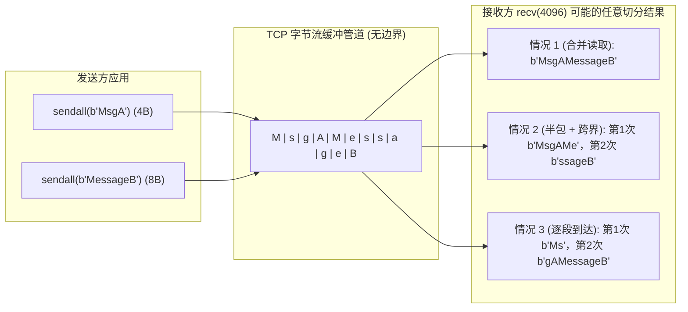

# 网络编程基础：Socket、TCP/UDP 与多路复用

即使在日常业务开发中你更多使用 `httpx`、FastAPI、gRPC 或数据库驱动等高层库，所有跨进程与跨机器通信最终都会收敛到操作系统内核提供的同一套原语——**Socket（套接字）**。线上最棘手的一类生产故障——服务滚动重启报 `Address already in use`、高并发下偶发报文截断或错位（俗称“粘包”）、半开死连接挂死工作线程、以及慢速客户端拖垮服务端内存（背压缺失导致 OOM）——本质上全都源于对传输层协议边界与内核套接字缓冲区行为的误解。

本章将沿着**“内核套接字抽象 → TCP 字节流分帧协议 → UDP 数据报通信 → `selectors` 多路复用与 `asyncio` 背压流”**四层脉络，构建扎实的现代 Python 网络工程底座。



---

## Socket 套接字抽象、地址族与名称解析

在 POSIX 与现代操作系统视角下，Socket 是一个指向内核网络通信端点的**文件描述符（File Descriptor，简称 FD）**。每创建一个连接的 Socket，内核都会为其分配独立的**发送缓冲区（Send Buffer）**与**接收缓冲区（Receive Buffer）**——Python 中的 `sock.send()` 并不是“直接把字节推上物理网线”，而是将用户态 `bytes` 拷贝进内核发送缓冲区，后续的分段、重传、拥塞控制均由内核协议栈异步完成。

创建一个套接字由三个正交维度唯一确定：`socket.socket(family, type, proto=0)`。

### 地址族（Address Family）：`AF_INET`、`AF_INET6` 与 `AF_UNIX`

地址族决定了内核如何寻址通信对端，以及 Python API 中地址参数的元组结构：

| 地址族常量 | 寻址空间 | Python 地址参数格式 | 典型应用场景与工程特性 |
| :--- | :--- | :--- | :--- |
| `socket.AF_INET` | IPv4（32 位地址） | 二元组 `(host: str, port: int)`，如 `("127.0.0.1", 8080)` | 传统局域网与公网通信；绑定 `"0.0.0.0"` 表示监听本机所有 IPv4 网卡，绑定 `"127.0.0.1"` 仅限本机回环访问 |
| `socket.AF_INET6` | IPv6（128 位地址） | 四元组 `(host, port, flowinfo, scope_id)`，通常简写为二元组 `("::1", 8080)` | 现代云原生、移动网络与双栈环境；绑定 `"::"` 监听所有 IPv6 接口（受 `IPV6_V6ONLY` 选项控制是否兼容 IPv4 映射） |
| `socket.AF_UNIX` | 本地文件系统路径或抽象命名空间 | 字符串路径或 `bytes`，如 `"/run/uvicorn.sock"` | **本机跨进程通信（IPC）首选**（仅类 Unix 系统以及现代 Windows 10+ 部分支持 `SOCK_STREAM`）；完全绕过 TCP/IP 网络协议栈、无需计算路由与 IP 校验和，延迟更低、吞吐更高，且可直接通过文件系统权限（`chmod` / `chown`）做访问控制 |

!!! tip "何时优先选用 `AF_UNIX`（Unix Domain Socket）？"
    当 Nginx 反向代理与同机部署的 Gunicorn / Uvicorn Python 进程通信，或者客户端连接本机 Docker 守护进程（`/var/run/docker.sock`）、PostgreSQL / Redis 本地实例时，使用 `AF_UNIX` 不仅消除了 TCP 三次握手与本地临时端口（Ephemeral Ports）占用，通常还能降低 `20%~40%` 的系统调用与协议栈开销。注意 `AF_UNIX` 服务端绑定路径前，若上次异常崩溃残留了同名 `.sock` 文件，需先确认无活跃监听并安全清理旧路径。

### 套接字类型（Socket Kind）：`SOCK_STREAM` 与 `SOCK_DGRAM`

在确定地址族之后，第二个核心参数 `type` 决定了数据传输的可靠性与边界语义：

| 对比维度 | `socket.SOCK_STREAM`（对应 TCP） | `socket.SOCK_DGRAM`（对应 UDP） |
| :--- | :--- | :--- |
| **连接模型** | **面向连接**：通信前需完成三次握手，断开需四次挥手；点对点一对一 | **无连接**：无需握手，单个 Socket 可随时向任意多个目标地址收发数据 |
| **数据边界** | **无消息边界的连续字节流（Byte Stream）**：应用层必须自行设计分帧协议 | **严格保留报文边界（Datagram）**：一次 `sendto` 严格对应对端一次 `recvfrom` |
| **可靠性与顺序** | 内核保证**不丢、不重、按序到达**（ACK 确认、超时重传、序列号重排） | **尽力而为（Best-Effort）**：可能丢包、乱序或重复到达，无内核级重传 |
| **流控与拥塞控制** | 内置滑动窗口流量控制与 BBR / CUBIC 拥塞控制，保护网络与慢速接收端 | 无内置流控与拥塞控制，发送速率完全由应用层自行节制 |
| **首部开销与延迟** | 首部至少 20 字节，握手与队头阻塞（Head-of-Line Blocking）带来额外延迟 | 首部固定 8 字节，零握手延迟、无队头阻塞 |
| **典型上层协议** | HTTP/1.1、HTTP/2、TLS、SSH、PostgreSQL、MySQL、Redis | DNS 查询、HTTP/3（QUIC）、WebRTC 音视频流、NTP 校时、游戏状态同步 |

### `SO_REUSEADDR` 深入解析：为什么服务重启会报 `Address already in use`？

开发服务端程序时，几乎每个人都会遇到这一经典报错：停止服务端进程后立即重新启动，调用 `sock.bind(("0.0.0.0", 8080))` 抛出 `OSError: [Errno 98] Address already in use`（macOS 上为 `Errno 48`）。

要理解根源，必须看清 TCP 四次挥手的状态机：**主动发起关闭（先发 `FIN` 包）的一方，在发送完最后一个 `ACK` 后，必须进入 `TIME_WAIT` 状态并持续等待 `2 * MSL`（Maximum Segment Lifetime，Linux 默认固定为 60 秒）**。如果服务端在仍有活跃客户端连接时主动重启（即服务端充当了主动关闭方），旧连接四元组就会停留在 `TIME_WAIT` 状态长达一分钟，有两个核心目的：

1. 确保对端收到最后的 `ACK`（若最后的 `ACK` 丢失，对端重传 `FIN` 时本端仍能响应）；
2. 让网络中残留的旧连接迷途报文在 `2 * MSL` 内自然消亡，防止污染随后复用相同四元组的新连接。

在默认情况下，只要本地端口上仍挂着处于 `TIME_WAIT` 状态的旧连接，内核就不允许新监听套接字再次 `bind` 该端口。**生产级 TCP 服务端必须在 `bind()` 之前显式开启 `SO_REUSEADDR` 套接字选项**：

```python
import socket

with socket.socket(socket.AF_INET, socket.SOCK_STREAM) as server_sock:
    # 关键：必须在 bind() 之前设置 SO_REUSEADDR！
    server_sock.setsockopt(socket.SOL_SOCKET, socket.SO_REUSEADDR, 1)
    server_sock.bind(("127.0.0.1", 0))  # 端口 0 表示让内核自动分配空闲临时端口
    server_sock.listen(128)
    print("监听地址:", server_sock.getsockname())
```

输出示例：

```text
监听地址: ('127.0.0.1', 58412)
```

!!! warning "`SO_REUSEADDR` 的跨平台安全差异（POSIX vs Windows）"
    - 在 **Linux / macOS（POSIX）** 上，`SO_REUSEADDR` 允许新监听 Socket 抢占仅处于 `TIME_WAIT` 状态的端口，但**绝对禁止**两个进程同时绑定完全相同的 `(IP, Port)` 处于活跃 `LISTEN` 状态（若需多进程内核级负载均衡监听同一端口，Linux 3.9+ 使用独立的 `SO_REUSEPORT`）。
    - 在 **Windows** 上，历史遗留的 `SO_REUSEADDR` 语义极其危险——它甚至允许另一个进程劫持绑定正在活跃监听的端口！因此在 Windows 生产环境中，若不希望端口被其他进程意外劫持，应关注 Windows 专属的 `socket.SO_EXCLUSIVEADDRUSE` 选项（Python `http.server` 与 `asyncio` 在底层已做了跨平台适配）。

### 协议无关地址解析 `socket.getaddrinfo()` 与网络字节序

早期教材常演示 `socket.gethostbyname(hostname)`，但该接口存在两大硬伤：**仅支持 IPv4**（在纯 IPv6 容器或双栈环境中直接失效），且不支持同时解析服务端口与协议类型。

现代网络编程中，**应当统一使用 `socket.getaddrinfo()` 进行协议无关（Protocol-Independent）的名称解析**，或者在客户端直连场景下直接使用高层辅助函数 `socket.create_connection()`（它内部会自动调用 `getaddrinfo` 并依次尝试返回的 IPv6 / IPv4 地址，直到成功建立连接）：

```python
import socket

# 查询本机回环地址在 TCP 流式套接字下的所有可用端点配置
infos = socket.getaddrinfo(
    host="127.0.0.1",
    port=8080,
    family=socket.AF_UNSPEC,     # 同时接纳 AF_INET 与 AF_INET6
    type=socket.SOCK_STREAM,     # 仅筛选 TCP 流式套接字
)

for family, socktype, proto, canonname, sockaddr in infos:
    print(f"family={family.name}, type={socktype.name}, sockaddr={sockaddr}")
```

输出：

```text
family=AF_INET, type=SOCK_STREAM, sockaddr=('127.0.0.1', 8080)
```

与此同时，当两台不同 CPU 架构的机器通过网络交换多字节二进制整数（例如 16 位端口号、32 位帧长度）时，必须约定统一的**字节序（Endianness）**：

- **主机字节序（Host Byte Order）**：现代主流处理器（x86_64 与 Apple Silicon ARM64）均采用**小端序（Little-Endian）**，即低有效字节存放在低内存地址（整数 `0x12345678` 在内存中依次存储为 `78 56 34 12`）。
- **网络字节序（Network Byte Order，RFC 1700）**：TCP/IP 协议簇统一规定采用**大端序（Big-Endian）**，即高有效字节先传输（`12 34 56 78`），符合人类从左到右阅读十六进制数的直觉。

虽然 `socket` 模块保留了 C 语言传统的 `htons()` / `htonl()` / `ntohs()` / `ntohl()` 函数，但在现代 Python 工程中，**强烈推荐统一使用 [05 流式 I/O 与序列化](05-io-streams-and-serialization.md) 介绍过的 `struct` 模块，并以格式前缀 `!`（代表 Network = Big-Endian 标准对齐）直接打包与解包二进制协议头**：

```python
import struct
import sys

value = 0x12345678
net_bytes = struct.pack("!I", value)  # !I 表示网络大端序 4 字节无符号整数 (uint32)

print("当前 CPU 字节序:", sys.byteorder)
print("网络字节序十六进制:", net_bytes.hex(" "))
assert struct.unpack("!I", net_bytes)[0] == value
```

输出：

```text
当前 CPU 字节序: little
网络字节序十六进制: 12 34 56 78
```

---

## TCP 字节流本质与消息分帧协议（Framing）

### 彻底破除“TCP 粘包”误区：TCP 根本没有“包”的概念

中文技术社区流传甚广的“TCP 粘包 / 拆包问题”，命名本身极具误导性——它让许多初学者误以为 TCP 协议存在某种把两个数据包错误粘连在一起的缺陷。

事实恰恰相反：**TCP（`SOCK_STREAM`）从诞生第一天起，向应用层承诺的抽象就是一条连续、无结构的可靠字节流（Byte Stream），就像自来水管道里的水流一样，根本不存在天然的“消息边界”**。



由于内核发送端的 Nagle 合并算法、链路层 MSS（最大报文段长度）切片、网卡 TSO/GRO 卸载以及接收端缓冲区异步积压，发送方连续调用两次 `send()` 写出的字节，在接收方调用 `sock.recv(4096)` 时，**以上三种情况全部都是完全合法、随时可能发生的正常现象**！在局域网低负载测试时“恰好每次 `recv(4096)` 都拿到完整一条 JSON”，只是因为消息极小且发送间隔远大于 RTT 造成的巧合；一旦上线遭遇高并发或跨公网抖动，这种假设必定崩溃。

### `send()` vs `sendall()`，以及 `recv()` 返回空字节串 `b""` 的精确语义

在手写基于 Socket 的协议代码前，必须牢牢掌握以下三条生死攸关的读写契约：

1. **`sock.send(data)` 可能只发出一部分字节！**
   当内核发送缓冲区剩余空间不足以容纳整个 `data`（例如 `data` 有 `1 MiB`，而内核发送缓冲区仅剩 `48 KiB` 空闲）时，`send(data)` 只会拷入 `48 KiB` 并**立即返回实际写入的字节数 `49152`**，绝不会报错！如果你忽略了 `send()` 的返回值，剩下的字节就会被静默丢弃。
2. **同步阻塞场景下发送完整数据应使用 `sock.sendall(data)`**：
   `sendall()` 在 C 语言底层自动维护了一个循环：不断调用 `send` 切片推进游标，直到 `data` 中所有字节全部移交内核发送缓冲区后才返回 `None`（若中途连接断开或超时则直接抛出异常）。
3. **`sock.recv(bufsize)` 的 `bufsize` 只是“上限”，且返回 `b""` 代表对端关闭（EOF）！**
   - `recv(4096)` 的含义是：“最多读取 4096 字节；只要内核接收缓冲区里有**哪怕 1 个字节**可读，就立即返回那部分字节”。
   - **关键红线**：当且仅当对端调用了 `close()` 或 `shutdown(SHUT_WR)` 发送了 TCP `FIN` 报文时，本端读完剩余数据后的 `recv()` 才会**立即返回空字节串 `b""`（长度为 0）**。如果连接正常但对端暂时没发数据，阻塞 `recv()` 会挂起等待（非阻塞模式则抛出 `BlockingIOError`），**永远不会用 `b""` 表示“暂时没数据”**！在循环中忘记判断 `if not chunk: break`，会导致对端断开后本端陷入 `recv()` 无限返回 `b""` 的 `100% CPU` 死循环。

### 4 字节大端长度前缀分帧协议（Length-Prefixed Framing）完整实战

既然 TCP 不提供消息边界，应用层就必须在字节流之上自行定义**分帧协议（Framing Protocol）**。业界主要有三类标准方案：

| 分帧方案 | 编码规则 | 代表协议 | 优缺点评估 |
| :--- | :--- | :--- | :--- |
| **定长帧** | 每条消息固定 `N` 字节，不足补零 | 早期金融报盘、硬件遥测 | 解析极简，但短消息浪费带宽，长消息无法扩展 |
| **分隔符帧** | 以特殊字节序列（如 `\r\n` 或 `\n`）结尾 | HTTP/1.1 头部、SMTP、JSON Lines（NDJSON） | 人类可读性好；但载荷内部若含分隔符需转义，且需逐字节扫描边界 |
| **长度前缀帧（首选）** | **固定长度头部（如 4B 大端 `uint32`）声明紧随其后的载荷字节长度** | HTTP/2 Frame、gRPC、PostgreSQL、Kafka、Redis Bulk String | **二进制安全（可传任意字节无需转义）**、预先精确知晓需分配内存大小、解析性能最高 |

下面我们用纯标准库手写一套**生产级 4 字节大端长度前缀分帧协议**，并在本机回环接口（`127.0.0.1` + 随机端口 `0`）上启动真实服务端线程与客户端进行高强度连发验证。注意代码中的两个工程细节：

- **防御超大帧内存耗尽攻击（`MAX_FRAME_SIZE`）**：如果恶意客户端或错位协议发来 `0xFFFFFFFF`（4 GiB）作为长度头，不做上限校验直接分配内存会瞬间打崩服务端；
- **严格区分“帧边界处的正常关闭（Clean EOF）”与“半包截断（Truncated Frame）”**：读取 4 字节帧头的第一个字节就遇到 `b""` 说明对端优雅关闭了连接；但若帧头读了 2 个字节或载荷读了一半突然遇到 `b""`，说明连接异常中断，必须抛出 `EOFError` 拒绝残缺脏数据！

```python
import json
import socket
import struct
import threading
from typing import Any

# 帧头格式：4 字节网络字节序（大端）无符号整数 (!I)，可表达 0 ~ 4 GiB 长度
HEADER_STRUCT = struct.Struct("!I")
# 安全防线：限制单帧最大载荷为 16 MiB，防止恶意超大长度头触发 OOM
MAX_FRAME_SIZE = 16 * 1024 * 1024


def recv_exact(sock: socket.socket, num_bytes: int) -> bytes:
    """从流式 Socket 精确读取 num_bytes 个字节；若中途遇到 EOF 则抛出 EOFError。"""
    if num_bytes < 0:
        raise ValueError(f"num_bytes 必须为非负整数，收到: {num_bytes}")
    if num_bytes == 0:
        return b""

    buf = bytearray(num_bytes)
    view = memoryview(buf)
    read_so_far = 0

    while read_so_far < num_bytes:
        # recv_into 直接写入预分配缓冲区切片，避免多次小块 bytes 拼接拷贝
        n = sock.recv_into(view[read_so_far:], num_bytes - read_so_far)
        if n == 0:
            raise EOFError(
                f"连接在帧传输中途意外断开：期望读取 {num_bytes} 字节，实际仅收到 {read_so_far} 字节"
            )
        read_so_far += n

    return bytes(buf)


def send_frame(sock: socket.socket, payload: bytes) -> None:
    """将二进制载荷封装为 [4B 大端长度头 + payload] 并完整写出。"""
    length = len(payload)
    if length > MAX_FRAME_SIZE:
        raise ValueError(f"单帧载荷 {length} B 超过安全上限 {MAX_FRAME_SIZE} B")
    header = HEADER_STRUCT.pack(length)
    # 合并头部与载荷（小消息减少一次系统调用，大消息也可分两次 sendall）
    sock.sendall(header + payload)


def recv_frame(sock: socket.socket) -> bytes | None:
    """读取并解包下一帧；若对端在帧边界处正常关闭连接（Clean EOF），返回 None。"""
    # 先尝试读取帧头的第 1 个字节以探测正常 EOF，还是进入完整 4 字节读取
    first = sock.recv(1)
    if first == b"":
        return None  # 对端已优雅发送 FIN 关闭写方向，无后续帧

    rest_header = recv_exact(sock, HEADER_STRUCT.size - 1)
    (payload_len,) = HEADER_STRUCT.unpack(first + rest_header)

    if payload_len > MAX_FRAME_SIZE:
        raise ValueError(f"拒绝非法帧长度: {payload_len} B > 上限 {MAX_FRAME_SIZE} B")

    return recv_exact(sock, payload_len)


def run_framing_demo() -> None:
    """本地回环 (127.0.0.1, 随机端口 0) 端到端验证长度前缀分帧。"""
    server_sock = socket.socket(socket.AF_INET, socket.SOCK_STREAM)
    server_sock.setsockopt(socket.SOL_SOCKET, socket.SO_REUSEADDR, 1)
    server_sock.bind(("127.0.0.1", 0))
    server_sock.listen(8)
    host, port = server_sock.getsockname()

    def server_worker() -> None:
        with server_sock:
            conn, _ = server_sock.accept()
            with conn:
                while True:
                    raw = recv_frame(conn)
                    if raw is None:
                        break  # 客户端已正常结束发送
                    req: dict[str, Any] = json.loads(raw.decode("utf-8"))
                    resp = {
                        "seq": req["seq"],
                        "echo_size": len(req["body"]),
                        "status": "ok",
                    }
                    send_frame(conn, json.dumps(resp).encode("utf-8"))

    t = threading.Thread(target=server_worker, daemon=True)
    t.start()

    # 客户端极速连续发送 20 条大小悬殊的消息（包含微小包与 128 KB 大包），验证绝不粘连或错位
    with socket.create_connection((host, port), timeout=5.0) as client_sock:
        expected_sizes: list[int] = []
        for seq in range(20):
            body = "X" * (131072 if seq % 5 == 0 else seq * 3 + 1)
            expected_sizes.append(len(body))
            msg = json.dumps({"seq": seq, "body": body}).encode("utf-8")
            send_frame(client_sock, msg)

        # 半关闭写方向：发送 FIN 通知服务端请求流已发完，同时保持本端读方向继续接收响应
        client_sock.shutdown(socket.SHUT_WR)

        received_sizes: list[int] = []
        while (reply_bytes := recv_frame(client_sock)) is not None:
            reply = json.loads(reply_bytes.decode("utf-8"))
            received_sizes.append(reply["echo_size"])

    t.join(timeout=2.0)
    assert received_sizes == expected_sizes
    print(f"成功收发并精确解帧 {len(received_sizes)} 条消息，最大单帧 {max(received_sizes)} 字节！")


if __name__ == "__main__":
    run_framing_demo()
```

输出：

```text
成功收发并精确解帧 20 条消息，最大单帧 131072 字节！
```

!!! tip "善用 `sock.shutdown(socket.SHUT_WR)` 实现 TCP 半关闭"
    TCP 是全双工通道，读写两个方向相互独立。直接调用 `sock.close()` 会立即同时关闭读写双向（释放本地 FD 引用）；而像上面客户端那样调用 `shutdown(socket.SHUT_WR)` 则只向对端发送 `FIN` 宣告“我不会再发新请求了”，同时依然保持读通道畅通，优雅收完服务端发回的最后几批响应帧后再执行 `close()`。

---

## UDP 无连接数据报通信

与 TCP 的连续字节流截然不同，UDP（`SOCK_DGRAM`）在内核中严格保留每一次发送的数据报边界：

- 发送方使用 `sock.sendto(data, address)` 直接指定目标 `(host, port)` 发送一个独立数据报；
- 接收方使用 `data, sender_addr = sock.recvfrom(bufsize)` 一次取走一整个数据报，并同时获知发送方的源地址。

### UDP 工程红线：单报文 MTU 上限、截断丢弃与超时重试

将 UDP 用于生产系统（例如自研健康探测、StatsD 指标上报、DNS 客户端或内网服务发现）时，必须严守三条工程准则：

1. **严控单报文大小，避开 IP 层分片（MTU 限制）**：
   虽然 UDP 协议头的 16 位长度字段理论上允许单包最大载荷为 `65535 - 20(IPv4头) - 8(UDP头) = 65507` 字节，但标准以太网链路层 **MTU（最大传输单元）仅为 `1500` 字节**。一旦单个 UDP 载荷超过 `1472` 字节（公网经由 PPPoE、VPN 隧道或 IPv6 时安全上限更低），IP 层就会被迫将其拆成多个 IP 分片传输——**只要其中任意一个分片丢失，整个 UDP 数据报就会被接收端内核直接丢弃**，丢包率呈指数级恶化！因此现代协议（如 QUIC / DNS EDNS0）普遍将单个 UDP 载荷严格控制在 **`1200 ~ 1400` 字节以内**。
2. **`recvfrom(bufsize)` 缓冲区必须大于等于最大预期报文**：
   在 TCP 中，`recv(16)` 读不完的字节会安全留在内核缓冲区等下次再读；**而在 UDP 中，如果对端发来 500 字节数据报，你却调用 `recvfrom(100)`，多出来的 400 字节会被内核永久截断丢弃**（在 Windows 上甚至会直接抛出 `OSError: [WinError 10040] WSAEMSGSIZE`）！通常应传入 `recvfrom(2048)` 或 `recvfrom(65535)`。
3. **应用层必须自行实现请求 ID 匹配、超时与退避重试**：
   UDP 没有连接概念，数据包丢失时内核不会报错也不会重传，阻塞的 `recvfrom()` 只会永远挂死。客户端必须配置 `settimeout()`，并在报文中携带单调递增或随机生成的 `request_id`，过滤迟到的旧重传响应。

### 本地回环 `127.0.0.1` 随机端口 UDP 请求/重试完整示例

```python
import json
import socket
import threading
from typing import Any

MAX_UDP_PAYLOAD = 1200  # 遵循公网安全 MTU 准则，避免 IP 分片


def udp_echo_server(sock: socket.socket, stop_event: threading.Event) -> None:
    """轻量 UDP 数据报响应服务。"""
    sock.settimeout(0.2)
    while not stop_event.is_set():
        try:
            datagram, client_addr = sock.recvfrom(2048)
        except TimeoutError:
            continue

        req = json.loads(datagram.decode("utf-8"))
        resp = {
            "req_id": req["req_id"],
            "result": req["metric"].upper(),
        }
        sock.sendto(json.dumps(resp).encode("utf-8"), client_addr)


def udp_request_with_retry(
    server_addr: tuple[str, int],
    metric: str,
    timeout_sec: float = 0.3,
    max_retries: int = 3,
) -> dict[str, Any]:
    """带请求 ID 校验与超时重试的 UDP 客户端调用。"""
    req_id = 1001
    payload = json.dumps({"req_id": req_id, "metric": metric}).encode("utf-8")
    if len(payload) > MAX_UDP_PAYLOAD:
        raise ValueError(f"UDP 载荷 ({len(payload)} B) 超过安全 MTU 阈值 {MAX_UDP_PAYLOAD} B")

    with socket.socket(socket.AF_INET, socket.SOCK_DGRAM) as cli:
        cli.settimeout(timeout_sec)
        for attempt in range(1, max_retries + 1):
            cli.sendto(payload, server_addr)
            try:
                while True:
                    raw, _ = cli.recvfrom(2048)
                    resp: dict[str, Any] = json.loads(raw.decode("utf-8"))
                    # 校验 req_id，防止上一轮超时迟到的旧报文张冠李戴
                    if resp.get("req_id") == req_id:
                        return resp
            except TimeoutError:
                if attempt == max_retries:
                    raise TimeoutError(f"UDP 请求经 {max_retries} 次重试仍未收到响应") from None

    raise RuntimeError("unreachable")


def run_udp_demo() -> None:
    srv_sock = socket.socket(socket.AF_INET, socket.SOCK_DGRAM)
    srv_sock.bind(("127.0.0.1", 0))
    server_addr = srv_sock.getsockname()

    stop_evt = threading.Event()
    worker = threading.Thread(target=udp_echo_server, args=(srv_sock, stop_evt), daemon=True)
    worker.start()

    try:
        reply = udp_request_with_retry(server_addr, metric="cpu.load.1m")
        assert reply == {"req_id": 1001, "result": "CPU.LOAD.1M"}
        print("UDP 响应成功:", reply)
    finally:
        stop_evt.set()
        worker.join(timeout=1.0)
        srv_sock.close()


if __name__ == "__main__":
    run_udp_demo()
```

输出：

```text
UDP 响应成功: {'req_id': 1001, 'result': 'CPU.LOAD.1M'}
```

---

## 非阻塞 Socket、I/O 多路复用（`selectors`）与 `asyncio` Streams

如果采用“每来一个客户端连接就分配一个专属线程阻塞等待 `recv()`”的同步模型，处理几十个连接尚能应付，但一旦面对成千上万个长连接（即经典的 **C10K / C100K 问题**），光是数千个操作系统线程栈的内存消耗与上下文切换就会把机器拖垮。解决这一问题的基石正是**非阻塞 I/O（Non-blocking I/O）配合操作系统内核的 I/O 多路复用（I/O Multiplexing）**。

### 阻塞、超时与非阻塞三种模式对比

通过 `sock.setblocking(flag)` 或 `sock.settimeout(value)`，同一个 Socket 可以在三种工作模式间切换：

| 模式 | 设置方式 | 内核缓冲区未就绪时的行为 | 适用场景 |
| :--- | :--- | :--- | :--- |
| **阻塞模式（默认）** | `sock.setblocking(True)` 或 `settimeout(None)` | **无限期挂起当前线程**，直到至少有数据可读/空间可写或连接断开 | 极简命令行脚本（生产环境严禁无超时裸奔，半开死连接会永久卡死线程） |
| **超时阻塞模式** | `sock.settimeout(5.0)`（正浮点数秒） | 挂起等待最多 `5.0` 秒；若仍未就绪则抛出内置 **`TimeoutError`**（Python 3.10+ 已将 `socket.timeout` 统一合并为内置 `TimeoutError` 的子类/别名） | 同步客户端（`urllib`、线程池数据库驱动、受控的同步 RPC） |
| **非阻塞模式** | `sock.setblocking(False)`（等价于 `settimeout(0.0)`） | **永不挂起线程**！若当前无法立即完成读写，瞬间抛出 **`BlockingIOError`**（对应底层 `EAGAIN` / `EWOULDBLOCK`） | 配合 `selectors` 或 `asyncio` 事件循环构建单线程高并发 Reactor 网络引擎 |

!!! note "非阻塞 `connect()` 的特殊行为"
    在非阻塞 Socket 上调用 `sock.connect((host, port))` 时，由于 TCP 三次握手需要至少一个网络往返时间（RTT）才能完成，调用会**立即抛出 `BlockingIOError`（`EINPROGRESS`）**——这并非连接失败，而是代表内核已在后台发起 `SYN` 握手；当该 Socket 在多路复用器中首次变为**可写（`EVENT_WRITE`）**并通过 `getsockopt(SOL_SOCKET, SO_ERROR) == 0` 校验时，即代表握手完成！

### 使用 `selectors.DefaultSelector` 构建单线程多路复用 Reactor

如果只是单纯把 1000 个 Socket 设为 `setblocking(False)` 然后在 `while True` 里轮询 `try: sock.recv()`，无事可做时 CPU 会瞬间飙到 `100%` 空转。我们需要反过来请求操作系统内核：**“请帮我同时盯着这 1000 个 FD，当其中任何一个真正可读或可写时再唤醒我，并直接告诉我具体是哪几个 FD 就绪了。”**

标准库 `selectors` 模块将各操作系统的最佳内核多路复用原语封装为了统一的 `selectors.DefaultSelector`：

- **Linux**：自动选用 `EpollSelector`（基于 `epoll`，时间复杂度 `O(就绪连接数)`，无连接数硬上限）；
- **macOS / BSD**：自动选用 `KqueueSelector`（基于 `kqueue`，同样为 `O(就绪连接数)` 高性能事件通知）；
- **Windows**：自动回退为 `SelectSelector`（基于 `select`）。

下面我们用不到 90 行标准库代码，从零实现一个经典的**单线程 Reactor 事件循环服务端**，在单个线程内同时监听新连接接入与多个客户端的并发读写——这正是 Nginx、Redis 以及 Python `asyncio` 事件循环最核心的底层骨架：

```python
from dataclasses import dataclass, field
import selectors
import socket


@dataclass
class ConnState:
    """每个客户端连接的非阻塞读写缓冲状态机。"""

    addr: tuple[str, int]
    out_buf: bytearray = field(default_factory=bytearray)


class SingleThreadReactorServer:
    """基于 selectors.DefaultSelector 的单线程多客户端并发回显服务器。"""

    def __init__(self, host: str = "127.0.0.1", port: int = 0) -> None:
        self.sel = selectors.DefaultSelector()
        self.listen_sock = socket.socket(socket.AF_INET, socket.SOCK_STREAM)
        self.listen_sock.setsockopt(socket.SOL_SOCKET, socket.SO_REUSEADDR, 1)
        self.listen_sock.bind((host, port))
        self.listen_sock.listen(128)
        self.listen_sock.setblocking(False)  # 必须设为非阻塞！
        self.address: tuple[str, int] = self.listen_sock.getsockname()

        # 注册监听套接字：data=None 标识它是负责 accept 的监听 FD
        self.sel.register(self.listen_sock, selectors.EVENT_READ, data=None)

    def _accept(self, sock: socket.socket) -> None:
        conn, addr = sock.accept()
        conn.setblocking(False)
        # 初始只关注 EVENT_READ！只有当 out_buf 有待发数据时才按需开启 EVENT_WRITE
        self.sel.register(conn, selectors.EVENT_READ, data=ConnState(addr=addr))

    def _service_connection(self, key: selectors.SelectorKey, mask: int) -> None:
        sock: socket.socket = key.fileobj  # type: ignore[assignment]
        state: ConnState = key.data

        if mask & selectors.EVENT_READ:
            try:
                chunk = sock.recv(4096)
            except BlockingIOError:
                chunk = None
            except ConnectionResetError:
                self._close_conn(sock)
                return

            if chunk == b"":
                # 客户端发送 FIN 关闭连接
                self._close_conn(sock)
                return
            if chunk:
                # 收到数据后放入该连接的专属待发送缓冲区，并开启写就绪监听
                state.out_buf.extend(chunk.upper())
                self.sel.modify(sock, selectors.EVENT_READ | selectors.EVENT_WRITE, data=state)

        if (mask & selectors.EVENT_WRITE) and state.out_buf:
            try:
                # 非阻塞模式下绝不能调 sendall！必须用 send 发出当前能接纳的字节数
                sent = sock.send(state.out_buf)
                del state.out_buf[:sent]
            except BlockingIOError:
                pass
            except BrokenPipeError:
                self._close_conn(sock)
                return

            # 关键：一旦待发缓冲区清空，立即取消 EVENT_WRITE 关注，否则会导致事件循环空转！
            if not state.out_buf:
                self.sel.modify(sock, selectors.EVENT_READ, data=state)

    def _close_conn(self, sock: socket.socket) -> None:
        self.sel.unregister(sock)
        sock.close()

    def poll_once(self, timeout: float = 0.1) -> None:
        for key, mask in self.sel.select(timeout=timeout):
            if key.data is None:
                self._accept(key.fileobj)  # type: ignore[arg-type]
            else:
                self._service_connection(key, mask)

    def close(self) -> None:
        for key in list(self.sel.get_map().values()):
            self.sel.unregister(key.fileobj)
            key.fileobj.close()  # type: ignore[union-attr]
        self.sel.close()
```

!!! warning "`selectors` / `epoll` 最容易踩的 `100% CPU` 死循环陷阱"
    只要内核发送缓冲区没满（99.9% 的时刻都是没满的），Socket 就永远处于**可写（`EVENT_WRITE` 就绪）**状态！如果你在连接刚建立、手里根本没有数据要发时就常驻注册 `EVENT_READ | EVENT_WRITE`，`sel.select()` 每次调用都会瞬间返回该连接可写，导致单线程 CPU 跑满 `100%` 空转。**务必遵守铁律：平时只注册 `EVENT_READ`；仅当 `out_buf` 非空（或上次非阻塞 `send` 未发完）时动态 `modify` 加上 `EVENT_WRITE`，发完后立即切回仅 `EVENT_READ`。**

### 高层 `asyncio` Streams：自动解帧、写背压（`drain()`）与优雅关闭

直接手写 `selectors` 状态机虽然性能强悍，但代码充斥着显式缓冲区切片与回调跳转。正如 [09 异步编程与 asyncio 结构化并发](09-asyncio-and-structured-concurrency.md) 所讲，`asyncio` 在底层封装了 `DefaultSelector` 与非阻塞 Socket，向上暴露了极其优雅的协程流接口——`asyncio.start_server()` 与 `asyncio.open_connection()`，将每个连接抽象为一对 `(StreamReader, StreamWriter)`：

| 核心操作 | `StreamReader` / `StreamWriter` 标准写法 | 底层原理解析与常见踩坑点 |
| :--- | :--- | :--- |
| **精确读取定长帧** | `data = await reader.readexactly(n)` | 异步版 `recv_exact`：若到达 EOF 时不足 `n` 字节，自动抛出 `asyncio.IncompleteReadError`（其 `.partial` 属性保存已读残余字节，长度为 `0` 即代表帧边界正常 EOF！） |
| **按分隔符读一行** | `line = await reader.readline()` | 读取直到 `\n`（默认单行上限 `limit=64 KiB`，超限抛出 `LimitOverrunError` 防内存攻击） |
| **写入并施加背压** | `writer.write(b)` **紧跟** `await writer.drain()` | **`write()` 是普通同步函数**，只把数据塞进内存缓冲！**必须配合 `await writer.drain()` 才能触发高水位暂停背压** |
| **标准双向关闭** | `writer.close()` **紧跟** `await writer.wait_closed()` | `close()` 仅发起异步关闭流程；**必须 `await writer.wait_closed()`** 等待底层 Socket / TLS 彻底刷空关闭，否则会泄漏异常或报 `ResourceWarning` |

#### 深入理解 `await writer.drain()`：为什么漏写它会引发生产 OOM？

这是异步网络编程面试与线上排障的最高频考点：为什么 `writer.write(chunk)` 不是 `async` 函数，却还要专门设计一个 `await writer.drain()`？

假设服务端正在以 `500 MB/s` 的速度从磁盘或内存生成数据流，而某个客户端处于弱网环境，接收窗口只能以 `50 KB/s` 消费。如果服务端循环里只写 `writer.write(chunk)` 而不调用 `await writer.drain()`：

1. 非阻塞 Socket 的内核发送缓冲区瞬间被塞满；
2. `writer.write()` 不会阻塞，而是把发不出去的所有 `chunk` 无限追加到 Python 进程用户态的待发送缓冲区中；
3. 短短几秒内，一个慢速客户端就能吃光服务端数 GB 内存，直接触发 Linux OOM Killer 杀死整个进程！

```mermaid
sequenceDiagram
    participant Coro as 业务协程 (Producer)
    participant Writer as StreamWriter 用户态缓冲
    participant Loop as asyncio 事件循环 & 内核 Socket

    Coro->>Writer: writer.write(chunk) (同步入队，缓冲达 80 KiB > 高水位 64 KiB)
    Writer->>Writer: 触发 pause_writing() 标记背压暂停
    Coro->>Writer: await writer.drain()
    Note over Coro,Writer: 协程在此挂起让出 CPU！停止继续生产新数据
    Loop-->>Writer: 对端消费数据，缓冲降至 12 KiB < 低水位 16 KiB
    Writer->>Writer: 触发 resume_writing() 解除背压
    Writer-->>Coro: drain() 恢复返回，协程安全继续下一轮写入
```

当缓冲区未超过高水位线（默认 `64 KiB`）时，`await writer.drain()` 几乎是零开销的快速通道；一旦超过高水位线，它就会立即挂起当前发送协程，直到内核将积压数据排空到低水位线（默认 `16 KiB`）以下——这就是**端到端流量背压（Backpressure）**的标准实现。

#### `asyncio` 长度前缀帧服务端与客户端完整实战

```python
import asyncio
import struct

HEADER = struct.Struct("!I")
MAX_FRAME = 16 * 1024 * 1024


async def async_send_frame(writer: asyncio.StreamWriter, payload: bytes) -> None:
    if len(payload) > MAX_FRAME:
        raise ValueError(f"载荷超限: {len(payload)}")
    writer.write(HEADER.pack(len(payload)) + payload)
    # 核心：每次批量写出后调用 drain() 传导背压，防止慢客户端撑爆内存
    await writer.drain()


async def async_recv_frame(reader: asyncio.StreamReader) -> bytes | None:
    try:
        header_bytes = await reader.readexactly(HEADER.size)
    except asyncio.IncompleteReadError as exc:
        if len(exc.partial) == 0:
            return None  # 帧边界处干净的 EOF（对端已关闭）
        raise EOFError(f"帧头截断：仅收到 {len(exc.partial)} 字节") from exc

    (length,) = HEADER.unpack(header_bytes)
    if length > MAX_FRAME:
        raise ValueError(f"非法帧长度: {length}")

    try:
        return await reader.readexactly(length)
    except asyncio.IncompleteReadError as exc:
        raise EOFError(f"载荷截断：期望 {length} 字节，仅收到 {len(exc.partial)} 字节") from exc


async def handle_client(reader: asyncio.StreamReader, writer: asyncio.StreamWriter) -> None:
    try:
        while True:
            # 为每次读帧设置 10 秒空闲超时，防御占着连接不说话的慢速攻击 (Slowloris)
            async with asyncio.timeout(10.0):
                frame = await async_recv_frame(reader)
            if frame is None:
                break
            await async_send_frame(writer, b"ACK:" + frame)
    finally:
        # 标准两步关闭序列：发起关闭 + 等待底层传输彻底清理完毕
        writer.close()
        await writer.wait_closed()


async def main() -> None:
    server = await asyncio.start_server(handle_client, host="127.0.0.1", port=0)
    host, port = server.sockets[0].getsockname()[:2]

    async with server:
        reader, writer = await asyncio.open_connection(host, port)
        try:
            for i in range(5):
                msg = f"task-{i}".encode("utf-8")
                await async_send_frame(writer, msg)
                reply = await async_recv_frame(reader)
                assert reply == b"ACK:" + msg
            print("asyncio 流式分帧交互全部通过，监听端口:", port)
        finally:
            writer.close()
            await writer.wait_closed()


if __name__ == "__main__":
    asyncio.run(main())
```

输出示例：

```text
asyncio 流式分帧交互全部通过，监听端口: 58490
```

---

## 练习与实战

### 练习 1：设计带魔数（Magic Bytes）、版本号与 CRC32 校验的二进制协议编解码器

真实工业协议（如 Kafka、RocketMQ 或自定义 RPC）通常不会只放一个裸 4 字节长度，而是会在固定协议头中加入**魔数（快速识别并踢掉误连的 HTTP/SSH 流量）**、**协议版本号**以及**完整性校验码**。

请基于 `struct` 与 `zlib.crc32` 实现一套二进制帧编解码函数 `encode_packet(version: int, payload: bytes) -> bytes` 与流式读取函数 `decode_packet_from_stream(stream: io.BufferedIOBase) -> tuple[int, bytes] | None`：

1. 固定帧头共 **11 字节**（网络字节序 `!`）：
   - `magic`（2 字节原样字节串 `b"KM"`，格式 `2s`）
   - `version`（1 字节无符号整数 `uint8`，格式 `B`）
   - `length`（4 字节无符号整数 `uint32`，格式 `I`，上限 `4 MiB`）
   - `crc32`（4 字节无符号整数 `uint32`，格式 `I`，对 `payload` 计算 `zlib.crc32(payload)`）
2. 当流在帧起点处即到达末尾（EOF）时返回 `None`；若魔数不匹配、长度超限、中途截断或 CRC32 校验失败，分别抛出语义清晰的异常。

??? success "点击查看答案与解析"
    **核心思路**：使用预编译的 `struct.Struct("!2sBII")` 一次性打包/解包 11 字节定长帧头（`2 + 1 + 4 + 4 = 11`）。读取时先读第 1 个字节区分干净的帧边界 EOF 与半包截断；解出 `magic`、`version`、`length`、`expected_crc` 后，先校验魔数与长度上限，再精确读取载荷并核对 `zlib.crc32(payload)`，防止损坏帧进入业务逻辑。
    
    ```python
    import io
    import struct
    import zlib
    
    MAGIC = b"KM"
    MAX_PACKET_LEN = 4 * 1024 * 1024
    # !2sBII -> 2B 魔数 + 1B 版本 + 4B 载荷长度 + 4B CRC32 = 11 字节
    PACKET_HEADER = struct.Struct("!2sBII")
    assert PACKET_HEADER.size == 11
    
    
    class ProtocolError(ValueError):
        """协议格式、魔数或校验和异常。"""
    
    
    def _read_exact(stream: io.BufferedIOBase, n: int) -> bytes:
        chunks: list[bytes] = []
        remaining = n
        while remaining > 0:
            chunk = stream.read(remaining)
            if not chunk:
                raise EOFError(f"流中途截断：还需 {remaining} 字节")
            chunks.append(chunk)
            remaining -= len(chunk)
        return b"".join(chunks)
    
    
    def encode_packet(version: int, payload: bytes) -> bytes:
        if not (0 <= version <= 255):
            raise ValueError("version 必须在 0..255 范围内")
        if len(payload) > MAX_PACKET_LEN:
            raise ProtocolError(f"载荷长度超限: {len(payload)}")
        checksum = zlib.crc32(payload)
        header = PACKET_HEADER.pack(MAGIC, version, len(payload), checksum)
        return header + payload
    
    
    def decode_packet_from_stream(stream: io.BufferedIOBase) -> tuple[int, bytes] | None:
        first = stream.read(1)
        if not first:
            return None  # 帧边界正常 EOF
    
        header_bytes = first + _read_exact(stream, PACKET_HEADER.size - 1)
        magic, version, length, expected_crc = PACKET_HEADER.unpack(header_bytes)
    
        if magic != MAGIC:
            raise ProtocolError(f"非法协议魔数: {magic!r}")
        if length > MAX_PACKET_LEN:
            raise ProtocolError(f"单帧长度超限: {length}")
    
        payload = _read_exact(stream, length)
        actual_crc = zlib.crc32(payload)
        if actual_crc != expected_crc:
            raise ProtocolError(
                f"CRC32 校验失败：期望 {expected_crc:#010x}，实际 {actual_crc:#010x}"
            )
        return version, payload
    
    
    # 1. 验证多帧连续粘连流的精确解码
    wire = (
        encode_packet(1, b"hello")
        + encode_packet(2, b"")
        + encode_packet(1, "二进制载荷".encode("utf-8"))
    )
    buf = io.BytesIO(wire)
    assert decode_packet_from_stream(buf) == (1, b"hello")
    assert decode_packet_from_stream(buf) == (2, b"")
    assert decode_packet_from_stream(buf) == (1, "二进制载荷".encode("utf-8"))
    assert decode_packet_from_stream(buf) is None
    
    # 2. 验证比特翻转篡改触发 CRC32 异常拦截
    corrupted = bytearray(encode_packet(1, b"transfer:100"))
    corrupted[-1] ^= 0xFF
    try:
        decode_packet_from_stream(io.BytesIO(bytes(corrupted)))
        raise AssertionError("应当拦截篡改报文")
    except ProtocolError as err:
        print("成功拦截损坏帧:", err)
    ```

### 练习 2：利用 `socket.socketpair()` 与 `selectors` 验证非阻塞双向状态机

在单元测试或沙箱环境中，我们经常使用 `socket.socketpair()` 创建一对已经在内核中彼此连通的匿名流式套接字（无需绑定网卡端口即可 100% 复现真实 Socket 缓冲区与 `BlockingIOError` 行为）。

请编写函数 `transfer_via_selector(payloads: list[bytes]) -> list[bytes]`：创建一对非阻塞 `socketpair`，在**同一个线程、同一个 `DefaultSelector` 循环**中同时管理发送端 `sock_w`（负责将 `payloads` 按 `\n` 行协议逐批非阻塞写出，写完后关闭 `sock_w`）与接收端 `sock_r`（负责非阻塞读取并按 `\n` 切分还原出完整的行列表，直到读到 EOF 退出循环）。确保发送完毕后及时注销 `sock_w` 的 `EVENT_WRITE` 监听。

??? success "点击查看答案与解析"
    **核心思路**：将待发送的所有行拼接放入 `out_buf = bytearray()`，初始为 `sock_w` 注册 `EVENT_WRITE`、为 `sock_r` 注册 `EVENT_READ`。每次事件循环唤醒时：若 `sock_w` 可写，使用 `sock_w.send(out_buf[:1024])` 模拟受限窗口分批写出，一旦 `out_buf` 清空立即 `unregister(sock_w)` 并调用 `sock_w.close()` 发送 EOF；若 `sock_r` 可读，将读取块追加到 `in_buf`，直到读到 `b""`（EOF）时关闭 `sock_r` 并将累积字节按行切分返回。
    
    ```python
    import selectors
    import socket
    
    
    def transfer_via_selector(lines: list[bytes]) -> list[bytes]:
        sock_w, sock_r = socket.socketpair()
        sock_w.setblocking(False)
        sock_r.setblocking(False)
    
        out_buf = bytearray(b"\n".join(lines) + (b"\n" if lines else b""))
        in_buf = bytearray()
    
        with selectors.DefaultSelector() as sel:
            sel.register(sock_r, selectors.EVENT_READ, data="reader")
            if out_buf:
                sel.register(sock_w, selectors.EVENT_WRITE, data="writer")
            else:
                sock_w.close()
    
            eof_reached = False
            while not eof_reached:
                for key, mask in sel.select(timeout=1.0):
                    if key.data == "writer" and (mask & selectors.EVENT_WRITE):
                        # 故意每次最多写 512 字节，验证多次非阻塞分片读写与拆包重组
                        sent = sock_w.send(out_buf[:512])
                        del out_buf[:sent]
                        if not out_buf:
                            sel.unregister(sock_w)
                            sock_w.close()  # 缓冲排空后立即注销写事件并发送 EOF
    
                    elif key.data == "reader" and (mask & selectors.EVENT_READ):
                        chunk = sock_r.recv(256)
                        if chunk == b"":
                            sel.unregister(sock_r)
                            sock_r.close()
                            eof_reached = True
                        else:
                            in_buf.extend(chunk)
    
        if not in_buf:
            return []
        return bytes(in_buf).splitlines()
    
    
    sample = [f"message-{i}-{'A' * 300}".encode("ascii") for i in range(10)]
    restored = transfer_via_selector(sample)
    assert restored == sample
    print(f"单线程 DefaultSelector 非阻塞双向传输完成，共还原 {len(restored)} 行数据")
    ```

### 练习 3：基于 `asyncio` Streams 实现带并发限流、空闲超时与背压保护的异步行协议处理器

在生产级异步 TCP 服务中，除了分帧与 `await writer.drain()`，还必须防止两类资源耗尽攻击：① 瞬时涌入上万连接耗尽文件描述符；② 客户端连接后迟迟不发换行符，拖死协程（Slowloris 慢速攻击）。

请编写一个面向 `StreamReader` / `StreamWriter` 的处理协程 `bounded_kv_handler(reader, writer, store, sem, idle_timeout=2.0)`，支持简单的文本行协议（每行 UTF-8 命令以 `\n` 结尾）：

- `SET <key> <value>` -> 存入字典 `store` 并回复 `OK\n`
- `GET <key>` -> 存在则回复 `VALUE <val>\n`，不存在则回复 `NOT_FOUND\n`
- `QUIT` -> 回复 `BYE\n` 后主动优雅断开连接
- 全程受 `asyncio.Semaphore` 并发槽位保护、单次读行受 `asyncio.timeout(idle_timeout)` 保护（超时回复 `ERR timeout\n` 并断开），每次写出必须调用 `await writer.drain()`，退出时必须完整执行 `writer.close()` + `await writer.wait_closed()`。

??? success "点击查看答案与解析"
    **核心思路**：进入处理器后通过 `async with sem:` 控制最大并发活跃连接处理数；在循环中用 `async with asyncio.timeout(idle_timeout): line = await reader.readline()` 读取命令，捕获 `TimeoutError` 时返回超时提示并跳出循环；所有分支统一收敛到 `finally` 块执行 `writer.close()` 与 `await writer.wait_closed()`。下面通过内存 `StreamReader` 或 `socketpair` 验证完整交互逻辑：
    
    ```python
    import asyncio
    import socket
    
    
    async def bounded_kv_handler(
        reader: asyncio.StreamReader,
        writer: asyncio.StreamWriter,
        store: dict[str, str],
        sem: asyncio.Semaphore,
        idle_timeout: float = 2.0,
    ) -> None:
        async with sem:
            try:
                while True:
                    try:
                        async with asyncio.timeout(idle_timeout):
                            raw_line = await reader.readline()
                    except TimeoutError:
                        writer.write(b"ERR timeout\n")
                        await writer.drain()
                        break
    
                    if not raw_line:
                        break  # 客户端已断开 (EOF)
    
                    parts = raw_line.decode("utf-8").rstrip("\r\n").split(" ", 2)
                    cmd = parts[0].upper()
    
                    if cmd == "SET" and len(parts) == 3:
                        store[parts[1]] = parts[2]
                        resp = b"OK\n"
                    elif cmd == "GET" and len(parts) == 2:
                        val = store.get(parts[1])
                        resp = f"VALUE {val}\n".encode("utf-8") if val is not None else b"NOT_FOUND\n"
                    elif cmd == "QUIT":
                        writer.write(b"BYE\n")
                        await writer.drain()
                        break
                    else:
                        resp = b"ERR invalid_command\n"
    
                    writer.write(resp)
                    await writer.drain()
            finally:
                writer.close()
                await writer.wait_closed()
    
    
    async def verify_kv_handler() -> None:
        s_srv, s_cli = socket.socketpair()
        srv_reader, srv_writer = await asyncio.open_connection(sock=s_srv)
        cli_reader, cli_writer = await asyncio.open_connection(sock=s_cli)
    
        store: dict[str, str] = {}
        sem = asyncio.Semaphore(100)
    
        async with asyncio.TaskGroup() as tg:
            tg.create_task(bounded_kv_handler(srv_reader, srv_writer, store, sem))
    
            cli_writer.write(b"SET lang Python3.14\nGET lang\nGET missing\nQUIT\n")
            await cli_writer.drain()
    
            replies = [await cli_reader.readline() for _ in range(4)]
            cli_writer.close()
            await cli_writer.wait_closed()
    
        assert replies == [
            b"OK\n",
            b"VALUE Python3.14\n",
            b"NOT_FOUND\n",
            b"BYE\n",
        ]
        print("异步 KV 帧处理器校验通过:", [r.decode().strip() for r in replies])
    
    
    asyncio.run(verify_kv_handler())
    ```
