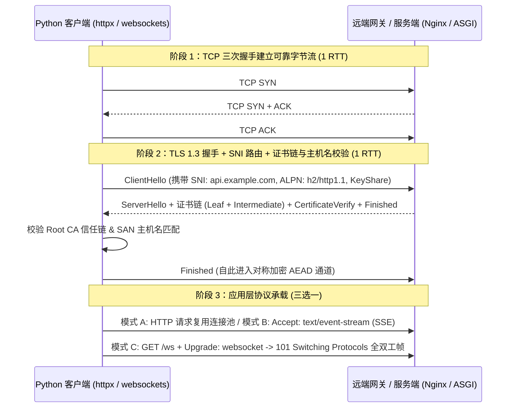
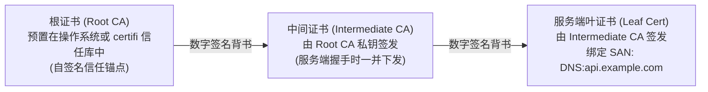

# 现代网络通信：TLS、HTTP 客户端与 WebSocket

上一章我们掌握了操作系统内核提供的裸 TCP 字节流与多路复用原语。但当数据跨越不可信的公网或企业云网络时，裸 TCP 立即面临三大工程缺失：**全明文裸奔且无法验证对端身份**、**缺乏统一的资源寻址与元数据语义**、以及**需要自己维护连接复用与全双工长连接消息帧**。

现代应用层通信协议正是围绕这三大诉求分层演进的：

1. **TLS（Transport Layer Security）**：在 TCP 字节流外包裹一层密码学安全通道，同时解决**机密性（防窃听）**、**完整性（防篡改）**与**身份认证（防中间人冒充）**；
2. **HTTP/1.1 & HTTP/2 与 SSE**：构建请求—响应模型、长连接池复用以及单向流式事件推送（大模型 Token 流式输出的标准底座）；
3. **WebSocket**：通过一次 HTTP `101 Switching Protocols` 握手，将半双工请求响应升级为极低帧头开销的**全双工双向实时帧通道**。



---

## TLS / SSL 安全传输核心机制（`ssl` 模块）

尽管历史习惯上仍常把安全套接字模块称为 `ssl`（Python 标准库模块名亦为 `import ssl`），但早期的 SSLv2 / SSLv3 以及 TLS 1.0 / 1.1 均因严重密码学漏洞被正式废弃（RFC 8996）。**现代生产环境只应使用 TLS 1.2 与 TLS 1.3（首选 TLS 1.3，仅需 1-RTT 即可完成密钥协商且强制前向安全 PFS）**。

### 证书信任链、SNI 与主机名匹配（SAN）原理

很多开发者只知道 HTTPS“加了密”，却不清楚如果只做加密而不验证身份，攻击者只需在中间人位置与你完成一次它自己的 TLS 握手，就能轻松解密并篡改全部流量。TLS 防止中间人劫持（MitM）的核心在于 **X.509 证书信任链（Chain of Trust）**与**主机名绑定校验**：



在每次建立新的 TLS 连接时，Python 的 `ssl` 模块（底层链接 OpenSSL）会严格执行两步缺一不可的验证：

1. **SNI（Server Name Indication，服务器名称指示）**：
   在云原生网关、CDN（如 Cloudflare）或 Nginx 反向代理上，同一个公网 IP 往往托管着成百上千个不同域名的 HTTPS 站点。因此客户端必须在 TLS 握手的第一步明文扩展字段（`ClientHello` 的 SNI 扩展）中传入目标域名（即 Python `wrap_socket(..., server_hostname="api.example.com")`），服务端才能据此挑选正确的站点证书返回。
2. **信任链验签 + 主机名匹配（SAN 校验）**：
   客户端不仅要沿着 `Leaf -> Intermediate -> Root CA` 逐级验证数字签名未伪造、证书未过期（`notBefore <= now <= notAfter`），**还必须核对叶证书的 `subjectAltName`（SAN 扩展，现代标准已弃用旧式 `CN` 字段匹配）是否包含你当前访问的 `server_hostname`**。否则，任何黑客只需为自己的域名 `evil.org` 申请一张完全合法的免费证书，就能冒充 `pay.bank.com`！

### `ssl.create_default_context()` 安全默认配置、内网自建 CA 与双向 mTLS

在 Python 标准库中，**创建客户端安全上下文的唯一正确入口是 `ssl.create_default_context()`**。它会自动启用安全协议下限（禁用不安全旧协议与弱加密套件）、开启 `verify_mode = ssl.CERT_REQUIRED`、开启 `check_hostname = True`，并自动加载当前操作系统的受信任根证书库。

针对企业研发中最常见的三类场景，标准配置模式如下：

```python
from pathlib import Path
import ssl


def build_public_tls_context() -> ssl.SSLContext:
    """场景 1：访问公网 HTTPS / WSS 服务（强制要求最低 TLS 1.3）。"""
    ctx = ssl.create_default_context(ssl.Purpose.SERVER_AUTH)
    ctx.minimum_version = ssl.TLSVersion.TLSv1_3
    return ctx


def build_internal_ca_context(ca_bundle: Path) -> ssl.SSLContext:
    """场景 2：访问由企业内部私有 PKI / 自建根 CA 签发证书的内网微服务。"""
    # 直接传入自定义根证书 PEM 文件，完整保留证书链与 SAN 主机名强校验！
    ctx = ssl.create_default_context(
        ssl.Purpose.SERVER_AUTH,
        cafile=str(ca_bundle),
    )
    return ctx


def build_mtls_client_context(
    ca_bundle: Path,
    client_cert: Path,
    client_key: Path,
) -> ssl.SSLContext:
    """场景 3：零信任网关 / 金融支付接口双向认证 (mTLS) —— 客户端也需出示自身证书。"""
    ctx = ssl.create_default_context(
        ssl.Purpose.SERVER_AUTH,
        cafile=str(ca_bundle),
    )
    # 加载客户端证书链与私钥，供服务端验证客户端身份
    ctx.load_cert_chain(certfile=str(client_cert), keyfile=str(client_key))
    return ctx
```

!!! warning "绝对红线：严禁在生产代码中设置 `CERT_NONE` 或 `verify=False`！"
    遇到企业内网自签名证书报错时，最恶劣的反模式就是图省事写下 `ctx.check_hostname = False; ctx.verify_mode = ssl.CERT_NONE` 或 `httpx.Client(verify=False)`。这相当于拆掉了防盗门锁芯——局域网 ARP 欺骗、公共 Wi-Fi 或恶意代理无需任何成本即可拦截你的 API Token 与用户隐私数据。
    **正确解法永远是导出企业内网 Root CA 的 `.pem` 公钥证书，通过 `cafile=...` 或 `ctx.load_verify_locations()`（或环境变量 `SSL_CERT_FILE`）将其加入受信任锚点**。

### 精准区分网络不可达、证书链不可信与主机名不匹配异常

线上排查连接故障时，必须把传输层网络错误与 TLS 校验失败严格区分开来，切忌用笼统的 `except Exception:` 把“证书被篡改”误报成“服务超时重试”：

| 故障阶段 | Python 典型异常类型 | 关键诊断属性（`verify_code` / 报错特征） | 根因定位与正确处置 |
| :--- | :--- | :--- | :--- |
| **DNS / TCP 建连阶段** | `socket.gaierror`、`ConnectionRefusedError`、`TimeoutError` | 尚未开始 TLS 握手 | 域名拼写错误、目标进程未监听端口、安全组防火墙丢包；可按策略切换节点或退避重试 |
| **TLS 证书链验证失败** | `ssl.SSLCertVerificationError`（`ssl.SSLError` 的子类） | `e.verify_code == 18`（自签名证书）<br>`e.verify_code == 20`（本地缺少签发者根证书，macOS 官方安装包未运行证书安装脚本常见）<br>`e.verify_code == 10`（证书已过期） | **切勿盲目重试**！检查服务端证书是否续期、是否漏配完整中间证书链（Fullchain），或客户端是否需配置内网 `cafile` / `certifi` |
| **TLS 主机名不匹配** | `ssl.SSLCertVerificationError` | `e.verify_code == 62`（`Hostname mismatch, certificate is not valid for '...'`） | 用内网裸 IP 直接访问绑定域名的证书、SNI 传错，或遭遇 DNS 劫持 / 中间人攻击；**立即阻断告警** |

我们可以利用 `socket.socketpair()` 在本地内存中演示并捕获真实的 TLS 1.3 握手信息与 `SSLCertVerificationError` 诊断码（无需依赖外部互联网连接）：

```python
import socket
import ssl

# 检查默认安全上下文的核心安全属性
default_ctx = ssl.create_default_context()
assert default_ctx.verify_mode == ssl.CERT_REQUIRED
assert default_ctx.check_hostname is True
print("OpenSSL 运行时版本:", ssl.OPENSSL_VERSION)
print("默认校验模式:", default_ctx.verify_mode.name, "主机名检查:", default_ctx.check_hostname)
```

输出示例：

```text
OpenSSL 运行时版本: OpenSSL 3.6.3 9 Jun 2026
默认校验模式: CERT_REQUIRED 主机名检查: True
```

---

## HTTP 客户端工程架构（`urllib.request` 与现代 `httpx`）

Python 生态目前并存着多代 HTTP 客户端库。在技术选型时，应根据项目的依赖约束与并发模型做出清晰取舍：

| 库名称 | 依赖属性 | 同步 / 异步支持 | HTTP/2 支持 | 连接池复用 | 推荐定位 |
| :--- | :--- | :--- | :--- | :--- | :--- |
| `urllib.request` | **Python 标准库内置** | 仅同步阻塞 | 不支持 | 单次 `urlopen` 不复用长连接 | **零外部依赖脚本**、CI/CD 部署钩子、轻量命令行工具 |
| `requests` | 第三方（`pip install requests`） | 仅同步阻塞 | 不支持 | 需显式使用 `requests.Session()` | 维护存量纯同步项目（注意默认 `timeout=None` 永不超时的历史隐患！） |
| **`httpx`（主力推荐）** | 第三方（`pip install httpx`） | **同步 `Client` 与异步 `AsyncClient` 双模同构** | 支持（`http2=True`） | `Client` / `AsyncClient` 内置高性能连接池 | **现代 Python 工程首选**（默认开启合理超时、完整类型注解、原生支持 ASGI 内存直连测试） |
| `aiohttp` | 第三方（`pip install aiohttp`） | 仅异步（`asyncio`） | 不支持 | `ClientSession` 连接池 | 超高吞吐纯异步爬虫或同时使用 `aiohttp` Web 服务端的体系 |

### 标准库零依赖方案：`urllib.request` 与异常处理顺序陷阱

在编写不希望引入任何第三方包的运维脚本或 SDK 初始化器时，标准库 `urllib.request` 完全够用。使用它时务必牢记两条实战细节：

1. **必须显式传入 `timeout` 秒数**（否则底层 Socket 默认阻塞模式可能无限挂起）；
2. **捕获异常时，`except HTTPError` 必须写在 `except URLError` 之前！**
   在类的继承树上，`urllib.error.HTTPError`（代表成功连上了服务器，但服务端返回了 `4xx` / `5xx` 状态码）竟然是 `urllib.error.URLError`（代表 DNS 失败、连接被拒绝等网络层错误）的**子类**！更巧妙的是，`HTTPError` 实例本身还是一个类文件响应流——你可以直接调用 `err.read()` 把服务端返回的详细 JSON 报错原因读出来。

下面我们配合标准库 `http.server` 在本地回环随机端口演示完整的 JSON 请求发送与 `422` 业务错误体读取：

```python
from http.server import BaseHTTPRequestHandler, ThreadingHTTPServer
import json
import threading
from typing import Any
from urllib.error import HTTPError, URLError
from urllib.request import Request, urlopen


class TinyJSONHandler(BaseHTTPRequestHandler):
    def do_POST(self) -> None:
        length = int(self.headers.get("Content-Length", "0"))
        body = json.loads(self.rfile.read(length).decode("utf-8"))

        if body.get("amount", 0) <= 0:
            payload = json.dumps({"error": "amount_must_be_positive"}).encode("utf-8")
            self.send_response(422)
            self.send_header("Content-Type", "application/json; charset=utf-8")
            self.send_header("Content-Length", str(len(payload)))
            self.end_headers()
            self.wfile.write(payload)
            return

        payload = json.dumps({"order_id": "ord_9001", "accepted": body["amount"]}).encode("utf-8")
        self.send_response(201)
        self.send_header("Content-Type", "application/json; charset=utf-8")
        self.send_header("Content-Length", str(len(payload)))
        self.end_headers()
        self.wfile.write(payload)

    def log_message(self, format: str, *args: Any) -> None:
        return  # 测试期间静默访问日志


def post_json_stdlib(url: str, data: dict[str, Any], timeout: float = 3.0) -> tuple[int, dict[str, Any]]:
    """零依赖标准库 JSON POST 客户端。"""
    raw_body = json.dumps(data).encode("utf-8")
    req = Request(
        url=url,
        data=raw_body,
        headers={
            "Content-Type": "application/json; charset=utf-8",
            "Accept": "application/json",
            "User-Agent": "kosmigen-stdlib-client/1.0",
        },
        method="POST",
    )
    try:
        with urlopen(req, timeout=timeout) as resp:
            return resp.status, json.loads(resp.read().decode("utf-8"))
    except HTTPError as http_err:
        # 注意：HTTPError 必须在 URLError 之前捕获！且可直接 .read() 读取服务端错误 JSON
        err_body = http_err.read().decode("utf-8", errors="replace")
        return http_err.code, json.loads(err_body)
    except URLError as url_err:
        raise ConnectionError(f"底层网络或 TLS 建连失败: {url_err.reason}") from url_err


def run_stdlib_http_demo() -> None:
    server = ThreadingHTTPServer(("127.0.0.1", 0), TinyJSONHandler)
    host, port = server.server_address[:2]
    url = f"http://{host}:{port}/orders"

    t = threading.Thread(target=server.serve_forever, daemon=True)
    t.start()
    try:
        status_ok, body_ok = post_json_stdlib(url, {"amount": 99})
        assert status_ok == 201 and body_ok["order_id"] == "ord_9001"

        status_err, body_err = post_json_stdlib(url, {"amount": -5})
        assert status_err == 422 and body_err["error"] == "amount_must_be_positive"
        print("201 成功响应:", body_ok)
        print("422 精确解析错误响应体:", body_err)
    finally:
        server.shutdown()
        server.server_close()


if __name__ == "__main__":
    run_stdlib_http_demo()
```

输出：

```text
201 成功响应: {'order_id': 'ord_9001', 'accepted': 99}
422 精确解析错误响应体: {'error': 'amount_must_be_positive'}
```

### 生产级 HTTP 客户端三大铁律（以 `httpx` 为基准）

在中大型后端服务、数据抓取与大模型网关开发中，第三方库 **`httpx`**（通过 `pip install httpx` 或 `uv add httpx` 安装）凭借同步 `httpx.Client` 与异步 `httpx.AsyncClient` 完全对称的工程接口成为了事实标准。然而，仅仅换上现代库并不等于拥有了高可用性——线上事故复盘表明，**生产级 HTTP 客户端必须严格落实以下三大工程铁律**：

#### 铁律一：在应用生命周期内复用单个 `Client` / `AsyncClient` 连接池

**灾难级反模式**：在每个业务函数或 FastAPI 路由处理函数内部每次请求都写 `httpx.get(url)` 或 `async with httpx.AsyncClient() as client:`！

为什么这在压测时会导致吞吐暴跌甚至全站雪崩？

- 每次新建并销毁 `Client`，都会彻底丢弃底层 HTTP Keep-Alive 连接池；
- 每发一次 HTTP 请求，都不得不重新经历 **DNS 解析 + TCP 三次握手（1 RTT）+ TLS 1.3 握手（1 RTT）**，跨地域接口单是握手开销就会凭空增加 `50 ~ 200 ms` 延迟；
- 高并发下短时间内频繁创建和关闭上万个客户端连接，会把本机 `1024 ~ 65535` 范围内的临时端口全部塞进 `TIME_WAIT` 状态，直接导致本机报 `Cannot assign requested address` 临时端口耗尽！

**正确范式**：在进程或 ASGI 服务启动阶段（如 FastAPI 的 `lifespan` 上下文）创建全局共享的 `AsyncClient` 实例，并通过 `httpx.Limits` 显式约束连接池边界，直到进程停机时再统一关闭。

#### 铁律二：配置四维细粒度超时（`connect` / `read` / `write` / `pool`）

只传一个笼统的 `timeout=30.0` 往往顾此失彼：对于已宕机黑洞 IP，等 30 秒才发现连不上太慢；而对于调用大模型推理接口，等待首字响应 20 秒又是正常的。`httpx.Timeout` 将超时精确拆解为四个独立维度：

| 超时维度 | 推荐工程典型值 | 防御的真实故障场景 |
| :--- | :--- | :--- |
| **`connect`** | `2.0 ~ 5.0` 秒 | 目标机器断电、防火墙丢弃 `SYN` 包时**快速失败**，绝不苦等几十秒 |
| **`read`** | 普通接口 `5.0 ~ 10.0` 秒；流式大模型 `60.0` 秒 | 成功建连并发完请求后，等待服务端返回**下一个响应数据块**的最大静默间隔 |
| **`write`** | `5.0 ~ 15.0` 秒 | 上传大请求体时，内核发送缓冲区持续满载写不进去的最大等待时间 |
| **`pool`** | `1.0 ~ 3.0` 秒 | 当本地连接池已达 `max_connections` 满载上限时，新请求排队等待空闲连接的最长时间（**快速触发 `PoolTimeout` 熔断降级，防止请求无限堆积挤爆内存**） |

#### 铁律三：严守幂等边界，实施“指数退避 + 全随机抖动（Full Jitter）”与 `Retry-After` 解析

分布式网络中偶发的连接重置、`502 Bad Gateway`、`503 Service Unavailable`、`504 Gateway Timeout` 与 `429 Too Many Requests` 是常态，但错误的重试代码比不重试更致命——它会在上游刚刚恢复的脆弱瞬间制造数十倍流量的**“重试风暴（Retry Storm）”**直接把上游再次打挂！

设计自动重试器必须遵守三条准则：

1. **只对幂等请求自动重试**：
   `GET`、`HEAD`、`PUT`、`DELETE`、`OPTIONS` 天然具备 HTTP 语义幂等性；而普通的 `POST` 请求（如扣款、创建订单、发短信）一旦发生 `ReadTimeout`，请求可能已经在服务端执行成功只是响应包丢在了半路！**除非 `POST` 请求头显式携带了服务端支持的唯一幂等键（如 `Idempotency-Key: <uuid>`），否则严禁自动重试 `ReadTimeout` 后的非幂等请求**。
2. **用“指数退避 + 全随机抖动（Exponential Backoff with Full Jitter）”打散同步洪峰**：
   如果 5000 个客户端在 `t = 0` 同时遇到上游闪断，且都写死等待 `1.0s`、`2.0s`、`4.0s`，它们依然会在第 1 秒、第 3 秒整齐划一地发起齐射。AWS 架构团队经典论文证明，打散重试尖峰综合表现最优的是 **Full Jitter** 策略——在第 `attempt` 次重试（从 `0` 计数）时，休眠时长从 `[0, min(cap, base * 2 ** attempt)]` 区间内均匀随机采样。
3. **优先尊重服务端的 `Retry-After` 响应头（RFC 9110）**：
   当遇到 `429` 限流或 `503` 维护时，上游往往会通过 `Retry-After` 明确告知客户端需要等待多久。根据 HTTP 规范，`Retry-After` 有两种合法格式：**纯整数秒**（如 `Retry-After: 5`）或 **GMT 日期时间字符串**（如 `Retry-After: Wed, 21 Oct 2026 07:28:00 GMT`），生产代码应同时兼容解析两者！

下面首先给出零依赖标准库实现的 `Retry-After` 解析与 Full Jitter 退避计算器（可直接运行测试），紧接着给出集成三大铁律的 `httpx.AsyncClient` 生产模板：

```python
from datetime import datetime, timezone
from email.utils import parsedate_to_datetime
import random

IDEMPOTENT_METHODS = frozenset({"GET", "HEAD", "PUT", "DELETE", "OPTIONS"})
RETRYABLE_STATUS_CODES = frozenset({429, 502, 503, 504})


def is_safe_to_retry(method: str, headers: dict[str, str] | None = None) -> bool:
    """判定请求是否满足安全自动重试的幂等条件。"""
    upper_method = method.upper()
    if upper_method in IDEMPOTENT_METHODS:
        return True
    if headers and any(k.lower() == "idempotency-key" for k in headers):
        return True
    return False


def parse_retry_after(header_value: str | None, max_wait: float = 60.0) -> float | None:
    """解析 RFC 9110 Retry-After 头（同时支持整数秒与 HTTP-date 格式），并施加安全上限。"""
    if not header_value:
        return None
    raw = header_value.strip()
    if raw.isdigit():
        return min(float(raw), max_wait)

    try:
        target_dt = parsedate_to_datetime(raw)
        if target_dt.tzinfo is None:
            target_dt = target_dt.replace(tzinfo=timezone.utc)
        delta = (target_dt - datetime.now(timezone.utc)).total_seconds()
        return min(max(0.0, delta), max_wait)
    except (TypeError, ValueError):
        return None


def compute_backoff_delay(
    attempt: int,
    base: float = 0.5,
    cap: float = 15.0,
    retry_after_header: str | None = None,
) -> float:
    """优先采用服务端 Retry-After，否则使用指数退避 + Full Jitter 计算等待秒数。"""
    server_hint = parse_retry_after(retry_after_header, max_wait=cap)
    if server_hint is not None:
        # 在服务端指定等待时长基础上附加微小正向抖动 (0~250ms)，避免所有客户端同毫秒唤醒
        return server_hint + random.uniform(0.0, 0.25)

    upper_bound = min(cap, base * (2**attempt))
    return random.uniform(0.0, upper_bound)


# 验证幂等检查、Retry-After 解析与退避范围
assert is_safe_to_retry("GET") is True
assert is_safe_to_retry("POST") is False
assert is_safe_to_retry("POST", {"Idempotency-Key": "req-123"}) is True
assert 5.0 <= compute_backoff_delay(0, retry_after_header="5") <= 5.25
assert 0.0 <= compute_backoff_delay(attempt=2, base=0.5, cap=10.0) <= 2.0
print("退避与幂等策略自检通过！")
```

将上述策略融入第三方库 `httpx`（需安装：`pip install httpx`）的完整异步客户端封装如下：

```python
# 依赖第三方包：pip install httpx
import asyncio
from typing import Any
import httpx


class ResilientAPIClient:
    """遵循三大生产铁律的 httpx.AsyncClient 生命周期与重试封装。"""

    def __init__(self, base_url: str) -> None:
        self._client = httpx.AsyncClient(
            base_url=base_url,
            # 铁律一：显式约束连接池上限与保活连接数
            limits=httpx.Limits(
                max_connections=100,
                max_keepalive_connections=20,
                keepalive_expiry=30.0,
            ),
            # 铁律二：配置四维细粒度超时
            timeout=httpx.Timeout(
                connect=3.0,
                read=10.0,
                write=10.0,
                pool=2.0,
            ),
            headers={"User-Agent": "kosmigen-service/1.0"},
        )

    async def aclose(self) -> None:
        await self._client.aclose()

    async def __aenter__(self) -> "ResilientAPIClient":
        return self

    async def __aexit__(self, *exc_info: object) -> None:
        await self.aclose()

    async def request_json(
        self,
        method: str,
        path: str,
        *,
        headers: dict[str, str] | None = None,
        json_body: dict[str, Any] | None = None,
        max_attempts: int = 3,
    ) -> Any:
        can_retry = is_safe_to_retry(method, headers)
        total_tries = max_attempts if can_retry else 1

        for attempt in range(total_tries):
            try:
                resp = await self._client.request(
                    method, path, headers=headers, json=json_body
                )
                if resp.status_code in RETRYABLE_STATUS_CODES and attempt < total_tries - 1:
                    delay = compute_backoff_delay(
                        attempt, retry_after_header=resp.headers.get("Retry-After")
                    )
                    await asyncio.sleep(delay)
                    continue

                resp.raise_for_status()
                return resp.json()

            except (httpx.ConnectError, httpx.ConnectTimeout, httpx.RemoteProtocolError):
                if attempt >= total_tries - 1:
                    raise
                await asyncio.sleep(compute_backoff_delay(attempt))
            except httpx.ReadTimeout:
                # 读超时仅在确认请求幂等时才允许重试！
                if not can_retry or attempt >= total_tries - 1:
                    raise
                await asyncio.sleep(compute_backoff_delay(attempt))
```

---

## 流式响应与 SSE（Server-Sent Events）

默认的 `client.get(url)` 会在内部调用 `await resp.aread()`，等整个 HTTP 响应体全部接收完毕并拼成一个完整的内存 `bytes` 对象后才交还给你。在以下两类核心场景中，必须改用 `client.stream(...)` 开启**流式消费（Streaming Response）**：

1. **下载数百 MB 乃至数 GB 的模型权重、数据集归档或导出报表**——一次性读入内存会瞬间拉爆容器内存配额；
2. **消费大模型 API（OpenAI / Claude / Gemini / 本地 vLLM）实时推送的 `text/event-stream`（SSE）流**——用户希望在首字生成后的 `200 ms` 内立即看到逐词打字机输出，而不是干等 `30 秒` 整段话生成结束。

### 流式分块下载大文件（恒定内存开销 + 原子落盘）

结合 [04 文件系统、路径与目录操作](04-filesystem-and-paths.md) 中的临时文件原子替换模式与 [06 哈希摘要、安全随机与编码基础](06-crypto-hashing-and-random.md) 的增量哈希校验，下载超大文件的标准流式写法如下（需安装 `httpx`）：

```python
# 依赖第三方包：pip install httpx
import hashlib
import os
from pathlib import Path
import tempfile
import httpx


async def download_large_file(
    client: httpx.AsyncClient,
    url: str,
    dest: Path,
    expected_sha256: str | None = None,
    chunk_size: int = 65536,
) -> Path:
    """流式分块下载大文件：全程仅占用 64 KiB 缓冲内存，校验通过后原子替换目标路径。"""
    dest.parent.mkdir(parents=True, exist_ok=True)
    hasher = hashlib.sha256()

    # 在同一目录下创建临时文件，确保最终 os.replace 处于同一文件系统实现原子重命名
    fd, tmp_name = tempfile.mkstemp(dir=dest.parent, prefix=f".{dest.name}.part-")
    tmp_path = Path(tmp_name)

    try:
        with os.fdopen(fd, "wb") as out_file:
            async with client.stream("GET", url) as resp:
                resp.raise_for_status()
                async for chunk in resp.aiter_bytes(chunk_size=chunk_size):
                    out_file.write(chunk)
                    hasher.update(chunk)
            out_file.flush()
            os.fsync(out_file.fileno())

        if expected_sha256 and hasher.hexdigest() != expected_sha256.lower():
            raise ValueError("下载文件 SHA-256 摘要校验不匹配，已丢弃损坏文件")

        os.replace(tmp_path, dest)
        return dest
    except BaseException:
        tmp_path.unlink(missing_ok=True)
        raise
```

### SSE（Server-Sent Events）协议格式与标准流式解析器实现

**SSE（`Content-Type: text/event-stream`）** 是 WHATWG HTML 标准定义的基于普通 HTTP 长连接的**服务端向客户端单向推送文本事件流**协议。相比 WebSocket，SSE 不需要协议升级握手、天然兼容 HTTP/2 多路复用、企业代理防火墙穿透率极高，因此成为了现代 AI 应用流式传输的绝对主流。

一条合规的 SSE 字节流遵循以下简洁却充满细节的分帧规则：

- 编码固定为 **UTF-8**，事件与事件之间由**一个空行（`\n\n` 或 `\r\n\r\n`）**作为分帧边界；
- 以冒号 `:` 开头的行（如 `: keep-alive`）是**注释行**，常被网关每隔 15 秒发送一次以防止空闲代理断开连接，解析器必须静默忽略；
- 每行非注释内容按第一个 `:` 切分为 `field: value`（若 `value` 开头紧跟**一个**空格 `' '`，仅剥除这第一个前导空格）；
- 核心字段包括：
  - `event`：事件名称（若未指定，默认值为 `"message"`）；
  - `data`：事件载荷。**易错关键点：同一个事件块内允许连续出现多行 `data:`，解析器必须用换行符 `"\n"` 将它们拼接起来，绝不能后一行覆盖前一行！**
  - `id`：事件唯一 ID（用于断线重连时通过请求头 `Last-Event-ID` 断点续传）；
  - `retry`：建议客户端重连等待的毫秒数。

下面我们用纯标准库编写一个完全符合规范、零外部依赖的 SSE 行流解析器（既可用于同步行迭代器，也可直接对接 `httpx` 的 `resp.aiter_lines()`）：

```python
from collections.abc import Iterable, Iterator
from dataclasses import dataclass
import json


@dataclass(slots=True, frozen=True)
class SSEEvent:
    event: str = "message"
    data: str = ""
    id: str | None = None
    retry: int | None = None


def parse_sse_lines(lines: Iterable[str]) -> Iterator[SSEEvent]:
    """将按行切分的文本流严格按 WHATWG SSE 规范解析为 SSEEvent 对象流。"""
    event_type = "message"
    data_lines: list[str] = []
    last_id: str | None = None
    retry_ms: int | None = None

    for raw_line in lines:
        line = raw_line.rstrip("\r\n")

        # 1. 遇到空行：代表当前事件帧结束，若累积了数据则派发事件并重置缓冲
        if line == "":
            if data_lines:
                yield SSEEvent(
                    event=event_type,
                    data="\n".join(data_lines),
                    id=last_id,
                    retry=retry_ms,
                )
            event_type = "message"
            data_lines = []
            retry_ms = None
            continue

        # 2. 以冒号开头的行为心跳注释，直接忽略
        if line.startswith(":"):
            continue

        # 3. 切分 field 与 value（仅剥除冒号后的首个可选空格）
        field_name, sep, value = line.partition(":")
        if sep and value.startswith(" "):
            value = value[1:]

        if field_name == "event":
            event_type = value
        elif field_name == "data":
            data_lines.append(value)
        elif field_name == "id" and "\x00" not in value:
            last_id = value
        elif field_name == "retry" and value.isdigit():
            retry_ms = int(value)


# 模拟一段真实的大模型流式响应（含注释心跳、多行 data 拼接、命名事件与 [DONE] 结束哨兵）
mock_llm_stream = [
    ": gateway-heartbeat\n",
    "id: evt_1\n",
    "event: content_delta\n",
    'data: {"token": "你好"}\n',
    "\n",
    "id: evt_2\n",
    "data: 第一行代码块\n",
    "data: 第二行代码块\n",
    "\n",
    "data: [DONE]\n",
    "\n",
]

parsed_events = list(parse_sse_lines(mock_llm_stream))
assert len(parsed_events) == 3
assert parsed_events[0] == SSEEvent(
    event="content_delta",
    data='{"token": "你好"}',
    id="evt_1",
)
assert json.loads(parsed_events[0].data)["token"] == "你好"
# 验证多行 data 自动以 \n 拼接，且沿用最近一次的 last_id
assert parsed_events[1].data == "第一行代码块\n第二行代码块"
assert parsed_events[2].data == "[DONE]"
print("SSE 解析结果:", parsed_events)
```

输出：

```text
SSE 解析结果: [SSEEvent(event='content_delta', data='{"token": "你好"}', id='evt_1', retry=None), SSEEvent(event='message', data='第一行代码块\n第二行代码块', id='evt_2', retry=None), SSEEvent(event='message', data='[DONE]', id='evt_2', retry=None)]
```

---

## WebSocket 全双工通信机制

当业务场景不满足于“客户端问一句、服务端流式答一段”，而是要求**客户端与服务端随时都能以毫秒级低延迟主动向对方发送高频消息**（如多人在线协作白板、实时语音对话 Agent、量化交易逐笔行情与报单通道、Web 终端 SSH）时，就需要登场真正的全双工协议——**WebSocket（RFC 6455）**。

| 选型维度 | 短轮询 / 长轮询（Polling） | SSE（`text/event-stream`） | WebSocket（`ws://` / `wss://`） |
| :--- | :--- | :--- | :--- |
| **通信方向** | 客户端不断拉取（半双工模拟） | **服务端 -> 客户端单向流** | **真正的双向全双工实时并发收发** |
| **载荷格式** | HTTP 文本 / 二进制 | 仅限 UTF-8 文本（二进制需 Base64 膨胀 33%） | **原生区分 UTF-8 文本帧与紧凑二进制帧** |
| **每帧协议开销** | 每次携带完整 HTTP 头（数百字节） | 极低（几字节 `data: ...\n\n`） | **极低（服务端下发每帧头部仅 2~10 字节）** |
| **连接与代理兼容** | 100% 普通 HTTP | 普通 HTTP（完美兼容 HTTP/2 复用） | 需 `101 Upgrade` 协议切换，负载均衡需配长连接超时 |

### HTTP `101 Switching Protocols` 升级握手原理

WebSocket 为了复用现有的 `80` / `443` 端口并穿透企业 HTTP 网关，将自己的建连握手巧妙设计为一次合法的 **HTTP/1.1 协议升级请求**：

1. **客户端发起升级请求**：发送携带 `Connection: Upgrade`、`Upgrade: websocket`、`Sec-WebSocket-Version: 13` 以及随机生成的 16 字节 Base64 编码挑战值 `Sec-WebSocket-Key` 的 HTTP GET 请求；
2. **服务端验证并返回 `101 Switching Protocols`**：服务端将该 `Sec-WebSocket-Key` 与 RFC 6455 规定的全局固定 GUID 魔串 `"258EAFA5-E914-47DA-95CA-C5AB0DC85B11"` 直接拼接，计算 **SHA-1 摘要后再经 Base64 编码**，填入响应头 `Sec-WebSocket-Accept`。这一设计的目的并非加密，而是**证明服务端确实是一个真正的 WebSocket 服务器**，防止中间缓存代理把历史普通 HTTP 响应误当成 WebSocket 握手放行！

我们可以用几行 Python 标准库代码精确复现 RFC 6455 标准文档中的握手计算向量：

```python
import base64
import hashlib
import secrets

WS_MAGIC_GUID = "258EAFA5-E914-47DA-95CA-C5AB0DC85B11"


def generate_ws_key() -> str:
    """客户端生成 16 字节安全随机数的 Base64 Sec-WebSocket-Key。"""
    return base64.b64encode(secrets.token_bytes(16)).decode("ascii")


def compute_ws_accept(sec_websocket_key: str) -> str:
    """服务端按 RFC 6455 计算 Sec-WebSocket-Accept 握手应答值。"""
    combined = (sec_websocket_key.strip() + WS_MAGIC_GUID).encode("ascii")
    sha1_digest = hashlib.sha1(combined).digest()
    return base64.b64encode(sha1_digest).decode("ascii")


# 使用 RFC 6455 Section 1.3 官方测试向量验证 100% 一致
rfc_sample_key = "dGhlIHNhbXBsZSBub25jZQ=="
assert compute_ws_accept(rfc_sample_key) == "s3pPLMBiTxaQ9kYGzzhZRbK+xOo="
print("RFC 6455 握手校验通过，随机新 Key 示例:", generate_ws_key())
```

输出示例：

```text
RFC 6455 握手校验通过，随机新 Key 示例: 8xQvK9mP2nL4rT6wY1zB3A==
```

### 帧类型、Ping/Pong 心跳保活与双向优雅关闭流程

一旦收到 `101 Switching Protocols`，底层 TCP 连接上就不再传输 HTTP 文本，而是切换为紧凑的 **WebSocket 二进制帧（Frame）** 协议。工程实践中必须重点把握三类帧机制：

1. **数据帧：文本帧（Opcode `0x1`）vs 二进制帧（Opcode `0x2`）**
   在现代 Python WebSocket 库中，传入 `str` 会自动封装为 UTF-8 文本帧（接收端自动解码为 `str` 并严格校验 UTF-8 合法性）；传入 `bytes` / `bytearray` 则自动封装为二进制帧（适合直接传输 Protobuf、MessagePack 或 PCM 音频采样流，零 Base64 转换损耗）。注意标准还强制要求客户端发往服务端的所有帧必须启用 4 字节随机异或掩码（Masking），以防恶意网页脚本污染透明代理缓存。
2. **控制帧：`Ping`（`0x9`）与 `Pong`（`0xA`）心跳保活——拯救“半开死连接”**
   为什么操作系统自带的 TCP Keepalive 救不了生产环境的 WebSocket？
   - Linux 内核默认要等连接静默 **2 小时（`7200 秒`）** 才会发出第一个 TCP Keepalive 探测包；
   - 更致命的是，TCP Keepalive 只能探测“客户端到最近一层七层反向代理（如 Nginx / 云 ALB）”之间的一段连接，无法端到端穿透应用层网关；而且一旦中间家用路由器重启、手机切基站或 NAT 映射表过期静默丢包，服务端若不发数据就永远收不到 `RST`，形成消耗内存却早已失联的**半开死连接（Half-Open Connection）**，同时 Nginx 默认 `proxy_read_timeout 60s` 也会直接掐断长期无流量的空闲长连接。
   - 因此 WebSocket 协议原生内置了 `Ping` / `Pong` 控制帧：**每隔 `20 秒` 发送一次 `Ping` 帧，若在 `20 秒` 超时内未收到对端自动回复的 `Pong` 帧，立即判定死连接并主动清理重连**。
3. **关闭帧（`Close`，`0x8`）与状态码双向握手**：
   优雅断开 WebSocket 绝不是粗暴调用 `sock.close()` 强行断开 TCP！标准流程是主动关闭方先发送一个携带 **2 字节无符号状态码 + 可选 UTF-8 原因说明** 的 `Close` 控制帧，对端收到后立即回敬一个确认 `Close` 帧，随后双方再干净地关闭底层 TCP 连接：
   - `1000`（Normal Closure）：任务正常结束，优雅关闭；
   - `1001`（Going Away）：服务端正在滚动重启下线，或浏览器页面跳转离开；
   - `1008`（Policy Violation）：鉴权 Token 失效、消息频率超限等策略拒绝；
   - `1011`（Internal Error）：服务端处理业务逻辑时发生未预期异常（类似 HTTP `500`）；
   - （注：`1006` 是本地伪状态码，专门表示**未收到对端 `Close` 帧而底层 TCP 连接异常中断**，绝不能由应用代码手工发送）。

### 使用 `websockets` 构建全双工服务端与自愈重连客户端

Python 标准库未内置完整的高层 WebSocket 帧状态机，生产工程普遍采用成熟轻量的 **`websockets`** 库（通过 `pip install websockets` 或 `uv add websockets` 安装，新版 `websockets.asyncio` 原生融合 `asyncio` 结构化并发与自动心跳保活）。

下面展示服务端（同时支持文本 JSON 指令与二进制音频块回传）与具备**自动断线指数退避重连能力**的客户端标准范式：

```python
# 依赖第三方包：pip install websockets
import asyncio
import json
import websockets
from websockets.asyncio.client import connect
from websockets.asyncio.server import ServerConnection, serve


async def ws_session_handler(ws: ServerConnection) -> None:
    """WebSocket 服务端连接处理器：自动识别 str 文本帧与 bytes 二进制帧。"""
    try:
        async for message in ws:
            if isinstance(message, str):
                req = json.loads(message)
                if req.get("action") == "bye":
                    # 发起带 1000 状态码与原因的双向优雅关闭握手
                    await ws.close(code=1000, reason="client requested close")
                    return
                await ws.send(json.dumps({"ack": req.get("seq"), "type": "text"}))
            else:
                # message 为 bytes 二进制帧（例如实时语音流切片）
                await ws.send(b"PCM_ACK:" + message[:16])
    except websockets.ConnectionClosedOK:
        pass  # 1000 / 1001 正常双向握手关闭
    except websockets.ConnectionClosedError as exc:
        # 对端未完成关闭握手即异常掉线（如 1006）
        print(f"客户端连接异常中断: code={exc.code}, reason={exc.reason}")


async def run_ws_demo() -> None:
    # ping_interval=20, ping_timeout=20 开启自动心跳探活，及时剔除半开死连接
    async with serve(
        ws_session_handler,
        host="127.0.0.1",
        port=0,
        ping_interval=20.0,
        ping_timeout=20.0,
        max_size=4 * 1024 * 1024,  # 限制单条消息最大 4 MiB 防内存攻击
    ) as server:
        port = server.sockets[0].getsockname()[1]
        uri = f"ws://127.0.0.1:{port}"

        # connect() 若用于 async for ws in connect(uri): 循环，甚至会自动按指数退避断线重连！
        async with connect(uri, ping_interval=20.0, ping_timeout=20.0) as ws:
            await ws.send(json.dumps({"action": "ping_app", "seq": 1}))
            text_reply = await ws.recv()
            print("收到文本帧:", text_reply)

            await ws.send(b"\x00\x01\x02\x03audio_chunk")
            bin_reply = await ws.recv()
            print("收到二进制帧:", bin_reply)

            await ws.send(json.dumps({"action": "bye"}))
            # 等待服务端完成 1000 正常关闭握手
            await ws.wait_closed()
            assert ws.close_code == 1000
```

!!! tip "利用 `async for ws in connect(uri):` 实现生产级长连接自愈"
    `websockets` 客户端有一个极其地道的高可用特性：当你把 `async with connect(uri) as ws:` 改写为异步迭代循环 `async for ws in connect(uri):` 时，只要遇到网络闪断或上游网关重启抛出 `ConnectionClosed` / 连接拒绝，它内部会自动执行**带随机抖动的指数退避（Exponential Backoff）重连**，只需在内部 `try ... except websockets.ConnectionClosed: continue` 即可写出永不掉线的行情/事件订阅守护协程！

---

## 练习与实战

### 练习 1：实现遵循幂等约束与 `Retry-After` 的零依赖重试执行器

请使用纯标准库编写一个通用同步 HTTP 重试调度函数 `execute_with_retry(method, headers, transport_call, max_attempts=4, sleep_fn=time.sleep)`：

1. `transport_call()` 是一个无参可调用对象，每次调用返回 `(status_code: int, resp_headers: dict[str, str], body: bytes)`，或者在底层断连/超时时抛出 `TimeoutError` / `ConnectionError`。
2. **幂等红线校验**：仅当 `method` 属于 `GET/HEAD/PUT/DELETE/OPTIONS`，或者请求头 `headers`（不区分大小写）包含非空 `"Idempotency-Key"` 时，才允许在发生 `TimeoutError`、`ConnectionError` 或响应码属于 `{429, 502, 503, 504}` 时自动重试；否则最多只执行 1 次，遇到异常原样抛出、遇到错误状态码直接返回结果。
3. 当响应包含 `Retry-After` 头（需忽略响应头键名的大小写，支持纯数字秒与 RFC 9110 GMT 日期两种格式）时优先按其指示等待，否则使用 `Full Jitter`（`random.uniform(0, min(8.0, 0.2 * (2 ** attempt)))`），通过注入 `sleep_fn` 收集每次等待时长以便快速单测验证。

??? success "点击查看答案与解析"
    **核心思路**：先统一将请求头键名转为小写判定幂等安全性；在重试循环中区分瞬态网络异常与可重试 HTTP 状态码，提取大小写无关的 `retry-after` 响应头，计算退避时间后调用可注入的 `sleep_fn(delay)`（测试时传入 `delays.append` 实现零等待毫秒级断言）。
    
    ```python
    from collections.abc import Callable
    from datetime import datetime, timedelta, timezone
    from email.utils import format_datetime, parsedate_to_datetime
    import random
    import time
    
    ResponseTuple = tuple[int, dict[str, str], bytes]
    SAFE_METHODS = frozenset({"GET", "HEAD", "PUT", "DELETE", "OPTIONS"})
    RETRY_CODES = frozenset({429, 502, 503, 504})
    
    
    def _extract_retry_after(resp_headers: dict[str, str], cap: float = 30.0) -> float | None:
        raw = next((v for k, v in resp_headers.items() if k.lower() == "retry-after"), None)
        if not raw:
            return None
        text = raw.strip()
        if text.isdigit():
            return min(float(text), cap)
        try:
            dt = parsedate_to_datetime(text)
            if dt.tzinfo is None:
                dt = dt.replace(tzinfo=timezone.utc)
            wait = (dt - datetime.now(timezone.utc)).total_seconds()
            return min(max(0.0, wait), cap)
        except (TypeError, ValueError):
            return None
    
    
    def execute_with_retry(
        method: str,
        headers: dict[str, str],
        transport_call: Callable[[], ResponseTuple],
        max_attempts: int = 4,
        sleep_fn: Callable[[float], None] = time.sleep,
    ) -> ResponseTuple:
        has_idem_key = any(k.lower() == "idempotency-key" and bool(v) for k, v in headers.items())
        can_retry = method.upper() in SAFE_METHODS or has_idem_key
        limit = max_attempts if can_retry else 1
    
        for attempt in range(limit):
            try:
                status, resp_headers, body = transport_call()
            except (TimeoutError, ConnectionError):
                if attempt >= limit - 1:
                    raise
                delay = random.uniform(0.0, min(8.0, 0.2 * (2**attempt)))
                sleep_fn(delay)
                continue
    
            if status in RETRY_CODES and attempt < limit - 1:
                hint = _extract_retry_after(resp_headers)
                delay = hint if hint is not None else random.uniform(0.0, min(8.0, 0.2 * (2**attempt)))
                sleep_fn(delay)
                continue
    
            return status, resp_headers, body
    
        raise RuntimeError("unreachable")
    
    
    # 1. 验证无幂等键的 POST 遇到 TimeoutError 严禁自动重试（仅调用 1 次）
    post_calls = 0
    
    def flaky_post() -> ResponseTuple:
        global post_calls
        post_calls += 1
        raise TimeoutError("read timed out")
    
    try:
        execute_with_retry("POST", {}, flaky_post, sleep_fn=lambda _: None)
    except TimeoutError:
        pass
    assert post_calls == 1
    
    # 2. 验证带 Idempotency-Key 的 POST 正确处理 429 HTTP-date Retry-After 与 503 退避后恢复
    recorded_sleeps: list[float] = []
    future_gmt = format_datetime(datetime.now(timezone.utc) + timedelta(seconds=3), usegmt=True)
    responses: list[ResponseTuple] = [
        (429, {"retry-after": future_gmt}, b"rate limited"),
        (503, {}, b"overloaded"),
        (200, {"Content-Type": "application/json"}, b'{"ok": true}'),
    ]
    
    status, _, payload = execute_with_retry(
        "POST",
        {"Idempotency-Key": "idem-888"},
        lambda: responses.pop(0),
        sleep_fn=recorded_sleeps.append,
    )
    assert status == 200 and payload == b'{"ok": true}'
    assert len(recorded_sleeps) == 2
    assert 1.5 <= recorded_sleeps[0] <= 3.5
    print("重试策略单测通过，记录休眠序列(s):", [round(s, 2) for s in recorded_sleeps])
    ```

### 练习 2：手写防中文 UTF-8 跨块截断的字节流增量 SSE 解码器

在真实底层网络流（如 `socket.recv` 或 `resp.aiter_raw()`）中，服务端推送的字节块（`bytes`）可能停在**任意字节位置**——包括把一个占 3 字节的 UTF-8 汉字（例如 `"流"` 的 UTF-8 编码 `e6 b5 81`）从中间劈成两半（前一个 chunk 结尾只有 `e6`，后一个 chunk 开头才是 `b5 81`），或者把一行 `data: ...` 拆在三个 chunk 里！如果直接对每个 `chunk` 调用 `chunk.decode("utf-8")`，会立即抛出 `UnicodeDecodeError`！

请使用标准库 `codecs.getincrementaldecoder("utf-8")` 编写一个增量状态机类 `IncrementalSSEDecoder`：

- 提供 `feed(chunk: bytes) -> list[SSEEvent]` 方法，接收任意粒度切分的 `bytes` 块，安全重组跨块 UTF-8 字符与跨块行，实时吐出已完整到达空行边界的 `SSEEvent` 列表。

??? success "点击查看答案与解析"
    **核心思路**：使用 `codecs.getincrementaldecoder("utf-8")()` 将任意切分的字节流无损拼接解码为增量文本（它会自动把末尾残缺的半个 UTF-8 多字节序列缓存到下一个 `chunk` 到来时再解码！）；再维护一个行残余字符串缓冲 `self._line_buf` 处理未遇到 `\n` 的半行文本，每拼出完整行即送入 SSE 字段状态机。
    
    ```python
    import codecs
    from dataclasses import dataclass
    
    
    @dataclass(slots=True, frozen=True)
    class SSEFrame:
        event: str
        data: str
        id: str | None = None
    
    
    class IncrementalSSEDecoder:
        """支持任意单字节/跨字符截断字节流输入的增量式 SSE 解码器。"""
    
        def __init__(self) -> None:
            self._utf8_decoder = codecs.getincrementaldecoder("utf-8")(errors="strict")
            self._line_buf = ""
            self._event = "message"
            self._data_parts: list[str] = []
            self._last_id: str | None = None
    
        def feed(self, chunk: bytes, *, final: bool = False) -> list[SSEFrame]:
            text = self._utf8_decoder.decode(chunk, final=final)
            if not text and not final:
                return []
    
            self._line_buf += text
            emitted: list[SSEFrame] = []
    
            while True:
                # 查找最早出现的 \r\n 或 \n 行边界
                nl_pos = self._line_buf.find("\n")
                if nl_pos == -1:
                    break
                raw_line = self._line_buf[:nl_pos].rstrip("\r")
                self._line_buf = self._line_buf[nl_pos + 1 :]
                frame = self._consume_line(raw_line)
                if frame is not None:
                    emitted.append(frame)
    
            return emitted
    
        def _consume_line(self, line: str) -> SSEFrame | None:
            if line == "":
                if not self._data_parts:
                    self._event = "message"
                    return None
                frame = SSEFrame(
                    event=self._event,
                    data="\n".join(self._data_parts),
                    id=self._last_id,
                )
                self._event = "message"
                self._data_parts = []
                return frame
    
            if line.startswith(":"):
                return None
    
            field, sep, val = line.partition(":")
            if sep and val.startswith(" "):
                val = val[1:]
    
            if field == "event":
                self._event = val
            elif field == "data":
                self._data_parts.append(val)
            elif field == "id":
                self._last_id = val
            return None
    
    
    raw_sse_bytes = (
        ": keepalive\r\n"
        "id: 42\r\n"
        "event: token\r\n"
        "data: 深度学习与流式网络\r\n"
        "data: 第二行中文\r\n"
        "\r\n"
    ).encode("utf-8")
    
    # 极端压力测试：每次只喂入 1 个字节！把所有 UTF-8 汉字（3 字节）与 \r\n 全部拆碎
    decoder = IncrementalSSEDecoder()
    results: list[SSEFrame] = []
    for i in range(len(raw_sse_bytes)):
        results.extend(decoder.feed(raw_sse_bytes[i : i + 1]))
    results.extend(decoder.feed(b"", final=True))
    
    assert results == [
        SSEFrame(event="token", data="深度学习与流式网络\n第二行中文", id="42")
    ]
    print("逐字节极限切分 UTF-8 SSE 解码成功:", results[0])
    ```

### 练习 3：手写 RFC 6455 WebSocket 掩码帧（Masked Frame）编码与解码器

为了深刻理解 WebSocket 为什么比 HTTP 轮询轻量得多，请按照 RFC 6455 第 5.2 节的二进制帧格式，用标准库编写一个客户端掩码数据帧编码函数 `build_client_frame(opcode: int, payload: bytes, mask_key: bytes) -> bytes` 与服务端帧解码函数 `parse_ws_frame(frame: bytes) -> tuple[int, bytes]`（仅需支持单帧 `FIN=1` 且载荷长度 `< 126` 字节的短帧场景，涵盖文本帧 `0x1`、二进制帧 `0x2` 与带 `1000` 状态码的关闭帧 `0x8`）：

- 第 1 字节：`0x80 | opcode`（最高位 `FIN=1`，低 4 位为 `opcode`）；
- 第 2 字节：客户端发往服务端时最高位 `MASK=1`（即 `0x80 | len(payload)`），紧跟 4 字节 `mask_key`；
- 掩码异或规则：掩码后第 `i` 个字节等于 `payload[i] ^ mask_key[i % 4]`（异或运算具有自反性，再算一次即完美还原明文）。

??? success "点击查看答案与解析"
    **核心思路**：利用位运算拼装首字节 `0x80 | (opcode & 0x0F)` 与次字节 `0x80 | length`；掩码变换只需遍历载荷字节与 `mask_key[i & 3]` 异或即可。对于关闭帧（`opcode == 0x8`），其载荷前 2 个字节正是网络大端序无符号短整数（`!H`）表示的关闭状态码（如 `1000`）加上后续 UTF-8 原因文本。
    
    ```python
    import struct
    
    OP_TEXT = 0x1
    OP_BINARY = 0x2
    OP_CLOSE = 0x8
    
    
    def _xor_mask(data: bytes, mask_key: bytes) -> bytes:
        return bytes(b ^ mask_key[i & 3] for i, b in enumerate(data))
    
    
    def build_client_frame(opcode: int, payload: bytes, mask_key: bytes = b"\x37\xfa\x21\x3d") -> bytes:
        if len(payload) >= 126:
            raise ValueError("本练习仅处理长度 < 126 的紧凑帧")
        if len(mask_key) != 4:
            raise ValueError("mask_key 必须严格为 4 字节")
    
        first_byte = 0x80 | (opcode & 0x0F)   # FIN=1 + opcode
        second_byte = 0x80 | len(payload)     # MASK=1 + 7-bit payload len
        masked_payload = _xor_mask(payload, mask_key)
        return bytes([first_byte, second_byte]) + mask_key + masked_payload
    
    
    def parse_ws_frame(raw: bytes) -> tuple[int, bytes]:
        if len(raw) < 2:
            raise EOFError("WebSocket 帧头不足 2 字节")
        fin = (raw[0] & 0x80) != 0
        opcode = raw[0] & 0x0F
        is_masked = (raw[1] & 0x80) != 0
        length = raw[1] & 0x7F
        assert fin is True and length < 126
    
        offset = 2
        if is_masked:
            mask_key = raw[offset : offset + 4]
            offset += 4
            payload = _xor_mask(raw[offset : offset + length], mask_key)
        else:
            payload = raw[offset : offset + length]
        return opcode, payload
    
    
    # 1. 验证 RFC 6455 Section 5.7 官方 "Hello" 掩码文本帧向量
    rfc_masked_hello = build_client_frame(OP_TEXT, b"Hello", mask_key=b"\x37\xfa\x21\x3d")
    assert rfc_masked_hello == bytes([0x81, 0x85, 0x37, 0xFA, 0x21, 0x3D, 0x7F, 0x9F, 0x4D, 0x51, 0x58])
    op, body = parse_ws_frame(rfc_masked_hello)
    assert op == OP_TEXT and body.decode("utf-8") == "Hello"
    
    # 2. 验证带 1000 Normal Closure 状态码的关闭帧构造与解析
    close_payload = struct.pack("!H", 1000) + "normal exit".encode("utf-8")
    close_frame = build_client_frame(OP_CLOSE, close_payload)
    c_op, c_body = parse_ws_frame(close_frame)
    (close_code,) = struct.unpack("!H", c_body[:2])
    close_reason = c_body[2:].decode("utf-8")
    assert c_op == OP_CLOSE and close_code == 1000 and close_reason == "normal exit"
    print(f"WebSocket 帧验证通过：关闭码={close_code}, 原因='{close_reason}'")
    ```
