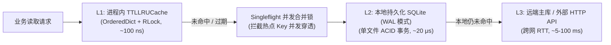

# 嵌入式数据库（SQLite）与本地缓存策略

并非所有数据持久化需求都值得大动干戈引入独立的 PostgreSQL 或 Redis 集群。在现代工程架构中，**进程内内存缓存（In-Process Cache）**与**嵌入式关系型数据库 SQLite** 构成了延迟最低、运维成本接近于零的两级本地数据底座：内存字典命中仅需约 `100 ns`，本机 NVMe 上的 SQLite WAL 查询仅需 `10 ~ 50 μs`（无需任何 TCP 套接字序列化与跨机器网络往返），比一次同机房远程数据库调用（`1 ~ 5 ms`）快出整整两个数量级。

从命令行开发工具、桌面与边缘端应用、大模型本地 RAG 元数据索引，到单机高吞吐中小型 Web 服务与持久化磁盘缓存（如著名的 `diskcache` 库底层正是 SQLite），掌握标准库内置 `sqlite3` 的正确调优姿势以及工业级本地缓存防击穿设计，是每一位 Python 工程师的核心基本功。



---

## Python DB-API 2.0（PEP 249）与内置 `sqlite3` 核心用法

为了避免换一种关系型数据库就要重写整套学习心智，Python 社区早在 **PEP 249（Python Database API Specification v2.0）** 中就统一规定了所有关系型数据库驱动的标准接口契约：统一的 `connect()` 入口、统一的 `Connection` 与 `Cursor` 对象模型、统一的事务方法（`commit()` / `rollback()`）以及统一的异常继承树（`Error` -> `DatabaseError` -> `IntegrityError` / `OperationalError` / `ProgrammingError`）。

Python 标准库内置的 `sqlite3` 模块正是 PEP 249 的官方标杆实现——它直接在 C 扩展层静态/动态链接了完整的 SQLite C 引擎，无需启动任何独立守护进程即可操作单文件关系型数据库（传入 `":memory:"` 则创建纯内存临时库；传入 `"file:data.db?mode=ro"` 配合 `uri=True` 则以严格只读模式打开）。

### 配置 `conn.row_factory = sqlite3.Row` 实现按名与按索引双模读取

默认情况下，`cursor.fetchone()` / `fetchall()` 返回的是纯位置元组 `tuple`（如 `(101, "alice@example.com", 1)`）。一旦日后有人修改了 `SELECT` 子句的列顺序，所有硬编码下标 `row[1]` 的业务代码都会悄无声息地错位报错。

在生产代码中打开连接后的第一件事，就是将行工厂设为内置 C 实现的高性能视图对象 `sqlite3.Row`：

- 它既支持像字典一样**按列名读取**（`row["email"]`、`row.keys()`、直接 `dict(row)` 转换）；
- 又完全保留了序列协议，支持**按下标访问与元组解包**（`user_id, email = row`），且内存开销远低于为每一行构造完整的 Python `dict`！

```python
import sqlite3

conn = sqlite3.connect(":memory:")
conn.row_factory = sqlite3.Row  # 开启列名 + 索引双模行对象

conn.execute("CREATE TABLE accounts (id INTEGER PRIMARY KEY, email TEXT UNIQUE, active INTEGER)")
conn.execute("INSERT INTO accounts (email, active) VALUES (?, ?)", ("alice@example.com", 1))

row = conn.execute("SELECT id, email, active FROM accounts WHERE id = ?", (1,)).fetchone()

# 1. 按字段名清晰访问（推荐）
assert row["email"] == "alice@example.com"
assert row.keys() == ["id", "email", "active"]
assert dict(row) == {"id": 1, "email": "alice@example.com", "active": 1}

# 2. 同时兼容按位置下标读取与解包
uid, email, active = row
assert (uid, email, active) == (1, "alice@example.com", 1)
conn.close()
```

### 参数化查询铁律：彻底杜绝 SQL 注入

数据库编程的第一条安全天条：**永远、绝对禁止使用 f-string、`%` 或 `.format()` 将外部变量直接拼接进 SQL 语句！**

如果写出 `f"SELECT * FROM users WHERE name = '{user_input}'"`，攻击者只需传入 `"' OR '1'='1"` 即可绕过条件拉取全表数据；若配合 `executescript()` 甚至能注入 `"; DROP TABLE users; --"` 删库。

正确的做法是使用 DB-API **参数化查询（Parameterized Query）**——在底层 C 接口中，SQL 语法树编译（`sqlite3_prepare_v2`）与参数值绑定（`sqlite3_bind_*`）是完全隔离的两个阶段，无论用户输入包含多少单引号、分号或控制字符，都只会被当作纯字面量数据对待，从根源上使 SQL 注入失去语法逃逸的可能。

`sqlite3` 原生支持两种标准占位符风格：

| 占位符风格 | 语法格式 | 传参容器类型 | 适用场景与易错提示 |
| :--- | :--- | :--- | :--- |
| **位置占位符（`qmark`）** | `?` | `tuple` 或 `list` 序列 | 参数较少（1~3 个）的简单语句。<br>**易错点**：单元素元组末尾必须加逗号 `(user_id,)`，漏写逗号写成 `(user_id)` 会报错 `ValueError: parameters are of unsupported type` 或把字符串拆成单个字符！ |
| **命名占位符（`named`）** | `:key_name` | `dict` 映射 | **字段较多（4 个以上）或同一参数在 SQL 中重复出现多次**的复杂查询，可读性与抗改错能力极强 |

```python
import sqlite3

with sqlite3.connect(":memory:") as tmp_conn:
    tmp_conn.execute("CREATE TABLE articles (id INTEGER PRIMARY KEY, title TEXT, tag TEXT)")

    # 恶意输入包含典型 SQL 注入载荷
    untrusted_title = "Python 指南'); DROP TABLE articles; --"

    # 安全写法 1：位置占位符 ? （注意单参数元组逗号！）
    tmp_conn.execute("INSERT INTO articles (title, tag) VALUES (?, ?)", (untrusted_title, "security"))

    # 安全写法 2：命名占位符 :key （同一参数 :kw 可在多处直接复用）
    rows = tmp_conn.execute(
        "SELECT id, title FROM articles WHERE title LIKE :kw OR tag = :exact_tag",
        {"kw": "%DROP TABLE%", "exact_tag": "security"},
    ).fetchall()

    # 表完好无损，恶意字符串仅作为普通文本完整存入并查出
    assert len(rows) == 1 and rows[0][1] == untrusted_title
tmp_conn.close()
```

!!! warning "动态表名或排序列名无法使用 `?` 占位符怎么办？"
    SQL 参数绑定仅能替换**数据值（字面量）**，不能替换表名、列名或 `ASC`/`DESC` 关键字。如果业务需要根据前端传参动态选择排序字段，**必须使用严格的 `frozenset` 白名单映射校验**（例如 `ALLOWED_SORT_COLS = frozenset({"created_at", "price", "id"})`，校验 `if col not in ALLOWED_SORT_COLS: raise ValueError(...)` 后再拼入固定标识符），绝不可直接放行用户输入！

### 批量写入 `executemany()`、读取自增主键 `lastrowid` 与 `RETURNING`

当需要向 SQLite 写入上万条记录时，应将批量写入包裹在**同一个事务**中并使用 `conn.executemany(sql, seq_of_parameters)`——它不仅复用了已编译好的预备语句（Prepared Statement），还直接接受**生成器表达式（Generator）**作为数据源，流式插入百万行也不会撑大内存：

```python
import sqlite3

conn = sqlite3.connect(":memory:")
conn.execute("CREATE TABLE logs (id INTEGER PRIMARY KEY AUTOINCREMENT, level TEXT, msg TEXT)")

# 1. 单条插入获取自增主键：通过返回的 Cursor 对象的 .lastrowid 属性
cur = conn.execute("INSERT INTO logs (level, msg) VALUES (?, ?)", ("INFO", "booted"))
assert cur.lastrowid == 1

# 2. 现代 SQLite (3.35+) 还原生支持 RETURNING 子句，一次往返直接拿回生成的列值
returned_id = conn.execute(
    "INSERT INTO logs (level, msg) VALUES (?, ?) RETURNING id",
    ("WARN", "high_latency"),
).fetchone()[0]
assert returned_id == 2

# 3. 批量流式写入：直接传入生成器，无需预先构造大列表
batch_gen = (("INFO", f"event-{i}") for i in range(1000))
with conn:
    conn.executemany("INSERT INTO logs (level, msg) VALUES (?, ?)", batch_gen)

total = conn.execute("SELECT COUNT(*) FROM logs").fetchone()[0]
assert total == 1002
conn.close()
```

---

## ACID 事务控制、连接生命周期陷阱与 WAL 高并发调优

### 揭秘 `sqlite3` 头号大坑：`with conn:` 根本不会关闭连接！

用惯了 `with open(...) as f:` 和 `with socket.create_connection(...) as sock:` 的 Python 开发者，十有八九会在生产代码里写出下面这段**看似优雅、实则持续泄漏文件描述符与文件锁**的代码：

```python
import sqlite3

# 陷阱实证：退出 with 块后，连接真的关掉了吗？
with sqlite3.connect(":memory:") as leaked_conn:
    leaked_conn.execute("CREATE TABLE t (x INTEGER)")
    leaked_conn.execute("INSERT INTO t VALUES (42)")

# 惊人事实：退出 with 之后，leaked_conn 依然完全处于打开可用状态！
assert leaked_conn.execute("SELECT x FROM t").fetchone()[0] == 42
leaked_conn.close()  # 必须手动补调 close() 才真正释放句柄！
```

为什么 `sqlite3.Connection` 要这样设计？因为连接对象可能需要在长生命周期内连续执行**几十个独立事务**！因此在 `sqlite3` 中，**`with conn:` 上下文管理器的唯一职责是管理“单次数据库事务边界”，而非“连接生命周期”**：

- 当 `with conn:` 代码块**正常结束**时，`conn.__exit__` 自动调用 **`conn.commit()`** 提交事务；
- 当 `with conn:` 代码块**抛出异常**时，`conn.__exit__` 自动调用 **`conn.rollback()`** 回滚整批脏修改，但**绝不会调用 `conn.close()`**！

在长运行服务或 Windows 环境下（未关闭的连接会死死锁住 `.db` / `.db-wal` 文件导致无法删除或迁移，并在 GC 回收时触发 `ResourceWarning: unclosed database`），**标准双层安全范式是用 `contextlib.closing()` 管连接关闭、内层 `with conn:` 管事务提交与回滚**：

```python
import contextlib
import sqlite3

# 外层 contextlib.closing 确保无论是否抛异常都必定执行 conn.close()；
# 内层 with conn 确保一组多表操作具备原子性（要么全部 COMMIT，要么异常自动 ROLLBACK）
with contextlib.closing(sqlite3.connect(":memory:")) as conn, conn:
    conn.execute("CREATE TABLE wallet (user TEXT PRIMARY KEY, balance INTEGER CHECK (balance >= 0))")
    conn.execute("INSERT INTO wallet VALUES ('alice', 100)")
```

### Python 3.12+ `autocommit` 参数演进与历史 `isolation_level` 怪癖

长期以来，旧版 `sqlite3` 默认的隐式事务控制（由 `isolation_level=""` 参数驱动）备受诟病：Python 底层 C 包装层试图在用户态去猜你写的 SQL 字符串——只有遇到 `INSERT` / `UPDATE` / `DELETE` 时才偷偷帮你发一句 `BEGIN`，而遇到 `SELECT` 或 `CREATE TABLE`（DDL）却不自动开启事务，行为既隐晦又偏离 PEP 249 标准（且计划在未来版本逐步弃用）。

**自 Python 3.12 起，`sqlite3.connect()` 正式引入了清晰的 `autocommit` 参数（推荐所有现代项目显式配置）**：

| `autocommit` 取值 | 事务行为语义 | 适用场景 |
| :--- | :--- | :--- |
| **`False`（现代工程首选）** | **严格遵循 PEP 249 标准**：始终处于显式事务保护之下（包括 `SELECT` 快照读与可回滚的 DDL），由 `conn.commit()` / `conn.rollback()` 或 `with conn:` 明确界定事务提交与回滚 | **几乎所有常规业务读写代码**，语义最可预测、绝无意外半提交 |
| `True` | 纯自动提交模式：若未手工执行 `BEGIN`，每条独立 SQL 执行完立即落盘提交 | 执行**禁止在事务内部运行**的管理指令（如 `PRAGMA journal_mode = WAL;`、`VACUUM`） |
| `sqlite3.LEGACY_TRANSACTION_CONTROL` | 兼容 Python 3.11 及更早版本的 `isolation_level` 字符串嗅探旧逻辑（当前默认值） | 仅用于兼容未迁移的老旧遗留代码库 |

!!! tip "Python 3.12–3.14 关键实战细节：`autocommit=False` 与 `WAL` 模式的初始化顺序！"
    当直接以 `sqlite3.connect(path, autocommit=False)` 打开连接时，PEP 249 规范要求底层立即开启一个隐式事务（`conn.in_transaction` 为 `True`）。而 SQLite 引擎规定 **`PRAGMA journal_mode = WAL` 绝不允许在已开启的事务内部执行**（否则会直接抛出 `sqlite3.OperationalError: cannot change into wal mode from within a transaction`）！
    因此，最稳健的连接工厂写法是：**先以 `autocommit=True` 打开连接执行所有初始化 `PRAGMA`，随后立即设置 `conn.autocommit = False` 切入严格事务模式**（见下方完整生产模板）。

### 生产环境必开的四大 SQLite `PRAGMA` 调优指令

刚用默认参数创建的 SQLite 连接是为 20 年前的慢速机械硬盘与旧系统兼容性妥协的，直接上生产不仅并发读会被写锁卡死，甚至**连外键约束都是默认关闭的**！每次新建连接时，应当统一执行以下四条黄金调优指令：

| `PRAGMA` 指令 | 默认行为痛点 | 开启后的工程收益与注意事项 |
| :--- | :--- | :--- |
| **`PRAGMA journal_mode = WAL;`** | 默认 `DELETE` 回滚日志模式下，**写操作会独占锁表，阻塞所有并发读；读操作也会阻塞写** | 切换为 **预写式日志（Write-Ahead Logging）**：修改先顺序追加到 `.db-wal` 文件，**读不阻塞写、写也不阻塞读**！单机并发读吞吐飙升数倍（注意：WAL 依赖本机共享内存 `.db-shm`，不可放在 NFS/SMB 网络挂载盘上） |
| **`PRAGMA synchronous = NORMAL;`** | 默认 `FULL` 在每次事务提交时都执行昂贵的多次磁盘 `fsync` | 在 **WAL 模式下搭配 `NORMAL`** 依然保证操作系统崩溃或断电绝不损坏数据库（仅极端断电瞬间可能回退最近一次未刷盘 checkpoint），同时将写入吞吐提升 **5~20 倍** |
| **`PRAGMA foreign_keys = ON;`** | **历史巨坑**：SQLite 默认允许写 `REFERENCES` 外键语法，但**运行时静默忽略所有外键检查**！ | 强制开启外键级联与引用完整性校验。**注意：该开关是连接级（Per-Connection）的，必须在每条新连接建立时都执行一次！** |
| **`PRAGMA busy_timeout = 5000;`** | SQLite 同一时刻只允许一个写者；另一个线程/进程尝试写入时若恰逢锁占用，瞬间抛出 `database is locked` | 遇到锁竞争时让底层引擎自动退避重试等待最多 `5000 ms`（5 秒），平抑绝大多数瞬时并发写毛刺 |

将上述所有最佳实践浓缩为一个可直接拷贝复用的**生产级 SQLite 连接工厂**：

```python
import contextlib
from pathlib import Path
import sqlite3
import tempfile


def open_production_sqlite(db_path: Path | str) -> sqlite3.Connection:
    """创建开启 WAL 并发、外键强约束、锁超时退避与 PEP 249 严格事务的 SQLite 连接。"""
    # 第一阶段：autocommit=True 执行非事务级连接初始化 PRAGMA
    conn = sqlite3.connect(db_path, autocommit=True)
    conn.row_factory = sqlite3.Row

    conn.execute("PRAGMA journal_mode = WAL;")
    conn.execute("PRAGMA synchronous = NORMAL;")
    conn.execute("PRAGMA foreign_keys = ON;")
    conn.execute("PRAGMA busy_timeout = 5000;")

    # 第二阶段：切入 PEP 249 标准显式事务控制模式
    conn.autocommit = False
    return conn


with tempfile.TemporaryDirectory() as tmp_dir:
    db_file = Path(tmp_dir) / "store.db"
    with contextlib.closing(open_production_sqlite(db_file)) as conn:
        with conn:
            conn.execute("CREATE TABLE users (id INTEGER PRIMARY KEY, name TEXT NOT NULL)")
            conn.execute(
                "CREATE TABLE orders ("
                "  id INTEGER PRIMARY KEY,"
                "  user_id INTEGER NOT NULL REFERENCES users(id) ON DELETE RESTRICT"
                ")"
            )
            conn.execute("INSERT INTO users (id, name) VALUES (1, 'Alice')")

        # 验证外键约束确实已生效，且异常时内层 with conn 自动回滚事务！
        try:
            with conn:
                conn.execute("INSERT INTO orders (user_id) VALUES (?)", (999,))
        except sqlite3.IntegrityError as exc:
            print("外键约束成功拦截非法关联写入并自动回滚:", exc)
```

输出：

```text
外键约束成功拦截非法关联写入并自动回滚: FOREIGN KEY constraint failed
```

---

## 标准库本地键值存储与内存缓存缺陷剖析

### `dbm` 与 `shelve`：轻量本地字典持久化的定位与安全边界

如果你的需求仅仅是为一个单进程 CLI 工具保存几十个本地键值配置，不想写任何建表 SQL，Python 标准库还提供了两个类字典本地持久化模块：

1. **`dbm`（纯字节键值存储 `bytes -> bytes`）**：
   把磁盘文件映射成类似 `dict[bytes, bytes]` 的接口。值得一提的是，**自 Python 3.13（PEP 718）起，标准库新增了 `dbm.sqlite3` 并将其设为跨平台默认后端**，彻底终结了过去不同操作系统上 `ndbm` / `gdbm` / `dumbdbm` 格式互不兼容的痛点！
2. **`shelve`（任意 Python 对象持久化 `str -> Any`）**：
   在 `dbm` 之上套了一层 `pickle` 序列化，允许你用字符串作键、直接存取任意可序列化的列表、字典或自定义数据类实例。

```python
from pathlib import Path
import shelve
import tempfile

with tempfile.TemporaryDirectory() as tmp_dir:
    shelf_path = str(Path(tmp_dir) / "cli_state")

    with shelve.open(shelf_path, flag="c") as state:
        state["last_sync"] = {"cursor": 4096, "tags": ["py314", "sqlite"]}

        # 注意 writeback=False（默认）的原地修改陷阱：
        # 直接写 state["last_sync"]["cursor"] = 8192 不会写回磁盘！必须取出修改后再重新赋值：
        record = state["last_sync"]
        record["cursor"] = 8192
        state["last_sync"] = record

    with shelve.open(shelf_path, flag="r") as state:
        assert state["last_sync"]["cursor"] == 8192
```

!!! warning "`shelve` 的两大工程禁区"
    1. **反序列化远程代码执行（RCE）风险**：`shelve` 底层无条件调用 `pickle.loads()`。**绝对禁止打开来源不可信或外部用户上传的 `shelve` 文件**，否则攻击者构造的恶意载荷可在打开读取瞬间执行任意系统命令！
    2. **缺乏多进程并发与过期淘汰能力**：传统 `dbm` / `shelve` 没有内置 TTL 过期机制，也不适合多线程/多进程高并发混合读写。一旦涉及结构化查询、TTL 缓存或并发安全，请直接使用 SQLite WAL 表！

### `functools.lru_cache` 在长生命周期服务中的两大致命痛点

谈及内存缓存，Python 开发者最熟悉的莫过于标准库一行装饰器 `@functools.lru_cache(maxsize=128)`。它在纯算法题（动态规划记忆化搜索）和短生命周期批处理脚本中表现堪称完美，但在 **7×24 小时运行的长生命周期后端服务**中直接滥用它，往往会埋下两颗定时炸弹：

#### 痛点一：完全没有过期时间（TTL），导致脏数据永久驻留

`lru_cache` 只基于**容量（Capacity）**淘汰——只要不同入参组合的总数没超过 `maxsize`（例如系统一共只有 50 个租户配置项，而 `maxsize=128`），哪怕数据库里的租户权限早已在三天前被管理员吊销，内存里的旧返回值也会**永久驻留直到进程重启**！

#### 痛点二：直接装饰实例方法会强引用 `self`，引发严重内存泄漏！

这是线上最隐蔽的 Python 内存泄漏元凶之一：当你把 `@lru_cache` 直接贴在一个类的普通实例方法 `def compute(self, x: int)` 上时，`lru_cache` 包装器是挂在**类属性（Class Attribute）**上的全局单例字典！每次调用 `obj.compute(10)`，缓存键 `(obj, 10)` 都会把实例 `obj` 的**强引用**死死锁进类的全局缓存字典里——即使请求早已结束、外部已经执行 `del obj`，垃圾回收器也永远无法释放这些死对象（直到把 `maxsize` 挤出为止）！

我们可以用标准库 `weakref`（弱引用）写一段 15 行的代码当场捕获这一泄漏现象：

```python
from functools import lru_cache
import gc
import weakref


class LeakyWorker:
    def __init__(self, payload_mb: int) -> None:
        self.buffer = bytearray(payload_mb * 1024)

    @lru_cache(maxsize=128)  # 危险反模式：直接在实例方法上套 lru_cache！
    def parse(self, factor: int) -> int:
        return len(self.buffer) * factor


worker = LeakyWorker(64)
weak_observer = weakref.ref(worker)  # 建立不增加引用计数的弱引用探针

_ = worker.parse(2)
del worker
gc.collect()

# 实锤泄漏：明明已经 del worker 并强制 GC，但弱引用探针发现对象依然存活在内存里！
assert weak_observer() is not None
print("清理缓存前，worker 是否泄漏存活:", weak_observer() is not None)

# 只有手动清空类方法上的全局缓存，实例才终于被释放！
LeakyWorker.parse.cache_clear()
gc.collect()
assert weak_observer() is None
print("清空缓存后，worker 是否已被安全回收:", weak_observer() is None)
```

输出：

```text
清理缓存前，worker 是否泄漏存活: True
清空缓存后，worker 是否已被安全回收: True
```

*(注：若只是缓存无参实例计算属性且随实例一同销毁，应使用 `@functools.cached_property`；若需带 TTL、线程安全且不绑死 `self` 的通用缓存，则应使用独立的缓存容器组件。)*

---

## 手写工业级内存缓存组件与缓存高可用模式

### 从零实现线程安全的 `TTLLRUCache`

要在长生命周期服务中安全使用进程内缓存，一个合格的缓存容器必须同时具备四项核心素质：

1. **`O(1)` 时间复杂度的 LRU（最近最少使用）容量淘汰**：利用 `collections.OrderedDict` 的 `move_to_end(key)` 与 `popitem(last=False)`，在每次读写命中时将热点键移至队尾，超容时瞬间弹出队首最冷键；
2. **基于 `time.monotonic()` 的精确 TTL 过期判定**：使用[单调时钟](03-datetime-and-timezone.md)彻底免疫操作系统 NTP 时间回拨导致的缓存提前失效或永不过期；
3. **惰性淘汰 + 主动清理双结合**：`get(key)` 发现过期立即惰性删除；同时在 `set()` 超容前及显式调用 `purge_expired()` 时主动扫除过期尸体，防止不再被访问的过期键白占容量挤走有效热数据；
4. **`threading.RLock` 可重入互斥锁保护**：确保在多线程 Web Worker、`ThreadPoolExecutor` 乃至 Python 3.13/3.14 自由线程（Free-Threading）模式下绝对没有字典并发修改竞态（`RuntimeError: OrderedDict mutated during iteration`）。

下面使用现代 Python 3.12+ 原生泛型语法（PEP 695）实现一个零外部依赖、百行以内的工业级 `TTLLRUCache`：

```python
from collections import OrderedDict
from dataclasses import dataclass
import threading
import time


@dataclass(slots=True, frozen=True)
class CacheStats:
    hits: int
    misses: int
    currsize: int
    maxsize: int


class TTLLRUCache[K, V]:
    """线程安全、支持容量上限 LRU 淘汰与单调时钟 TTL 过期的内存缓存。"""

    def __init__(self, maxsize: int = 1024, default_ttl: float = 60.0) -> None:
        if maxsize <= 0:
            raise ValueError("maxsize 必须大于 0")
        if default_ttl <= 0:
            raise ValueError("default_ttl 必须大于 0")
        self._maxsize = maxsize
        self._default_ttl = default_ttl
        # 存储结构：key -> (value, expires_at_monotonic)
        self._store: OrderedDict[K, tuple[V, float]] = OrderedDict()
        self._lock = threading.RLock()
        self._hits = 0
        self._misses = 0

    def get(self, key: K, default: V | None = None) -> V | None:
        now = time.monotonic()
        with self._lock:
            entry = self._store.get(key)
            if entry is None:
                self._misses += 1
                return default

            value, expires_at = entry
            if now >= expires_at:
                # 惰性淘汰：已过期，立即移除并记为未命中
                del self._store[key]
                self._misses += 1
                return default

            # 命中有效键：提升至队尾标记为最近刚使用 (MRU)
            self._store.move_to_end(key, last=True)
            self._hits += 1
            return value

    def set(self, key: K, value: V, *, ttl: float | None = None) -> None:
        effective_ttl = self._default_ttl if ttl is None else ttl
        if effective_ttl <= 0:
            self.delete(key)
            return

        now = time.monotonic()
        expires_at = now + effective_ttl

        with self._lock:
            if key in self._store:
                self._store[key] = (value, expires_at)
                self._store.move_to_end(key, last=True)
                return

            # 若容量已满，优先主动清理已过期的槽位，仍满再按 LRU 弹出队首最久未用项
            if len(self._store) >= self._maxsize:
                self._purge_expired_unlocked(now)
            while len(self._store) >= self._maxsize:
                self._store.popitem(last=False)

            self._store[key] = (value, expires_at)

    def delete(self, key: K) -> bool:
        with self._lock:
            return self._store.pop(key, None) is not None

    def purge_expired(self) -> int:
        """主动扫描并清除所有已过期条目，返回清理数量。"""
        with self._lock:
            return self._purge_expired_unlocked(time.monotonic())

    def _purge_expired_unlocked(self, now: float) -> int:
        expired_keys = [k for k, (_, exp) in self._store.items() if now >= exp]
        for k in expired_keys:
            del self._store[k]
        return len(expired_keys)

    def stats(self) -> CacheStats:
        with self._lock:
            return CacheStats(
                hits=self._hits,
                misses=self._misses,
                currsize=len(self._store),
                maxsize=self._maxsize,
            )


# 验证 LRU 淘汰顺序与 TTL 自动过期
cache = TTLLRUCache[str, int](maxsize=2, default_ttl=10.0)
cache.set("a", 1)
cache.set("b", 2)
assert cache.get("a") == 1      # 访问 "a" 使其跃升为最新，"b" 成为最旧
cache.set("c", 3)               # 容量超限 (maxsize=2)，精准淘汰最久未用的 "b"
assert cache.get("b") is None
assert cache.get("a") == 1 and cache.get("c") == 3

cache.set("temp", 99, ttl=0.03)
time.sleep(0.05)
assert cache.get("temp") is None  # TTL 到期精准失效
print("TTLLRUCache 验证通过，统计快照:", cache.stats())
```

输出：

```text
TTLLRUCache 验证通过，统计快照: CacheStats(hits=3, misses=2, currsize=1, maxsize=2)
```

### 三大经典缓存高并发异常及其 Python 防御实现

在高并发生产环境中，仅仅有一个 `TTLLRUCache` 还不够——当缓存层与底层慢速数据源（数据库或远程微服务）配合时，必须主动防御分布式系统著名的**三大缓存异常风暴**：

| 异常名称 | 触发场景还原 | 致命后果 | 标准 Python 工程防御方案 |
| :--- | :--- | :--- | :--- |
| **1. 缓存穿透（Cache Penetration）** | 恶意爬虫或故障客户端高频查询**缓存和数据库里都根本不存在的 ID**（如 `user_id = -9999`） | 由于数据库查出 `None` 没写缓存，每次请求都 100% 穿透直击底层数据库 | ① 入口参数合法性拦截（或布隆过滤器）；<br>② **负缓存（Negative Caching）**：用专属私有哨兵对象 `_NULL_SENTINEL = object()` 把“查无此人”也缓存一个短 TTL（如 `10s`）！ |
| **2. 缓存击穿（Cache Stampede / Breakdown）** | **某一个超高频热点 Key**（如首页置顶配置）在到达 TTL 失效的同一毫秒，恰好涌入 500 个并发请求 | 500 个线程同时发现缓存 Miss，瞬间向数据库发射 500 条一模一样的重型聚合 SQL | **Singleflight（并发请求合并锁 / 互斥回源）**：同一个 Key 同一时刻只放行 **1 个线程**去查库回填，其余 499 个线程原地等待并直接共享该次查库结果！ |
| **3. 缓存雪崩（Cache Avalanche）** | 服务启动预热时为 50,000 个缓存键设置了完全相同的 `ttl = 3600` 秒 | 1 小时后的同一秒钟，50,000 个键集体同时过期，全量流量瞬间砸垮数据库 | **TTL 随机抖动（TTL Jitter）**：写入时令实际过期时间为 `ttl * random.uniform(0.85, 1.15)`，将失效洪峰均匀摊平到 10 分钟窗口内 |

#### 手写 `Singleflight`（并发请求合并器）防御缓存击穿实战

发源于 Go 语言 `golang.org/x/sync/singleflight` 的 **Singleflight 模式**，是解决热点 Key 缓存击穿最优雅、锁粒度最细的无外部依赖利器：它的全局锁**仅在登记/清理字典条目的几十纳秒内短暂持有**（不同 Key 之间的查询完全并行互不阻塞！），而针对**同一个热点 Key** 同时到达的所有线程则会挂在同一把 `threading.Event` 信号上等待首个代表线程回源完成：

```python
from collections.abc import Callable
from concurrent.futures import ThreadPoolExecutor
from dataclasses import dataclass, field
import random
import threading
import time
from typing import Any

# 专属私有哨兵：严格区分“缓存未命中”与“数据库里确实是 None（负缓存）”
_NEGATIVE_SENTINEL: Any = object()


@dataclass
class _InFlightCall:
    done: threading.Event = field(default_factory=threading.Event)
    result: Any = None
    error: BaseException | None = None


class Singleflight:
    """线程安全的同 Key 并发回源合并器：确保同一时刻相同 Key 的昂贵加载函数只执行一次。"""

    def __init__(self) -> None:
        self._mu = threading.Lock()
        self._calls: dict[Any, _InFlightCall] = {}

    def do(self, key: Any, fn: Callable[[], Any]) -> Any:
        with self._mu:
            existing = self._calls.get(key)
            if existing is not None:
                # 已有同 Key 请求正在飞往数据库！释放全局锁，仅等待该请求完成信号
                is_leader = False
                call = existing
            else:
                # 当前线程成为该 Key 的唯一回源代表 (Leader)
                is_leader = True
                call = _InFlightCall()
                self._calls[key] = call

        if not is_leader:
            call.done.wait()
            if call.error is not None:
                raise call.error
            return call.result

        # Leader 线程在全局锁之外执行慢速 I/O，绝不阻塞其他不同 Key 的并发请求
        try:
            call.result = fn()
            return call.result
        except BaseException as exc:
            call.error = exc
            raise
        finally:
            with self._mu:
                self._calls.pop(key, None)
                call.done.set()  # 唤醒所有正在等待该 Key 的 Follower 线程！


def get_with_full_protection(
    cache: TTLLRUCache[str, Any],
    flight: Singleflight,
    key: str,
    loader: Callable[[], Any],
    *,
    base_ttl: float = 60.0,
    negative_ttl: float = 5.0,
) -> Any:
    """集齐防穿透（负缓存哨兵）、防击穿（Singleflight）与防雪崩（TTL Jitter）的标准读取模板。"""
    cached = cache.get(key)
    if cached is not None:
        return None if cached is _NEGATIVE_SENTINEL else cached

    def load_and_populate() -> Any:
        # 双重检查（Double-Check）：防止排队间隙前一批刚填好缓存
        second_check = cache.get(key)
        if second_check is not None:
            return None if second_check is _NEGATIVE_SENTINEL else second_check

        fresh_val = loader()
        if fresh_val is None:
            # 防穿透：对不存在的数据写入短 TTL 负缓存哨兵
            cache.set(key, _NEGATIVE_SENTINEL, ttl=negative_ttl)
        else:
            # 防雪崩：在基准 TTL 上附加 ±15% 随机抖动打散集体过期时间
            jittered_ttl = base_ttl * random.uniform(0.85, 1.15)
            cache.set(key, fresh_val, ttl=jittered_ttl)
        return fresh_val

    return flight.do(key, load_and_populate)


# 压测验证：40 个并发线程在热点 Key 失效瞬间同时发起请求，底层慢速数据库究竟被查了几次？
shared_cache = TTLLRUCache[str, Any](maxsize=256)
shared_flight = Singleflight()
db_query_count = 0
count_lock = threading.Lock()


def heavy_db_query(item_id: str) -> dict[str, str] | None:
    global db_query_count
    with count_lock:
        db_query_count += 1
    time.sleep(0.05)  # 模拟 50ms 慢 SQL 聚合耗时
    if item_id == "missing_id":
        return None
    return {"id": item_id, "title": "Hot Homepage Banner"}


with ThreadPoolExecutor(max_workers=40) as pool:
    futures = [
        pool.submit(
            get_with_full_protection,
            shared_cache,
            shared_flight,
            "hot_banner",
            lambda: heavy_db_query("hot_banner"),
        )
        for _ in range(40)
    ]
    results = [f.result() for f in futures]

assert all(r == {"id": "hot_banner", "title": "Hot Homepage Banner"} for r in results)
# 奇迹验证：40 个并发线程同时冲锋，数据库实际仅承受了 1 次查询！
assert db_query_count == 1

# 再连续查 10 次不存在的 missing_id，验证负缓存防穿透生效（总查库次数仅 +1 变为 2）
for _ in range(10):
    assert (
        get_with_full_protection(
            shared_cache,
            shared_flight,
            "missing_id",
            lambda: heavy_db_query("missing_id"),
        )
        is None
    )
assert db_query_count == 2
print(f"高可用缓存防护验证通过！50 次高压请求最终仅触发底层查询 {db_query_count} 次")
```

输出：

```text
高可用缓存防护验证通过！50 次高压请求最终仅触发底层查询 2 次
```

---

## 练习与实战

### 练习 1：基于 SQLite 严格事务与 `CHECK` / 外键约束实现原子转账账本

请基于 `open_production_sqlite` 模式（WAL + `foreign_keys=ON` + `autocommit=False` + `contextlib.closing`）编写一个本地积分账本函数 `transfer_points(conn, from_uid, to_uid, amount)`：

1. 表结构包含账户表 `wallets(uid TEXT PRIMARY KEY, balance INTEGER NOT NULL CHECK (balance >= 0))` 与转账流水表 `ledger(id INTEGER PRIMARY KEY AUTOINCREMENT, from_uid TEXT NOT NULL REFERENCES wallets(uid), to_uid TEXT NOT NULL REFERENCES wallets(uid), amount INTEGER NOT NULL CHECK (amount > 0))`；
2. 一次转账必须同时完成：**扣减转出方余额、增加转入方余额、插入一条流水记录**；
3. 验证两个异常场景均能完整回滚（既不扣错钱，也不残留半条流水）：① 转出方余额不足触发 `CHECK (balance >= 0)` 约束失败；② 转入方 `to_uid` 不存在触发外键 `FOREIGN KEY` 约束失败。

??? success "点击查看答案与解析"
    **核心思路**：依赖 SQLite 表级 `CHECK (balance >= 0)` 与连接级 `PRAGMA foreign_keys = ON`，将三条 DML 语句包裹在同一个 `with conn:` 事务块中。还要特别检查 `UPDATE` 影响行数 `cur.rowcount == 1`，防止对不存在的 `from_uid` 执行 `UPDATE` 静默影响 0 行却给 `to_uid` 凭空加钱！一旦中途任何一步抛出 `IntegrityError` 或 `ValueError`，`with conn:` 会将已执行的修改原子回滚。
    
    ```python
    import contextlib
    import sqlite3
    
    
    def create_ledger_db() -> sqlite3.Connection:
        conn = sqlite3.connect(":memory:", autocommit=True)
        conn.row_factory = sqlite3.Row
        conn.execute("PRAGMA foreign_keys = ON;")
        conn.autocommit = False
        with conn:
            conn.execute(
                "CREATE TABLE wallets ("
                "  uid TEXT PRIMARY KEY,"
                "  balance INTEGER NOT NULL CHECK (balance >= 0)"
                ")"
            )
            conn.execute(
                "CREATE TABLE ledger ("
                "  id INTEGER PRIMARY KEY AUTOINCREMENT,"
                "  from_uid TEXT NOT NULL REFERENCES wallets(uid),"
                "  to_uid TEXT NOT NULL REFERENCES wallets(uid),"
                "  amount INTEGER NOT NULL CHECK (amount > 0)"
                ")"
            )
        return conn
    
    
    def transfer_points(
        conn: sqlite3.Connection, from_uid: str, to_uid: str, amount: int
    ) -> int:
        if amount <= 0:
            raise ValueError("转账积分必须为正整数")
        with conn:
            c1 = conn.execute(
                "UPDATE wallets SET balance = balance - :amt WHERE uid = :uid",
                {"amt": amount, "uid": from_uid},
            )
            if c1.rowcount != 1:
                raise LookupError(f"转出账户不存在: {from_uid}")
    
            c2 = conn.execute(
                "UPDATE wallets SET balance = balance + :amt WHERE uid = :uid",
                {"amt": amount, "uid": to_uid},
            )
            if c2.rowcount != 1:
                raise LookupError(f"转入账户不存在: {to_uid}")
    
            c3 = conn.execute(
                "INSERT INTO ledger (from_uid, to_uid, amount) VALUES (?, ?, ?)",
                (from_uid, to_uid, amount),
            )
            return int(c3.lastrowid or 0)
    
    
    with contextlib.closing(create_ledger_db()) as db:
        with db:
            db.executemany(
                "INSERT INTO wallets (uid, balance) VALUES (?, ?)",
                [("u1", 100), ("u2", 50)],
            )
    
        # 1. 正常转账 40 分
        tx_id = transfer_points(db, "u1", "u2", 40)
        assert tx_id == 1
    
        # 2. 余额不足 (60 < 200)：触发 CHECK 约束自动回滚
        try:
            transfer_points(db, "u1", "u2", 200)
        except sqlite3.IntegrityError:
            pass
    
        # 3. 转入不存在用户：先执行的 u1 扣款必须随异常完整回滚！
        try:
            transfer_points(db, "u1", "ghost_user", 10)
        except LookupError:
            pass
    
        balances = dict(db.execute("SELECT uid, balance FROM wallets").fetchall())
        ledger_cnt = db.execute("SELECT COUNT(*) FROM ledger").fetchone()[0]
        assert balances == {"u1": 60, "u2": 90}
        assert ledger_cnt == 1
        print("ACID 转账与异常回滚全部验证通过，最终余额:", balances)
    ```

### 练习 2：基于 SQLite WAL 构建可持久化的本地磁盘 TTL 缓存（`SQLiteDiskCache`）

命令行工具、爬虫断点缓存与本地 Embedding 向量缓存经常需要**进程退出重启后依然保留且带过期时间**的本地磁盘缓存（比 `shelve` 更安全、无 `pickle` 漏洞且支持并发读）。

请基于 `sqlite3`（开启 WAL 模式，使用 `json` 安全序列化代替 `pickle`）实现一个上下文管理类 `SQLiteDiskCache`：

1. 表结构 `cache_entries(key TEXT PRIMARY KEY, value_json TEXT NOT NULL, expires_at REAL NOT NULL)`，并为 `expires_at` 建立索引加速清理；
2. `set(key: str, value: Any, ttl: float)`：使用 SQLite 的 `INSERT INTO ... ON CONFLICT(key) DO UPDATE SET ...`（UPSERT 语法）原子写入或覆盖更新过期时间戳（注意：由于需跨进程重启持久化，此处过期时间应使用 `time.time() + ttl` 挂钟时间戳）；
3. `get(key: str, default: Any = None)`：若不存在或已过期则删除旧记录并返回 `default`，否则反序列化 JSON 返回；
4. 实现 `__enter__` 与 `__exit__` 确保退出 `with SQLiteDiskCache(path) as dc:` 时**真正关闭底层 SQLite 连接**。

??? success "点击查看答案与解析"
    **核心思路**：跨进程重启的磁盘缓存无法延续上一进程的内存单调时钟基准，因此落盘 `expires_at` 选用 `time.time() + ttl`；使用 SQLite 标准 `ON CONFLICT(key) DO UPDATE` 一条语句完成原子插入或刷新，并在 `expires_at` 列上建立二级索引 `idx_cache_expires` 使批量清理 `DELETE FROM cache_entries WHERE expires_at <= ?` 达到索引范围扫描级别的高效。
    
    ```python
    import json
    from pathlib import Path
    import sqlite3
    import tempfile
    import time
    from typing import Any
    
    
    class SQLiteDiskCache:
        """基于 SQLite WAL + JSON 的安全持久化本地磁盘 TTL 缓存。"""
    
        def __init__(self, db_path: Path | str) -> None:
            self._conn = sqlite3.connect(db_path, autocommit=True)
            self._conn.execute("PRAGMA journal_mode = WAL;")
            self._conn.execute("PRAGMA synchronous = NORMAL;")
            self._conn.execute("PRAGMA busy_timeout = 5000;")
            self._conn.autocommit = False
    
            with self._conn:
                self._conn.execute(
                    "CREATE TABLE IF NOT EXISTS cache_entries ("
                    "  key TEXT PRIMARY KEY,"
                    "  value_json TEXT NOT NULL,"
                    "  expires_at REAL NOT NULL"
                    ")"
                )
                self._conn.execute(
                    "CREATE INDEX IF NOT EXISTS idx_cache_expires ON cache_entries(expires_at)"
                )
    
        def close(self) -> None:
            self._conn.close()
    
        def __enter__(self) -> "SQLiteDiskCache":
            return self
    
        def __exit__(self, *exc_info: object) -> None:
            self.close()
    
        def set(self, key: str, value: Any, ttl: float = 300.0) -> None:
            payload = json.dumps(value, ensure_ascii=False)
            expires_at = time.time() + ttl
            with self._conn:
                self._conn.execute(
                    "INSERT INTO cache_entries (key, value_json, expires_at) "
                    "VALUES (:k, :v, :exp) "
                    "ON CONFLICT(key) DO UPDATE SET "
                    "  value_json = excluded.value_json, "
                    "  expires_at = excluded.expires_at",
                    {"k": key, "v": payload, "exp": expires_at},
                )
    
        def get(self, key: str, default: Any = None) -> Any:
            now = time.time()
            row = self._conn.execute(
                "SELECT value_json, expires_at FROM cache_entries WHERE key = ?",
                (key,),
            ).fetchone()
            if row is None:
                return default
    
            value_json, expires_at = row
            if now >= expires_at:
                with self._conn:
                    self._conn.execute("DELETE FROM cache_entries WHERE key = ?", (key,))
                return default
            return json.loads(value_json)
    
        def purge_expired(self) -> int:
            with self._conn:
                cur = self._conn.execute(
                    "DELETE FROM cache_entries WHERE expires_at <= ?",
                    (time.time(),),
                )
                return cur.rowcount
    
    
    with tempfile.TemporaryDirectory() as tmp:
        cache_file = Path(tmp) / "disk_cache.sqlite3"
    
        # 模拟进程 1 写入数据并彻底关闭退出
        with SQLiteDiskCache(cache_file) as dc1:
            dc1.set("embedding:doc1", [0.12, -0.45, 0.88], ttl=60.0)
            dc1.set("ephemeral", {"tmp": True}, ttl=0.02)
    
        time.sleep(0.04)
    
        # 模拟进程 2 重新启动挂载同一磁盘文件：持久项仍在，短命项已自动过期
        with SQLiteDiskCache(cache_file) as dc2:
            assert dc2.get("embedding:doc1") == [0.12, -0.45, 0.88]
            assert dc2.get("ephemeral") is None
            print("SQLiteDiskCache 跨会话持久化与过期淘汰验证通过！")
    ```

### 练习 3：封装可复用的 `@resilient_cached` 防穿透与防击穿函数装饰器

请将正文的 `TTLLRUCache`、`Singleflight`、负缓存哨兵与 TTL Jitter 组合成一个通用的函数装饰器 `@resilient_cached(maxsize=256, ttl=30.0, negative_ttl=3.0)`：

1. 根据位置参数与命名参数构造可哈希缓存键 `(args, tuple(sorted(kwargs.items())))`；
2. 当被装饰函数返回 `None` 时缓存负结果 `negative_ttl` 秒；返回非空值时缓存 `ttl * random.uniform(0.9, 1.1)` 秒；
3. 当被装饰函数**抛出异常**时，不能将异常缓存下来（下次调用应允许正常重试），但当前同一批次挂载在 `Singleflight` 上的并发调用都应感知到该异常；
4. 在被装饰函数上挂载 `.cache` 属性以便监控命中率或手动失效特定键。

??? success "点击查看答案与解析"
    **核心思路**：在装饰器闭包内实例化专属的 `TTLLRUCache` 与 `Singleflight`。Leader 线程执行原函数若抛出异常，`Singleflight.do` 会将异常同步传播给同批等待线程，且因为异常跳过了 `cache.set(...)`，不会把临时网络故障污染进长期缓存中。
    
    ```python
    from collections import OrderedDict
    from collections.abc import Callable
    from concurrent.futures import ThreadPoolExecutor
    from dataclasses import dataclass, field
    from functools import wraps
    import random
    import threading
    import time
    from typing import Any
    
    _MISSING_VAL: Any = object()
    
    
    @dataclass
    class _FlightSlot:
        done: threading.Event = field(default_factory=threading.Event)
        value: Any = None
        err: BaseException | None = None
    
    
    class _MiniTTLLRU:
        def __init__(self, maxsize: int, default_ttl: float) -> None:
            self._maxsize = maxsize
            self._default_ttl = default_ttl
            self._data: OrderedDict[Any, tuple[Any, float]] = OrderedDict()
            self._lock = threading.RLock()
            self.hits = 0
            self.misses = 0
    
        def get(self, key: Any) -> Any:
            now = time.monotonic()
            with self._lock:
                item = self._data.get(key)
                if item is None:
                    self.misses += 1
                    return None
                val, exp = item
                if now >= exp:
                    del self._data[key]
                    self.misses += 1
                    return None
                self._data.move_to_end(key)
                self.hits += 1
                return val
    
        def set(self, key: Any, val: Any, *, ttl: float) -> None:
            exp = time.monotonic() + ttl
            with self._lock:
                self._data[key] = (val, exp)
                self._data.move_to_end(key)
                while len(self._data) > self._maxsize:
                    self._data.popitem(last=False)
    
    
    def resilient_cached(
        *, maxsize: int = 256, ttl: float = 30.0, negative_ttl: float = 3.0
    ):
        def decorator[R](func: Callable[..., R]) -> Callable[..., R]:
            cache = _MiniTTLLRU(maxsize=maxsize, default_ttl=ttl)
            flight_lock = threading.Lock()
            in_flight: dict[Any, _FlightSlot] = {}
    
            @wraps(func)
            def wrapper(*args: Any, **kwargs: Any) -> R:
                cache_key = (args, tuple(sorted(kwargs.items())))
                hit = cache.get(cache_key)
                if hit is not None:
                    return None if hit is _MISSING_VAL else hit  # type: ignore[return-value]
    
                with flight_lock:
                    slot = in_flight.get(cache_key)
                    if slot is None:
                        is_leader = True
                        slot = _FlightSlot()
                        in_flight[cache_key] = slot
                    else:
                        is_leader = False
    
                if not is_leader:
                    slot.done.wait()
                    if slot.err is not None:
                        raise slot.err
                    return slot.value
    
                try:
                    again = cache.get(cache_key)
                    if again is not None:
                        slot.value = None if again is _MISSING_VAL else again
                        return slot.value
    
                    val = func(*args, **kwargs)
                    if val is None:
                        cache.set(cache_key, _MISSING_VAL, ttl=negative_ttl)
                    else:
                        cache.set(cache_key, val, ttl=ttl * random.uniform(0.9, 1.1))
                    slot.value = val
                    return val
                except BaseException as exc:
                    slot.err = exc
                    raise
                finally:
                    with flight_lock:
                        in_flight.pop(cache_key, None)
                        slot.done.set()
    
            wrapper.cache = cache  # type: ignore[attr-defined]
            return wrapper
    
        return decorator
    
    
    invocations = 0
    inv_lock = threading.Lock()
    
    
    @resilient_cached(maxsize=64, ttl=10.0, negative_ttl=2.0)
    def fetch_user_profile(uid: int) -> dict[str, Any] | None:
        global invocations
        with inv_lock:
            invocations += 1
        time.sleep(0.03)
        if uid < 0:
            raise RuntimeError("invalid negative uid")
        if uid == 404:
            return None
        return {"uid": uid, "role": "admin"}
    
    
    # 1. 并发 20 线程压测防击穿：仅调用底层 1 次
    with ThreadPoolExecutor(max_workers=20) as ex:
        res = list(ex.map(fetch_user_profile, [1] * 20))
    assert len(res) == 20 and invocations == 1
    
    # 2. 验证负缓存防穿透：连续查不存在的 404 用户 5 次，仅新增 1 次底层调用
    for _ in range(5):
        assert fetch_user_profile(404) is None
    assert invocations == 2
    
    # 3. 验证抛异常绝不污染缓存：每次调用 uid=-1 都会真正执行并抛异常
    for _ in range(2):
        try:
            fetch_user_profile(-1)
        except RuntimeError:
            pass
    assert invocations == 4
    c = fetch_user_profile.cache  # type: ignore[attr-defined]
    print(f"高可用缓存装饰器验证通过！hits={c.hits}, misses={c.misses}")
    ```
