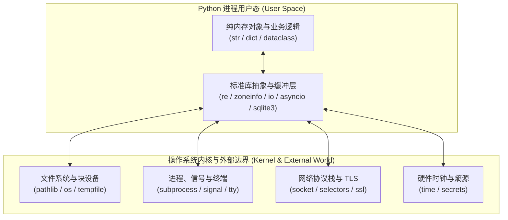

# 本章导读

如果说第一章 [Python 语言](../01-language/overview.md) 解决的是**“进程内存内部的对象如何组织与协作”**，那么本章 **通用编程（General Programming）** 解决的就是**“Python 程序如何跨越内存边界，安全、高效地与真实外部世界交互”**——包括清洗非结构化文本、处理全球时区、读写磁盘文件系统、编排外部进程、调度多核与异步并发、收发网络字节流以及持久化关系型数据。

---

## 从语言内核走向外部世界

当数据一旦离开纯内存对象（如 `dict`、`list`），进入磁盘、管道、网卡或数据库时，程序的复杂度会立即发生质变。开发者必须直面四个核心工程问题：

1. **表示与边界（Representation & Framing）**：内存里没有“粘包”和“乱码”，但磁盘和网络上只有连续的原始字节流（`bytes`）。你必须显式指定字符编码（UTF-8）、字节序（大端 / 小端）、时区基准（UTC）与消息分帧边界。
2. **部分失败与原子性（Partial Failure & Atomicity）**：内存赋值几乎不会写出一半崩溃，但写文件可能断电、网络传输可能半途重置、批量写库可能中途违反约束。因此必须掌握临时文件原子替换（`os.replace`）、超时控制与数据库 ACID 事务。
3. **资源生命周期（Resource Lifecycle）**：文件描述符（FD）、Socket 连接、子进程句柄和数据库连接都是操作系统内核管理的稀缺资源，泄漏会导致整个服务出现 `Too many open files` 或连接池枯竭。
4. **等待与吞吐（Latency & Concurrency）**：一次内存访问仅需约 `100 ns`，而一次磁盘持久化或跨机房网络请求往往需要 `1 ms ~ 100 ms`（相差百万倍）。如何利用多线程、多进程或单线程事件循环（`asyncio`）把等待时间重叠起来，直接决定了系统的吞吐上限。



---

## “自带电池（Batteries Included）”标准库地图

Python 之所以能在自动化运维、后端服务、数据管道与 AI 工程中成为通用胶水与主力语言，很大程度上归功于其覆盖面极广且随版本持续现代化的标准库体系：

| 能力领域 | 现代核心模块（Python 3.12–3.14+） | 替代或淘汰的历史做法 |
| :--- | :--- | :--- |
| **文本与正则** | `re`、`unicodedata`、`textwrap`、`difflib` | 手写复杂下标切片、脆弱的字符串拼接解析 |
| **专用容器与算法** | `collections`（`deque`/`Counter`）、`heapq`、`bisect`、`graphlib` | 用 `list.pop(0)` 做队列（`O(n)` 退化）、手写排序实现优先队列 |
| **日期、时区与计时** | `datetime`（Aware UTC）、`zoneinfo`、`time.monotonic` / `perf_counter` | 已废弃的 `datetime.utcnow()`、第三方 `pytz` 的 `.localize()` 怪癖、用 `time.time()` 测耗时 |
| **路径与文件系统** | `pathlib.Path`（含 3.12+ `Path.walk`）、`shutil`、`tempfile`、`os.replace` | `os.path.join` 字符串拼接、直接覆盖写目标配置文件 |
| **流式 I/O 与序列化** | `io`、`json`、`csv`、`tomllib`、`struct`、`compression.zstd`（3.14+） | 一次性 `f.read()` 撑爆内存、不设 `filter` 直接解压不可信 `tar` 包 |
| **密码学哈希与随机** | `hashlib`（含 `file_digest`）、`hmac.compare_digest`、`secrets`、`uuid`（含 3.14+ `uuid7`） | 用 `random` 生成验证码/Token、用 `==` 比对签名摘要 |
| **进程、信号与 CLI** | `subprocess.run`（列表传参）、`signal`、`argparse`（或生态库 `Typer`） | `os.system()` 拼接字符串引发命令注入、`sys.argv` 手工切片解析 |
| **并发、并行与异步** | `concurrent.futures`、`queue`、`asyncio.TaskGroup`、`asyncio.timeout` | 手工裸管 `Thread` 生命周期、在协程内误调同步阻塞 I/O |
| **网络与本地持久化** | `socket`、`selectors`、`ssl`、`urllib` / `httpx`、`sqlite3`（WAL 模式） | 字符串拼接 SQL 引发注入、忽略 TCP 字节流分帧边界 |

---

## I/O 模型与并发心智预热

在进入后续文件、进程、并发与网络章节之前，先区分两组最容易混淆的基础概念：

### 1. 用户态缓冲（User-space Buffering）vs 系统调用（Syscall）

每次从用户态切换到操作系统内核态执行 `read()` / `write()` 系统调用都有固定上下文切换成本。因此 Python 的 `open()` 默认在用户态维护了一层缓冲区（通常 8 KB）：

```python
import io

# 查看当前平台默认缓冲区字节大小
print("默认缓冲区大小:", io.DEFAULT_BUFFER_SIZE)
```

输出：

```text
默认缓冲区大小: 8192
```

- 当你调用 `f.write("hello")` 时，数据往往还停留在 Python 进程的用户态内存缓冲区中，并未真正写入内核页缓存，更未落入物理磁盘；
- 只有缓冲区写满、调用 `f.flush()`、正常退出 `with open(...)` 块，才会刷入操作系统内核；而要确保断电不丢数据，还需调用 `os.fsync(f.fileno())` 强制刷盘。

### 2. 阻塞 / 非阻塞 vs 同步 / 异步，以及并发三模型选型

日常工程中面对高吞吐需求时，Python 提供了三套分工明确的并发工具：

| 维度 | 多线程（`threading` / `ThreadPoolExecutor`） | 多进程（`multiprocessing` / `ProcessPoolExecutor`） | 异步协程（`asyncio`） |
| :--- | :--- | :--- | :--- |
| **调度主体** | 操作系统内核抢占式调度 | 操作系统内核抢占式调度（独立进程空间） | 用户态事件循环协作式调度（显式 `await` 让出） |
| **单进程内存开销** | 中等（每线程独立系统栈，通常数 MB） | 较高（独立解释器与内存页，IPC 需序列化或共享内存） | **极低**（每 Task 仅数 KB 堆对象，轻松支撑上万并发连接） |
| **标准构建下多核利用** | 受限于 GIL，同一时刻单核执行字节码（I/O 期间释放 GIL） | **原生绕过 GIL，跑满多核 CPU** | 单线程运行，不利用多核（可结合多进程 worker） |
| **最佳适用场景** | **中低并发阻塞型 I/O**、复用不支持异步的传统同步库（数据库驱动、文件读写） | **CPU 密集型重计算**（图像编码、加解密、科学计算、AST 解析） | **高并发网络 I/O**（网关代理、海量 HTTP/WebSocket 连接、大模型并发流式请求） |

!!! note "Python 3.13 / 3.14 自由线程（Free-Threading）补充"

    在启用实验性/可选的无 GIL 构建（如 `python3.14t`）时，多线程也能直接并行利用多核 CPU；但在标准默认构建中，“I/O 用 `asyncio` 或线程池、CPU 密集用进程池”依然是最稳健的工程基准准则。

---

## 跨平台可移植性准则

编写可在 Linux 服务器、macOS 开发机与 Windows 终端无缝运行的通用 Python 代码，务必遵守以下四条底线：

1. **永远显式声明 `encoding="utf-8"`**：尽管现代 Python（PEP 686，Python 3.15 默认 UTF-8 模式）正在消除历史遗留编码差异，但在現行跨平台环境（尤其是旧版 Windows 默认 GBK / `cp936`）中，不写 `encoding="utf-8"` 的 `open()` 与 `Path.read_text()` 仍是乱码头号根源。
2. **用 `pathlib.Path` 代替硬编码斜杠 `"/"` 或 `"\\"`**：让路径对象自动处理盘符、分隔符与规范化。
3. **理解换行符自动转换**：文本模式下写出 `"\n"` 在 Windows 上默认会被转换为 `"\r\n"`；读写二进制文件或使用 `csv` 模块时必须注意模式与 `newline=""` 设置。
4. **多进程入口必须置于 `if __name__ == "__main__":` 保护之下**：在 `spawn` 启动模式（Windows、macOS 默认，且自 Python 3.14 起成为 Linux 默认安全模式）下，子进程会重新导入主脚本模块；缺少入口守卫会导致无限递归创建子进程直至崩溃。

---

## 本章阅读路线

本章共包含 12 篇实战专题，按**“内存数据处理 → 本地系统与存储 → 并发调度 → 网络协议与数据库”**循序推进：

1. **[01 文本处理与正则表达式](01-text-and-regex.md)**：Unicode 规范化、`re` 引擎原理、防灾难性回溯、命名分组与零宽环视。
2. **[02 进阶容器与算法标准库](02-collections-and-algorithms.md)**：`deque` / `Counter` / `ChainMap`、`heapq` 优先队列、`bisect` 二分查找与 `graphlib` 拓扑排序。
3. **[03 日期、时间与时区工程](03-datetime-and-timezone.md)**：Naive vs Aware 时间、UTC 准则、`zoneinfo` 夏令时处理与单调时钟计时。
4. **[04 文件系统、路径与目录操作](04-filesystem-and-paths.md)**：`pathlib` 全景、`Path.walk` 目录扫描、软硬链接与临时文件原子写入模式。
5. **[05 流式 I/O、数据序列化与归档压缩](05-io-streams-and-serialization.md)**：`io` 三层流、大文件分块流式处理、JSON/CSV/TOML、`struct` 二进制解包、`zstd` 与防穿越安全解压。
6. **[06 哈希摘要、安全随机与编码基础](06-crypto-hashing-and-random.md)**：`hashlib` 流式摘要、HMAC 防时序攻击校验、`secrets` 安全令牌、`uuid7` 与 Base64。
7. **[07 系统编程、子进程与 CLI 开发](07-os-processes-and-cli.md)**：标准流契约、`subprocess` 安全调用与防死锁管道、`signal` 优雅停机与 `argparse` 子命令。
8. **[08 多线程、多进程与并发同步原语](08-threading-and-multiprocessing.md)**：锁与死锁预防、有界队列背压、`multiprocessing` IPC/共享内存与 `concurrent.futures`。
9. **[09 异步编程与 asyncio 结构化并发](09-asyncio-and-structured-concurrency.md)**：事件循环、`TaskGroup` 结构化并发、`asyncio.timeout`、信号量限流与 `to_thread` 桥接。
10. **[10 网络编程基础：Socket、TCP/UDP 与多路复用](10-socket-and-network-protocols.md)**：TCP 字节流本质与长度前缀分帧、UDP、`selectors` 多路复用及 `asyncio` Streams 背压。
11. **[11 现代网络通信：TLS、HTTP 客户端与 WebSocket](11-http-tls-and-websocket.md)**：`ssl` 证书链校验、`httpx` 连接池/超时/重试、SSE 流式消费与 WebSocket 全双工。
12. **[12 嵌入式数据库（SQLite）与本地缓存策略](12-sqlite-and-local-caching.md)**：参数化查询、ACID 事务与 WAL 并发调优、手写线程安全 TTL+LRU 缓存与防击穿设计。

---

## 练习与实战

### 练习 1：对比用户态缓冲与显式刷新的可见性

在一个临时目录中用 `open(path, "w", encoding="utf-8")` 打开文件并写入一行短字符串 `"hello buffer"`，但在**尚未退出 `with` 块且尚未调用 `flush()`** 时，用另一个文件读取调用检查磁盘上该文件的字节大小（`path.stat().st_size`），观察结果；随后调用 `f.flush()` 再次检查文件大小，并用代码验证这一现象。

??? success "点击查看答案与解析"

    由于 `"hello buffer"` 远小于默认用户态缓冲区（8192 字节），写入后数据暂存于 `TextIOWrapper` / `BufferedWriter` 的用户态内存中，此时内核视角下的文件大小仍为 `0`；调用 `flush()` 或离开 `with` 块自动关闭时，缓冲区数据才真正提交给操作系统：

    ```python
    from pathlib import Path
    import tempfile

    with tempfile.TemporaryDirectory() as tmp_dir:
        target = Path(tmp_dir) / "demo.txt"
        with target.open("w", encoding="utf-8") as f:
            f.write("hello buffer")
            size_before_flush = target.stat().st_size

            f.flush()
            size_after_flush = target.stat().st_size

        assert size_before_flush == 0
        assert size_after_flush == len(b"hello buffer")
        print(f"flush 前磁盘大小: {size_before_flush} B, flush 后磁盘大小: {size_after_flush} B")
    ```

### 练习 2：为什么测量代码耗时应使用 `perf_counter` 而非 `time.time`？

请列举 `time.time()`、`time.monotonic()` 与 `time.perf_counter()` 三者的设计差异，并编写一个微基准计时上下文管理器 `Timer`，记录代码块执行的毫秒耗时（保留两位小数）。

??? success "点击查看答案与解析"

    - **`time.time()`（系统挂钟时间 Wall-clock）**：用于表示现实日历时间戳，但操作系统后台运行 NTP（网络时间协议）校时或管理员手动改时间时，它可能发生**向过去回跳**（导致耗时算出负数！）或向前突变。
    - **`time.monotonic()`（单调递增时钟）**：保证绝不因系统校时而后退，非常适合实现**超时控制、任务调度器与缓存过期（TTL）判定**。
    - **`time.perf_counter()`（高精度性能计数器）**：同样具有单调性，且选用当前硬件平台最高分辨率的计时源（纳秒级精度），专门用于测量短时间代码片段的性能开销。

    ```python
    from dataclasses import dataclass
    import time


    @dataclass
    class Timer:
        elapsed_ms: float = 0.0

        def __enter__(self) -> "Timer":
            self._start = time.perf_counter_ns()
            return self

        def __exit__(self, exc_type, exc_val, exc_tb) -> None:
            self.elapsed_ms = round((time.perf_counter_ns() - self._start) / 1_000_000, 2)


    with Timer() as t:
        total = sum(i * i for i in range(100_000))

    assert total > 0
    assert t.elapsed_ms >= 0.0
    print(f"计算耗时: {t.elapsed_ms:.2f} ms")
    ```

### 练习 3：识别任务类型并选择正确的并发模型

判断以下四个真实业务场景分别属于哪类负载，并从“线程池（`ThreadPoolExecutor`）”、“进程池（`ProcessPoolExecutor`）”和“异步协程（`asyncio`）”中选出最合适的一种并简述理由：

1. 同时向 2000 台远程服务器发起轻量级 HTTP 健康检查请求并汇总状态；
2. 对本地目录中 80 张高分辨率无损 PNG 图片批量计算像素级高斯模糊并重新编码压缩；
3. 在一个小型脚本中并发调用 10 次某第三方遗留 SDK（该 SDK 内部使用同步阻塞的 `urllib` / `socket` 且不提供 `async` 接口）；
4. 维护一个同时承载 5000 个浏览器长连接实时推送行情消息的 WebSocket 网关。

??? success "点击查看答案与解析"

    1. **2000 个并发 HTTP 健康检查 -> 选 `asyncio`（配合 `httpx.AsyncClient` + `Semaphore` 限流）**：
       属于典型的高并发网络等待型 I/O，单线程事件循环无需创建数千个操作系统线程，内存极省且切换开销最小。
    2. **80 张大图像素级计算与重编码 -> 选 `ProcessPoolExecutor` 多进程池**：
       属于典型的 CPU 密集型计算负载。在默认有 GIL 的解释器中，多线程无法并行执行纯计算，使用与 CPU 核心数匹配的进程池才能跑满多核吞吐。
    3. **10 次并发调用仅提供同步阻塞接口的遗留 SDK -> 选 `ThreadPoolExecutor` 线程池（若处于异步程序中则用 `asyncio.to_thread`）**：
       并发度不高（仅 10 个），且第三方库不支持异步非阻塞协议，直接塞进协程会卡死事件循环；用线程池包装阻塞 I/O 最简单直接，且底层等待网络期间会自动释放 GIL。
    4. **5000 个长连接 WebSocket 实时推送网关 -> 选 `asyncio`**：
       长连接绝大部分时间处于空闲等待状态，若采用“一连接一线程”模型仅线程栈就会消耗数十 GB 内存，而基于 I/O 多路复用的 `asyncio` 仅用极少内存即可轻松管理数千长连接。
