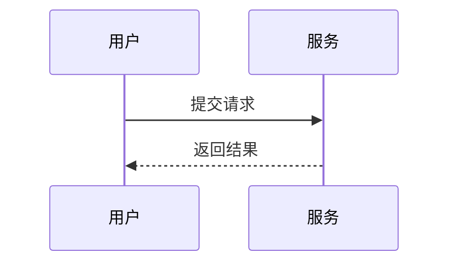
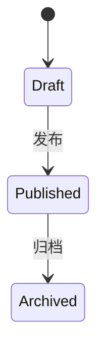

# kosmigen 网站内容编辑手册

适用于本仓库当前实现，核对日期：2026-11-09。直接依赖为 Material for MkDocs **9.7.7**、mkdocs-awesome-nav **3.3.0**。当前本地环境使用 MkDocs 1.6.1、Python-Markdown 3.10.3、PyMdown Extensions 11.0.1，三者为间接依赖，实际版本以安装环境为准。

本手册位于 `handbook/`，供仓库编辑者使用，不会发布到网站。文件路径默认相对于仓库根目录；命令也从仓库根运行。示例日期、名称和资源路径需要替换成实际内容。

## 目录

- [日常编辑流程](#日常编辑流程)
- [项目结构与内容位置](#项目结构与内容位置)
- [添加技术文档与导航](#添加技术文档与导航)
- [添加博客文章](#添加博客文章)
- [博客元数据完整说明](#博客元数据完整说明)
- [作者与目录默认配置](#作者与目录默认配置)
- [项目卡片](#项目卡片)
- [Now近况](#now近况)
- [首页、关于、页脚与404](#首页关于页脚与404)
- [通用页面元数据](#通用页面元数据)
- [Markdown基础语法](#markdown基础语法)
- [提示框与折叠内容](#提示框与折叠内容)
- [代码展示与注释](#代码展示与注释)
- [内容选项卡](#内容选项卡)
- [表格、任务、脚注与术语](#表格任务脚注与术语)
- [图片、视频与附件](#图片视频与附件)
- [按钮、卡片与HTML](#按钮卡片与html)
- [Mermaid图表](#mermaid图表)
- [复用其他文件](#复用其他文件)
- [当前支持与未启用的能力](#当前支持与未启用的能力)
- [网址、链接与迁移](#网址链接与迁移)
- [预览、检查与发布](#预览检查与发布)
- [常见问题](#常见问题)
- [实现维护与官方资料](#实现维护与官方资料)

## 日常编辑流程

| 想做什么 | 编辑位置 |
| --- | --- |
| 写 Python 文档 | `docs/notes/Python/新文件.md` 与同目录 `.nav.yml` |
| 写 CSAPP、AI 文档 | `docs/notes/CSAPP/`、`docs/notes/AI/` 中的新 `.md` 与 `.nav.yml` |
| 写工具文档 | `docs/notes/Tools/` 中的新 `.md` 与 `.nav.yml` |
| 写博客 | `docs/blog/posts/年月/新文章.md`，无需逐篇添加导航 |
| 展示项目 | `docs/projects/index.md` 的 `projects` 列表 |
| 发布近况 | `docs/now/YYYY/YYYY-MM-DD.md`；固定入口自动展示最新一期 |
| 改 Now 标题下的介绍 | `docs/now/.meta.yml` 的 `intro` |
| 改侧栏目录图标 | 对应目录 `.nav.yml` 顶层的 `icon` |
| 改单篇页面图标 | 对应 Markdown 顶部的 `icon` |
| 改首页介绍 | `docs/index.md` |
| 改作者名字、头像、简短介绍 | `docs/blog/.authors.yml` |
| 改作者完整介绍 | `docs/about/author.md` |

1. 在对应位置新建或修改文件。
2. 普通文档按需加入 `.nav.yml`，博客由插件自动收录。
3. 本地预览，检查正文、图片、导航和手机布局。
4. 严格构建并检查差异。
5. 只提交确定要发布的文件；推送 `main` 会自动部署。

最小技术文档模板：

```markdown
---
title: 列表与元组
description: Python 列表与元组的区别及使用场景。
---

# 列表与元组

这一页解释什么、适合什么读者。

## 核心概念

正文。

## 示例

正文。

## 参考资料

- [Python 官方文档](https://docs.python.org/3/)
```

普通页面的 `title`、`description` 均可省略。正文通常只写一个一级标题 `#`，下级章节使用 `##`、`###`。

## 项目结构与内容位置

```text
PythonDocs/
├── mkdocs.yml                    # 站点、插件、扩展、样式与脚本入口
├── requirements.txt              # 依赖
├── README.md                     # 仓库入口和快速启动
├── Agent.md                      # 代理共享工作规范
├── AGENTS.md / CLAUDE.md          # 规范入口
├── handbook/                     # 编辑手册，不发布
├── docs/                         # 网站公开内容
│   ├── .nav.yml                  # 导航组织
│   ├── index.md                  # 首页
│   ├── 404.md                    # 自定义 404 正文
│   ├── notes/
│   │   ├── index.md              # 技术文档入口
│   │   ├── C/                    # C
│   │   ├── Python/               # Python
│   │   ├── Java/                 # Java、框架与第三方库
│   │   ├── AI/                   # AI、机器学习等
│   │   ├── CSAPP/                # 深入理解计算机系统
│   │   └── Tools/                # 开发工具与其他工具
│   ├── blog/
│   │   ├── index.md              # 博客入口，可留空
│   │   ├── tags.md               # 标签索引
│   │   ├── .authors.yml          # 作者资料
│   │   └── posts/
│   │       ├── .meta.yml         # 文章默认作者
│   │       └── 2026-11/          # 按年月存放文章
│   ├── projects/
│   │   └── index.md              # 项目卡片数据
│   ├── now/
│   │   ├── .meta.yml             # 所有 Now 页面的共享介绍
│   │   ├── index.md              # 固定入口，自动展示最新一期
│   │   └── YYYY/                 # 按年份整理，可继续添加年份
│   │       └── YYYY-MM-DD.md     # 按日期保存的近况
│   ├── about/                    # 网站与个人介绍
│   └── assets/
│       ├── images/               # 图片
│       ├── fonts/                # 字体与授权
│       ├── stylesheets/          # 按职责拆分的样式
│       └── javascripts/          # 交互脚本与本地组件
├── overrides/                    # 自定义主题模板
│   └── partials/                 # 页眉、页脚、博客和项目组件
├── hooks/                        # 构建时处理
├── scripts/                      # 按需运行的维护工具
├── tests/                        # 博客元数据等构建逻辑检查
└── .github/workflows/            # 自动部署
```

`notes` 是技术文档的物理目录，显示名称为“文档”或“技术文档”。当前一级分类为 `C`、`Python`、`Java`、`AI`、`CSAPP` 和 `Tools`，路径与链接使用这些大小写。框架、工具、开发生态内容按主题加入现有分类，必要时再扩充栏目。无需为修改显示名称移动已发布文件。

`.nav.yml`、`.meta.yml`、`.authors.yml` 都是隐藏文件，编辑器需要显示隐藏文件。`site/` 是生成结果，`.venv/` 是运行环境，均不是网站内容源。

## 添加技术文档与导航

### 给现有栏目添加页面

例如新增 `docs/notes/Python/data-structures.md`，再修改 `docs/notes/Python/.nav.yml`：

```yaml
nav:
  - index.md
  - 列表与元组: data-structures.md
```

路径相对于这个 `.nav.yml` 所在目录；列表顺序决定侧栏顺序。显式标签“列表与元组”与正文标题可以不同。

当前大多使用显式导航，**新增文件不会必然自动出现在侧栏**。未进入导航的普通 Markdown 仍可能构建、进入搜索并通过网址访问，不能当作私有草稿。

若某个目录确实希望自动收录文件，可以使用：

```yaml
nav:
  - index.md
  - "*.md"
```

或者在该目录启用：

```yaml
append_unmatched: true
nav:
  - index.md
```

根目录没有 `.nav.yml`。插件发现底层页面树后，侧栏与手机菜单按 `extra.site_navigation` 筛选出配置中的顶层栏目，名称、顺序与目标和顶部保持一致。各栏目内部仍由自己的 `.nav.yml` 组织，建议保留明确顺序。

### 新建子目录

例如增加 Python 异步编程：

```text
docs/notes/Python/
├── .nav.yml
├── index.md
└── async/
    ├── .nav.yml
    ├── index.md
    └── asyncio.md
```

Python 的 `.nav.yml`：

```yaml
nav:
  - index.md
  - 异步编程: async
```

`async/.nav.yml`：

```yaml
nav:
  - index.md
  - asyncio.md
```

`navigation.indexes` 已启用，目录入口 `index.md` 可以合并为可点击的栏目名称。目录名、导航标签和正文标题不是同一个设置。

### Java 文档的内容风格

Java 栏目采用概念、语法、示例、输出、注意事项和练习的教程形式，以 JDK 21 为示例基准。完整程序需要实际编译运行；框架和第三方库示例还要注明依赖版本与运行命令。

写作模板、分类边界和验证要求见 [Java 文档编写规范](Java文档编写规范.md)。

### 添加框架或工具分类

与语言绑定的框架优先放在语言目录中，例如 `docs/notes/Java/framework/`；工具文档加入已有的 `docs/notes/Tools/`。确需新增跨语言的框架分类时，可以参考以下步骤：

1. 创建 `docs/notes/Frameworks/index.md`、`docs/notes/Frameworks/.nav.yml`。
2. 在里面添加 `fastapi/`、`spring/` 等主题目录和内容。
3. 在 `docs/notes/.nav.yml` 中增加同级入口。
4. 在 `docs/notes/overview.md` 按需增加链接或卡片。

根导航自动发现 `docs/notes/` 技术文档目录，栏目内顺序由 `docs/notes/.nav.yml` 管理。下面是新增分类后的示例：

```yaml
nav:
  - index.md
  - C: C
  - Python: Python
  - Java: Java
  - AI: AI
  - CSAPP: CSAPP
  - 工具: Tools
  - 框架: Frameworks
```

`Frameworks/.nav.yml` 示例：

```yaml
nav:
  - index.md
  - FastAPI: fastapi
  - Spring: spring
```

目录在 `notes/` 下时，顶部“文档”的选中状态会自动覆盖该路径。新增文档若放进全新的根目录，需要同步补充 `mkdocs.yml` 的 `extra.site_navigation` 中“文档”的 `paths`。

### 更改不同位置的名称

| 想改哪里 | 文件 |
| --- | --- |
| 顶部文字、顺序、目标网址 | `mkdocs.yml` 的 `extra.site_navigation`，由页眉模板读取 |
| 左侧与手机顶层栏目名称、顺序和目标 | 与顶部共用 `extra.site_navigation`；页面树仍由插件发现 |
| 栏目内页面标签和顺序 | 对应目录 `.nav.yml` |
| 正文标题 | 对应 Markdown 的 `#` 标题 |
| 默认页面标题 | 对应 Markdown 的 `title` |
| 页脚快速链接 | 同一份 `extra.site_navigation`，英文名称使用 `title_en` |
| 桌面侧栏最上方的栏目标题 | 对应 `extra.site_navigation` 项的 `hide_sidebar_title_on_desktop`，不影响手机抽屉 |
| 侧栏图标 | 目录在自己的 `.nav.yml` 顶层设置 `icon`；单篇页面在 front matter 中设置 `icon`。空字符串隐藏，未设置时使用默认图标；显示名称改动不影响图标 |

顶部是自定义模板，修改左侧标签不会自动改顶部。[awesome-nav 导航规则](https://lukasgeiter.github.io/mkdocs-awesome-nav/features/nav/)。

### 侧栏图标

目录的图标放在该目录自己的 `.nav.yml`。例如 `docs/notes/Java/.nav.yml`：

```yaml
icon: lucide/coffee

nav:
  - Java 入门: intro.md
  - Java 概述: overview.md
  - 核心: basics
  - 进阶: advanced
  - 框架: framework
  - 第三方库: third-party
```

在已有文件顶部添加 `icon` 即可，保留原来的导航列表。该字段只设置目录本身的图标，下级文章仍使用各自的图标或默认文档图标。移动目录时，这份配置可以一起移动；修改父导航给目录起的别名也不影响图标。

单篇文档在自己的 Markdown 顶部设置：

```markdown
---
title: 一篇文档
icon: lucide/code
---

# 一篇文档
```

目录和页面都支持 `icon: ""` 隐藏图标。未设置时，目录使用 `lucide/folder`，页面使用 `lucide/file-text`；当 index 页合并为目录入口时，目录的显式 `icon` 优先，目录没有配置时才读取 index 页的 `icon`。目录设置不会自动传给每篇文章，因此不要为了设置目录图标把 `icon` 放进会被所有页面继承的 `.meta.yml`。

博客目录图标在 `docs/blog/.nav.yml`，Tags 页面图标在 `docs/blog/tags.md`；插件生成的时间归档分组从 `docs/blog/archive/.nav.yml` 读取图标。手机一级栏目保持纯文字，展开后的目录和页面才显示图标。

图标名无需记忆：到 [Lucide 图标库](https://lucide.dev/icons/) 搜索用途并查看名称，在名称前加 `lucide/`，例如 `coffee` → `lucide/coffee`、`rocket` → `lucide/rocket`，无需 `.svg` 后缀。项目通过官方 `lucide-static` **1.69.0** 构建依赖提供该版本的完整 SVG 图标库，日常新增图标只需修改名称，不用逐个下载 SVG。

主题自带的 Material、Font Awesome 等图标仍可使用，例如 `material/book-open`。可以在 [Material 官方图标搜索](https://squidfunk.github.io/mkdocs-material/reference/icons-emojis/#search) 查找；侧栏配置使用路径形式，不使用正文图标短代码的冒号形式。

首次准备环境时，在仓库根目录运行 `npm ci --ignore-scripts`。依赖和锁文件分别在 `package.json`、`package-lock.json`，本地与自动部署使用相同版本。`hooks/icon_assets.py` 直接从依赖目录读取图标，保留项目自定义覆盖的优先级；`node_modules/` 不提交，网站只嵌入用到的 SVG，不包含整套图标库、图标字体或额外的浏览器图标脚本。完整许可证自动发布在 `/PureLearning/assets/licenses/lucide.txt`，来源与许可证副本保留在 `overrides/.icons/lucide/`。

图标不存在或字段类型不正确时，构建会指出具体文件；图标依赖未安装时，会明确提示安装命令。目录级 `icon` 是本项目通过 `hooks/navigation_icons.py` 增加的能力；`mkdocs.yml` 只需注册 hook，无需维护逐项的图标映射。

顶部与页脚快速链接共用配置，例如“文档”这一项：

```yaml
extra:
  site_navigation:
    - id: docs
      title: 文档
      title_en: Docs
      url: notes/overview/
      paths: [notes/]
      hide_sidebar_title_on_desktop: true
```

在现有列表中编辑或追加条目，不要用这段示例覆盖其余栏目。`title` 用于顶部、`title_en` 用于页脚，列表顺序同时决定两处顺序。`url` 是点击入口；`paths` 是使栏目保持选中的路径范围，可填写多个别名。路径相对站点根目录，保留末尾 `/`，不要加域名或 `/PureLearning/` 前缀。`id` 是脚本和样式使用的稳定标识，改名称时保留；尤其不要随意改动 `docs`，侧栏状态保存也使用它。

`hide_sidebar_title_on_desktop: true` 隐藏桌面侧栏最上方的栏目标题。目前“文档”和“关于”已启用，文档侧栏从 `overview` 开始；设置为 `false` 或删除这一项即可恢复标题，其他栏目也可使用同一个开关。该设置只隐藏顶层标题，保留子目录、页面条目以及手机抽屉的分组入口与返回标题。

侧栏模板根据栏目的 `paths` 识别当前栏目，为需要隐藏的顶层标题添加通用 class `kb-sidebar-title--desktop-hidden`，再由 `sidebar.css` 的桌面媒体查询控制显示，不依赖栏目 ID、标题文字或多层嵌套选择器。

### 移动端导航与目录

手机布局参考 [Zensical 文档页](https://zensical.org/docs/create-your-site/)：48px 单行页眉，左侧菜单以留有 8px 边距的圆角浮层显示。菜单只列 `extra.site_navigation` 的“博客、文档、项目、Now、关于”，一级栏目不显示前置图标，点击整行在原位展开下级，不直接进入页面；实际页面链接在下级列表中，不展示自动发现的公益 404 或英文顶层目录名。

侧栏选中与悬停状态统一使用浅灰色整行背景，文字、图标与箭头保持同一区域；深色模式使用对应深灰。带链接与展开箭头的条目以 `.kb-nav-row` 作为共同背景容器，内部不分别着色。

文章目录是独立的右下角圆形按钮，点一次即可显示 `On this page` 章节弹层。它与左上菜单分开，点击章节、空白区域或 Escape 关闭；桌面仍显示右侧目录。标题由 `markdown_extensions.toc.title` 配置，手机行为在 `site-toc.mjs` 中维护，菜单与目录样式在 `sidebar.css` 中维护。

首页和页脚保留 GitHub 联系方式；页眉及手机菜单不显示仓库统计组件。`repo_url` 仍用于反馈与源码链接。

## 添加博客文章

### 可复制模板

创建 `docs/blog/posts/2026-11/python-async-notes.md`：

````markdown
---
date: 2026-11-05
slug: python-async-notes
description: 从一个小例子理解 Python 异步任务的调度方式。
categories:
  - Python
  - 实践
draft: true
---

# 理解 Python 的异步任务

这里写一两段摘要，让读者知道文章讨论什么。

<!-- more -->

## 问题背景

正文。

## 实现示例

```python
print("从最小例子开始")
```

## 参考资料

- [Python 官方文档](https://docs.python.org/3/)
````

写作时保留 `draft: true`，发布前删除或改成 `false`。新文章会继承默认作者，不用逐篇填写作者或加入 `.nav.yml`。

### 摘要、描述与正文

| 内容 | 用途 |
| --- | --- |
| `description` | HTML 描述元信息，不自动成为列表摘要 |
| 标题后、`<!-- more -->` 前的正文 | 博客列表和时间归档中的摘要，可用 Markdown |
| 分隔符后的内容 | 详情页继续展示的完整正文 |

没有分隔符时，当前配置允许整篇出现在列表中。建议每篇都加；分隔符不会截断详情页。

### 文章网址与自动页面

源文件按年月存放即可，已有 `2026-8/` 不必批量改名。上例发布网址为：

```text
https://kosmigen.github.io/PureLearning/blog/2026/11/05/python-async-notes/
```

网址由 `date` 和 `slug` 决定，不由源文件夹名称决定。省略 slug 时根据文章标题生成，改标题可能改网址；建议显式填写稳定英文 slug。

博客自动生成时间归档、标签索引与分页，每页 8 篇，通常按创建日期倒序，置顶排在前面。当前未开启分类归档、作者文章聚合页、RSS 和评论服务。

### 博客入口和标签页

`docs/blog/index.md` 当前可以留空，列表由插件和模板生成，不需要自己维护文章链接。想增加顶部导语时，可以给它添加 `description` 或 Markdown 正文；正文会显示在文章列表上方。

本站还支持仅用于博客列表入口的自定义字段：

```yaml
---
title: 博客
description: 关于技术、阅读和生活的记录。
hide_blog_intro: true
---
```

`hide_blog_intro: true` 隐藏导语区域；省略或设为 `false` 时，有描述 / 正文才会显示。它不是控制单篇博客摘要的字段。

`docs/blog/tags.md` 里的 `<!-- material/tags -->` 是标签索引占位标记，不是普通注释；保留它才能生成标签与文章清单。时间归档和分页页由插件自动创建，不要手工编辑生成结果。

## 博客元数据完整说明

Front matter 必须从文件开头开始，以两行 `---` 包围。字段名区分大小写，缩进用空格，布尔值用 `true` / `false`。

### 主要字段

| 字段 | 类型与要求 | 本站效果 |
| --- | --- | --- |
| `date` | YAML 日期或日期映射；必填 | 排序、归档、网址、日期展示 |
| `slug` | 字符串；建议填写 | 网址最后一段，不写域名或完整路径 |
| `title` | 字符串；可选 | 页面标题，建议与正文一级标题一致 |
| `description` | 字符串；可选 | 页面描述，不代替摘要分隔符 |
| `categories` | 字符串列表；可选 | **本站用作标签**，显示在列表、详情和标签索引 |
| `authors` | 作者 ID 列表；可选 | 默认继承 `purelearning`，注意目录默认值的合并 |
| `draft` | 布尔值；可选 | `true` 在生产构建排除，本地 serve 默认显示 |
| `pin` | 布尔值；可选 | `true` 置顶并显示置顶状态 |
| `readtime` | 正整数；可选 | 手工指定阅读分钟数，覆盖自动估算 |
| `image` | 图片 URL 或站内路径；可选 | 博客列表、时间归档和详情页封面 |
| `image_alt` | 字符串；建议随封面填写 | 封面替代文本 |
| `image_layout` | `top` / `side`；可选 | 默认顶部大图；显式填写 `side` 为右侧小图，手机统一上下排列 |
| `hide` | 字符串列表；可选 | 例如隐藏 `toc`，详见通用元数据 |

Tags 插件当前设置 `tags_name_property: categories`，且只处理 `blog/**`。不要同时填写 `tags` 或误写单数 `category`。普通技术文档不会自动获得博客标签。统一标签命名，避免 `python`、`Python` 分散成不同标签。

### 创建日期与更新日期

```yaml
date:
  created: 2026-11-05
  updated: 2026-11-08
```

映射形式必须有 `created`；实际更新时再填 `updated`。详情页会显示更新日期，不会因此改变创建日期对应的网址。

精确时间可写：

```yaml
date: 2026-11-05 09:30:00+08:00
```

日期不要加引号；当前插件校验的是 YAML 解析后的日期 / 时间对象。`date: "2026-11-05"` 会成为字符串并导致校验失败；不要写中文日期。

未来日期**不会自动变成草稿**，当前 `draft_if_future_date` 默认为 `false`。隔离文章要显式写 `draft: true`。GitHub Pages 也不会因为到达发布日期自动重新构建。

### 带封面模板

```yaml
---
date: 2026-11-05
slug: reading-notes
categories:
  - 阅读
image: assets/images/blog/reading-notes/cover.jpg
image_alt: 书桌上的书和笔记
image_layout: top
---
```

先把图片放到真实位置。这里的路径相对于 **`docs/` 根目录**，不加 `docs/` 前缀，也不按文章所在目录写 `../../../`。完整外部 HTTPS 图片地址也可以使用。

不写 `image_layout` 时默认使用 `top`：在列表和归档中显示上方大图，在文章详情中显示标题及元信息下方的通栏封面；只有显式填写 `image_layout: side` 才显示列表右侧缩略图，并在详情页的宽屏标题信息右侧显示小图。窄屏详情页统一上下排列。缺少 `image` 保持纯文字，未知布局回退为 `top`。注意字段拼写是 **`image_layout`**，误写为 `iamge_layout` 会产生构建警告。

列表和归档封面按固定比例裁剪、延迟加载，点击进入文章；详情封面保持原图比例并优先加载，不会裁切或拉伸，竖图会居中、限高，避免封面过长。`image_alt` 同时用于这两处的替代文本。正文的其他插图仍写 Markdown，路径相对于当前 `.md`，与封面的路径规则不同。

### 字数与阅读时间

`hooks/blog_metadata.py` 自动统计汉字和英文 / 数字词组；忽略围栏代码、HTML 标签、注释、图片，链接显示文字计入。这是混合内容阅读估算，不是严格的编辑软件字数。

阅读速度按约 500 汉字 / 分钟、265 英文词 / 分钟混合估算，向上取整，最少 1 分钟。复杂文章可写 `readtime: 8`；`readtime: 0` 会回到自动估算，不能用来隐藏时间。`word_count` 会由 hook 覆盖，不要手填。

### 原生支持但本站没有展示的字段

Material 博客接受相关阅读 `links`：

```yaml
links:
  - Python 文档: notes/Python/index.md
  - 外部资料: https://docs.python.org/3/
```

其中站内路径以 `docs/` 为基准。插件会解析，但本站已取消原生左侧信息栏，当前不渲染这份 `links`；参考资料直接写在正文末尾。

博客插件已经指定模板，不需要手填 `template: blog-post.html`。不要把普通博客改成项目模板。自定义元数据只有被模板 / hook 使用才有效，随意写 `cover`、`summary`、`author`、`views` 不会自动生成对应内容。

原生规则见 [Material 博客写作](https://squidfunk.github.io/mkdocs-material/setup/setting-up-a-blog/)与[博客插件参考](https://squidfunk.github.io/mkdocs-material/plugins/blog/)；封面和字数以本仓库实现为准。

## 作者与目录默认配置

### 统一作者资料

编辑 `docs/blog/.authors.yml`：

```yaml
authors:
  purelearning:
    name: kosmigen
    description: 青春又醉倒在 籍籍无名的怀
    avatar: assets/images/author.svg
    url: about/author/
```

- `purelearning` 为内部 ID，`name` 才是显示名；更改显示名无需改 ID。
- `description` 只写文本，当前用于作者姓名的悬停提示，不会解析 Markdown。文章标题下仅显示作者姓名与日期，下一行将标签和阅读统计用留白分组，不显示头像、简介引用块或标签底色；作者姓名仍链接到介绍页。
- `avatar` 使用完整外部 URL 或相对于 `docs/` 的资源路径。
- `url` 为点击作者的去向，站内使用网站根下路径；完整介绍在 `docs/about/author.md`。

### 默认作者与多作者

`docs/blog/posts/.meta.yml`：

```yaml
authors:
  - purelearning
```

新建年月子目录也会继承。新增作者先在 `.authors.yml` 注册，例如 `guest`，再在文章写：

```yaml
authors:
  - guest
```

**列表采用合并而非整体替换。** 当前默认作者会与新增作者合并，上例通常得到 `purelearning` 与 `guest` 两名作者；只写 `authors: []` 也不能可靠清空默认值。若需要独立客座文章，先调整默认作者的目录范围，再按文章或子目录指定，不要误以为填写一个 ID 就会替换全局作者。

### 其他目录默认值

任意内容目录可创建 `.meta.yml`，为它及子目录统一设置元数据，例如：

```yaml
search:
  exclude: true
```

这会统一排除站内搜索，但不会阻止公开访问。标量通常由页面值覆盖，列表追加合并，映射递归合并。`meta` 必须在 `blog` 前注册，当前配置正确。[Meta 插件规则](https://squidfunk.github.io/mkdocs-material/plugins/meta/)。

## 项目卡片

只编辑 `docs/projects/index.md` 开头的 YAML。页面隐藏左右侧栏，不需要再写“项目”大标题。

```yaml
---
title: 项目
description: 个人项目与实验，以及对应的说明网站。
template: projects.html
hide:
  - navigation
  - toc
projects:
  - id: pygit
    name: PyGit
    url: https://kosmigen.github.io/PyGit/
    description: 用 Python 实现小型版本控制工具，探索对象、暂存区和提交历史。
    status: 进行中
  - id: next-project
    name: 下一个项目
    url: ""
    description: 这个项目的用途和主要特点。
    status: 筹备中
---
```

| 字段 | 规则 |
| --- | --- |
| `projects` | 列表，按填写顺序展示 |
| `name`、`description` | 必填非空文本，描述作为纯文本展示，不解析 Markdown |
| `url` | 可省略或为 `""`；有值时为完整 HTTP(S) 网址，不能含用户名或密码 |
| `status` | 可选文本，例如进行中、已完成、维护中，不是固定枚举 |
| `id` | 可选且唯一，省略按顺序生成 `project-1` 等，建议使用稳定英文 ID |

不要只写 `url:`，这会成为 `null` 并校验失败。所有字段使用文本，含 `: `、`#` 等特殊内容时用引号。

预览通过 [thum.io URL API](https://www.thum.io/documentation/api/url) 自动截图和缓存，无需手动截图、API 密钥或 iframe。项目必须是公开可访问的网址；登录站点或限制截图的站点可能无法预览。首次生成可能慢，网站更新后可能延迟刷新，失败时仍保留“前往网站”。

仅点击卡片底部“前往网站”链接时在新窗口访问网站，预览、标题、描述和其他空白区域不跳转；桌面两列、手机单列。悬停轻微晃动一次，触屏和系统减少动态效果时停用。Card、Badge 本地托管，不依赖 CDN；预览图片依赖外部服务。项目名字和描述会进入站内搜索。

项目栏目只展示项目卡片。测试、依赖管理等技术实践长文按主题放入“技术文档”，不要堆进卡片描述。

## Now近况

Now 记录一个阶段的近况，参考 [nownownow 的 /now 介绍](https://nownownow.com/about)。它有固定入口 `/PureLearning/now/`，始终展示日期最新的已发布版本。底部 `Past updates` 按日期倒序列出所有版本。历史地址按文件目录生成，例如 `docs/now/2026/2026-11-09.md` 对应 `/PureLearning/now/2026/2026-11-09/`。

### 修改页面介绍

`Now` 标题下的“最近在做什么。”在 `docs/now/.meta.yml` 中维护：

```yaml
intro: |
  最近在做什么。
  记录这段时间的关注与日常。

  不定期更新。
```

直接修改 `intro` 的文字，最新入口和历史页会一起更新。多行内容使用 `|`，下方每行缩进两个空格；网页保留手动换行与空行，长句仍随屏幕宽度自动折行。设为 `intro: ""` 即可隐藏介绍。这是纯文字配置，模板会按文字显示；不需要修改 HTML，也不用在每期记录里重复填写。该文件由已经启用的 Material `meta` 插件读取。

### 发布一期

1. 在 `docs/now/` 下按年份建目录，再新建 `YYYY-MM-DD.md`，例如 `docs/now/2026/2026-11-09.md`。月份和日期也可以不补零，例如 `2026-11-9.md`。文件名是唯一日期来源，无需再填写 `date`。
2. 用 Markdown 写正文；页面已有 `Now` 主标题，正文从 `##` 开始即可。标题、段落结构可自由安排。
3. 写好后设置 `draft: false`，本地预览并构建。无需修改 `.nav.yml` 或把内容复制进 `index.md`。

```markdown
---
title: 这一阶段的近况
draft: true
---

## 最近在做

在这里写下近况。

## 生活里

这部分也可以换成其他主题，或直接删除。
```

`title` 可省略，主要显示在历史列表；如把日期用作标题，请加引号，例如 `title: "2026-11-09"`。`draft` 必须是布尔值，不要给 `true` / `false` 加引号；省略等同于 `false`。`draft: true` 在预览和正式构建中都会被排除，不生成页面、不进入导航和搜索，也不会替换当前一期。日期只用于排序，不提供定时发布；准备好再将草稿改为发布状态。

系统递归读取 `docs/now/` 下的日期文件，可以按年份或其他子目录整理，也兼容直接放在 `docs/now/` 下的旧记录。最新一期按文件名中的实际日期决定；目录名只用于组织文件。同一天只能有一份已发布记录，重复日期会明确提示两个冲突文件。新增年份无需修改 `.nav.yml`；根目录的 `.meta.yml` 介绍会自动传给所有年份的页面。

没有已发布版本时，入口展示 `docs/now/index.md` 中的空状态文案。后续新增日期文件即可保留不同时期的记录；修改同一文件会同时更新对应历史页与最新入口（如果它仍是最新一期）。

Markdown 图片和站内链接以当前文件所在目录为基准。例如在 `docs/now/2026/2026-11-09.md` 中写 ``；同目录图片可以直接写 ``。系统在复制最新正文时自动调整路径，入口与历史页都能正确解析，引用式链接、查询参数与锚点也会保留。栏目由 `hooks/now.py` 在构建时完成，无需浏览器脚本或额外依赖；模板为 `overrides/now.html`，样式为 `docs/assets/stylesheets/now.css`，自动适配明暗主题和手机布局。

## 首页关于页脚与404

| 修改内容 | 位置与注意事项 |
| --- | --- |
| 首页姓名、英文介绍、补充说明 | `docs/index.md` 的 `.kb-home-*` 文本，保留 HTML 类名和嵌套 |
| 首页社交链接 | 同文件 `.kb-home-actions` 的 `href` 与文字 |
| 首页插画、图下注释 | 同文件 `img`、`figcaption`，资源放 `docs/assets/images/home/` |
| 首页插画鼠标动效 | `docs/assets/javascripts/home-animation.mjs`；鼠标进入时弹跳、移动时轻微倾斜，移开后复位；触屏不触发，支持减少动态效果 |
| 关于网站 | `docs/about/website.md`；顶部和页脚入口为 `about/website/` |
| 作者完整介绍 | `docs/about/author.md` |
| 页脚布局、格言与文章展示 | `overrides/partials/footer.html` |
| 页脚快速链接与联系方式 | `mkdocs.yml` 的 `extra.site_navigation`、`extra.social` |
| 版权 | `mkdocs.yml` 的 `copyright`，由页脚模板展示 |
| 404 正文 | `docs/404.md`，由 `overrides/404.html` 复用生成真实 404 |
| 站点名、说明、域名、仓库链接 | `mkdocs.yml` |
| Logo、favicon | `theme.logo`、`theme.favicon`，当前都指向 `assets/images/cipher-wheel.svg` |
| 亮暗切换图标与提示文字 | `mkdocs.yml` 的 `theme.palette[].toggle`；当前从固定版本的 Lucide 构建依赖读取细线图标，按跟随系统、浅色、深色循环，偏好由 Material 保存 |
| 搜索入口与快捷键 | `overrides/partials/search.html`、`docs/assets/stylesheets/search.css`、`docs/assets/javascripts/site-search.mjs`；桌面显示紧凑圆角入口和 Ctrl/⌘K 提示，手机保留搜索图标与原生全屏搜索 |

`ignore: 404.md` 只是忽略导航，不会阻止构建。GitHub Pages 使用构建根部的 `404.html`；普通 `http.server` 默认报错页不代表部署后的自定义 404。

当前 404 通过 `docs/404.md` 的 iframe 接入腾讯官方公益页 `https://wx.gtimg.com/core/404.html`，公益图片、项目与内容由腾讯维护。该页独立显示，不包含本站顶部导航、侧栏和大页脚。“返回首页”和“打开腾讯公益页面”入口在 `overrides/404.html` 中维护，始终处于 iframe 外；外部内容无法加载时仍可返回本站或直接打开官方页面。

布局在 `docs/assets/stylesheets/not-found.css` 中维护，iframe 限制顶层导航且不发送本站页面的 Referer。正常 `/404/` 和真实错误页使用同一模板；模板保留 `<base>`，首页链接经 `| url` 处理以兼容 `/PureLearning/` 部署前缀。修改后测试深层不存在网址，而不仅是 `/404/`。此页排除站内搜索，也不加载本站的交互脚本。

## 通用页面元数据

```yaml
---
title: 页面标题
description: 一句话说明页面内容。
subtitle: 简短侧栏副标题
icon: material/book-open-page-variant
hide:
  - toc
search:
  boost: 2
---
```

| 字段 | 用途与限制 |
| --- | --- |
| `title` | 页面标题来源；显式 `.nav.yml` 标签优先决定对应导航文字 |
| `description` | HTML 描述，不自动插入正文或生成卡片 |
| `subtitle`、`icon` | 原生导航的副标题、图标，不改变自定义顶部入口 |
| `hide: [navigation]` | 隐藏左侧导航，不隐藏自定义顶部导航 |
| `hide: [toc]` | 隐藏右侧目录，博客也隐藏手机目录 |
| `search.exclude: true` | 不进入站内搜索，但页面仍公开 |
| `search.boost` | 搜索权重，默认 1，一般不用改 |
| `template` | 指定覆盖模板，仅特殊页面使用 |

`status: new` / `deprecated` 需要先在 `mkdocs.yml` 的 `extra.status` 注册说明，才有完整的原生侧栏状态提示；当前未注册。它与项目卡片 `status` 是不同机制。

`hide` 控制展示，不是权限设置；自定义页眉和页脚也不保证支持原生所有隐藏项。普通文档的 `draft: true` 不会产生博客的发布隔离效果。普通私有草稿放 `docs/` 外，或明确配置 `exclude_docs`。

当前没有配置评论、社交卡片或 robots 模板，随意填写 `comments`、`social`、`robots: noindex` 不会完整启用相关功能。[页面元数据](https://squidfunk.github.io/mkdocs-material/reference/)、[站内搜索](https://squidfunk.github.io/mkdocs-material/setup/setting-up-site-search/)。

## Markdown基础语法

### 标题、段落、换行与分隔线

```markdown
# 页面标题

## 一级章节

### 二级章节

第一段文字。

第二段文字。

需要强制换行时，在行尾添加两个空格，或在必要处使用 <br>。

---
```

空行分段，普通源文件换行通常仍在同一段内。标题、列表、代码块前后留空行；嵌套内容通常缩进 4 个空格。不要靠大量空行设置网页间距。

标题自动进入目录并产生 `¶` 永久链接。需要稳定章节链接时可指定 ID：

```markdown
## 安装方法 { #installation }

[跳到安装方法](#installation)
```

目录标题由 `mkdocs.yml` 的 `markdown_extensions.toc.title` 统一设置为 `On this page`。桌面使用右侧目录，手机点击内容区右下角的独立按钮，显示章节弹层；不需要先打开导航侧栏。通常直接使用已有目录组件即可。`[TOC]` 可以在正文生成目录，但会与侧边目录重复，一般没有必要。

### 强调、标记、上下标与转义

```markdown
**加粗**，*斜体*，***加粗且斜体***。

~~删除线~~，==高亮==，^^下划线^^。

H~2~O，x^2^。

`行内代码`，例如 `python -m venv .venv`。

转义语法字符：\*星号会原样显示\*。
```

`^^`、`~`、`^`、`==` 来自当前已启用的 PyMdown 扩展。上下标含空格时需按扩展规则转义；这些写法不是 LaTeX 公式排版。

### 列表与引用

```markdown
- 第一个要点
- 第二个要点
    - 子要点，缩进四个空格

1. 第一步
2. 第二步

    第二步里的补充段落。

> 引用文字。
>
> 引用也可以包含多段文字和 **强调**。
```

普通引用使用 `>`。作者简介在 `.authors.yml` 中写纯文本，用于姓名的悬停提示；完整介绍在 `docs/about/author.md` 中维护。

### 链接

假设当前文件在 `docs/notes/Python/`：

```markdown
[Python 官方文档](https://docs.python.org/3/)

[本站 Java 文档](../Java/index.md)

[本页章节](#installation)

[复用链接定义][python-docs]

[python-docs]: https://docs.python.org/3/ "Python 文档"
```

站内优先链接相对 `.md` 源文件，MkDocs 会转换成发布路径，博客插件也会转换文章的日期网址。尖括号可表示自动链接，例如 `<https://docs.python.org/3/>`。

## 提示框与折叠内容

已启用 `admonition` 与 `pymdownx.details`：

```markdown
!!! note "补充说明"

    说明里可以有 **强调**、列表、图片和代码块。

!!! warning "兼容性要求"

    这个示例需要 Python 3.11 及以上。

!!! tip "使用建议"

    从最小可运行示例开始。

??? example "点击查看推导"

    默认折叠，点击标题展开。

???+ note "默认展开的补充说明"

    可以手动收起。
```

正文必须缩进 **4 个空格**。`!!!` 常显，`???` 默认收起，`???+` 默认展开；`!!! note ""` 可省略标题栏。

常用类型：`note`、`abstract`、`info`、`tip`、`success`、`question`、`warning`、`failure`、`danger`、`bug`、`example`、`quote`。可嵌套代码块、选项卡和另一层提示框，内层继续缩进。

也支持 `!!! info inline` / `!!! info inline end` 左右浮动提示，但窄屏较拥挤，优先使用整行提示框。[官方提示框说明](https://squidfunk.github.io/mkdocs-material/reference/admonitions/)。

## 代码展示与注释

### 高亮、标题、行号、重点行

````markdown
```python title="hello.py" linenums="1" hl_lines="2-3"
def greet(name):
    message = f"Hello, {name}"
    return message
```
````

| 选项 | 用途 |
| --- | --- |
| `python` | 代码语言，也可用 `c`、`java`、`bash`、`yaml`、`json`、`sql`、`text` 等 |
| `title="hello.py"` | 显示标题，不会创建真实文件 |
| `linenums="1"` | 显示行号，可设为其他起始数字 |
| `hl_lines="2 4-6"` | 高亮某几行或连续范围 |

代码只展示，不在网页自动执行。复制按钮已全局开启，单独关闭可写：

````markdown
``` { .text .no-copy }
这里不提供复制按钮。
```
````

行内语法高亮：

```markdown
使用 `#!python len(items)` 获取元素数量。
```

### 可点击代码注释

`content.code.annotate` 已启用。在代码注释里添加编号，并在代码块后紧接有序列表：

````markdown
```python
values = [1, 2, 3]  # (1)!
print(sum(values))  # (2)!
```

1. 创建整数列表。
2. 计算元素之和；这里也能写 **强调** 和链接。
````

编号从 1 开始，与解释一一对应；结尾 `!` 使标记附近的注释符号在展示时隐藏。其他语言使用自己的注释语法，JSON 不能照搬 Python 的 `#`。

想把三连反引号本身展示出来，外层代码围栏使用四个反引号。[官方代码参考](https://squidfunk.github.io/mkdocs-material/reference/code-blocks/)。

## 内容选项卡

适合按语言、平台或安装方式切换内容：

````markdown
=== "Python"

    ```python
    print("Hello")
    ```

=== "Java"

    ```java
    System.out.println("Hello");
    ```

=== "说明"

    也可以放普通段落、列表与图片。
````

内容缩进 4 个空格。当前 `content.tabs.link` 会联动相同标签：选择 Python 后，其他同名选项也会同步。不同概念若不想联动，使用不同标签。可以嵌套在提示框中。[官方选项卡说明](https://squidfunk.github.io/mkdocs-material/reference/content-tabs/)。

## 表格任务脚注与术语

### 表格

```markdown
| 名称 | 类型 | 说明 |
| :--- | :---: | ---: |
| `items` | `list` | 动态长度 |
| `count` | `int` | 元素个数 |
```

冒号控制左、中、右对齐。表格里的竖线转义为 `\|`；换行可用 `<br>`。复杂长内容使用分节或列表更容易阅读。当前没有表格排序和筛选插件。

### 任务列表

```markdown
- [x] 完成基本实现
- [ ] 补充性能比较
- [ ] 整理参考资料
```

这是展示用复选框，读者不能勾选并保存回仓库。

### 定义列表

```markdown
迭代器
:   按顺序逐个提供元素的对象。

生成器
:   使用 `yield` 逐步生成值的一类迭代器。
```

### 脚注

```markdown
这个结论依赖一个前提[^assumption]。

[^assumption]: 解释前提，也可以提供链接。
```

脚注汇总到页面末尾并带返回链接。同页脚注 ID 保持唯一。

### 缩略语与提示

```markdown
API 是应用程序之间通信的接口。

*[API]: Application Programming Interface
```

`abbr` 与主题工具提示已开启。普通链接也可用标题提示，例如 `[文档](https://docs.python.org/3/ "Python 官方文档")`。

### 按键

```markdown
使用 ++ctrl+c++ 中断程序，++cmd+k++ 表示 macOS 快捷键。
```

由 `pymdownx.keys` 渲染为按键样式，按键名遵循该扩展规则。

## 图片视频与附件

### 资源位置

按需要创建目录，不必提前添加空目录：

```text
docs/assets/images/python/               技术文档图片
docs/assets/images/blog/文章短名/          博客封面和插图
docs/assets/files/                       PDF、代码包等附件
```

文件名推荐小写英文、数字和连字符。现有中文文件名可以继续用。

### 插图与尺寸

当前文件在 `docs/notes/Python/` 时：

```markdown


{ width="560" loading="lazy" }


```

当前文件在 `docs/blog/posts/2026-11/` 时：

```markdown

```

替代文本描述内容，避免只写“图片”。`width` 控制展示宽度，主题仍限制最大宽度并保持比例。可用 `{ align=left width="200" }` / `{ align=right width="200" }` 绕排，但移动端优先避免浮动。

### 图注

独占一段的 `` 会自动把方括号中的说明显示在图片正下方，适用于博客和文档。空替代文本、正文中的行内图片和带 `align` 的绕排图片不自动生成图注。已有 `figure` 不会重复添加图注。需要图注与替代文本不同时，可使用下方显式写法。

```html
<figure markdown="1">

{ width="600" }

<figcaption>图 1：缓存结构。</figcaption>
</figure>
```

依靠 `md_in_html` 在 HTML 容器内处理 Markdown，示例路径仍按当前文件调整。

### 明暗主题专用图片

```markdown


```

这是主题支持的图片标记，需要准备两张真实图片，普通照片不必拆分。

### 视频和附件

```html
<video controls preload="metadata" width="640">
  <source src="https://example.com/demo.mp4" type="video/mp4">
  浏览器不支持视频播放，请通过下载链接查看。
</video>
```

普通文档内的下载链接：

```markdown
[下载示例代码](../../assets/files/example.zip)

[下载 PDF](../../assets/files/notes.pdf){ download }
```

原始 HTML 的 `src` / `href` 由浏览器按**最终网页位置**解析，MkDocs 不会像 Markdown 链接一样全面重写它们。博客发布位置与源文件目录不同，嵌入本地视频尤其要核对路径；可使用稳定完整 HTTPS 地址，模板内则用 `| url`。

大型视频建议外部托管。当前没有灯箱、上传短代码、视频短代码或自动博客封面服务。远程图片不会自动下载到仓库。[MkDocs 图片与路径规则](https://www.mkdocs.org/user-guide/writing-your-docs/)。

## 按钮卡片与HTML

### 主题按钮

```markdown
[开始阅读](../python/index.md){ .md-button .md-button--primary }

[源码](https://github.com/kosmigen/PureLearning){ .md-button }
```

依靠 `attr_list`，适合入口或下载，不必把所有普通链接都变成按钮。

### 普通文档的网格卡片

假设放在 `docs/notes/overview.md`：

```html
<div class="grid cards" markdown>

- **Python**

    语言特性、标准库与开发实践。

    [进入 Python](Python/index.md)

- **Java**

    语言基础与开发生态。

    [进入 Java](Java/index.md)

</div>
```

原生网格适合文档入口，与项目页的 Web Awesome 组件用途不同。项目页继续填写 YAML，不必手写 `wa-card`。[网格参考](https://squidfunk.github.io/mkdocs-material/reference/grids/)。

### 在 HTML 内写 Markdown

```html
<div markdown="1">

这里可以写 **Markdown** 和列表。

</div>
```

没加 `markdown` 的容器里不一定解析 Markdown。`markdown="1"` 使用默认模式，`"block"` / `"span"` 可分别限定块级 / 行内解析。

普通 Markdown 中的 `{{ ... }}` 不会执行 Jinja；Jinja 写在 `overrides/`。当前没有 macros、Vue、React 或 MDX 运行环境。

即时导航会更换页面内容，自定义交互应放 `.mjs` 并处理 `document$` 生命周期，不能依赖正文 `<script>` 每次都会重新执行。日常写作优先使用已有组件。

## Mermaid图表

使用 `mermaid` 围栏，当前已启用：

````markdown

````

时序图：

````markdown

````

状态图：

````markdown

````

主题在浏览器中渲染 Mermaid。本站增加滚动容器，横向 `flowchart LR` / `RL`、`graph LR` / `RL` 可拖动、滑动或使用方向键查看。不要用 `python` 围栏放图表。

构建成功不代表图表语法正确，发布前实际打开检查。类型取决于主题捆绑的 Mermaid 版本，不能假定最新实验语法都可用。[图表参考](https://squidfunk.github.io/mkdocs-material/reference/diagrams/)。

## 复用其他文件

已启用 `pymdownx.snippets`，例如直接展示仓库依赖：

````markdown
```text title="requirements.txt"
--8<-- "requirements.txt"
```
````

也可独立包含另一份 Markdown：

```markdown
--8<-- "handbook/fragments/shared-note.md"
```

第二例是模式示例，需要先自己创建该文件。默认从**运行构建的工作目录**解析，不是相对于当前 Markdown；本站统一在仓库根运行命令。

片段里的相对链接按最终包含页考虑。不要直接包含带 front matter 的整篇博客。当前未为 snippets 开启严格缺失文件检查，拼错路径可能静默跳过，要确认实际出现了内容。[Snippets 语法](https://facelessuser.github.io/pymdown-extensions/extensions/snippets/)。

## 当前支持与未启用的能力

### 现在可以直接使用

| 功能 | 提供者 / 配置 |
| --- | --- |
| 标题、段落、列表、引用、链接、图片、普通代码 | Markdown / MkDocs |
| 表格、围栏代码、目录和标题锚点 | MkDocs 默认扩展、`toc`、SuperFences |
| 提示框、折叠提示 | `admonition`、`pymdownx.details` |
| 属性和类名、HTML 内 Markdown | `attr_list`、`md_in_html` |
| 定义列表、脚注、缩略语 | `def_list`、`footnotes`、`abbr` |
| 删除线、下标、上标、下划线、高亮 | `pymdownx.tilde`、`caret`、`mark` |
| 按键、任务列表 | `pymdownx.keys`、`tasklist` |
| 代码高亮、行号、重点行、行内高亮 | `highlight`、`inlinehilite` |
| 代码复制、代码注释 | Material `content.code.copy`、`content.code.annotate` |
| 内容复用 | `pymdownx.snippets` |
| 选项卡与同名联动 | `pymdownx.tabbed`、`content.tabs.link` |
| Mermaid | SuperFences 自定义围栏与主题 |
| 按钮、原生网格卡片 | 主题样式与属性 / HTML 扩展 |
| 目录默认元数据 | `meta` 插件 |
| 博客、归档、分页、置顶、草稿 | `blog` 插件 |
| 博客标签索引 | `tags` 插件，元数据字段为 `categories` |
| 列表封面、混合字数、项目自动预览 | 本仓库模板和 hooks，不是通用 Markdown 语法 |

### 需要额外开启或开发

| 能力 | 当前情况 |
| --- | --- |
| LaTeX 数学 `$...$` / `$$...$$` | 未启用 `pymdownx.arithmatex`，也未加载 MathJax / KaTeX，不自动排版 |
| `:material-language-python:` 图标短代码 | 未配置 `pymdownx.emoji` 与 Material 图标生成器；Unicode emoji 可直接写 |
| CriticMarkup 文本增删标记 | 未启用 `pymdownx.critic`；`diff` 代码块只负责高亮展示 |
| `///` 新式块语法或 `:::tip` | 未启用对应扩展，当前使用 `!!!` / `???` |
| `[[双链]]`、自动 API 交叉引用 | 未配置对应扩展 / autorefs，写普通完整链接 |
| Markdown 中 `{{ 变量 }}` | 未配置 macros，不执行 Jinja |
| Python API 自动文档 | 未配置 mkdocstrings |
| 图片灯箱、表格排序筛选 | 未配置对应插件或脚本 |
| RSS、评论、浏览量、社交卡片、版本切换 | 未配置相关插件 / 服务 |
| 根据网址自动生成项目文字介绍 | 只自动截图，说明需要自己填写 |
| 多语言站点与自动翻译 | 中英文搜索不代表已配置多语言内容 |

想增加新能力，先修改 `mkdocs.yml`，按需补充依赖和脚本。保留现有配置，不要把官方示例整段覆盖进来。增加后更新本手册并验证实际效果。

## 网址链接与迁移

### 当前网址

| 页面 / 栏目 | 内容位置 | 发布路径 |
| --- | --- | --- |
| 首页 | `docs/index.md` | `/PureLearning/` |
| 博客 | `docs/blog/` | `/PureLearning/blog/` |
| 技术文档 | `docs/notes/overview.md` | `/PureLearning/notes/overview/` |
| C | `docs/notes/C/` | `/PureLearning/notes/C/` |
| Python | `docs/notes/Python/` | `/PureLearning/notes/Python/` |
| Java | `docs/notes/Java/` | `/PureLearning/notes/Java/` |
| AI | `docs/notes/AI/` | `/PureLearning/notes/AI/` |
| CSAPP | `docs/notes/CSAPP/` | `/PureLearning/notes/CSAPP/` |
| 工具 | `docs/notes/Tools/` | `/PureLearning/notes/Tools/` |
| 项目 | `docs/projects/` | `/PureLearning/projects/` |
| 关于 | `docs/about/website.md` | `/PureLearning/about/website/` |

普通文档 `docs/notes/Python/example.md` 通常生成 `/PureLearning/notes/Python/example/`；`index.md` 对应目录入口。博客则使用日期与 slug。

### 路径基准对照

| 使用场景 | 基准 |
| --- | --- |
| Markdown 正文链接、插图 | 当前 `.md` 所在目录 |
| `.nav.yml` 条目 | 此 `.nav.yml` 所在目录 |
| 博客 `image`、作者 `avatar`、博客 `links` 的站内路径 | `docs/` 根目录；这是对应模板 / 插件约定 |
| 模板站内网址 | 用 `| url` 处理 |
| snippets 文件引用 | 默认构建命令的工作目录 |
| 原始 HTML 相对 `href` / `src` | 浏览器按最终网页 URL 解析 |

模板示例：

```jinja
<a href="{{ 'notes/Python/' | url }}">Python</a>
```

不要写 `/notes/Python/`，否则丢掉 `/PureLearning/` 部署前缀。发布内容也不要引用本地 `127.0.0.1`。

### 改名与迁移

修改栏目标签通常不用移动文件；移动已发布文件会改变网址。移动前搜索引用，调整导航、图片路径与正文链接，并核对所有入口。

当前不生成旧地址跳转，只维护本手册列出的现有网址。改名后需要同步顶部与页脚入口、栏目导航以及正文链接。

如果把栏目 `index.md` 改成普通页面（如 `about/website.md`），栏目原目录网址就不再自动对应正文。同步修改 `extra.site_navigation` 的 `url`，在 `paths` 中保留栏目范围，避免继续链接到 `/about/` 等已撤下的入口。

## 预览检查与发布

### 准备环境

仅在不存在 `.venv/` 时创建：

```sh
python3 -m venv .venv
```

首次安装或环境缺少依赖时：

```sh
.venv/bin/python -m pip install -r requirements.txt
npm ci --ignore-scripts
```

### 预览

```sh
.venv/bin/mkdocs serve --dev-addr 127.0.0.1:8000
```

访问 <http://127.0.0.1:8000/PureLearning/>，保存内容后自动重建。`Ctrl+C` 停止。端口占用时可换成 8001，不要随意停止其他进程。

`serve` 默认显示博客草稿，生产构建排除 `draft: true`，所以预览里看见草稿是正常的。切换明暗主题，并用手机宽度看一遍排版。

### 严格构建与差异检查

```sh
.venv/bin/mkdocs build --strict
git diff --check
git status --short
git diff
```

已有预览正在使用 `site/` 时可以独立构建：

```sh
.venv/bin/mkdocs build --strict --site-dir /tmp/purelearning-check
```

按本次变更检查：

- 正文、标题、代码和图片是否正确，图片有没有有意义的替代文本。
- 新页面是否进入预期侧栏，顶部选中状态是否正确。
- 博客摘要、标签、封面、日期和作者是否正确。
- 手机有无横向溢出，表格、图表是否可读。
- 暗色模式下自定义图片和内容是否可见。
- 站内链接、附件和外部项目网址能否访问。
- 要发布的博客是否已去除草稿标记，未完成内容是否意外公开。

严格构建把 warning 视为失败；但“不在导航”可能仅是 INFO，HTML 链接、交互和 Mermaid 语法还需实页检查。

修改 hooks 或交互脚本时，还应运行 `.venv/bin/python -m unittest discover -s tests`，并对修改的脚本运行 `node --check 文件路径`。部署流程会自动执行现有 Python 测试、所有自定义顶层 `.mjs` / `.js` 的语法检查以及严格构建，任一步失败均停止部署；部署使用 Node.js 22，先通过 `npm ci --ignore-scripts` 安装固定版本的图标依赖；不编译前端应用或打包整套图标资源。

### 提交与部署

先查看差异，只添加本次确定发布的文件，避免不加区分地 `git add .`。例如：

```sh
git add docs/notes/Python/data-structures.md docs/notes/Python/.nav.yml
git diff --cached
git commit -m "docs: add Python data structures notes"
git push origin main
```

`.github/workflows/deploy-pages.yml` 在推送 `main` 或手动触发后安装依赖、严格构建并部署。等待工作流成功再核对线上；本地预览成功不代表已经上线。`site/` 不提交。

推送出现 `Connection closed ... port 22` 时先区分网络与权限，不需要因此重写网站或重置 Git。按 GitHub 官方指引检查 443 端口 SSH 或 HTTPS 连接；不在仓库保存令牌。

## 常见问题

| 现象 | 检查方向 |
| --- | --- |
| 新文档没有侧栏入口 | 对应 `.nav.yml` 是否收录；显式导航不保证自动追加 |
| 启动报 `ConfigModel() argument after ** must be a mapping, not list` | `.nav.yml` 顶层误写成了 `- nav:`，应改为 `nav:`，页面条目再缩进到下面 |
| 导航提示目录不存在，但磁盘里有文件夹 | 空目录没有 Markdown 页面，不会被识别为可发布分类；先添加栏目 `index.md` 再引用目录 |
| 没放导航仍可搜索或访问 | 普通 Markdown 仍会发布；草稿放 `docs/` 外或用 `exclude_docs` |
| 博客日期类型错误 | 使用未加引号的合法 YAML 日期，映射必须有 `created` |
| 博客列表出现整篇正文 | 摘要后加 `<!-- more -->`，描述字段不能替代分隔符 |
| 没有标签 | 本站填 `categories`，不是默认 `tags` |
| 封面不显示 | 检查 `image` 和图片地址，站内封面路径从 `docs/` 计算 |
| 详情页没有封面或位置不对 | 检查 `image`、`image_layout` 的拼写与图片地址；`top` 在标题信息下方，`side` 在宽屏右侧 |
| 改标题后旧链接失效 | 检查是否缺少稳定 `slug`，恢复原 slug 或补跳转 |
| 默认作者与指定作者同时出现 | `.meta.yml` 列表合并，需要检查默认值作用范围 |
| 作者简介与完整介绍不一致 | `.authors.yml` 的简短介绍与 `about/author.md` 分别维护 |
| `links` 没出现相关阅读模块 | 本站取消左侧信息栏；参考资料写正文 |
| 公式或图标短代码原样显示 | 没有启用对应扩展，不能把主题全部能力当作当前已有 |
| 提示框、选项卡内容跑到外面 | 检查空行和 4 空格缩进，避免 Tab 混用 |
| 编辑器预览和网站不同 | 编辑器不一定支持 PyMdown，以 `mkdocs serve` 为准 |
| 项目预览加载失败或不更新 | 截图服务缓存、目标站点限制或服务异常，网站入口仍可使用 |
| HTML 图片只在部分页面可见 | 检查最终网址与相对路径，尤其博客的动态日期路径 |
| 首页内 Markdown 原样显示 | 首页是 HTML 布局，需要合适的 `markdown` 容器 |
| 主题团队显示 MkDocs 2.0 提示 | 与内容语法无关；保留项目固定依赖，不为消除提示盲目升级 |
| 404 出现在“不在导航”的 INFO 中 | 它被刻意排除导航，自定义 404 仍会构建 |
| 修改生成 HTML 下次丢失 | 编辑 `docs/`、`overrides/`、hooks，不改 `site/` |

## 实现维护与官方资料

### 实现位置

资源路径在本表中以 `docs/assets/` 为基准；模板与 hooks 从仓库根计算。

| 文件 | 职责 |
| --- | --- |
| `mkdocs.yml` | 配置、功能开关与资源注册 |
| `overrides/blog.html`、`overrides/partials/post.html` | 博客列表、摘要与封面 |
| `overrides/blog-post.html`、`overrides/partials/content.html` | 博客阅读布局与元信息插入 |
| `overrides/partials/blog-post-meta.html` | 作者、日期、字数、阅读时间、签名与标签 |
| `overrides/partials/blog-post-navigation.html` | 文末前后篇 |
| `overrides/blog-post.html` 与主题原生 `partials/toc.html`、导航宏 | 移动端独立目录弹层与桌面右侧目录 |
| `overrides/projects.html`、`overrides/partials/project-cards.html` | 项目模板 |
| `overrides/partials/header.html`、`overrides/partials/footer.html` | 自定义页眉、页脚 |
| `overrides/404.html` | 真实 404 页 |
| `hooks/blog_metadata.py` | 字数与阅读时间 |
| `hooks/project_cards.py` | 项目校验、截图地址与可搜索卡片内容 |
| `hooks/diagrams.py` | 图表滚动容器 |
| `stylesheets/tokens.css` | 共享颜色、字体、字号、尺寸变量 |
| `stylesheets/extra.css` | 文档阅读与基础样式 |
| `stylesheets/site.css` | 顶部导航与主题变量映射 |
| `stylesheets/search.css` | 搜索入口、结果面板与快捷键提示 |
| `stylesheets/sidebar.css` | 桌面侧栏、手机导航浮层、分类手风琴与独立目录弹层 |
| `overrides/partials/nav.html`、`overrides/main.html` | 顶层四栏目与全站侧栏外壳 |
| `javascripts/site-toc.mjs` | 独立目录按钮、键盘与关闭交互 |
| `stylesheets/blog.css` | 博客统一样式入口 |
| `stylesheets/blog/common.css` | 共享链接状态与辅助交互规则 |
| `stylesheets/blog/index.css`、`blog/post.css`、`blog/meta.css` | 列表与归档、正文与文章目录、作者标签与统计，后两项也在 `stylesheets/` 下 |
| `stylesheets/home.css`、`projects.css`、`footer.css` | 对应页面 / 区域样式，后面各文件也在 `stylesheets/` 下 |
| `javascripts/site-navigation.mjs` | 即时导航后选中状态 |
| `javascripts/home-animation.mjs`、`projects.mjs`、`diagram-drag.mjs` | 各区域交互，后面各文件也在 `javascripts/` 下 |
| `scripts/subset_reading_fonts.py` | 中文字体维护工具，正常写作不需运行 |

导入链为 `extra.css → tokens.css → reading-fonts.css`、`blog.css → blog-fonts.css + blog/{common,index,post,meta}.css`、`projects.css → vendor/webawesome/theme.css`。`mkdocs.yml` 的 `extra_css` 先加载基础、页眉、搜索和侧栏，再加载各页面与页脚；被导入文件不要再重复注册到 `extra_css`。博客模块分别维护自己的响应式规则，共享链接状态和辅助交互规则位于 `blog/common.css`，先于列表、正文和元信息加载。

页脚联系方式在 `mkdocs.yml` 的 `extra.social` 中维护：`icon` 为 Material 自带图标名称，`link` 为真实联系地址，`name` 为图标的可访问名称。当前使用与首页一致的 GitHub 和 X 账号。`javascripts/footer-jelly.mjs` 仅控制背景阴影的自动果冻形变与鼠标弹性挤压，跟随明暗主题；离屏或后台时暂停，系统开启减少动态效果时显示静态阴影，不影响手机滚动和链接点击。

四列页脚依次为站点名称与密码轮标志、近期文章、快速入口和联系方式，配色跟随全站亮暗主题切换。底色、文字、链接强调色和分隔线统一读取 `tokens.css` 中的全站变量；暗色模式沿用正文的中性深灰，背景果冻阴影以全站底色和表面色混合形成较浅的灰色。动画读取 CSS 静态阴影的计算颜色，因此切换主题或减少动态效果时配色保持一致。密码轮复用 `assets/images/cipher-wheel.svg`，通过 `footer.css` 的遮罩以低对比灰色展示，联系方式统一放在 Connect 栏。英文格言与署名在底部分隔线下方以小号灰字展示，和版权信息自然换行；格言在 `overrides/partials/footer.html` 中维护。近期文章自动显示最近两篇已发布博客（预览时也不显示草稿），使用博客插件生成的真实文章网址；有 `image` 时显示封面缩略图，没有封面时显示文档图标。

### 本次结构整理

2026-11-05 删除未使用的 `reading-serif/`、旧地图字体、旧插画、Anime.js、Web Awesome Button 及仅供它使用的依赖，以及与主题默认内容相同的 `overrides/main.html`。`home-map.css` 改为 `home.css`，移除无引用旧设计变量，字体工具只生成实际使用的 Sans。

现有文章、网址、未完成的 AI 文稿、中文 Sans 完整字形覆盖、Charter、首页插画、实际使用组件与对应授权均保留。空入口和短 `.nav.yml` 也可能有导航作用，不能只按大小删除。

### 官方参考

| 主题 | 官方资料 |
| --- | --- |
| MkDocs 文件、链接、媒体、元数据 | <https://www.mkdocs.org/user-guide/writing-your-docs/> |
| MkDocs 配置、排除文档 | <https://www.mkdocs.org/user-guide/configuration/> |
| 页面元数据和组件索引 | <https://squidfunk.github.io/mkdocs-material/reference/> |
| 博客写作 | <https://squidfunk.github.io/mkdocs-material/setup/setting-up-a-blog/> |
| 博客完整配置与元数据 | <https://squidfunk.github.io/mkdocs-material/plugins/blog/> |
| 默认元数据 | <https://squidfunk.github.io/mkdocs-material/plugins/meta/> |
| 自定义导航 | <https://lukasgeiter.github.io/mkdocs-awesome-nav/features/nav/> |
| 提示框 | <https://squidfunk.github.io/mkdocs-material/reference/admonitions/> |
| 代码展示与注释 | <https://squidfunk.github.io/mkdocs-material/reference/code-blocks/> |
| 内容选项卡 | <https://squidfunk.github.io/mkdocs-material/reference/content-tabs/> |
| 原生网格 | <https://squidfunk.github.io/mkdocs-material/reference/grids/> |
| 图片 | <https://squidfunk.github.io/mkdocs-material/reference/images/> |
| 图表 | <https://squidfunk.github.io/mkdocs-material/reference/diagrams/> |
| Python-Markdown 扩展 | <https://python-markdown.github.io/extensions/> |
| PyMdown 扩展 | <https://facelessuser.github.io/pymdown-extensions/> |
| Snippets | <https://facelessuser.github.io/pymdown-extensions/extensions/snippets/> |

官方文档会随版本更新，使用时对照当前配置、依赖和覆盖模板。官方截图中的作者侧栏、分类页、图标等不一定与本站的布局和开关一致。
